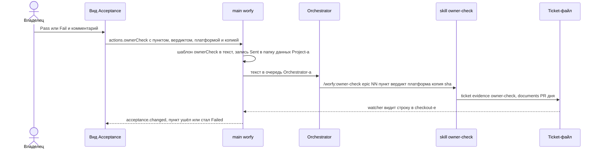

# worfy-acceptance: приёмка владельца в одном виде — Ticket-ы, ждущие его проверки, с Evidence и решением Pass или Fail по одному

Status: черновик 2026-11-13 из исследования конкурентов, владельцем не принят
Critic: [docs/product/critic/worfy-acceptance-2026-11-13.md](../../docs/product/critic/worfy-acceptance-2026-11-13.md) — Defer.
Source: исследование конкурентов 2026-11-13 ([папка досье](../../docs/research/2026-11-13-competitors/)), проверенная
идея review-quality-7 «Очередь проверок владельца: приёмка в одном месте, human review только по риску, предел
очереди». Досье: [Claude Code agent teams](../../docs/research/2026-11-13-competitors/claude-code-agent-teams.md),
[GitHub Copilot cloud agent и Agent HQ](../../docs/research/2026-11-13-competitors/github-copilot-cloud-agent-and-agent-hq-mission-.md),
[Claude Code agent view](../../docs/research/2026-11-13-competitors/claude-code-agent-view.md),
[Claude Code desktop app](../../docs/research/2026-11-13-competitors/claude-code-desktop-app.md),
[Google Antigravity](../../docs/research/2026-11-13-competitors/google-antigravity.md),
[Cursor agents window](../../docs/research/2026-11-13-competitors/cursor-agents-window-cloud-agents-and-automation.md),
[Devin Desktop](../../docs/research/2026-11-13-competitors/devin-desktop-formerly-windsurf.md). Файл, который Epic
заменяет: [owner-acceptance-guides.md](../owner-acceptance-guides.md). [CONTEXT.md](../../CONTEXT.md) — термины Ticket,
Epic, Project, Machine, Stable copy, Update, Available update, Orchestrator, Stage, Pipeline, Autopilot, Run, Linked
machine, Harness, Profile, Full mode, Silent mode, PR inbox, Team reviewer.
Зависит от: [worfy-evidence](../worfy-evidence/spec.md) — строки Evidence, вид `owner-check`, матрица, снимки и клипы;
[worfy-pipeline](../worfy-pipeline/spec.md) — `Waits: owner`, Stage, уведомление «ждёт тебя»;
[worfy-update](../worfy-update/spec.md) — Stable copy, её commit и номер версии, Update;
[worfy-human-review](../worfy-human-review/spec.md) — Stage `human-review` и Team reviewer, то есть то, чем Acceptance не
является.
Ticket-ы: Epic `worfy-acceptance`, 11 Ticket-ов, нумерация с `01`. Файлов Ticket-ов пока нет: их пишут после того, как
владелец примет spec.

## Проблема

- Проверка владельца в workflow — ручной пункт раздела «Готово, когда» Ticket-а (метка `tickets.manual_mark` Profile-а).
  Такой пункт доказывает только строка `owner-check`, `screenshot` или `video` (`docs/features/evidence.md:53`). Строку
  `owner-check` пишет Orchestrator со слов владельца (`docs/features/evidence.md:87`,
  `harness/skills/ship-ticket/step-6-manual-gui-checks.md:61-62`).
- Ручные пункты merge не держат: PR вливается после зелёного `ci-ok`, пункты уходят в «Ждёт владельца» `HANDOFF.md`
  (правило Profile-а worfy, `~/.claude/worfy-harness/projects/worfy/rules-review-depth.md:28-29`). Run Autopilot
  пропускает Epic, где остались только Ticket-ы владельца, и идёт к следующему
  (`.scratch/worfy-autopilot-queue/spec.md:72-73`, [ADR-0100](../../docs/adr/0100-run-epic-queue.md), п. 2). Непроверенное
  копится.
- Сколько: по `grep` на `04fc90f3a` в `.scratch/*/issues/` — 118 Ticket-ов в 24 Epic-ах с неотмеченным ручным пунктом,
  всего 166 пунктов. 107 из этих Ticket-ов уже `done`, 94 из них закрыты в октябре. Ещё 20 Ticket-ов стоят `blocked` с
  `Waits: owner`.
- В worfy это разбросано. Chip «Evidence n/m» и матрица есть только на карточке одного Ticket-а и в focus mode
  (`docs/features/evidence.md`, «On the Canvas»). Неотмеченный ручной пункт — строка Command palette, которую находит
  только набор текста; она ведёт к Ticket-у (`docs/features/workflow.md:80-81`, `src/renderer/palette/commands.ts:583-605`).
  Уведомление «`<epic> NN` is waiting for you» приходит один раз и открывает доску Pipeline
  (`src/main/workflow/waits-notify.ts:1-16`, `docs/features/notifications.md:18`). Списка «что ждёт именно меня» по всем
  Epic-ам и Project-ам нет.
- Есть ли изменение в Stable copy владельца, не видно нигде. Факты PR и git Stage собирает только для Ticket-ов в работе
  (`src/main/workflow/stages.ts:17-20`), а Status `done` проходит все Stage, кроме Done
  (`src/shared/workflow/pipeline.ts:342`). Update знает commit Stable copy (`src/main/update/stable-copy.ts:71-84`, поле
  `running` в `src/shared/ipc/update.ts:87`, схема `:68`), но с Ticket-ами его никто не сравнивает. Владелец смотрит пункт в копии, где
  изменения ещё нет, или спрашивает Orchestrator-а.
- Пошаговые гайды приёмок Orchestrator ведёт руками в `.scratch/owner-acceptance-guides.md` (278 строк): шаги «Сделай →
  Должно быть» и «Перед началом Orchestrator сделает». Владелец отвечает в чате номером шага
  (`.scratch/owner-acceptance-guides.md:13`), Orchestrator переносит его слово в Ticket. На файл ссылается «Ждёт
  владельца» (`HANDOFF.md:35`). Шаги живут в файле, пункты — в Ticket-е, и они расходятся.
- 11 Ticket-ов worfy помечают ручной пункт `(manual)`, а Profile worfy задаёт метку `вручную`: `worfy-mcp-live` 03, 05,
  08, `worfy-ui-kit` 19, `worfy-product-session` 08, 15, 17, 19, 21, 23, `worfy-human-review` 12. Обе копии разбора читают
  только метку Profile-а и старую русскую (`src/shared/workflow/evidence.ts:168`, `harness/lib/evidence.cjs:54-57`). Для
  Project-а worfy эти пункты не ручные: `parseDoneSection` Harness-а с меткой `вручную` даёт `manual: false` пункту 2
  Ticket-а `worfy-mcp-live` 08. Любой список ручных пунктов их сейчас не увидит.

## Решение

- В worfy появляется вид **Acceptance**: шестая вкладка View switch после Pull requests
  (`ShellView`, `src/renderer/shell/Toolbar.tsx:18`), секция боковой панели и бейдж rail-а. Вид показывает проверки,
  которые ждут владельца, во всех Project-ах Machine окна.
- Проверка — ручной пункт «Готово, когда» без `[x]` и без доказательства владельца. Отдельной строкой идут Ticket-ы
  `blocked` с `Waits: owner`, у которых таких пунктов нет: там ждут решения, а не проверки.
- У пункта видно: что проверить, где (`needs:`), есть ли изменение в Stable copy (или «ещё нет в Stable copy» с Update),
  что уже доказали агенты (снимки, клипы, contact sheet) и что подготовил Orchestrator (неручные пункты того же Ticket-а).
- Владелец проходит пункты по одному: доказательство, затем Pass или Fail с комментарием. worfy заполняет шаблон
  действия Project-а и отправляет текст Orchestrator-у, как Run wave. Строку `owner-check` пишет skill Harness через
  `ticket evidence`; worfy в Ticket ничего не пишет ([ADR-0002](../../docs/adr/0002-worfy-is-a-view-over-the-workflow.md)).
  Пока строки нет в checkout-е, пункт помечен «Sent».
- Fail становится Ticket-ом доработки (Q2); его ручной пункт приходит владельцу сам, когда merge доработки есть в Stable
  copy.
- Шаги приёмки живут в самом Ticket-е приёмки: один ручной пункт на шаг. Файл гайдов уходит (Q5).
- Human review по риску (Stage в Pipeline) и предел очереди в этот Epic не входят: это решения владельца (Q3, Q4).

### Набросок функции

**Путь владельца.**

1. На rail-е и на вкладке — бейдж «3»: три пункта готовы к проверке. В секции Acceptance боковой панели — счёт по
   Project-ам.
2. Владелец открывает вкладку Acceptance. Слева — группы, справа — первый пункт группы Ready to check.
3. Справа: Project, Epic, Ticket и номер пункта; текст пункта («Сделай → Должно быть»); где проверять (`needs: mac
   stable`); строка Stable copy; Evidence пункта с превью снимков и клипом; неручные пункты Ticket-а с их состоянием;
   ссылки Open Ticket и Open PR.
4. Если изменения ещё нет в Stable copy, пункт стоит в группе Update first, а строка говорит «Not in your Stable copy
   yet» и даёт Update worfy, когда есть Available update.
5. Владелец смотрит в Stable copy, пишет комментарий (для Fail он обязателен) и нажимает Pass или Fail.
6. Строка пункта получает «Sent», вид выбирает следующий пункт.
7. Orchestrator получает текст шаблона. Skill `owner-check` пишет строку `owner-check` и публикует её; при Fail заводит
   Ticket доработки.
8. Строка дошла до checkout-а — пункт уходит из очереди (Pass) или встаёт в Failed (Fail).

**Экран.**

```text
┌ Canvas · Session · Pipeline · Runs · Pull requests · [Acceptance 3] ─────────────────────────────────────┐
├─────────────────────────────────┬────────────────────────────────────────────────────────────────────────┤
│ Ready to check · 3              │ worfy · worfy-mcp-live 03 — Подхват сервера и Restart                  │
│ ▸ mcp-live 03 · 4        mac    │ Item 4 of 6 · manual · needs mac stable                                │
│   mcp-live 05 · 2        mac    │ ● In your Stable copy 0.4.2101 — the change is there since 0.4.2093    │
│   ui-kit 19 · 1          mac    │ ────────────────────────────────────────────────────────────────────── │
│ Update first · 1                │ Сделай: добавь сервер `claude mcp add` в работающей Session →          │
│   evidence 13 · 1   → 0.4.2110  │ Должно быть: сервер появился в chip-е «MCP n/m» без новой Session      │
│ Waits for you · 1               │                                                                        │
│   browser 19 — Blocked reason   │ Evidence                                                               │
│ Failed · 1                      │   screenshot pass · mac dev · 3f2a1b9c      [light] [dark]             │
│   retry 08 · 2 «не видно …»     │   video pass · mac dev · 3f2a1b9c           [▶ clip] Contact sheet     │
│ ▸ In work · 5                   │ Prepared by the Orchestrator · 2 of 3 verified                         │
│ ▸ Older · 94                    │   ✓ test-run …   ✓ ci-check …   ○ «Итог» written                       │
│                                 │ Open Ticket · Open PR #1830                                            │
│                                 │ ┌ Comment (required for Fail) ───────────────────────────────────────┐ │
│                                 │ └────────────────────────────────────────────────────────────────────┘ │
│                                 │ Checked in: mac · stable · 0.4.2101 ▾              [ Pass ]  [ Fail ]  │
└─────────────────────────────────┴────────────────────────────────────────────────────────────────────────┘
```

Пункты в примере — для наглядности; номера версий и PR выдуманы.

**Путь решения.**



## Как это сделано у конкурентов

- **Claude Code agent teams** ([досье](../../docs/research/2026-11-13-competitors/claude-code-agent-teams.md), разделы
  «Работа без присмотра, лимиты и сбои», «Общая доктрина Anthropic о системах из многих агентов», «Запуск в феврале
  2026»). Документация не советует надолго оставлять команду без присмотра. Чек-лист работы без присмотра кончается тем,
  что человек одобряет результат. Пользователи пишут, что узкое место — проверка, а не оркестрация: с командой агентов
  человек перестал успевать проверять. Плана дольше сессии нет: ни epic, ни ticket, ни очереди («Слабые места и чего
  нет»), так что и очереди проверок человека нет.
- **GitHub Copilot cloud agent и Agent HQ**
  ([досье](../../docs/research/2026-11-13-competitors/github-copilot-cloud-agent-and-agent-hq-mission-.md), «Copilot code
  review», «Человек отвечает; главное ограничение — ревью», «Где вмешивается человек»). GitHub прямо называет ревью главным
  ограничением. Copilot approvals (GA 2026-10-28, по умолчанию выключены) засчитываются в обязательные одобрения PR,
  снимаются новым commit-ом и ограничиваются путями файлов. Человек одобряет план, ревьюит и вливает draft PR. Это
  проверка кода PR, а не приёмка поведения в установленной копии.
- **Claude Code agent view и desktop app**
  ([agent view](../../docs/research/2026-11-13-competitors/claude-code-agent-view.md), «Группы и порядок»;
  [desktop app](../../docs/research/2026-11-13-competitors/claude-code-desktop-app.md), «Автоматизация и несколько
  агентов»). В agent view группа Ready for review собирает сессии с открытым PR, которому нужен review или у которого
  падают checks; рядом группа Needs input. Pane Overview в desktop app группирует threads так же: Ready for review,
  Waiting on you. Единица списка — сессия или thread, а не пункт приёмки со своими доказательствами.
- **Google Antigravity** ([досье](../../docs/research/2026-11-13-competitors/google-antigravity.md), «Планирование,
  artifact-ы, комментарии, ревью»). Walkthrough — artifact с итогом изменений, выводом test-ов, screenshots и записями
  браузера. Комментарий к области screenshot уходит агенту chip-ом в следующем сообщении. Это ближе всего к «доказательство,
  затем решение с комментарием», но внутри одной задачи.
- **Cursor** ([досье](../../docs/research/2026-11-13-competitors/cursor-agents-window-cloud-agents-and-automation.md),
  «Cloud Agents»): скриншоты, видео и логи агента прикладываются к PR.
- **Devin** ([досье](../../docs/research/2026-11-13-competitors/devin-desktop-formerly-windsurf.md), «Заявленные
  принципы»): узкое место выпуска — уже review; большие PR пропускают не глядя («Lazy LGTM»). Ответ Cognition — AI-ревью и
  удобный diff.
- В прочитанных разделах досье нет одного списка проверок владельца по всем проектам, где у пункта свои доказательства и
  ответ, есть ли изменение в копии, которой человек пользуется.

## Истории пользователя

1. Как владелец, я хочу видеть в одном месте все проверки, которые ждут именно меня, во всех Project-ах этой Machine, а
   не искать ручные пункты по Epic-ам и `HANDOFF.md`.
2. Как владелец, я хочу сразу знать, есть ли изменение в моей Stable copy, и обновить её одной кнопкой, если нет.
3. Как владелец, я хочу видеть доказательства, которые уже собрали агенты (снимки обеих тем, клип с contact sheet,
   test-ы), рядом с пунктом, без focus mode.
4. Как владелец, я хочу видеть, что Orchestrator подготовил к проверке, и не начинать, пока подготовка не готова.
5. Как владелец, я хочу проходить пункты по одному: Pass или Fail с комментарием, затем следующий.
6. Как владелец, я хочу, чтобы моё решение попадало в Ticket строкой `owner-check` с той копией и тем commit-ом, которые
   я смотрел, без пересказа в чате.
7. Как владелец, я хочу, чтобы Fail с моими словами становился доработкой, а повторная проверка приходила ко мне сама,
   когда доработка в Stable copy.
8. Как владелец, я хочу видеть Ticket-ы, которые ждут моего решения (`Waits: owner`), с их причиной.
9. Как владелец, я хочу проверять пункты Windows на ПК (Linked machine) и записывать их с платформой ПК.
10. Как владелец, я хочу, чтобы старые непроверенные пункты не заслоняли новые.
11. Как Orchestrator, я хочу получать решение владельца в одной форме (шаблон действия), а не свободным текстом, и не вести
    гайды руками.
12. Как владелец, я не хочу, чтобы мои слова с личными данными попали в публичный репозиторий.

## Решения по реализации

- **Одно правило «ждёт владельца».** Чистая функция в `src/shared/acceptance/queue.ts` (имена новых файлов здесь и
  дальше — предложение) над моделями Project-ов (`src/shared/workflow/types.ts`). Пункт ждёт владельца, когда он ручной
  (`manual`, `:181`), без `[x]` (`checked`, `:179`) и не `verified` (`state`, схема `evidenceItemSchema`, `:174`). Ticket
  ждёт владельца сам, когда он `blocked` с `Waits: owner`: то же правило, что у очереди Autopilot (`ownersOwn`,
  `src/shared/autopilot/epic-queue.ts:38`), функция становится общей.
- **Группы**, в этом порядке, у каждой счёт:
  - **Ready to check** — пункт ждёт владельца, и изменение можно смотреть: PR Ticket-а влит (у Ticket-а нескольких
    репозиториев — все PR), или Ticket `done` без PR (Silent mode, `local-green`), или Ticket сам ждёт владельца
    (`Waits: owner`: Orchestrator подготовил приёмку). В Project-е worfy ещё одно условие: изменение есть в Stable copy
    нужной платформы.
  - **Update first** — то же, но Stable copy старше merge.
  - **Waits for you** — Ticket-ы с `Waits: owner` без ждущих ручных пунктов. Строка — их `Blocked reason:`, действия —
    Open Ticket и Open Orchestrator. Pass и Fail здесь нет.
  - **Failed** — ручной пункт, чья последняя строка Evidence — `fail` (`itemState`, `src/shared/workflow/evidence.ts:136`).
    Строка показывает её ref: дату и слова.
  - **In work** — пункт ждёт владельца, а изменение не влито. Свёрнута.
  - **Older** — пункты Ticket-ов, закрытых раньше порога (Q1). Свёрнута, как «Older · N» секции Epics
    (`docs/features/workflow.md:77`).
  - Внутри группы — по Project-у, Epic-у, номеру Ticket-а и номеру пункта.
- **Метка ручного пункта.** Обе копии разбора читают метку Profile-а, `manual` и старую `вручную`. В worfy это
  `accepted` (`src/shared/workflow/doc-headings.ts:46`) и его вызовы в `src/shared/workflow/evidence.ts:168` и
  `src/shared/workflow/manual-checks.ts:24`, в Harness — `accepted` в `harness/lib/evidence.cjs:54-57`. Общие случаи — в
  `harness/bin/tests/fixtures/evidence/grammar.json`, согласие копий держит `test/contract/evidence-rules-agree.test.ts`.
- **Служба в main** (`src/main/acceptance/`). Она следит за моделями всех Project-ов Machine через workflow hub, как
  `installWaitsNotifications` (`src/main/workflow/waits-notify.ts:114-116`): Ticket-файлы под watcher-ом, gh и git не
  запускаются, пока ничего не меняется. Канал `acceptance.get` и событие `acceptance.changed` — `'project', 'read'`, без
  Project-а в запросе, как `projectPulse.get` (`src/shared/ipc/project-pulse.ts:40-43`). Снимок несёт всё, что рисует вид:
  пункт и его строки Evidence, неручные пункты Ticket-а, строку Stable copy, отметку «Sent». Renderer только рисует, как
  в PR inbox (`docs/features/pr-inbox.md`, «How it works»).
- **Stable copy пункта.** Только у Project-а, чей `repoUrl` (`src/shared/workflow/types.ts:253`) — репозиторий самого
  worfy (`UPDATE_REPO_PAGE`, `src/shared/ipc/update.ts:16`). У других Project-ов нет Stable copy: строка говорит только
  «merged #N» или «not merged».
  - Commit Stable copy: `running` службы Update, когда окно — сама Stable copy (`src/shared/ipc/update.ts:68`), иначе файл
    рядом с копией (`stableCopyPath`, `readStableMetadata`, `src/main/update/stable-copy.ts:22`, `:77`).
  - Merge commit: PR из строки `PR:` Ticket-а, иначе по ветке, как у Stage. Поле `mergeCommit` даёт gh
    (`FIELDS`, `src/main/github/prs.ts:48`) под учётной записью Project-а (`accountAuth`, `:172`). Спрашивается один раз на
    влитый PR и хранится в памяти: merge commit влитого PR не меняется. У Ticket-а без своего PR, который ждёт владельца
    (Ticket приёмки), берутся merge-и его блокеров.
  - Есть ли изменение: `git merge-base --is-ancestor <merge> <commit Stable copy>` через `gitRunner`
    (`src/main/workflow/stages.ts:49`), как Deploy (`:363`). Commit-а нет в checkout-е — «Stable copy not checked». worfy
    не делает `git fetch` в репозитории Project-а
    ([ADR-0005](../../docs/adr/0005-worfy-own-state-inventory.md)).
  - Версии: `git rev-list --count <merge>` — номер первой сборки с изменением, как `buildNumber`
    (`scripts/build-version.ts:51`), текст — `numberedVersion` (`src/shared/version-number.ts`). Строка: «In your Stable
    copy 0.4.N — the change is there since 0.4.M» или «Not in your Stable copy yet: it runs 0.4.K, the change is in 0.4.M».
  - Update first даёт кнопку Update worfy, когда есть Available update; иначе говорит, что `main` ждёт зелёного CI.
- **Решение — шаблон действия.**
  - Новое действие `ownerCheck` с подписью «Record owner check» в `ACTIONS` и `ACTION_LABELS`
    (`src/shared/projects/action-templates.ts:22`, `:26`). Новые placeholders в `PLACEHOLDERS` (`:8`): `item` (номер
    пункта), `verdict` (`pass` или `fail`), `platform`, `copy`, `sha` (commit копии или `-`, когда он не известен).
  - Шаблон по умолчанию с plugin-ом Harness (`PLUGIN_HARNESS_TEMPLATES`, `:64`):
    `/worfy:owner-check {epic} {NN} {item} {verdict} {platform} {copy} {sha}`. Со старым Harness — пустой
    (`LEGACY_HARNESS_TEMPLATES`, `:47`): кнопки неактивны с причиной, как у «Process gate queue» и «Draft replies».
  - Комментарий владельца — не placeholder. Он идёт после команды отдельным абзацем «Owner's words:» в виде цитаты. Так
    шаблон не вставит свободный текст внутрь команды. Значения placeholders проверяют схемы, как `githubRepoSchema`
    (`src/shared/ipc/actions.ts:84`).
  - Канал `actions.ownerCheck` (`'project', 'write'`) рядом с `actions.runWave` (`src/shared/ipc/actions.ts:49`).
    Обработчик — `ActionLauncher` (`src/main/actions/launch.ts:180`): текст уходит Orchestrator-у Project-а, в его очередь,
    пока идёт ход, как Run wave (`docs/features/workflow.md:104`). Пока идёт Autopilot — отказ с причиной
    (`AUTOPILOT_RUNNING_HINT`, `src/main/actions/launch.ts:144`; Q6).
  - Поле шаблона — в Project settings рядом с другими шаблонами (`src/renderer/shell/ProjectSettings.tsx`).
- **«Sent» — отправлено, но ещё не записано.** worfy хранит отправленные решения в папке данных Project-а: Project, Epic,
  номер Ticket-а, номер и текст-hash пункта, вердикт, время. Слов владельца там нет. Образец — состояние «seen» PR inbox
  (`src/main/projects/pr-inbox-state.ts`). Запись уходит, когда в checkout-е появилась строка `owner-check` с тем же
  вердиктом. Строка пункта — «Sent · waits for the line»; после 24 часов без строки — «Not recorded yet» и Send again.
  Перезапуск «Sent» не теряет.
- **Платформа, копия и commit строки.** Платформа — та Machine, в окне которой нажата кнопка (на Linked machine — её).
  Копия — из `needs:` пункта; без неё — `stable` в Project-е worfy, когда изменение есть в Stable copy, иначе
  `installed`. Владелец меняет их в строке «Checked in». `sha` — commit этой копии: Stable copy этой Machine или сборка
  Linked machine из `hello.build` (`src/main/link/messages.ts:62-76`); не известен — `-`, и skill не передаёт `--sha`,
  тогда `ticket evidence` берёт `HEAD` (`docs/features/evidence.md`, «`ticket evidence`»).
- **Skill `owner-check` Harness-а** (`harness/skills/owner-check/SKILL.md`, текст английский,
  [ADR-0074](../../docs/adr/0074-harness-neutral-by-language-and-project.md)).
  - Проверяет, что пункт — ручной пункт этого Ticket-а (`ticket evidence <epic> <NN>`).
  - Пишет `ticket evidence <epic> <NN> <item> owner-check <pass|fail> --ref "<YYYY-MM-DD>: <слова владельца>"
    --platform <p> --copy <c> [--sha <s>]` — форма из `harness/skills/ship-ticket/step-6-manual-gui-checks.md:61-62`.
    Одна и та же строка не пишется дважды: повторное Send again ничего не добавляет.
  - Pass отмечает пункт `[x]`. Fail заводит Ticket доработки (Q2): `Source:` называет пункт и дату, «Готово, когда» —
    тот же ручной пункт с его `needs:`. Pass на пункте доработки дописывает `owner-check pass` и исходному пункту.
  - Full mode: строки дня идут в один documents PR, перед push — `evidence-check --changed`. Silent mode: прямо в
    Workflow folder, без PR.
  - Никогда не отмечает пункт без слова владельца и не пишет `pass` на Fail.
  - В Codex skill вызывается так же: сообщение, которое начинается с имени skill-а, его вызывает
    (`docs/features/vendors.md:93`).
- **Вид** (`src/renderer/acceptance/AcceptanceView.tsx`, `useAcceptance.ts`, `open.ts`, `acceptance.css`). Вкладка — в
  `ShellView` (`src/renderer/shell/Toolbar.tsx:18`) и `VIEW_NAMES` (`src/renderer/shell/AppShell.tsx:77`), вид
  смонтирован рядом с остальными (`src/renderer/shell/AppShell.tsx:117-127`). Две панели и ↑ ↓ — как в Pull requests (`docs/features/pr-inbox.md`,
  «Selecting»); новых сочетаний клавиш нет. Вкладка активна и без открытого Project-а: вид — по всем Project-ам. Evidence
  пункта рисует `EvidenceMatrix` (`src/renderer/canvas/nodes/EvidenceMatrix.tsx:108`) для одного пункта, превью —
  `EvidencePreview` (`src/renderer/canvas/nodes/EvidencePreview.tsx:48`): снимки и клипы впервые показываются вне focus
  mode, хранилище `worfy-image://` их уже отдаёт (`src/main/images/protocol.ts`). Текст пункта — тем же
  `src/renderer/markdown/Markdown.tsx`.
- **Входы.** Секция `src/renderer/shell/sidebar/AcceptanceSection.tsx` по образцу `PullRequestsSection.tsx`, бейдж rail-а —
  число Ready to check. Строка «Acceptance» в группе View Command palette. Строки ручных проверок палитры
  (`manualCheckCommands`, `src/renderer/palette/commands.ts:583-605`) открывают вид на пункте, а не Ticket. Клик
  уведомления «is waiting for you» открывает вид на Ticket-е, если он там есть, иначе доску Pipeline, как сейчас.
- **Linked machine.** Окно Linked machine показывает очередь Project-ов той Machine, как Pull requests. Read only — только
  смотреть, Pass и Fail неактивны с подсказкой Read only. Full access — решение уходит Orchestrator-у Project-а, на его
  Machine. Пункт `needs: windows …` на Mac показывает сборку ПК из `hello.build`, пока ПК связан и в сети. Снимки и клипы
  по связи не отдаются, как и сейчас (`docs/features/evidence.md`, «On a Linked machine»).
- **Шаги приёмки — ручные пункты Ticket-а.** Правило Harness: ручной пункт пишется для владельца, один шаг — «Сделай: … →
  Должно быть: …», с `needs:`. Подготовка Orchestrator-а («Перед началом Orchestrator сделает») — неручные пункты того же
  Ticket-а. Правило — в шаблоне Ticket-а `harness/skills/to-tickets/SKILL.md` и в
  `harness/skills/ship-ticket/step-6-manual-gui-checks.md`.
- **Acceptance — не Human review.** Stage `human-review` ждёт решения ревью на GitHub до merge, Team reviewer пишет
  черновик ревью (`docs/features/human-review.md:12-16`). Acceptance читает Evidence ручных пунктов, обычно после merge.
  Pipeline этот Epic не меняет (Q3).
- **ADR не нужен новый:** worfy только читает Ticket-ы и отправляет текст по клику владельца (ADR-0002, тот же путь, что у
  Run wave). Ticket документации дописывает в инвентарь ADR-0005 хранилище «Sent».
- **Термин в CONTEXT.md:** **Acceptance** — вид ручных пунктов Ticket-ов всех Project-ов Machine, которые ждут проверки
  владельца, с их Evidence и Stable copy; решение Pass или Fail уходит Orchestrator-у. _Avoid_: приёмка (как имя вида),
  review queue, inbox. Слово «accepted» у Epic-а значит принятый spec (`src/shared/workflow/accepted-epics.ts`); tooltip
  вкладки — «Checks that wait for you».
- **Тексты UI — английские** (ADR-0074), документы — русские.

## Решения по test-ам

- Хороший test проверяет поведение снаружи: какие пункты и в каких группах видит владелец, какой текст ушёл Orchestrator-у,
  какая строка оказалась в Ticket-файле. Как служба устроена внутри, test не проверяет.
- **Без моделей и без сети.** Orchestrator — `WORFY_AGENT=fake` (`src/main/agent/fake-query.ts`), gh — stand-in
  `GhRunner` (`src/main/github/prs.ts:71`). Stable copy — временная папка через `WORFY_UPDATE_STABLE`
  (`src/main/update/stable-copy.ts:5-9`) с `worfy-stable.json`, который называет commit временного репозитория; `origin`
  этого репозитория — строка адреса репозитория worfy, сеть не нужна.
- **Seam 1 — unit:** правило «ждёт владельца» и группы над моделями (ручной, `[x]`, состояние, `Waits: owner`, влит, в
  Stable copy, порог Older); render шаблона с новыми placeholders и абзацем комментария; текст строки Stable copy; метка
  ручного пункта (`test/unit/evidence.test.ts` и общие случаи `grammar.json`).
- **Seam 2 — contract:** служба над временным Project-ом с Ticket-файлами (merge commit — предок, не предок, нет в
  checkout-е); «Sent» переживает новый экземпляр службы; `actions.ownerCheck` кладёт текст в очередь fake Orchestrator-а,
  отказывает при Autopilot и Linked machine с Read only (образец — `test/contract/actions.test.ts`); согласие копий —
  `test/contract/evidence-rules-agree.test.ts`; Harness — `harness/bin/tests/ticket-evidence.test.sh` (метка) и
  `harness/bin/tests/agents-text.test.sh` (текст skill-а держит правило «кто пишет какую строку»).
- **Seam 3 — e2e** `test/e2e/acceptance.spec.ts` в настоящем Electron на fake agent: группы, пункт со снимком и клипом из
  `test/fixtures/evidence-clip/`, Pass — текст в очереди fake Orchestrator-а, test дописывает строку — пункт уходит; ↑ ↓;
  снимки двух панелей при 1280 и 1600 px в обеих темах, как `test/e2e/pr-inbox.spec.ts`.
- **Сначала падающий test** в каждом Ticket-е кода: красный на старом поведении, это пишется в «Итог».
- Платных eval-ов нет; настоящий Claude и Codex test-ы не запускают.

## Не в этом Epic-е

- Предел очереди: Autopilot замедляется, когда непроверенного больше N. Нужно новое решение владельца (Q4).
- Human review по риску — Stage в Pipeline, который держит Ticket до слова владельца (Q3).
- worfy сам пишет строки Evidence или отмечает пункты — никогда (ADR-0002).
- Снимки и клипы Stable copy или экрана ОС из вида: правило «картинка только из своей сборки с fixture-данными» остаётся
  (`docs/features/evidence.md`, «Screenshots and clips»).
- Снимки и клипы в окне Linked machine: хранилище Evidence по связи не отдаётся.
- Окружения Deploy других Project-ов как ответ «где смотреть»: у них только «влито или нет».
- Утренняя сводка и уведомление «N checks wait for you»: в этом Epic-е только бейдж и секция.
- Комментарий к области снимка, как у Antigravity.
- Ревью кода PR человеком — это PR inbox и Team reviewer (`docs/features/pr-inbox.md`, `docs/features/human-review.md`).
- Ответ на вопрос `Waits: owner` из самого вида: только ссылка на Orchestrator.

## Ticket-ы

01. **Метка ручного пункта в обеих копиях** — worfy (`src/shared/workflow/evidence.ts`, `manual-checks.ts`) и Harness (`harness/lib/evidence.cjs`) читают метку Profile-а, `manual` и `вручную`; общие случаи в `grammar.json`; 11 Ticket-ов worfy с `(manual)` становятся ручными. Агент, platform PR. Blocked by: —.
02. **Очередь Acceptance в main и каналы** — правило «ждёт владельца» и группы (`src/shared/acceptance/queue.ts`), служба по всем Project-ам Machine поверх workflow hub, хранилище «Sent», `acceptance.get` и `acceptance.changed`; без UI. Агент. Blocked by: —.
03. **Stable copy пункта** — commit Stable copy, merge commit PR через gh раз на PR, `merge-base --is-ancestor`, номера версий, группа Update first и кнопка Update worfy. Агент. Blocked by: 02.
04. **Шаблон `ownerCheck` и канал `actions.ownerCheck`** — действие и placeholders, абзац «Owner's words», текст Orchestrator-у в очередь, отказ при Autopilot (Q6), поле в Project settings, запись «Sent». Агент. Blocked by: 02.
05. **Skill Harness `owner-check`** — строка через `ticket evidence`, Pass отмечает пункт, Fail заводит Ticket доработки (Q2), documents PR дня, privacy check слов владельца, без повторной строки. Агент, platform PR. Blocked by: —.
06. **Вид Acceptance** — шестая вкладка, две панели, группы, пункт с Evidence вне focus mode, «Prepared by the Orchestrator», строка Stable copy, строка решения с «Checked in», «Sent», ↑ ↓. Агент. Blocked by: 02, 03, 04.
07. **Входы в вид** — секция боковой панели и бейдж rail-а, строка «Acceptance» палитры; строки ручных проверок палитры и клик уведомления «is waiting for you» открывают вид на пункте. Агент. Blocked by: 06.
08. **Linked machine и пункты Windows** — вид в окне Linked machine (Read only смотрит, Full access решает), платформа и копия окна, сборка ПК из `hello.build` для `needs: windows …`. Агент. Blocked by: 03, 06.
09. **Шаги приёмки в Ticket-ах** — правило Harness для ручных пунктов («Сделай → Должно быть», `needs:`, подготовка — неручные пункты), перенос открытых гайдов в их Ticket-ы, файл гайдов по Q5, `HANDOFF.md` ведёт на вид. Агент (Orchestrator). Blocked by: 05, 06.
10. **Документация** — страница Feature `docs/features/acceptance.md` en и ru, правки страниц app-shell, evidence, workflow и notifications, термин Acceptance в `CONTEXT.md`, поправка инвентаря ADR-0005. Агент. Blocked by: 07, 08, 09.
11. **Приёмка владельцем** — в самом виде Acceptance, на Mac Stable и на ПК. Владелец. Blocked by: 01–10.

## Волны

| Wave | Ticket-ы | Почему так |
|---|---|---|
| 1 | 01, 02, 05 | метка (`src/shared/workflow/`, `harness/lib/`), очередь и каналы (`src/shared/acceptance/`, `src/main/acceptance/`), skill (`harness/skills/owner-check/`): общих файлов нет |
| 2 | 03, 04 | Stable copy (служба в main) и шаблон с каналом (`src/shared/projects/`, `src/main/actions/`): оба опираются на очередь и «Sent» из 02, файлы разные |
| 3 | 06 | вид: нужны снимок очереди (02), строка Stable copy (03) и канал решения (04) |
| 4 | 07, 08, 09 | входы (`src/renderer/shell/`, палитра, уведомление), Linked machine (link и Stable copy), шаги приёмки (тексты Harness, `.scratch/`): общих файлов нет |
| 5 | 10 | документация по сделанному |
| 6 | 11 | приёмка |

Wave — Ticket-ы, которые можно брать параллельно: блокеры закрыты, общих файлов нет. Wave, которую берут в работу,
вычисляется заново в момент запуска (CONTEXT.md, термин Wave). Если ответ на Q3 — (б) или (в), Ticket 12 со Stage
добавляется после Wave 3 плана.

## Риски

- **Старый хвост.** 107 `done` Ticket-ов с неотмеченным пунктом, 94 из них октябрьские. Без ответа на Q1 вид откроется
  длинным списком; вариант (а) убирает их в Older.
- **Метка `(manual)`.** Пока 01 не влит, 11 Ticket-ов worfy в очередь не попадают. Поэтому 01 — в Wave 1.
- **Слова владельца в публичном репозитории.** В Full mode ref строки `owner-check` — слова владельца, и они уходят в
  documents PR. Privacy check (`evidence-check` в `pnpm lint` и CI, `docs/features/evidence.md`, «Privacy check») находит
  путь с именем, хост, email; skill заменяет найденное на `<home>`, `<host>` и говорит владельцу. Поле комментария в
  Project-е с Full mode говорит, что слова будут в репозитории.
- **Задержка строки.** В Full mode строка попадает в checkout только после merge documents PR. «Sent» держит пункт
  помеченным, и после перезапуска тоже; повторное Send again не пишет вторую строку.
- **Commit-а Stable copy нет в checkout-е.** worfy не делает `git fetch` — строка честно говорит «not checked».
- **Лимит gh.** Merge commit спрашивается один раз на влитый PR, только для групп Ready to check и Update first; отказ
  GitHub — «not checked», а не ошибка вида.
- **Цена.** Каждое решение — короткий ход Orchestrator-а и расход Limits. Если это дорого, решения копятся в виде и
  уходят одним сообщением, как Send all в Pull requests; это отдельный Ticket после приёмки.
- **Linked machine со старой worfy.** Сообщение новой версии получает только Machine, которая назвала его в `hello`
  ([ADR-0079](../../docs/adr/0079-link-machines-announce-accepted-messages.md)); вид говорит обновить worfy на той Machine.
- **Codex как Orchestrator.** Если `test/contract/codex-parity.test.ts` закрепляет список skill-ов, 05 его дополняет.
- **Platform PR-ы.** 01 и 05 трогают Harness: Windows verdict до merge
  ([ADR-0083](../../docs/adr/0083-ci-ok-on-every-pr-is-the-merge-condition.md)).
- **Размер 06.** Вид — самый большой Ticket; если он выходит больше примерно 600 строк кода, 06 делится на список и панель
  пункта.

## Вопросы владельцу

1. **Q1. Старые непроверенные пункты** (107 `done` Ticket-ов, 94 из октября).
   (а) Все в виде; пункты Ticket-ов, закрытых больше 14 дней назад, — в свёрнутой группе Older. Рекомендация: ничего не
   теряется и не заслоняет новое.
   (б) Orchestrator один раз проходит их с владельцем по Epic-ам: отмечает `[x]` с записью в «Итог» «не проверено, снято
   владельцем <дата>».
   (в) Вид показывает только Ticket-ы, закрытые после его выхода; старых не видно совсем.
2. **Q2. Что делает Fail.**
   (а) Строка `owner-check fail` со словами владельца и новый Ticket доработки в том же Epic-е, без блокеров; Pass на его
   пункте закрывает и исходный. Рекомендация: так уже делают руками — доработки приёмки `worfy-autopilot-queue` 20 ушли в
   Ticket 21 (`.scratch/owner-acceptance-guides.md:187`).
   (б) Только строка `fail`; что делать дальше, Orchestrator спрашивает владельца.
   (в) Ticket снова открывается (`ticket open`, `harness/bin/TICKETS.md:40`) и идёт новым PR.
3. **Q3. Human review по риску.**
   (а) Не в этом Epic-е: сначала вид, решение — после двух недель работы с ним. Рекомендация.
   (б) Новый вид Stage `owner-check` после merge: Ticket с ручным пунктом без доказательства владельца стоит на нём и в
   `done`. Это поправка [ADR-0067](../../docs/adr/0067-pipeline-in-profile-and-sha-bound-agent-marks.md) и правила
   `src/shared/workflow/pipeline.ts:342`; Profile только включает Stage, условий в нём нет.
   (в) Тот же Stage до merge, только для Ticket-ов со строкой `Risk: high` (`harness/skills/max-review/SKILL.md:31`;
   сегодня её не читает ничто и не пишет ни один Ticket): PR ждёт Pass владельца. Это меняет правило «ручные пункты
   владельца merge не держат» (`rules-review-depth.md:28-29`).
4. **Q4. Предел очереди.**
   (а) Предела нет; вид и бейдж показывают число. Рекомендация.
   (б) Autopilot не начинает следующий Epic очереди и новый Run, пока в Ready to check больше N пунктов; N — в Settings.
   (в) Только уведомление, когда в Ready to check больше N.
5. **Q5. Файл пошаговых гайдов.**
   (а) Шаги переезжают в Ticket-ы приёмки как ручные пункты, файл удаляется, `HANDOFF.md` ведёт на вид. Рекомендация.
   (б) Файл остаётся печатной копией, её собирает skill из Ticket-ов.
   (в) Файл и вид живут рядом, файл Orchestrator ведёт руками, как сейчас.
6. **Q6. Решение во время Run-а Autopilot.**
   (а) Pass и Fail неактивны с причиной, как Run wave. Рекомендация: приёмку готовит Orchestrator, значит он и так
   свободен.
   (б) worfy держит решения на диске Machine и отдаёт их Orchestrator-у после конца Run-а.
   (в) Решение уходит в очередь Orchestrator-а и во время Run-а.

## Готово, когда

- [ ] Вкладка Acceptance и секция боковой панели показывают ручные пункты всех Project-ов Machine, которые ждут владельца,
      по группам; бейдж rail-а — число Ready to check.
- [ ] Пункт открывается с Evidence (снимки, клип, contact sheet), неручными пунктами Ticket-а и строкой Stable copy: «In
      your Stable copy» с версией или «Not in your Stable copy yet» с Update worfy.
- [ ] Pass и Fail с комментарием отправляют шаблон действия Orchestrator-у; строку `owner-check` пишет skill через
      `ticket evidence`; worfy в Ticket ничего не пишет.
- [ ] Отправленное решение помечено «Sent», пока строки нет в checkout-е, и после перезапуска тоже.
- [ ] Fail ведёт к тому, что решил владелец в Q2; при варианте (а) ручной пункт доработки приходит в Ready to check после
      её merge.
- [ ] Метка Profile-а и `manual` читаются одинаково в worfy и Harness; 11 Ticket-ов worfy с `(manual)` — в очереди.
- [ ] На Linked machine с Full access решение записывается с платформой этой Machine; с Read only — только просмотр.
- [ ] Шаги открытых приёмок — ручные пункты своих Ticket-ов; файл гайдов — по Q5; `HANDOFF.md` ведёт на вид.
- [ ] Страницы Feature en и ru, термин Acceptance в `CONTEXT.md`, поправка инвентаря ADR-0005.
- [ ] (вручную) Владелец принял Epic, пройдя его приёмку в самом виде Acceptance.
