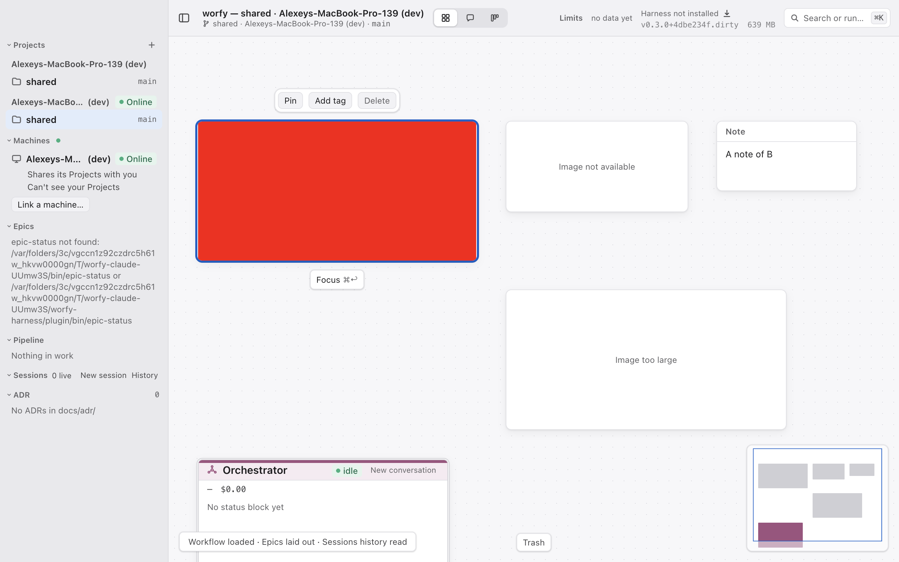
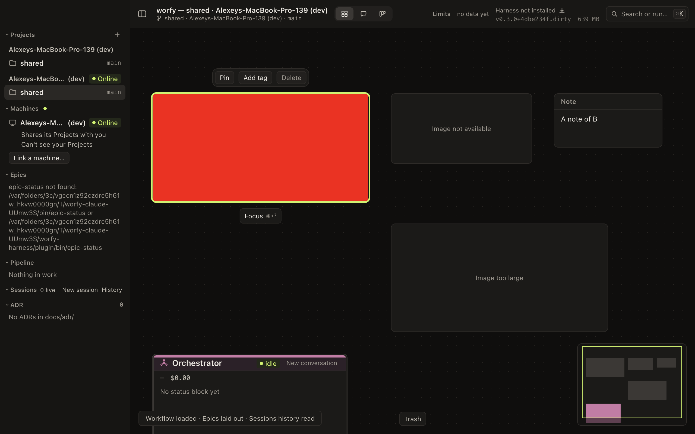

# 24 — Картинка с Canvas видна на Linked machine

Type: feature
Status: open 2026-10-24T22:34Z
Blocked by: 23
Source: владелец, 2026-10-25 (чат Mac-оркестратора): картинки на Canvas (ticket 23); этот ticket —
их показ на другой машине. Код перечитан по main `d089cfea`.

## Что происходит

Linked machine — другая машина, к которой подключено приложение; её Canvas виден здесь только для
чтения. Layout (файл раскладки Canvas) идёт по link-у как JSON. После ticket-а 23 (картинка — файл
`<Project data folder>/images/<id>.<ext>`, в Layout только `{ file, width, height, mime }`) Node
картинки придёт на другую машину без байтов: файла там нет, и картинка не покажется.

Файлы Card уже ходят по link-у отдельно. Канал `cards.file` (`src/shared/ipc/cards.ts:76`) отдаёт
файл кусками по 4 MB (`CARD_FILE_CHUNK_BYTES`), с пределом `CARD_FILE_LIMIT_BYTES` (20 MB). Забирает
их `src/main/cards/remote.ts`; машина-владелец сама находит файл и проверяет путь
(`readCardFileChunk` в `src/main/cards/protocol.ts:328`). Ответы `missing` и `too-large` уже есть в
схеме канала.

## Что сделать

1. Файлы картинок ходят по link-у так же, как файлы Card: либо новый канал по образцу `cards.file`
   (куски по 4 MB, тот же предел), либо обобщённый канал файлов, который обслуживает и Card, и
   картинки. Выбор — за исполнителем, с причиной в PR; обобщение не должно менять поведение Card.
2. Машина-владелец сама находит файл по label-у Project-а и id картинки и проверяет, что путь внутри
   `<Project data folder>/images/`; по link-у не приходит путь, только id.
3. Protocol handler картинок из ticket-а 23 различает картинку своей машины и картинку Linked machine
   (по адресу, как `worfy-card://<card id>.<project label>.<machine label>/…`) и для второй забирает
   байты через link.
4. Картинка на другой машине — только для чтения, как весь удалённый Canvas: нет resize, удаления и
   вставки.
5. Нет файла, файл больше предела или link оборвался — в карточке понятная заглушка-плашка с текстом
   причины («Image not available», «Image too large»), а не значок битой картинки.
6. Картинки из чата Session на Linked machine (worfy-ui 28, PR #835): адрес
   `worfy-image://attachments.<machine label>/<sha256>.<ext>`, копия лежит в
   `<data>/attachments/images/` той машины. Сейчас main отвечает на такой адрес 404, и окно
   показывает chip вместо миниатюры. Тот же канал по link-у отдаёт и эти копии: машина-владелец
   находит файл по имени из шаблона хранилища, путь по link-у не приходит.

## Вне скоупа

- Вставка картинки на Canvas Linked machine с этой машины.
- Кэш картинок Linked machine на диске этой машины.

## Тесты

- contract: канал отдаёт файл кусками, отказывает пути вне папки картинок и чужому id, отвечает
  `missing` и `too-large`; сборка кусков на стороне получателя держит предел.
- unit: карточка показывает заглушку для `missing`, `too-large` и ошибки link-а.
- e2e с двумя машинами по образцу `test/e2e/linked-cards.spec.ts`: картинка с одной машины видна
  на другой без искажений; у удалённой картинки нет рамки resize.
- contract: адрес `worfy-image://attachments.<machine label>/…` забирает копию через link; чужое
  имя и путь вне хранилища получают отказ.

## Готово, когда

- [ ] Картинка, вставленная на одной машине, видна на Canvas Linked machine с теми же пропорциями.
- [ ] Байты идут по link-у кусками не больше 4 MB, с пределом 20 MB; машина-владелец проверяет путь.
- [ ] На Linked machine картинку нельзя растянуть, удалить или заменить.
- [ ] Нет файла, слишком большой файл, обрыв link-а — понятная заглушка с причиной, не битая
      картинка.
- [ ] Миниатюра картинки из чата Session на Linked machine видна в её Transcript здесь, а не chip.
- [ ] Поведение файлов Card не изменилось: их contract- и e2e-тесты зелёные.

## Итог

**Канал.** Новый канал `images.file` (`src/shared/ipc/images.ts`, `project`/`read`) по образцу
`cards.file`: те же куски не больше 4 MB, тот же предел 20 MB, та же схема ответа (`file`, `missing`,
`too-large`). Код обоих концов — общий: чтение куска на машине-владельце (`readFileChunk`) и сборка
кусков с проверкой предела и mtime на получателе (`fetchLinkedFile`) переехали из
`src/main/cards/protocol.ts` и `src/main/cards/remote.ts` в `src/main/link/file-chunks.ts`; Card-ы
зовут их как раньше, их contract-тесты (`test/contract/card-protocol.test.ts`) и e2e
(`linked-cards.spec.ts`) зелёные. Каналы остаются раздельными, протокол link-а не меняется — ADR-0088
не занят. **Решено без владельца, подтвердить:** отдельный канал с общим кодом, а не один обобщённый
канал файлов для Card-ов и картинок.

**Безопасность.** По link-у идут только имя хранилища (`attachments` или `canvas.<project label>`,
проверка схемой канала) и имя файла. Машина-владелец сама находит папку хранилища
(`src/main/images/stores.ts`, тот же locator, что у её собственного окна) и отдаёт файл через
`resolveImageFile`: только имя из шаблона хранилища, без `..`, абсолютного пути, разделителей (в том
числе закодированных), symlink-а на файл или папку, файла другого Project-а
(`readImageFileChunk`, `src/main/images/protocol.ts`). Каждый случай — contract-тест в
`test/contract/linked-image-protocol.test.ts`. Сторона, которая показывает, ещё раз проверяет
расширение (то, что просило имя) и предел.

**Project только этой машины (`localOnly`, круг 1 ревью).** `cards.file` и `images.file` называют
Project не `projectId`, а project label (последние 8 hex его id): `projectLabel` у `cards.file`,
хранилище `canvas.<project label>` у `images.file`. Раньше link adapter такой вызов не узнавал, и
Linked machine получала файлы Card и картинки Project-а с `localOnly`; у `cards.file` дыра была и до
этого ticket-а. Теперь `localProjectIn` (`src/main/link/caller.ts`) находит Project и по label-у,
поэтому оба канала получают тот же отказ до handler-а, что и `layout.get`: «<имя> is local to this
Machine». Тесты — через link adapter в `test/contract/projects.test.ts` и в
`test/unit/link-caller-local-only.test.ts`.

**Хранилище `attachments` под `localOnly` не попадает, и это осознанно.** Копии отправленных картинок
лежат в одной общей папке `<data>/attachments/images/` под именем `<sha256 содержимого>.<ext>`.
Записи о том, из Session какого Project-а копия, нет, поэтому привязать копию к Project-у нельзя.
Чтобы получить копию, Linked machine должна знать sha256 картинки. Узнать его она может только из
Transcript-а, а Transcript Session Project-а с `localOnly` ей не отдаётся. Остаётся одна возможность:
проверить, есть ли на машине картинка, которая у Linked machine уже есть, по хешу её байтов.
**Решено без владельца, подтвердить.**

**Протокол.** `worfy-image://<хранилище>.<machine label>/<имя>` больше не 404: handler берёт байты
через link (`src/main/images/remote.ts`). Это и картинки Canvas Linked machine, и миниатюры картинок
из чата её Session (`attachments.<machine label>`). Нет файла — 404, больше предела — 413, link
оборвался — 502.

**Заглушка.** Когда `` не загрузилась, Node спрашивает у main причину (канал `images.status`,
`local`: HEAD того же handler-а) и пишет её на плашке: «Image not available», «Image too large»,
«Image not available: the Linked machine is not reachable».

**Только для чтения.** На Canvas Linked machine у картинки нет рамки resize, а Delete её не трогает
(`deletableNodes`, `src/renderer/canvas/history.ts`) — при любом уровне доступа, как просит ticket.
Вставка на Canvas Linked machine по-прежнему отказывается (ticket 23).

**Тесты.** contract — `test/contract/linked-image-protocol.test.ts`; unit —
`test/unit/image-node.test.tsx` (плашки, поздний ответ, нет resize, Delete); e2e с двумя машинами —
`test/e2e/linked-images.spec.ts` (картинка B на A с натуральным размером 400 × 200 и пропорциями на
экране, плашки для пропавшего и слишком большого файла, нет resize; Delete картинки вместе с note
убирает note в корзину B, а картинка и её файл на B остаются),
добавлен в `scripts/e2e-specs.table.json`. Миниатюра из чата проверена только contract-тестом: e2e с
Session на Linked machine не написан.

