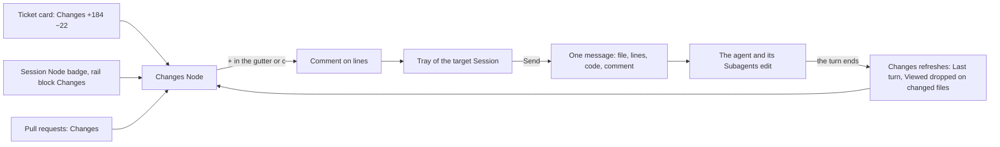

# worfy-changes-view: экран Changes — diff Ticket-а, Session и PR с комментариями к строкам, которые уходят агенту одной пачкой

Status: черновик 2026-11-13 из исследования конкурентов, владельцем не принят
Critic: [docs/product/critic/worfy-changes-view-2026-11-14.md](../../docs/product/critic/worfy-changes-view-2026-11-14.md) — Split.
Source: исследование конкурентов 2026-11-13, папка
[docs/research/2026-11-13-competitors/](../../docs/research/2026-11-13-competitors/); досье
[Vibe Kanban](../../docs/research/2026-11-13-competitors/vibe-kanban.md),
[Orca](../../docs/research/2026-11-13-competitors/orca.md),
[Claude Code desktop app](../../docs/research/2026-11-13-competitors/claude-code-desktop-app.md),
[Claude Code cloud sessions and Projects](../../docs/research/2026-11-13-competitors/claude-code-cloud-sessions-and-projects.md),
[Codex app](../../docs/research/2026-11-13-competitors/codex-app-codex-in-the-chatgpt-desktop-app.md),
[Google Antigravity](../../docs/research/2026-11-13-competitors/google-antigravity.md),
[JetBrains Air](../../docs/research/2026-11-13-competitors/jetbrains-air.md),
[Devin](../../docs/research/2026-11-13-competitors/devin.md),
[Devin Desktop](../../docs/research/2026-11-13-competitors/devin-desktop-formerly-windsurf.md),
[Warp](../../docs/research/2026-11-13-competitors/warp-agent-management-panel-oz-cloud-agents-and-.md),
[GitHub Copilot app](../../docs/research/2026-11-13-competitors/github-copilot-app.md),
[GitHub Copilot cloud agent and Agent HQ](../../docs/research/2026-11-13-competitors/github-copilot-cloud-agent-and-agent-hq-mission-.md),
[Factory Droids](../../docs/research/2026-11-13-competitors/factory-droids.md),
[Cursor](../../docs/research/2026-11-13-competitors/cursor-agents-window-cloud-agents-and-automation.md),
[Kiro](../../docs/research/2026-11-13-competitors/kiro.md); идеи `review-quality-4` и `workspace-ui-1` этого
исследования, сверенные с кодом; обзор рынка 2026-11-08
[research-рынок-приложений-для-параллельных-агентов.md](../../docs/product/roadmap-worfy/research-рынок-приложений-для-параллельных-агентов.md);
[CONTEXT.md](../../CONTEXT.md) — термины.
Зависит от: Epic-ов [worfy-pr-inbox](../worfy-pr-inbox/spec.md) (вид Pull requests, нити ревью, `pr-inbox.json`),
[worfy-human-review](../worfy-human-review/spec.md) (Team reviewer), [worfy-pipeline](../worfy-pipeline/spec.md)
(Stage Human review), [worfy-ui-kit](../worfy-ui-kit/spec.md) (kit на Base UI; ContextMenu kit — его Ticket 12, ещё
`open`).
Ticket-ы: Epic `worfy-changes-view`, 12 Ticket-ов, нумерация с `01`. Файлов `issues/` нет: Ticket-ы заводятся после
приёмки spec-а владельцем. Имена новых файлов ниже — предложение; implementer сверяет их с `main`.

## Проблема

- Чтобы увидеть, что агент поменял, пользователь уходит из worfy. Open PR на карточке Ticket-а открывает PR в браузере
  (`docs/features/workflow.md:105`). В Pull requests кнопка Start review — ссылка на вкладку Files на GitHub
  (`src/renderer/pr-inbox/usePrInbox.ts:337`, `docs/features/pr-inbox.md:78`). Ticket без PR, Session без PR и
  незакоммиченные правки видны только в редакторе или в `git diff`, набранном руками.
- В worfy нет diff-а ни Ticket-а, ни Session, ни последнего хода. В main нет ни одного вызова `git diff`: git там
  читает worktree-ы, ветки и remote (`src/main/workflow/reader.ts:426-456`, `src/main/workflow/stages.ts:47-58`). PR
  inbox читает детали PR без `diffHunk` и `files` (`src/main/github/inbox.ts:13-16`). Diff в UI есть только в трёх
  узких местах: окно переноса Harness сравнивает разделы CLAUDE.md и Profile (`src/renderer/harness/MigrationForm.tsx:97`,
  `:143`), Getting started показывает записанный пример ревью (`src/renderer/getting-started/ReviewExample.tsx:66-72`),
  а комментарий PR рисует блок ```` ```suggestion ```` (`src/renderer/markdown/Markdown.tsx:117`).
- Что поменял последний ход, worfy не знает, хотя данные проходят мимо. Codex присылает diff хода
  (`turn/diff/updated`), а worfy его отбрасывает (`src/main/vendors/codex/items.ts:75`). PreToolUse hook Claude Code
  видит каждый вызов tool-а, в том числе Subagent-ов (поле `agent_id` у `BaseHookInput` в `sdk.d.ts`), но worfy берёт
  из него только папку (`src/main/vendors/claude/options.ts:415-440`) и ставит его только Session-ам Autopilot-а с
  Auto-approval и Product Session (`src/main/vendors/claude/session.ts:629`, `src/main/vendors/claude/options.ts:744`).
- Замечание к строке приходится пересказывать агенту словами. Comments on quotes работают только на тексте ответа
  агента (`docs/features/sessions.md:174-176`). Комментария к строке кода нет, и агент сам ищет, о каком месте речь.
- Обзор рынка 2026-11-08 записал «своего экрана diff» в то, чего у worfy нет
  (`docs/product/roadmap-worfy/research-рынок-приложений-для-параллельных-агентов.md:51`, `:189`). Review там —
  самая частая тема обсуждений (`docs/product/roadmap-worfy/issues/03-рынок-приложений-для-параллельных-агентов.md:28`).
- Epic worfy-pr-inbox отложил «What changed since my review» (`.scratch/worfy-pr-inbox/spec.md:279`), хотя main уже
  хранит head commit, который пользователь видел последним (`src/main/github/inbox.ts:404-413`,
  `src/main/projects/pr-inbox-state.ts:18-25`). Stage Human review ждёт решения ревью на GitHub
  (`src/shared/workflow/pipeline.ts:367-368`), так что и само ревью идёт там.

## Решение

У worfy появляется экран Changes: diff Ticket-а, Session или PR с деревом файлов, режимами Inline и Side by side,
отметкой Viewed и комментариями к строкам. Комментарии копятся в том же лотке, что Comments on quotes, и уходят
выбранной Session одним сообщением: файл, строки, сам код и текст пользователя. worfy при этом только читает git и
GitHub и ничего не пишет в репозиторий (ADR-0005 — собственное состояние worfy живёт в его папке данных, не в
репозиториях Project-ов).

Набросок функции (вариант, который рекомендует вопрос Q1):

- **Где.** Новый вид Node — `changes` — рядом с карточкой Ticket-а или Node-ом Session, как Browser, который открыла
  Session (`docs/features/browser.md:14`). Node Session-а входит в её Family и уходит с Canvas вместе с ней. Читать
  удобнее в focus mode: кнопка Changes открывает его плиткой рядом с плиткой Session, preset Main + side
  (`docs/features/focus-mode.md:49`).
- **Чей diff.**
  - Ticket — его worktree или ветка против merge-base с базой Profile-а (`worktree.base`). Ticket над несколькими
    репозиториями (ADR-0104 — один Ticket в нескольких репозиториях) показывает репозитории верхним уровнем дерева.
  - Session — её папка (`cwd`), если это git.
  - PR — любой PR из вида Pull requests: свой или коллеги.
- **Scope** (что сравнивается), меню над diff-ом:
  - All changes — ветка против merge-base вместе с незакоммиченным и новыми файлами; по умолчанию для Ticket-а, PR
    и Session в worktree;
  - Commit — один commit из списка commit-ов ветки;
  - Uncommitted — рабочее дерево против `HEAD`, с файлами, которых нет в git;
  - Last turn — правки последнего хода Session вместе с её Subagent-ами; по умолчанию для Session в корне Project-а;
  - Since my last look — с head commit-а, на котором пользователь нажал Mark seen;
  - Compare against — любая ветка вместо базы.
- **Вид.** Дерево файлов с фильтром, статусом (A, M, D, R) и `+N −M`. Inline или Side by side, Wrap, Hide whitespace.
  Большой файл и файл lock-а свёрнуты. Binary-файл показан размерами. Файлы workflow в Full mode (`.scratch/**`) стоят
  свёрнутой группой Workflow files в конце.
- **Viewed.** Отметка у файла. Она снимается сама, когда содержимое файла изменилось после отметки.
- **Комментарии.** «+» в gutter, клавиша `c` или выделение нескольких строк открывает popover: текст и до 3 картинок,
  как у Comments on quotes. Комментарий встаёт в лоток Session, которой он уйдёт; Send отправляет все разом.
  Отправленный комментарий остаётся тусклым на своей строке, а блок в сообщении Session ведёт обратно на строку.
- **Входы.**
  - Карточка Ticket-а — chip Changes `+184 −22`; на Stage Human review — главная кнопка Review changes.
  - Node Session — badge Changes; Session view — блок Changes в rail справа.
  - Pull requests — кнопка Changes в панели выбранного PR.
  - Command palette — Open changes.

### Как пользователь идёт по экрану

1. На карточке Ticket-а с веткой стоит chip `Changes +184 −22`. Клик ставит Node Changes рядом с карточкой и открывает
   focus mode: слева плитка Session, которой уйдут комментарии, справа Changes.
2. Scope — All changes: ветка против merge-base с базой. В шапке — база, head, число файлов и `+/−`.
3. Пользователь идёт по файлам клавишами `j` и `k`, по hunk-ам — `n` и `p`, отмечает файл Viewed клавишей `v`.
4. На строке он нажимает «+» в gutter или `c`; выделение нескольких строк даёт комментарий к диапазону. В popover —
   текст и картинки, ⌘↵ сохраняет.
5. Внизу Node-а лоток: «3 comments on 2 files», chip-ы комментариев, Clear, поле общего текста и выбор Session
   («To: …»). Тот же комментарий виден в лотке поля ввода этой Session.
6. Send (⌘↵) отправляет одно сообщение. Если агент занят, сообщение ждёт в очереди вместе с комментариями, как
   сейчас (`docs/features/sessions.md:196`).
7. Агент и его Subagent-ы правят код. Ход кончается, Changes обновляется сам. С изменённых файлов отметка Viewed
   снята, scope Last turn показывает правки этого хода.
8. Отправленные комментарии остаются тусклыми на своих строках. Блок комментария в сообщении Session открывает Changes
   на этой строке.
9. В следующий раз пользователь выбирает Since my last look и видит только новое.

Из Pull requests путь тот же: кнопка Changes в панели PR. Нити ревью GitHub стоят на своих строках, и их можно
добавить в пачку для агента кнопкой Add to comments.

### Экран

```
┌─ Changes · Ticket 03 · worfy-changes-view ─────────────────────────── [Refresh] [Mark seen] ─┐
│ [All changes ▾]  origin/main ← worfy-changes-view/03 · base 1a2b3c4 · 6 files · +184 −22     │
│ [Inline | Side by side]  [ ] Wrap  [ ] Hide whitespace         Viewed 2/6   Compare [main ▾] │
├─────────────────────────┬────────────────────────────────────────────────────────────────────┤
│ Filter files…           │ src/main/changes/git.ts                  M  +120 −8   [✓] Viewed   │
│ ▾ src/main/changes      │ @@ -10,6 +10,14 @@                                                 │
│   M git.ts          ✓   │  10  10    import { execFile } from 'node:child_process'           │
│   A pre-images.ts       │      11 +  const READ_ONLY = { GIT_OPTIONAL_LOCKS: '0' }      [+]  │
│ ▾ src/renderer/changes  │      ┌─ not sent ─────────────────────────────────┐                │
│   M DiffPane.tsx        │      │ Why not the gitRunner of stages.ts?        │                │
│ ▸ Workflow files (2)    │      └─────────────────────────── Edit · Delete ──┘                │
│                         │  11  12    export function readDiff(…) {                           │
├─────────────────────────┴────────────────────────────────────────────────────────────────────┤
│ 3 comments on 2 files   [git.ts:11] [pre-images.ts:40–44] [DiffPane.tsx:7]            Clear  │
│ To [Orchestrator ▾]   Message to the agent…                                      [Send ⌘↵]   │
└──────────────────────────────────────────────────────────────────────────────────────────────┘
```

Side by side делит правую часть на две колонки: старая сторона слева, новая справа, номера строк у каждой. Тексты UI
английские: «UI copy is ENGLISH» (`docs/design/BRIEF.md:4`; ADR-0017 — английские канонические термины).



## Как это сделано у конкурентов

- **Claude Code desktop app** ([досье](../../docs/research/2026-11-13-competitors/claude-code-desktop-app.md), раздел
  «Worktree, diff и review»): клик по числу изменений в карточке Changes открывает diff, комментарий ставится по
  наведению на строку, Cmd/Ctrl+Enter отправляет все сразу, и Claude правит код. Пользователи просили diff против
  других веток, кроме main (143 голоса); в diff нет картинок, stage hunk, amend и rebase («Что ругают»).
- **Claude Code cloud sessions** ([досье](../../docs/research/2026-11-13-competitors/claude-code-cloud-sessions-and-projects.md)):
  карточка Changes со счётчиками `+/−`, «Compare against» любой ветки; комментарии к строкам собираются в следующее
  сообщение агенту.
- **Codex app** ([досье](../../docs/research/2026-11-13-competitors/codex-app-codex-in-the-chatgpt-desktop-app.md),
  пункты «Git внутри приложения» и «Review pane»): Review pane с областями Unstaged, Staged, Commit, Branch и
  Last turn; inline-комментарий для Codex; в проекте из нескольких репозиториев — выбор репозитория.
- **Google Antigravity** ([досье](../../docs/research/2026-11-13-competitors/google-antigravity.md), пункт «Review
  pane и version control»): виды Uncommitted, Branch против `origin/main`, Agent Edits и по отдельным ходам; комментарий к
  строке уходит агенту с файлом и номером строки.
- **JetBrains Air** ([досье](../../docs/research/2026-11-13-competitors/jetbrains-air.md), пункт «Review»): All Changes,
  unified или side by side, F7 — к следующему изменению; комментарии копятся и уходят агенту вместе.
- **Vibe Kanban** ([досье](../../docs/research/2026-11-13-competitors/vibe-kanban.md), разделы «Review» и «Что хвалят»;
  компания закрылась 2026-04-10, код поддерживает сообщество): панель Changes с деревом файлов, unified или
  side-by-side, живым обновлением по file watcher и виртуализацией 300+ файлов. Комментарии уходят одним блоком
  `## Review Comments (N)` — файл, строка, цитата кода; туда же можно добавить review-комментарии PR с GitHub.
  Side-by-side пользователи назвали лучшей функцией, комментарии к строкам — вторым по важности вкладом после
  worktree; просили diff по commit-у и по ходу и отметки «просмотрено», как на GitHub.
- **Orca** ([досье](../../docs/research/2026-11-13-competitors/orca.md), разделы «Review: diff, аннотации,
  attribution» и «Что хвалят»):
  diff staged, unstaged и untracked против точки ответвления worktree, базу можно сменить; diff картинок и
  трёхсторонний вид конфликтов. Annotate AI Diff: «+» в gutter или `c`, комментарий держится за строку при правках,
  Send to agent шлёт все одной пачкой выбранному или новому агенту. Ушедший пользователь всё равно хвалил комментарии
  агенту, другой перенёс всё в своё приложение, а для review остался на Orca.
- **Devin и Devin Desktop** ([Devin](../../docs/research/2026-11-13-competitors/devin.md), раздел «Devin Review и
  качество кода»; [Devin Desktop](../../docs/research/2026-11-13-competitors/devin-desktop-formerly-windsurf.md),
  раздел «Agent Command Center — главный экран»): вкладка Changes с отсечкой «Since last seen»; Devin Review
  ставит файлы в порядке чтения и узнаёт перемещённый код — это хвалили больше всего.
- **Warp** ([досье](../../docs/research/2026-11-13-competitors/warp-agent-management-panel-oz-cloud-agents-and-.md),
  раздел «Вертикальные вкладки, Tab Configs, worktrees, Code Review»): у каждого worktree своя панель —
  незакоммиченное, против main или любой ветки, откат hunk-ов; inline-комментарии уходят агенту пачкой.
- **GitHub Copilot app, Factory Droids, Cursor, Kiro**
  ([Copilot app](../../docs/research/2026-11-13-competitors/github-copilot-app.md),
  [Factory Droids](../../docs/research/2026-11-13-competitors/factory-droids.md),
  [Cursor](../../docs/research/2026-11-13-competitors/cursor-agents-window-cloud-agents-and-automation.md),
  [Kiro](../../docs/research/2026-11-13-competitors/kiro.md)): вкладка Changes с комментариями и виртуализированным
  списком для очень больших PR (Copilot app); построчный review diff в приложении (Droids); вид diffs со stage,
  commit и PR (Cursor); у Kiro панель Reviews показывает diff, а комментарии и merge — на GitHub.
- **GitHub Copilot cloud agent** ([досье](../../docs/research/2026-11-13-competitors/github-copilot-cloud-agent-and-agent-hq-mission-.md)):
  правки просят комментарием `@copilot` в PR; обратная связь через комментарии PR казалась пользователям медленной,
  просили чат внутри PR.

Что берём: diff против базы и незакоммиченное, смену базы, Last turn, «с прошлого просмотра», Viewed, комментарии к
строкам одной пачкой. Что не берём в этот Epic: stage, revert и commit из diff-а (Codex app, Antigravity, Cursor),
diff картинок и вид конфликтов (Orca), порядок файлов по смыслу (Devin Review).

## Истории пользователя

1. Как пользователь, я открываю diff Ticket-а с его карточки и вижу всё, что ветка поменяла против базы, не уходя в
   GitHub или редактор.
2. Как пользователь, я хочу видеть, что поменял последний ход агента вместе с его Subagent-ами, чтобы проверить ход
   сразу, пока помню просьбу.
3. Как пользователь, я хочу смотреть незакоммиченное отдельно и каждый commit отдельно.
4. Как пользователь, я хочу сравнить ветку с другой веткой, а не только с базой Profile-а.
5. Как пользователь, я хочу переключать Inline и Side by side и прятать изменения пробелов.
6. Как пользователь, я хочу отмечать файлы Viewed, и чтобы отметка снималась, если агент файл потом поменял.
7. Как пользователь, я хочу видеть только то, что изменилось с моего прошлого просмотра.
8. Как пользователь, я хочу оставить комментарий к строке или диапазону, с картинкой, и отправить все комментарии
   агенту одной пачкой.
9. Как пользователь, я хочу, чтобы агент получил файл, номера строк и сам код, а не мой пересказ.
10. Как пользователь, я хочу видеть diff рядом с чатом Session и писать агенту, не закрывая diff.
11. Как пользователь, я хочу открыть diff PR из Pull requests, видеть нити ревью GitHub на их строках и добавить их в
    пачку для агента.
12. Как пользователь, я хочу, чтобы Ticket на Stage Human review открывал diff одной кнопкой.
13. Как пользователь Linked machine с доступом Read only, я хочу читать diff; писать комментарии и отметки я не жду.
14. Как пользователь Silent mode, я хочу, чтобы worfy ничего не писал в репозиторий: ни index, ни refs, ни файлы.

## Решения по реализации

- **Только чтение git.** Новый модуль `src/main/changes/` запускает git с `GIT_OPTIONAL_LOCKS=0`,
  `GIT_TERMINAL_PROMPT=0`, `-c core.quotePath=false`, `--no-ext-diff`, `--no-color` и `-z` для имён, как уже читает
  `src/main/work-track/ticket-status.ts:16`, `:278`. Без `GIT_OPTIONAL_LOCKS=0` чтение рабочего дерева
  обновляет `.git/index` и берёт `index.lock`, и `git commit` агента в ту же секунду падает. Команды: `merge-base`,
  `diff`, `log`, `show`, `ls-files --others --exclude-standard`, `for-each-ref`, `cat-file -e`, `hash-object` без `-w`
  и `diff --no-index`. Никогда — `fetch`, `add`, `stash`, `update-index`. У `gitRunner`
  (`src/main/workflow/stages.ts:47-58`) таймаут 10 s и буфер 8 MB, для целого patch-а этого мало. Поэтому сначала
  список файлов (`--numstat`, `--raw`), patch файла — по запросу, с пределом размера. Разбор вывода — чистый модуль
  `src/shared/changes/parse.ts`: файлы, hunk-и, строки с номерами двух сторон, rename, binary, смена режима, «\ No
  newline at end of file», CRLF.
- **Чей diff.** `src/main/changes/subjects.ts`:
  - Ticket — worktree из `ticketWorktrees(root)` (`src/main/workflow/reader.ts:439`), а без worktree — ветка
    Ticket-а (`parallel: single`; Project над несколькими репозиториями — `ticketBranches`, `reader.ts:476`, ADR-0104);
  - Session — `cwd` из `SessionNodeView` (`src/shared/ipc/sessions.ts:104`);
  - PR — Ticket 09.
- **База.** Поле Profile-а `worktree.base` читается через `bin/profile --field`, как `readGithubAccount`
  (`src/main/workflow/profile.ts:670`). При `null` порядок тот же, что у preflight Harness
  (`harness/profiles/README.md:173`): `origin/<layout.repos.<repo>.default_branch>`, ветка, на которую указывает
  `origin/HEAD`, `origin/main`. Без `origin` и с `workflow.finish: local-green` — локальная ветка. Merge-base —
  `git merge-base <база> HEAD`. Compare against берёт любую ветку из `for-each-ref`.
- **Scope-ы.**
  - All changes — `git diff <merge-base>` плюс новые файлы из `ls-files --others` через `diff --no-index`.
  - Uncommitted — `git diff HEAD` плюс новые файлы.
  - Commit — список `git log <merge-base>..HEAD`, diff одного — `git show`.
  - Last turn — часть Vendor-а, ниже.
  - Since my last look — Ticket 04.
  - Какие scope-ы есть у предмета, отвечает main (`changes.scopes`), и меню строится из ответа. Так Ticket-ы 04, 06
    и 07 не трогают renderer.
- **Каналы** — `src/shared/ipc/changes.ts` и `src/main/ipc/changes.ts`, по файлу на домен (ADR-0006 — контракт IPC
  через declaration merging). Чтение: `changes.scopes`, `changes.list` (файлы, статус, `+/−`, blob id сторон),
  `changes.file` (hunk-и одного файла, контекст, «Show whole file»), `changes.commits`, событие `changes.updated` —
  все `'project', 'read'`. Запись в состояние worfy: `changes.markViewed`, `changes.markSeen` — `'project', 'write'`.
  Правила доступа — `src/shared/ipc/channels.ts:21-52`. Git идёт на Machine Project-а (ADR-0052 — Machine и связь
  Machine-ов).
- **Предел размера.** Список файлов — всегда целиком. Patch файла больше 2 000 строк или 1 MB приходит свёрнутым:
  «Large diff · N lines · Show». Lock-файлы и файлы с атрибутом `linguist-generated` свёрнуты так же. Binary — «Binary
  file · 12 KB → 14 KB». Больше 300 файлов — папки дерева свёрнуты. В DOM только hunk-и на экране и по два экрана
  вокруг: своя отрисовка окном, без новой библиотеки (в `package.json` нет ни diff-библиотеки, ни виртуализации).
- **Файлы workflow.** В Full mode корень Ticket-ов — `.scratch/**` checkout-а (`src/main/workflow/folder.ts`; описание
  в шапке `src/main/workflow/reader.ts:8-12`). Его файлы стоят свёрнутой группой Workflow files в конце дерева. В
  Silent mode их в репозитории нет.
- **Node `changes`.** Один файл `src/renderer/canvas/nodes/ChangesNode.tsx`: registry находит его сам
  (`src/renderer/canvas/nodes/index.ts:1-13`). Части экрана — в `src/renderer/changes/` (`ScopeBar.tsx`,
  `FileTree.tsx`, `DiffPane.tsx`, `Tray.tsx`), чтобы Ticket-ы 04, 05 и 09 правили разные файлы. Данные Node-а в Layout
  (`src/shared/layout/types.ts:24-30`): предмет (`{ ticket: epic, NN }`, `{ session: nodeId }` или `{ pr: repo, N }`) и
  scope. Один Node на предмет: повторный клик ведёт к уже открытому. Место — как у Browser Session-а; Node Session
  входит в её Family и уходит с Canvas вместе с ней.
- **Focus mode.** Плитка рисует компонент Node-а (`src/renderer/focus/FocusMode.tsx:12-15`), поэтому Changes в плитке
  работает без доработки. Вход с Session открывает focus mode на двух Node-ах — Session и Changes — с preset-ом
  Main + side. Сейчас `requestFocus` (`src/renderer/focus/focus-state.ts:35`) берёт только id Node-ов, а focus mode
  всегда открывается с preset-ом Even (`docs/features/focus-mode.md:17`). Поэтому `requestFocus` получает
  необязательный preset (список preset-ов — `src/renderer/focus/split-tree.ts:37`).
- **Входы.**
  - Карточка Ticket-а: action `src/renderer/canvas/actions/Changes.tsx` в слоте действий
    (`src/renderer/canvas/badges/index.ts:42-44`). Место под chip даёт `src/renderer/canvas/ticket-card.ts`, как для
    `ReviewThreads` (`src/renderer/canvas/badges/ReviewThreads.tsx:17-18`). Счётчик — `git diff --shortstat` при
    сдвиге head ветки и в конце хода, без опроса по таймеру.
  - Node Session: badge `src/renderer/canvas/badges/Changes.tsx` (`SlotSubject` вида `session`,
    `badges/index.ts:18`).
  - Session view: блок rail `src/renderer/session/rail/ChangesRail.tsx` (`src/renderer/session/rail/index.ts:1-9`).
    Не шапка: оттуда уже убрали chip MCP, потому что шапка «had grown too crowded» (`docs/features/sessions.md:218-220`).
- **Kit.** ToggleGroup (Inline и Side by side), Menu (scope, Compare against), Popover (комментарий), Tooltip — из
  `src/renderer/theme/kit/` (ADR-0106 — kit на Base UI). Context menu на строке (Comment, Copy line) ждёт ContextMenu
  kit (worfy-ui-kit, Ticket 12). До него на строке работают «+» в gutter и `c`.
- **Цвета без подсветки синтаксиса** — до ответа на Q5. Добавленные и удалённые строки — tokens `--ready-*` и
  `--blocked-*`, как в `src/renderer/harness/MigrationForm.tsx:85-86`. Блоки кода в PR inbox тоже без цветов
  синтаксиса (`docs/features/pr-inbox.md:95`).
- **Комментарии к строкам** — то же хранилище и тот же лоток, что Comments on quotes:
  - `QuoteComment` (`src/renderer/session/quote-comments.ts:43`) получает вариант `code`: путь, репозиторий,
    сторона (`old` или `new`), первая и последняя строка, текст строк, commit (или «uncommitted») и предмет.
    Пределы те же: 3 картинки на комментарий и 10 на сообщение (`quote-comments.ts:31`, `:33`).
  - Хранилище по Session (`quoteKey`, `src/renderer/session/quote-store.ts:39`) переходит со схемы `v: 2` (`:49`)
    на `v: 3`; запись `v: 2` читается как есть.
  - `agentText` (`quote-comments.ts:189`) получает второй раздел, `parseQuoted` (`:229`) читает его обратно для
    пузыря. Правила `composeRound` (`:308`) не меняются: например, команда со `/` вместе с комментариями отвергается.
    Пример сообщения:

    ```
    Comments on lines of the diff (2), worktree .claude/worktrees/03, branch worfy-changes-view/03:

    1. src/main/changes/git.ts:11 (new side, commit 9f8e7d6)
       > const READ_ONLY = { GIT_OPTIONAL_LOCKS: '0' }
       Why not the gitRunner of stages.ts?

    2. src/renderer/changes/DiffPane.tsx:40–44 (new side, uncommitted)
       > …
       [image 1]

    General:
    Fix both, then run the unit tests of the module.
    ```

  - Код в цитате — до 6 строк; длиннее режется в середине с «…», как цитата длиннее 200 символов
    (`QUOTE_FOR_AGENT`).
  - Лоток Node-а Changes показывает комментарии выбранной Session. Её поле ввода показывает те же: «N comments ·
    M on code». Смена Session в «To» переносит неотправленные комментарии к коду в её лоток. Комментарии к
    сообщениям остаются: они привязаны к сообщению своей Session.
  - Send — `agent.send` (`src/shared/ipc/agent.ts:69`) живой Session, с очередью как сейчас.
  - Список «To»: живые Session-ы с Binding к Ticket-у (`src/shared/binding/resolve.ts`), Session самого Node-а,
    Orchestrator и «New session in this worktree». Значение по умолчанию решает Q2.
  - После правок агента неотправленный комментарий ищется заново по тексту строки — ближайшее совпадение к старому
    месту, как `anchorRange` для цитат (`quote-comments.ts:132`). Строки нет — комментарий получает пометку «Line
    changed» и остаётся в лотке.
  - На экране только для чтения нет ни «+», ни лотка, как у Comments on quotes (`docs/features/sessions.md:209`).
- **Last turn — новая часть Vendor driver-а.** `TurnChangesPart` в `src/main/vendors/turn-changes.ts`, по файлу на
  Vendor (`src/main/vendors/driver.ts:1-4`; ADR-0094 — граница Vendor-а: свой driver на каждый Vendor). Пока часть
  не подключена, она отвечает `PartNotWired` (`src/main/vendors/driver.ts:38`), и scope Last turn не предлагается.
  - **Claude** (`src/main/vendors/claude/turn-changes.ts`).
    - Hook `toolUseHooks` (`src/main/vendors/claude/options.ts:427`) ставится каждой Session Claude, которую ведёт
      worfy, а не только Autopilot-у с Auto-approval (`session.ts:629`). Он по-прежнему отвечает `{}`: вызов идёт как
      без hook-а (`options.ts:415-426`).
    - `observe` (`ToolUseFacts`, `src/main/agent/session/types.ts:182`) получает ещё `tool_name`, `tool_input`,
      `agent_id` и `prompt_id`.
    - Перед первым `Edit`, `MultiEdit`, `Write` или `NotebookEdit` пути за ход main копирует байты файла в
      `<папка данных Project-а>/changes/pre/<sha256>` или записывает «файла не было». Граница хода — `prompt` и
      `result` самой Session.
    - Diff — `git diff --no-index <копия> <файл>`. Копия больше 2 MB не делается: файл в Last turn помечен «too
      large to keep».
    - Ошибка копирования не останавливает вызов tool-а.
    - Правки командами (`Bash`) этот путь не видит. Last turn говорит это словами и ведёт в Uncommitted.
    - Session, начатая вне worfy (терминал, Claude desktop), получает приблизительный Last turn по `tool_use`
      `Edit` и `Write` из transcript-а (`src/shared/transcript/parse.ts`), с пометкой «Approximate».
  - **Codex** (`src/main/vendors/codex/turn-changes.ts`).
    - `turn/diff/updated` уходит из списка отброшенных (`src/main/vendors/codex/items.ts:63-76`). Его `diff` — весь
      unified diff хода, как его считает Codex
      (`src/main/vendors/codex/protocol/json/v2/TurnDiffUpdatedNotification.json`); main хранит последний за ход.
    - `fileChange` уже приходит как `tool_use` с `changes` (`items.ts:143-144`).
    - После рестарта diff собирается из `FileUpdateChange` (`path`, `kind`, `diff`) ответа `thread/turns/list`.
    - Нити Subagent-ов Codex идут через `follow()` (`items.ts:2-4`). Их diff ходов входит в Last turn родителя, если
      пришёл между его `turn/started` и `turn/completed`.
- **Viewed и Since my last look.** `<папка данных Project-а>/changes.json` рядом с `pr-inbox.json` (таблица
  `docs/features/storage-and-diagnostics.md:169-184`):
  - по предмету — `{путь → blob id}` отметок Viewed и `{head commit, время}` последнего Mark seen;
  - отметка снимается, когда blob id новой стороны изменился; у рабочего дерева он считается `git hash-object` без
    `-w`, который ничего не пишет;
  - у PR «последний просмотр» — уже существующий `seenHeadOid` из `pr-inbox.json`, а Mark seen в Changes и в
    Pull requests — одно действие (`prInbox.markSeen`, `src/main/github/inbox.ts:404`);
  - Since my last look сравнивает commit-ы: незакоммиченное показывает отдельный scope.
  - Копии файлов Last turn хранятся за последние 20 ходов Session и удаляются, когда Session уходит в Archive
    (ADR-0076 — авто-архив законченных Session-ов); на Project — не больше 256 MB, старые уходят первыми.
  - Поправка к ADR-0005 записывает `changes.json` и `changes/pre/`.
- **PR** (Ticket 09).
  - Кнопка Changes в панели выбранного PR рядом с Open on GitHub (`src/renderer/pr-inbox/PrInboxView.tsx:478`).
  - Запрос деталей получает `baseRefName` и `baseRefOid` (поля — `src/main/github/inbox.ts:63`).
  - Если оба commit-а есть локально (`git cat-file -e`), diff считается локально. Иначе —
    `gh api repos/<owner>/<repo>/pulls/<N>` с заголовком `Accept: application/vnd.github.diff`: это GET без
    `--method`, как требует правило чтения (`inbox.ts:29-30`, ADR-0105 — публикация в PR только по щелчку
    пользователя). Ответ кэшируется в памяти по head commit-у; отказ GitHub на очень большой diff даёт «Open on
    GitHub».
  - Нити ревью стоят на своих строках (`path`, `line`, `isOutdated` — `src/shared/ipc/pr-inbox.ts:43-51`); outdated —
    списком над файлом. Add to comments кладёт последний комментарий нити в лоток как комментарий для агента.
  - Код и слова коллег остаются в памяти main, на диск не пишутся (как тексты PR inbox: `inbox.ts:30-31`).
- **Живое обновление** (Ticket 08). `changes.updated` приходит, когда:
  - сдвинулся head ветки — watcher workflow уже следит за refs веток Ticket-ов (`src/main/workflow/watch.ts:9-13`);
  - кончился ход Session, чья папка в этом worktree;
  - пришёл результат `Edit`, `Write`, `Bash`, `fileChange` или `commandExecution` такой Session — с паузой 1 s;
  - Node стал видимым или окно получило фокус;
  - пользователь нажал Refresh.

  Отдельного watcher-а на файлы worktree нет: в большом репозитории это десятки тысяч файлов. Экран сохраняет
  прокрутку и открытые файлы.
- **Stage Human review** (Ticket 10). На этом Stage (`src/shared/workflow/pipeline.ts:367-368`) action на карточке
  называется Review changes и становится главной кнопкой. То же на карточке доски Pipeline
  (`src/renderer/pipeline/PipelineBoard.tsx`). В Command palette — Open changes.
- **Linked machine и Silent mode.** Linked machine с доступом Read only читает diff, а отметки и комментарии — каналы
  записи — ей закрыты (ADR-0066 — доступ Read only). В Silent mode в репозиторий не пишется ничего; сообщение с
  комментариями уходит только агенту.
- **Windows.** Имена файлов — через `-z` и `core.quotePath=false`. Hide whitespace добавляет `--ignore-cr-at-eol`.
  Contract test-ы чтения идут на Windows runner-е.
- **ADR.** Ticket 02 пишет новый ADR «Экран Changes читает git и GitHub, ничего не пишет в репозиторий». Ticket 04
  дописывает поправку к ADR-0005.

## Решения по test-ам

- Хороший test проверяет поведение снаружи: какие файлы, строки и scope-ы видит пользователь, какое сообщение
  получил агент, что записано в папке данных worfy и что не тронуто в репозитории. Как устроен разбор внутри, test не
  проверяет.
- **Без моделей и без сети.** Claude — `WORFY_AGENT=fake` (`src/main/agent/fake-query.ts`), PreToolUse — через
  `fakePreToolUse` (`src/main/vendors/claude/query.ts:249`), в том числе вызов Subagent-а с `agent_id`. Codex —
  `WORFY_CODEX=fake` (`test/fixtures/codex-app-server/fake-app-server.mjs`), fake шлёт `turn/diff/updated`. GitHub —
  stand-in `WORFY_GH`, как в `test/contract/pr-inbox.test.ts`. Репозитории, владельцы и PR в fixture-ах выдуманы.
- **Seam 1 — unit:**
  - разбор вывода git в `src/shared/changes/parse.ts`: rename, binary, «No newline at end of file», CRLF, пути с
    пробелами и не-ASCII;
  - выбор базы по `worktree.base` и запасному порядку;
  - текст для агента и разбор обратно для комментариев к коду (образец — `test/unit/quote-comments.test.ts`);
  - поиск строки комментария заново после правок;
  - снятие Viewed при новом blob id;
  - переход хранилища с `v: 2` на `v: 3` (образец — `test/unit/quote-store.test.tsx`).
- **Seam 2 — contract:** main над временным git-репозиторием, который строит сам test (`NO_GIT_MAINTENANCE` из
  `test/git-env.ts`):
  - worktree против merge-base вместе с новыми файлами, Commit, Uncommitted, Compare against;
  - после всех чтений байты и mtime `.git/index` прежние, новых refs и объектов нет;
  - база при stub `bin/profile` с `worktree.base` и с `null`;
  - Last turn Claude над fake query, Last turn Codex над fake app-server;
  - diff PR через stand-in `gh`.

  Те же test-ы идут на Windows runner-е.
- **Seam 3 — e2e** в настоящем Electron на fake agent (образцы — `test/e2e/quote-comments.spec.ts`,
  `test/e2e/focus.spec.ts`, `test/e2e/pr-inbox.spec.ts`):
  - карточка Ticket-а → Node Changes → комментарий к строке → Send: fake agent получил одно сообщение с блоком;
  - плитки Session и Changes в focus mode;
  - экран Read only без «+»;
  - PR из Pull requests.
- **Сначала падающий test** в каждом Ticket-е кода: он красный на старом поведении, это пишется в «Итог».

## Не в этом Epic-е

- **Правка кода из diff-а:** stage, unstage, revert hunk-а, commit, push, merge. worfy — вид над workflow, а не
  редактор (ADR-0002 — worfy показывает и запускает workflow, но не владеет его состоянием). Правит агент или
  пользователь в своём редакторе.
- **Публикация комментариев на GitHub ревью-комментариями** — если Q3 не решит иначе. Публикация шла бы путём
  ADR-0105, со своим lint-ом Silent mode.
- **Подсветка синтаксиса** — если Q5 не решит иначе.
- **Diff картинок** (рядом, swipe, наложение), трёхсторонний вид конфликтов merge, preview Markdown в diff-е.
- **Порядок файлов по смыслу** и распознавание перемещённого кода: нужна модель или отдельный анализ.
- **Комментарии к плану агента и к отрисованному Markdown.**
- **Пометка строк, которые написал AI** (Attribution у Orca).
- **Diff одного Subagent-а отдельно:** Ticket-а и Last turn Session для этого хватает.
- **Last turn у Terminal:** у Terminal нет transcript-а.
- **Шаг Getting started через Changes** (`ReviewExample.tsx` остаётся записанным примером), GitLab и Bitbucket.
- **Autopilot:** Changes — экран для человека; Run его не открывает и не ждёт.

## Ticket-ы

1. **01 — Прототип экрана Changes**: Card с HTML-прототипом на выдуманных данных — дерево, Inline и Side by side, scope-ы, popover комментария, лоток и «To»; владелец смотрит до кода UI, как с прототипом Product Session (`.scratch/worfy-product-session/spec.md:89-93`). Blocked by: —.
2. **02 — Чтение diff-а в main**: `src/main/changes/` только на чтение (`GIT_OPTIONAL_LOCKS=0`), предмет Ticket (worktree или ветка, несколько репозиториев) и Session, база из `worktree.base` с запасным порядком, scope-ы All changes, Uncommitted, Commit, Compare against, предел размера, разбор в `src/shared/changes/parse.ts`, каналы `changes.*`, заготовка `TurnChangesPart` с `PartNotWired`, новый ADR. Blocked by: —.
3. **03 — Node Changes и входы**: Node `changes`, дерево, Inline и Side by side, Wrap, Hide whitespace, свёрнутые большие, lock- и binary-файлы, группа Workflow files, клавиши, меню scope-ов из `changes.scopes`; входы — action на карточке Ticket-а с местом в `ticket-card.ts`, badge Node-а Session, блок rail, focus mode Main + side. Blocked by: 01, 02.
4. **04 — Viewed и Since my last look**: `changes.json` в папке данных Project-а, `changes.markViewed` и `changes.markSeen`, отметка снимается при новом blob id, scope Since my last look, для PR — `seenHeadOid` из `pr-inbox.json`, поправка к ADR-0005 и таблица `storage-and-diagnostics.md`. Blocked by: 03.
5. **05 — Комментарии к строкам**: вариант `code` в `quote-comments.ts`, хранилище `v: 3`, раздел в `agentText` и `parseQuoted`, «+» в gutter, `c` и диапазон, popover kit, лоток Node-а со списком «To», Send через `agent.send`, тусклые отправленные строки, блок в пузыре ведёт на строку, поиск строки заново после правок. Blocked by: 03.
6. **06 — Last turn для Claude**: hook `toolUseHooks` у каждой Session Claude, `tool_name`, `tool_input`, `agent_id` и `prompt_id` в `ToolUseFacts`, копии файлов перед первой правкой хода с Subagent-ами, предел и уборка с Archive, приблизительный Last turn по transcript-у для Session вне worfy. Blocked by: 02.
7. **07 — Last turn для Codex**: `turn/diff/updated` вместо отбрасывания, `fileChange` текущего хода, сборка после рестарта из `thread/turns/list`, нити Subagent-ов через `follow()`. Blocked by: 02.
8. **08 — Живое обновление**: `changes.updated` по сдвигу head ветки, концу хода и результатам правящих tool-ов Session в этом worktree (пауза 1 s), по видимости Node-а и фокусу окна; прокрутка и открытые файлы сохраняются. Blocked by: 03, 06, 07.
9. **09 — PR в Changes**: кнопка Changes в панели PR вида Pull requests, `baseRefName` и `baseRefOid` в запросе деталей, diff локально или через `gh api` (GET) с кэшем по head commit-у, нити ревью на строках и Add to comments, поведение для PR коллеги по ответу Q3. Blocked by: 03, 05.
10. **10 — Review changes на Stage Human review**: главная кнопка на карточке Ticket-а и на доске Pipeline, Open changes в Command palette. Blocked by: 03.
11. **11 — Документация**: страница Feature `docs/features/changes.md` и перевод в `docs/features/ru/` (ADR-0088 — страницы Feature на английском), ссылки из `sessions.md`, `pr-inbox.md`, `workflow.md`, `focus-mode.md`, термин Changes и Family в `CONTEXT.md`. Blocked by: 04–10.
12. **12 — Приёмка владельцем**: владелец проходит путь Ticket → Changes → комментарии → Send → Last turn и путь PR на Mac Stable copy. Blocked by: 01–11.

## Волны

| Wave | Ticket-ы | Почему так |
|---|---|---|
| 1 | 01, 02 | прототип для владельца и чтение в main: общих файлов нет, UI ждёт обоих |
| 2 | 03, 06, 07 | Node и входы (`src/renderer/`), часть Claude (`src/main/vendors/claude/`), часть Codex (`src/main/vendors/codex/`): все стоят на каналах и заготовке части из 02; 03 ждёт ещё взгляда владельца на 01 |
| 3 | 04, 05, 10 | Viewed (`src/main/changes/seen.ts`, `FileTree.tsx`), комментарии (`quote-*`, `DiffPane.tsx`, `Tray.tsx`), кнопка на Stage (`actions/Changes.tsx`, доска): разные файлы, все после Node-а из 03 |
| 4 | 08, 09 | обновление (`src/main/changes/refresh.ts`) и PR (`src/main/github/`, `src/renderer/pr-inbox/`): 08 ждёт Last turn обоих Vendor-ов, 09 — лоток из 05 |
| 5 | 11 | документация по сделанному |
| 6 | 12 | приёмка |

Wave — Ticket-ы, которые можно брать параллельно: блокеры закрыты, общих файлов нет. Wave, которую берут в работу,
вычисляется заново в момент запуска (CONTEXT.md, термин Wave). Таблица — прогноз по Blocked by и спискам файлов.

## Риски

- **`index.lock` и гонка с агентом.** Чтение рабочего дерева без `GIT_OPTIONAL_LOCKS=0` берёт `index.lock`, и
  commit агента падает. Закрывает правило «только чтение» Ticket-а 02 и contract test на нетронутый `.git/index`.
- **Большие diff-ы.** Библиотеки виртуализации нет. Закрывают: список без patch-ей, patch по запросу, свёрнутые
  большие и сгенерированные файлы, отрисовка только видимого. Предел 300 файлов и 2 000 строк проверяет e2e test на
  сгенерированном репозитории.
- **Last turn у Claude не видит правки командами.** Formatter, codegen или `sed` в `Bash` проходят мимо копий.
  Экран говорит это словами и ведёт в Uncommitted. Полный снимок дерева — вариант (б) вопроса Q4.
- **Hook на каждый вызов tool-а.** Сейчас hook стоит только у Session-ов Autopilot-а с Auto-approval и Product Session.
  Он отвечает `{}` и копирует только до первой правки пути за ход, асинхронно. Ошибка копирования не останавливает
  вызов. Contract test меряет, что вызов не ждёт копию дольше чтения файла.
- **Правки фоновых Subagent-ов после конца хода.** Background task может править файлы, когда ход родителя уже
  кончился. Такие правки идут в следующий ход Session, и Last turn пишет «includes edits made between turns».
- **Комментарии к Orchestrator-у во время Run-а.** Сообщение ждёт в очереди, пока идёт ход Run-а. Список «To»
  предупреждает «Autopilot is running» и предлагает New session in this worktree.
- **Диск.** Копии файлов Last turn — только тронутые файлы. Предел — 20 ходов на Session и 256 MB на Project, уборка
  с Archive.
- **Rate limit GitHub.** Diff PR — один GET на head commit, ответ в кэше памяти. Свой PR с локальными commit-ами
  GitHub не спрашивает совсем. Пока PR inbox стоит на паузе из-за rate limit — остаток ниже 10 %
  (`src/main/github/inbox.ts:19-21`), — Changes тоже не спрашивает GitHub и предлагает Open on GitHub.
- **Очень большой PR.** GitHub отказывает в diff-е сверх своего предела. Тогда — «Open on GitHub», а для PR с
  локальной веткой — локальный diff.
- **Строка комментария ушла.** Агент переписал место до Send: комментарий получает «Line changed» и остаётся в лотке,
  а не пропадает молча.
- **Windows.** CRLF, длинные пути, пути с не-ASCII. Закрывают `-z`, `core.quotePath=false`, `--ignore-cr-at-eol` в
  Hide whitespace и contract test-ы на Windows runner-е.
- **ContextMenu kit ещё `open`.** Пока его нет, на строке работают «+» и `c`. Правый щелчок появится с Ticket-ом 12
  worfy-ui-kit.

## Вопросы владельцу

1. **Q1. Где живёт экран Changes?**
   - (а) Node `changes` на Canvas рядом с карточкой Ticket-а или Node-ом Session; читать — в focus mode плиткой рядом
     с Session. Рекомендация: так diff стоит рядом с чатом, как у конкурентов, а плитка focus mode есть даром.
   - (б) Отдельный вид окна Changes, как Pull requests. Шире, но чат Session при этом не виден.
   - (в) Панель в Session view справа от чата. У Ticket-а без живой Session её нет.
2. **Q2. Кому по умолчанию уходят комментарии к diff-у Ticket-а?** Список «To» в любом случае даёт выбрать другую
   Session.
   - (а) Живой Session с Binding к Ticket-у, а без неё — Orchestrator-у. Рекомендация: implementer-ы Wave — это
     Subagent-ы Orchestrator-а, им сообщение не отправить.
   - (б) Всегда новой Session в worktree Ticket-а.
   - (в) Всегда Orchestrator-у.
3. **Q3. Что делать с комментариями к PR коллеги?**
   - (а) Только агенту — например, Session с Team reviewer пишет из них черновик ревью голосом команды; на GitHub не
     уходит ничего, Start review остаётся ссылкой на GitHub. Рекомендация.
   - (б) Добавить Submit review: комментарии уходят на GitHub ревью по щелчку, путём ADR-0105, с lint-ом Silent mode.
     Это новая запись в GitHub.
4. **Q4. Как считать Last turn у Claude?**
   - (а) Копии файлов перед первой правкой хода через PreToolUse hook. Точно для правок tool-ами, с Subagent-ами в
     любых worktree; правки командами не видны; диск — только тронутые файлы. Рекомендация.
   - (б) Снимок всего worktree в начале каждого хода, объекты в папке данных worfy. Видит и команды, но стоит git на
     каждый ход и знает только папку самой Session: worktree-ы implementer-ов в него не попадут.
   - (в) Только по вызовам `Edit` и `Write` из transcript-а, без копий. Ничего не хранит, но точные номера строк
     теряются, когда файл менялся после хода.
5. **Q5. Нужна ли подсветка синтаксиса?**
   - (а) Нет, в этом Epic-е без неё, как блоки кода в PR inbox сейчас. Рекомендация: Epic и так большой.
   - (б) Да: новая зависимость (например, Shiki) с ADR и проверкой лицензии, как Base UI в ADR-0106.

## Готово, когда

- [ ] На карточке Ticket-а с веткой или worktree chip Changes `+N −M` открывает Node Changes. Diff совпадает с
      `git diff <merge-base>` этого worktree вместе с новыми файлами — на Mac и на Windows.
- [ ] Scope-ы All changes, Commit, Uncommitted, Last turn, Since my last look и Compare against работают у Ticket-а и у
      Session; у PR — All changes, Commit и Since my last look.
- [ ] Last turn у Claude показывает правки tool-ами хода вместе с Subagent-ами, у Codex — diff хода от Codex. Правки
      командами Claude названы словами.
- [ ] Дерево файлов, Inline и Side by side, Wrap, Hide whitespace; Viewed снимается, когда файл изменился.
- [ ] Комментарий к строке или диапазону, с картинкой, встаёт в лоток Session. Send отправляет одно сообщение с
      файлом, строками, кодом и текстом. Блок в пузыре ведёт на строку. Неотправленные комментарии переживают рестарт.
- [ ] Badge Node-а Session, блок rail и focus mode Main + side открывают Changes рядом с Session.
- [ ] PR из Pull requests открывается в Changes с нитями ревью на строках; на GitHub не уходит ничего, кроме того, что
      решит Q3.
- [ ] Ticket на Stage Human review показывает Review changes на карточке и на доске Pipeline.
- [ ] worfy ничего не пишет в репозиторий: `.git/index`, refs и объекты не тронуты; отметки и копии файлов — только в
      папке данных worfy.
- [ ] Linked machine с доступом Read only читает diff, но не видит «+», лотка и отметок.
- [ ] Новый ADR, поправка к ADR-0005, страница Feature en и ru, термины в `CONTEXT.md`.
- [ ] (manual) Владелец принял Epic.
