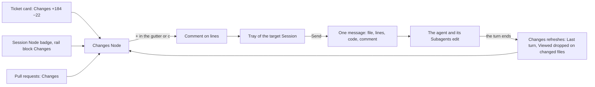

# worfy-changes-view: экран Changes — часть 1: diff Ticket-а и комментарии к строкам, которые уходят агенту одной пачкой; часть 2 (позже): Last turn, Viewed, PR, живое обновление, входы Session

Status: принят владельцем 2026-11-19 по указанию «продолжай все остальные эпики», часть 1
Critic: [docs/product/critic/worfy-changes-view-2026-11-14.md](../../docs/product/critic/worfy-changes-view-2026-11-14.md) — Split;
применены: возражение 2 и альтернатива critic-а — Epic разрезан на две части, в этом spec-е Ticket-ы только части 1
(прототип, чтение git, Node Changes с входом с карточки Ticket-а и из Command palette без живого счётчика, комментарии
к строкам одной пачкой, документы, приёмка); главный цикл доходит до пользователя в Wave 3. Badge Node-а Session, блок
rail, preset focus mode и chip `+N −M` со счётчиком — отдельный Ticket части 2. Возражение 1 — применено в части 2:
Since my last look у PR делает Ticket PR, и он стоит после Ticket-а Viewed. Возражение 3 — не применено: правило
«новый Epic — не больше одного за раз» владелец применил сам 2026-11-19, выбрав этот Epic следующим после
worfy-auth-check; черновик worfy-acceptance остаётся непринятым, worfy-ui-kit закрыт (19/19) и ContextMenu kit влит.
Source: исследование конкурентов 2026-11-13, папка
[docs/research/2026-11-13-competitors/](../../docs/research/2026-11-13-competitors/); досье
[Vibe Kanban](../../docs/research/2026-11-13-competitors/vibe-kanban.md),
[Orca](../../docs/research/2026-11-13-competitors/orca.md),
[Claude Code desktop app](../../docs/research/2026-11-13-competitors/claude-code-desktop-app.md),
[Claude Code cloud sessions and Projects](../../docs/research/2026-11-13-competitors/claude-code-cloud-sessions-and-projects.md),
[Codex app](../../docs/research/2026-11-13-competitors/codex-app-codex-in-the-chatgpt-desktop-app.md),
[Google Antigravity](../../docs/research/2026-11-13-competitors/google-antigravity.md),
[JetBrains Air](../../docs/research/2026-11-13-competitors/jetbrains-air.md),
[Devin](../../docs/research/2026-11-13-competitors/devin.md),
[Devin Desktop](../../docs/research/2026-11-13-competitors/devin-desktop-formerly-windsurf.md),
[Warp](../../docs/research/2026-11-13-competitors/warp-agent-management-panel-oz-cloud-agents-and-.md),
[GitHub Copilot app](../../docs/research/2026-11-13-competitors/github-copilot-app.md),
[GitHub Copilot cloud agent and Agent HQ](../../docs/research/2026-11-13-competitors/github-copilot-cloud-agent-and-agent-hq-mission-.md),
[Factory Droids](../../docs/research/2026-11-13-competitors/factory-droids.md),
[Cursor](../../docs/research/2026-11-13-competitors/cursor-agents-window-cloud-agents-and-automation.md),
[Kiro](../../docs/research/2026-11-13-competitors/kiro.md); идеи `review-quality-4` и `workspace-ui-1` этого
исследования, сверенные с кодом; обзор рынка 2026-11-08
[research-рынок-приложений-для-параллельных-агентов.md](../../docs/product/roadmap-worfy/research-рынок-приложений-для-параллельных-агентов.md);
[CONTEXT.md](../../CONTEXT.md) — термины. Строки кода и документов разделов «Проблема», «Решение», части 1 и
Ticket-ов сверены заново с `16e1834dc` (2026-11-19); строки раздела «Часть 2 — после приёмки части 1» — с черновиком
2026-11-13, кроме помеченных «на `16e1834dc`», их сверяют, когда часть 2 принимают.
Зависит от: Epic-а [worfy-ui-kit](../worfy-ui-kit/spec.md) (closed, 19/19: kit на Base UI, ContextMenu kit) и
Comments on quotes (worfy-polish, Ticket 102: хранилище и лоток комментариев); часть 2 — ещё
[worfy-pr-inbox](../worfy-pr-inbox/spec.md) (вид Pull requests, нити ревью, `pr-inbox.json`),
[worfy-human-review](../worfy-human-review/spec.md) (Team reviewer) и [worfy-pipeline](../worfy-pipeline/spec.md)
(Stage Human review).
Ticket-ы: Epic `worfy-changes-view`, часть 1 — 7 Ticket-ов: `issues/01`–`issues/07`; переделка после приёмки
2026-11-21 — `issues/08`–`issues/10` («Ответы владельца 2026-11-21»). Двенадцать Ticket-ов черновика
перенумерованы под часть 1; у части 2 Ticket-ов нет. Имена новых файлов ниже — предложение; implementer сверяет их с
`main`.

## Проблема

- Чтобы увидеть, что агент поменял, пользователь уходит из worfy. Open PR на карточке Ticket-а открывает PR в браузере
  (`docs/features/workflow.md:105`). В Pull requests кнопка Start review — ссылка на вкладку Files на GitHub
  (`src/renderer/pr-inbox/usePrInbox.ts:338`, `docs/features/pr-inbox.md:78`). Ticket без PR, Session без PR и
  незакоммиченные правки видны только в редакторе или в `git diff`, набранном руками.
- В worfy нет diff-а ни Ticket-а, ни Session, ни последнего хода. В main нет ни одного вызова `git diff`: git там
  читает worktree-ы, ветки и remote (`src/main/workflow/reader.ts:560`, `:621-629`, `src/main/workflow/stages.ts:47-58`).
  PR inbox читает детали PR без `diffHunk` и `files` (`src/main/github/inbox.ts:13-16`). Diff в UI есть только в трёх
  узких местах: окно переноса Harness сравнивает разделы CLAUDE.md и Profile (`src/renderer/harness/MigrationForm.tsx:103`,
  `:149`), Getting started показывает записанный пример ревью (`src/renderer/getting-started/ReviewExample.tsx:66-72`),
  а комментарий PR рисует блок ```` ```suggestion ```` (`src/renderer/markdown/Markdown.tsx:128-136`).
- Что поменял последний ход, worfy не знает, хотя данные проходят мимо. Codex присылает diff хода
  (`turn/diff/updated`), а worfy его отбрасывает (`src/main/vendors/codex/items.ts:80`). PreToolUse hook Claude Code
  видит каждый вызов tool-а, в том числе Subagent-ов (поле `agent_id` у `BaseHookInput` в `sdk.d.ts`), но worfy берёт
  из него только папку (`src/main/vendors/claude/options.ts:443-458`) и ставит его только Session-ам Autopilot-а с
  Auto-approval и Product Session (`src/main/vendors/claude/session.ts:638`, `src/main/vendors/claude/options.ts:800-801`).
- Замечание к строке приходится пересказывать агенту словами. Comments on quotes работают только на тексте ответа
  агента (`docs/features/sessions.md:220-222`). Комментария к строке кода нет, и агент сам ищет, о каком месте речь.
- Обзор рынка 2026-11-08 записал «своего экрана diff» в то, чего у worfy нет
  (`docs/product/roadmap-worfy/research-рынок-приложений-для-параллельных-агентов.md:51`, `:189`). Review там —
  самая частая тема обсуждений (`docs/product/roadmap-worfy/issues/03-рынок-приложений-для-параллельных-агентов.md:28`).
- Epic worfy-pr-inbox отложил «What changed since my review» (`.scratch/worfy-pr-inbox/spec.md:279`), хотя main уже
  хранит head commit, который пользователь видел последним (`src/main/github/inbox.ts:407`, `:423`,
  `src/main/projects/pr-inbox-state.ts:18-25`). Stage Human review ждёт решения ревью на GitHub
  (`src/shared/workflow/pipeline.ts:367-368`), так что и само ревью идёт там.

## Решение

У worfy появляется экран Changes: diff Ticket-а, Session или PR с деревом файлов, режимами Inline и Side by side,
отметкой Viewed и комментариями к строкам. Комментарии копятся в том же лотке, что Comments on quotes, и уходят
выбранной Session одним сообщением: файл, строки, сам код и текст пользователя. worfy при этом только читает git и
GitHub и ничего не пишет в репозиторий (ADR-0005 — собственное состояние worfy живёт в его папке данных, не в
репозиториях Project-ов).

**Часть 1** (Ticket-ы 01–07) — главный цикл: diff Ticket-а (scope-ы All changes, Uncommitted, Commit, Compare against)
в Node Changes, открытый кнопкой Changes на карточке Ticket-а или строкой Open changes в Command palette; комментарии к
строкам уходят Session одним сообщением. **Часть 2** (после приёмки части 1, без Ticket-ов) — Last turn у Claude и
Codex, живое обновление, Viewed и Since my last look, diff Session и PR, chip со счётчиком `+N −M`, входы с Node-а
Session, из rail и из Pull requests, Review changes на Stage Human review. Набросок ниже описывает всю функцию; что из
него в какой части — в разделах «Решения по реализации — часть 1» и «Часть 2 — после приёмки части 1».

Набросок функции (вариант Q1 (а), решено без владельца):

- **Где.** Новый вид Node — `changes` — рядом с карточкой Ticket-а или Node-ом Session, как Browser, который открыла
  Session (`docs/features/browser.md:14`). Node Session-а входит в её Family и уходит с Canvas вместе с ней. Читать
  удобнее в focus mode: кнопка Changes открывает его плиткой рядом с плиткой Session, preset Main + side
  (`docs/features/focus-mode.md:49`).
- **Чей diff.**
  - Ticket — его worktree или ветка против merge-base с базой Profile-а (`worktree.base`). Ticket над несколькими
    репозиториями (ADR-0104 — один Ticket в нескольких репозиториях) показывает репозитории верхним уровнем дерева.
  - Session — её папка (`cwd`), если это git.
  - PR — любой PR из вида Pull requests: свой или коллеги.
- **Scope** (что сравнивается), меню над diff-ом:
  - All changes — ветка против merge-base вместе с незакоммиченным и новыми файлами; по умолчанию для Ticket-а, PR
    и Session в worktree;
  - Commit — один commit из списка commit-ов ветки;
  - Uncommitted — рабочее дерево против `HEAD`, с файлами, которых нет в git;
  - Last turn — правки последнего хода Session вместе с её Subagent-ами; по умолчанию для Session в корне Project-а;
  - Since my last look — с head commit-а, на котором пользователь нажал Mark seen;
  - Compare against — любая ветка вместо базы.
- **Вид.** Дерево файлов с фильтром, статусом (A, M, D, R) и `+N −M`. Inline или Side by side, Wrap, Hide whitespace.
  Большой файл и файл lock-а свёрнуты. Binary-файл показан размерами. Файлы workflow в Full mode (`.scratch/**`) стоят
  свёрнутой группой Workflow files в конце.
- **Viewed.** Отметка у файла. Она снимается сама, когда содержимое файла изменилось после отметки.
- **Комментарии.** «+» в gutter, клавиша `c` или выделение нескольких строк открывает popover: текст и до 3 картинок,
  как у Comments on quotes. Комментарий встаёт в лоток Session, которой он уйдёт; Send отправляет все разом.
  Отправленный комментарий остаётся тусклым на своей строке, а блок в сообщении Session ведёт обратно на строку.
- **Входы.**
  - Карточка Ticket-а — chip Changes `+184 −22`; на Stage Human review — главная кнопка Review changes.
  - Node Session — badge Changes; Session view — блок Changes в rail справа.
  - Pull requests — кнопка Changes в панели выбранного PR.
  - Command palette — Open changes.

### Как пользователь идёт по экрану

Шаги 1–6 и 8 — часть 1 (в ней chip — кнопка Changes без счётчика, focus mode — выделить Session и Changes и нажать
Focus, без `v` и Viewed); шаги 7 и 9, счётчик и плитки по щелчку — часть 2.

1. На карточке Ticket-а с веткой стоит chip `Changes +184 −22`. Клик ставит Node Changes рядом с карточкой и открывает
   focus mode: слева плитка Session, которой уйдут комментарии, справа Changes.
2. Scope — All changes: ветка против merge-base с базой. В шапке — база, head, число файлов и `+/−`.
3. Пользователь идёт по файлам клавишами `j` и `k`, по hunk-ам — `n` и `p`, отмечает файл Viewed клавишей `v`.
4. На строке он нажимает «+» в gutter или `c`; выделение нескольких строк даёт комментарий к диапазону. В popover —
   текст и картинки, ⌘↵ сохраняет.
5. Внизу Node-а лоток: «3 comments on 2 files», chip-ы комментариев, Clear, поле общего текста и выбор Session
   («To: …»). Тот же комментарий виден в лотке поля ввода этой Session.
6. Send (⌘↵) отправляет одно сообщение. Если агент занят, сообщение ждёт в очереди вместе с комментариями, как
   сейчас (`docs/features/sessions.md:129-131`).
7. Агент и его Subagent-ы правят код. Ход кончается, Changes обновляется сам. С изменённых файлов отметка Viewed
   снята, scope Last turn показывает правки этого хода.
8. Отправленные комментарии остаются тусклыми на своих строках. Блок комментария в сообщении Session открывает Changes
   на этой строке.
9. В следующий раз пользователь выбирает Since my last look и видит только новое.

Из Pull requests путь тот же (часть 2): кнопка Changes в панели PR. Нити ревью GitHub стоят на своих строках, и их
можно добавить в пачку для агента кнопкой Add to comments.

### Экран

```
┌─ Changes · Ticket 03 · worfy-changes-view ─────────────────────────── [Refresh] [Mark seen] ─┐
│ [All changes ▾]  origin/main ← worfy-changes-view/03 · base 1a2b3c4 · 6 files · +184 −22     │
│ [Inline | Side by side]  [ ] Wrap  [ ] Hide whitespace         Viewed 2/6   Compare [main ▾] │
├─────────────────────────┬────────────────────────────────────────────────────────────────────┤
│ Filter files…           │ src/main/changes/git.ts                  M  +120 −8   [✓] Viewed   │
│ ▾ src/main/changes      │ @@ -10,6 +10,14 @@                                                 │
│   M git.ts          ✓   │  10  10    import { execFile } from 'node:child_process'           │
│   A pre-images.ts       │      11 +  const READ_ONLY = { GIT_OPTIONAL_LOCKS: '0' }      [+]  │
│ ▾ src/renderer/changes  │      ┌─ not sent ─────────────────────────────────┐                │
│   M DiffPane.tsx        │      │ Why not the gitRunner of stages.ts?        │                │
│ ▸ Workflow files (2)    │      └─────────────────────────── Edit · Delete ──┘                │
│                         │  11  12    export function readDiff(…) {                           │
├─────────────────────────┴────────────────────────────────────────────────────────────────────┤
│ 3 comments on 2 files   [git.ts:11] [pre-images.ts:40–44] [DiffPane.tsx:7]            Clear  │
│ To [Orchestrator ▾]   Message to the agent…                                      [Send ⌘↵]   │
└──────────────────────────────────────────────────────────────────────────────────────────────┘
```

В части 1 на этом экране нет Mark seen, отметок Viewed и счётчика «Viewed 2/6» — они в части 2; Refresh есть с
части 1.

Side by side делит правую часть на две колонки: старая сторона слева, новая справа, номера строк у каждой. Тексты UI
английские: «UI copy is ENGLISH» (`docs/design/BRIEF.md:4`; ADR-0017 — английские канонические термины).



## Как это сделано у конкурентов

- **Claude Code desktop app** ([досье](../../docs/research/2026-11-13-competitors/claude-code-desktop-app.md), раздел
  «Worktree, diff и review»): клик по числу изменений в карточке Changes открывает diff, комментарий ставится по
  наведению на строку, Cmd/Ctrl+Enter отправляет все сразу, и Claude правит код. Пользователи просили diff против
  других веток, кроме main (143 голоса); в diff нет картинок, stage hunk, amend и rebase («Что ругают»).
- **Claude Code cloud sessions** ([досье](../../docs/research/2026-11-13-competitors/claude-code-cloud-sessions-and-projects.md)):
  карточка Changes со счётчиками `+/−`, «Compare against» любой ветки; комментарии к строкам собираются в следующее
  сообщение агенту.
- **Codex app** ([досье](../../docs/research/2026-11-13-competitors/codex-app-codex-in-the-chatgpt-desktop-app.md),
  пункты «Git внутри приложения» и «Review pane»): Review pane с областями Unstaged, Staged, Commit, Branch и
  Last turn; inline-комментарий для Codex; в проекте из нескольких репозиториев — выбор репозитория.
- **Google Antigravity** ([досье](../../docs/research/2026-11-13-competitors/google-antigravity.md), пункт «Review
  pane и version control»): виды Uncommitted, Branch против `origin/main`, Agent Edits и по отдельным ходам; комментарий к
  строке уходит агенту с файлом и номером строки.
- **JetBrains Air** ([досье](../../docs/research/2026-11-13-competitors/jetbrains-air.md), пункт «Review»): All Changes,
  unified или side by side, F7 — к следующему изменению; комментарии копятся и уходят агенту вместе.
- **Vibe Kanban** ([досье](../../docs/research/2026-11-13-competitors/vibe-kanban.md), разделы «Review» и «Что хвалят»;
  компания закрылась 2026-04-10, код поддерживает сообщество): панель Changes с деревом файлов, unified или
  side-by-side, живым обновлением по file watcher и виртуализацией 300+ файлов. Комментарии уходят одним блоком
  `## Review Comments (N)` — файл, строка, цитата кода; туда же можно добавить review-комментарии PR с GitHub.
  Side-by-side пользователи назвали лучшей функцией, комментарии к строкам — вторым по важности вкладом после
  worktree; просили diff по commit-у и по ходу и отметки «просмотрено», как на GitHub.
- **Orca** ([досье](../../docs/research/2026-11-13-competitors/orca.md), разделы «Review: diff, аннотации,
  attribution» и «Что хвалят»):
  diff staged, unstaged и untracked против точки ответвления worktree, базу можно сменить; diff картинок и
  трёхсторонний вид конфликтов. Annotate AI Diff: «+» в gutter или `c`, комментарий держится за строку при правках,
  Send to agent шлёт все одной пачкой выбранному или новому агенту. Ушедший пользователь всё равно хвалил комментарии
  агенту, другой перенёс всё в своё приложение, а для review остался на Orca.
- **Devin и Devin Desktop** ([Devin](../../docs/research/2026-11-13-competitors/devin.md), раздел «Devin Review и
  качество кода»; [Devin Desktop](../../docs/research/2026-11-13-competitors/devin-desktop-formerly-windsurf.md),
  раздел «Agent Command Center — главный экран»): вкладка Changes с отсечкой «Since last seen»; Devin Review
  ставит файлы в порядке чтения и узнаёт перемещённый код — это хвалили больше всего.
- **Warp** ([досье](../../docs/research/2026-11-13-competitors/warp-agent-management-panel-oz-cloud-agents-and-.md),
  раздел «Вертикальные вкладки, Tab Configs, worktrees, Code Review»): у каждого worktree своя панель —
  незакоммиченное, против main или любой ветки, откат hunk-ов; inline-комментарии уходят агенту пачкой.
- **GitHub Copilot app, Factory Droids, Cursor, Kiro**
  ([Copilot app](../../docs/research/2026-11-13-competitors/github-copilot-app.md),
  [Factory Droids](../../docs/research/2026-11-13-competitors/factory-droids.md),
  [Cursor](../../docs/research/2026-11-13-competitors/cursor-agents-window-cloud-agents-and-automation.md),
  [Kiro](../../docs/research/2026-11-13-competitors/kiro.md)): вкладка Changes с комментариями и виртуализированным
  списком для очень больших PR (Copilot app); построчный review diff в приложении (Droids); вид diffs со stage,
  commit и PR (Cursor); у Kiro панель Reviews показывает diff, а комментарии и merge — на GitHub.
- **GitHub Copilot cloud agent** ([досье](../../docs/research/2026-11-13-competitors/github-copilot-cloud-agent-and-agent-hq-mission-.md)):
  правки просят комментарием `@copilot` в PR; обратная связь через комментарии PR казалась пользователям медленной,
  просили чат внутри PR.

Что берём: diff против базы и незакоммиченное, смену базы, Last turn, «с прошлого просмотра», Viewed, комментарии к
строкам одной пачкой. Что не берём в этот Epic: stage, revert и commit из diff-а (Codex app, Antigravity, Cursor),
diff картинок и вид конфликтов (Orca), порядок файлов по смыслу (Devin Review).

## Истории пользователя

Часть 1 даёт истории 1, 3, 4, 5, 8, 9, 13 и 14; часть 2 — 2, 6, 7, 10, 11 и 12.

1. Как пользователь, я открываю diff Ticket-а с его карточки и вижу всё, что ветка поменяла против базы, не уходя в
   GitHub или редактор.
2. Как пользователь, я хочу видеть, что поменял последний ход агента вместе с его Subagent-ами, чтобы проверить ход
   сразу, пока помню просьбу.
3. Как пользователь, я хочу смотреть незакоммиченное отдельно и каждый commit отдельно.
4. Как пользователь, я хочу сравнить ветку с другой веткой, а не только с базой Profile-а.
5. Как пользователь, я хочу переключать Inline и Side by side и прятать изменения пробелов.
6. Как пользователь, я хочу отмечать файлы Viewed, и чтобы отметка снималась, если агент файл потом поменял.
7. Как пользователь, я хочу видеть только то, что изменилось с моего прошлого просмотра.
8. Как пользователь, я хочу оставить комментарий к строке или диапазону, с картинкой, и отправить все комментарии
   агенту одной пачкой.
9. Как пользователь, я хочу, чтобы агент получил файл, номера строк и сам код, а не мой пересказ.
10. Как пользователь, я хочу видеть diff рядом с чатом Session и писать агенту, не закрывая diff.
11. Как пользователь, я хочу открыть diff PR из Pull requests, видеть нити ревью GitHub на их строках и добавить их в
    пачку для агента.
12. Как пользователь, я хочу, чтобы Ticket на Stage Human review открывал diff одной кнопкой.
13. Как пользователь Linked machine с доступом Read only, я хочу читать diff; писать комментарии и отметки я не жду.
14. Как пользователь Silent mode, я хочу, чтобы worfy ничего не писал в репозиторий: ни index, ни refs, ни файлы.

## Решения по реализации — часть 1

Строки ниже сверены с `16e1834dc` (2026-11-19). Решения части 2 — в разделе «Часть 2 — после приёмки части 1».

- **Только чтение git.** Новый модуль `src/main/changes/` запускает git с `GIT_OPTIONAL_LOCKS=0`,
  `GIT_TERMINAL_PROMPT=0`, `-c core.quotePath=false`, `--no-ext-diff`, `--no-color` и `-z` для имён — так уже читает
  `src/main/work-track/ticket-status.ts` (правило — `:16`, окружение — `:276-278`). Без `GIT_OPTIONAL_LOCKS=0` чтение
  рабочего дерева обновляет `.git/index` и берёт `index.lock`, и `git commit` агента в ту же секунду падает. Команды:
  `merge-base`, `diff`, `log`, `show`, `ls-files --others --exclude-standard`, `for-each-ref`, `cat-file -e`,
  `hash-object` без `-w` и `diff --no-index`. Никогда — `fetch`, `add`, `stash`, `update-index`. У `gitRunner`
  (`src/main/workflow/stages.ts:47-58`) таймаут 10 s и буфер 8 MB, для целого patch-а этого мало. Поэтому сначала
  список файлов (`--numstat`, `--raw`), patch файла — по запросу, с пределом размера. Разбор вывода — чистый модуль
  `src/shared/changes/parse.ts`: файлы, hunk-и, строки с номерами двух сторон, rename, binary, смена режима, «\ No
  newline at end of file», CRLF.
- **Предмет части 1 — Ticket.** `src/main/changes/subjects.ts`: worktree из `ticketWorktrees(root)`
  (`src/main/workflow/reader.ts:560`), а без worktree — ветка Ticket-а (`parallel: single`; Project над несколькими
  репозиториями — `ticketBranches`, `reader.ts:621-629`, ADR-0104 — один Ticket в нескольких репозиториях; репозитории
  стоят верхним уровнем дерева). Session и PR как предмет — часть 2.
- **База.** Main уже читает `worktree.base` и `workflow.finish` Profile-а: поля `mainBranch` и `finish`
  (`src/main/workflow/profile.ts:717-720`, схема — `:725-729`); их берёт `main-ref.ts`
  (`src/main/workflow/main-ref.ts:92-98`). Changes берёт те же поля, без второго вызова `bin/profile`. При
  `worktree.base: null` порядок тот же, что у preflight Harness (`harness/profiles/README.md:173`):
  `origin/<layout.repos.<repo>.default_branch>`, ветка, на которую указывает `origin/HEAD`, `origin/main`. Без `origin`
  и с `workflow.finish: local-green` — локальная ветка. Merge-base — `git merge-base <база> HEAD`. Compare against берёт
  любую ветку из `for-each-ref`.
- **Scope-ы части 1.**
  - All changes — `git diff <merge-base>` плюс новые файлы из `ls-files --others` через `diff --no-index`; по
    умолчанию.
  - Uncommitted — `git diff HEAD` плюс новые файлы.
  - Commit — список `git log <merge-base>..HEAD`, diff одного — `git show`.
  - Compare against — любая ветка вместо базы.
  - Какие scope-ы есть у предмета, отвечает main (`changes.scopes`), и меню строится из ответа. Так Last turn и Since
    my last look части 2 не трогают renderer меню.
- **Каналы** — `src/shared/ipc/changes.ts` и `src/main/ipc/changes.ts`, по файлу на домен (ADR-0006 — контракт IPC
  через declaration merging; новый домен `src/main/ipc/index.ts` находит сам, `:4-6`). Чтение: `changes.scopes`,
  `changes.list` (файлы, статус, `+/−`, blob id сторон), `changes.file` (hunk-и одного файла, контекст, «Show whole
  file»), `changes.commits`; Ticket 05 добавляет `changes.targets` (список «To»). Все — `'project', 'read'`: каналов
  записи в части 1 нет. Правила доступа — `src/shared/ipc/channels.ts:21-52`. Git идёт на Machine Project-а (ADR-0052 —
  Machine и связь Machine-ов).
- **Предел размера.** Список файлов — всегда целиком. Patch файла больше 2 000 строк или 1 MB приходит свёрнутым:
  «Large diff · N lines · Show». Lock-файлы и файлы с атрибутом `linguist-generated` свёрнуты так же. Binary — «Binary
  file · 12 KB → 14 KB». Больше 300 файлов — папки дерева свёрнуты. В DOM только hunk-и на экране и по два экрана
  вокруг: своя отрисовка окном, без новой библиотеки (в `package.json` нет ни diff-библиотеки, ни виртуализации).
- **Файлы workflow.** В Full mode корень Ticket-ов — `.scratch/**` checkout-а (`src/main/workflow/folder.ts`; описание
  в шапке `src/main/workflow/reader.ts:9-11`). Его файлы стоят свёрнутой группой Workflow files в конце дерева. В
  Silent mode их в репозитории нет.
- **Node `changes`.** Один файл `src/renderer/canvas/nodes/ChangesNode.tsx`: registry находит его сам
  (`src/renderer/canvas/nodes/index.ts:1-13`). Части экрана — в `src/renderer/changes/` (`ScopeBar.tsx`,
  `FileTree.tsx`, `DiffPane.tsx`, `Tray.tsx`), чтобы Ticket-ы 03 и 05 правили разные файлы, кроме `DiffPane.tsx` (gutter
  — в 05, Ticket-ы в разных Wave). Данные Node-а — свободный JSON Layout-а (`nodeDataSchema`,
  `src/shared/layout/types.ts:29`), схема Layout-а не меняется: предмет (`{ ticket: epic, NN }`) и scope. Один Node на
  предмет: повторный щелчок ведёт к уже открытому. Место — рядом с карточкой Ticket-а, как ставит `placeNear`
  (`src/shared/canvas/tools.ts:178`). Кнопка Refresh перечитывает diff; живого обновления в части 1 нет.
- **Focus mode.** Плитка рисует компонент Node-а (`src/renderer/focus/FocusMode.tsx:12-13`), поэтому Changes в плитке
  работает без доработки: пользователь выделяет Session и Changes и жмёт Focus, preset — Even
  (`docs/features/focus-mode.md:17`). Вход с Session с preset-ом Main + side — часть 2.
- **Входы части 1.**
  - Карточка Ticket-а: action `src/renderer/canvas/actions/Changes.tsx` в слоте действий
    (`src/renderer/canvas/badges/index.ts:5-7`, `:44`), видна у Ticket-а с worktree или веткой. Без счётчика
    `+N −M`: место строки действий карточка уже держит (`SLOTS_HEIGHT`, `src/renderer/canvas/ticket-card.ts:51-56`),
    `ticket-card.ts` не меняется. Chip со счётчиком — часть 2 (возражение 2 critic-а).
  - Command palette — Open changes в группе Action (`src/renderer/palette/commands.ts:94`, сборка — `:770`) для
    Ticket-а с worktree или веткой.
- **Kit.** ToggleGroup (Inline и Side by side), Menu (scope, Compare against), Popover (комментарий), Tooltip и
  ContextMenu (Comment, Copy line на строке) — из `src/renderer/theme/kit/` (ADR-0106 — kit на Base UI). ContextMenu kit
  влит: Epic worfy-ui-kit закрыт, 19/19.
- **Цвета без подсветки синтаксиса** (Q5, решено без владельца). Добавленные и удалённые строки — tokens `--ready-*` и
  `--blocked-*`, как в `src/renderer/harness/MigrationForm.tsx:91-92`. Блоки кода в PR inbox тоже без цветов
  синтаксиса.
- **Комментарии к строкам** — то же хранилище и тот же лоток, что Comments on quotes (`docs/features/sessions.md:220-254`).
  - Модель (Ticket 04): `QuoteComment` (`src/renderer/session/quote-comments.ts:43`) получает вариант `code`: путь,
    репозиторий, сторона (`old` или `new`), первая и последняя строка, текст строк, commit (или «uncommitted») и
    предмет. Пределы те же: 3 картинки на комментарий и 10 на сообщение (`COMMENT_IMAGES`, `MESSAGE_IMAGES` —
    `quote-comments.ts:31`, `:33`).
  - Хранилище по Session (`quoteKey`, `src/renderer/session/quote-store.ts:39`) переходит со схемы `v: 2` (`:49`,
    запись — `:102`) на `v: 3`; запись `v: 2` читается как есть. Оно живёт в localStorage окна, в папке данных worfy
    (`docs/features/storage-and-diagnostics.md:74`), поэтому поправка к ADR-0005 части 1 не нужна.
  - `agentText` (`quote-comments.ts:189`) получает второй раздел, `parseQuoted` (`:229`) читает его обратно для
    пузыря. Правила `composeRound` (`:308`) не меняются: например, команда со `/` вместе с комментариями отвергается.
    Пример сообщения:

    ```
    Comments on lines of the diff (2), worktree .claude/worktrees/03, branch worfy-changes-view/03:

    1. src/main/changes/git.ts:11 (new side, commit 9f8e7d6)
       > const READ_ONLY = { GIT_OPTIONAL_LOCKS: '0' }
       Why not the gitRunner of stages.ts?

    2. src/renderer/changes/DiffPane.tsx:40–44 (new side, uncommitted)
       > …
       [image 1]

    General:
    Fix both, then run the unit tests of the module.
    ```

  - Код в цитате — до 6 строк; длиннее режется в середине с «…», как цитата длиннее 200 символов
    (`QUOTE_FOR_AGENT`, `quote-comments.ts:37`).
  - После Refresh неотправленный комментарий ищется заново по тексту строки — ближайшее совпадение к старому месту, как
    `anchorRange` для цитат (`quote-comments.ts:132`). Строки нет — комментарий получает пометку «Line changed» и
    остаётся в лотке.
  - Экран (Ticket 05): «+» в gutter, клавиша `c`, выделение нескольких строк и ContextMenu → Comment открывают popover.
    Лоток Node-а Changes показывает комментарии выбранной Session; её поле ввода показывает те же: «N comments · M on
    code». Смена Session в «To» переносит неотправленные комментарии к коду в её лоток. Комментарии к сообщениям
    остаются: они привязаны к сообщению своей Session.
  - Send делает то же, что Send поля ввода этой Session (`composeRound` и `agent.send`,
    `src/shared/ipc/agent.ts:69-75`), с очередью как сейчас (`docs/features/sessions.md:129-131`).
  - Список «To» отвечает main (`changes.targets`): Session Node-ы worfy с Binding-ом на Ticket, не в Archive — отбор как
    у `ticketSession` (`src/main/actions/launch.ts:409-430`), но без порога 24 часа, — и Orchestrator Project-а (его
    Session — `liveOrchestratorSession`, `src/main/ipc/getting-started.ts:92`). По умолчанию — Session с Binding-ом, у
    которой последняя запись новее; без неё — Orchestrator (Q2, решено без владельца). Пока Orchestrator ведёт Run,
    строка «To» предупреждает «Autopilot is running». «New session in this worktree» — часть 2.
  - На экране только для чтения нет ни «+», ни лотка, как у Comments on quotes (`docs/features/sessions.md:254`).
- **Linked machine и Silent mode.** Linked machine с доступом Read only читает diff (каналы `read`); «+», лоток и Send
  ей не показаны (ADR-0066 — доступ Read only). В Silent mode в репозиторий не пишется ничего; сообщение с
  комментариями уходит только агенту.
- **Windows.** Имена файлов — через `-z` и `core.quotePath=false`. Hide whitespace добавляет `--ignore-cr-at-eol`.
  Contract test-ы чтения идут на Windows runner-е CI.
- **ADR.** Ticket 02 пишет новый ADR «Экран Changes читает git, ничего не пишет в репозиторий»; чтение GitHub
  дописывает к нему Amendment Ticket PR части 2. Поправка к ADR-0005 (`changes.json`, копии Last turn) — часть 2.

## Решения по test-ам — часть 1

- Хороший test проверяет поведение снаружи: какие файлы, строки и scope-ы видит пользователь, какое сообщение
  получил агент и что не тронуто в репозитории. Как устроен разбор внутри, test не проверяет.
- **Без моделей и без сети.** Claude — `WORFY_AGENT=fake` (`src/main/agent/fake-query.ts`). Репозитории в fixture-ах
  выдуманы.
- **Seam 1 — unit:**
  - разбор вывода git в `src/shared/changes/parse.ts`: rename, binary, «No newline at end of file», CRLF, пути с
    пробелами и не-ASCII;
  - выбор базы по `worktree.base` и запасному порядку;
  - текст для агента и разбор обратно для комментариев к коду (образец — `test/unit/quote-comments.test.ts`);
  - поиск строки комментария заново после правок;
  - переход хранилища с `v: 2` на `v: 3` (образец — `test/unit/quote-store.test.tsx`).
- **Seam 2 — contract:** main над временным git-репозиторием, который строит сам test (`NO_GIT_MAINTENANCE`,
  `test/git-env.ts:14`):
  - worktree против merge-base вместе с новыми файлами, Commit, Uncommitted, Compare against;
  - после всех чтений байты и mtime `.git/index` прежние, новых refs и объектов нет;
  - база при `worktree.base` и при `null`;
  - список «To»: Session с Binding-ом на Ticket, Session другого Ticket-а, Orchestrator.

  Те же test-ы идут на Windows runner-е.
- **Seam 3 — e2e** в настоящем Electron на fake agent (образцы — `test/e2e/quote-comments.spec.ts`,
  `test/e2e/focus.spec.ts`):
  - карточка Ticket-а → Node Changes → комментарий к строке → Send: fake agent получил одно сообщение с блоком;
  - Open changes из Command palette;
  - экран Read only без «+» и лотка.
- **Сначала падающий test** в каждом Ticket-е кода: он красный на старом поведении, это пишется в «Итог».

## Не в этом Epic-е

- **Правка кода из diff-а:** stage, unstage, revert hunk-а, commit, push, merge. worfy — вид над workflow, а не
  редактор (ADR-0002 — worfy показывает и запускает workflow, но не владеет его состоянием). Правит агент или
  пользователь в своём редакторе.
- **Публикация комментариев на GitHub ревью-комментариями** — если Q3 части 2 не решит иначе. Публикация шла бы путём
  ADR-0105, со своим lint-ом Silent mode.
- **Подсветка синтаксиса** (Q5).
- **Diff картинок** (рядом, swipe, наложение), трёхсторонний вид конфликтов merge, preview Markdown в diff-е.
- **Порядок файлов по смыслу** и распознавание перемещённого кода: нужна модель или отдельный анализ.
- **Комментарии к плану агента и к отрисованному Markdown.**
- **Пометка строк, которые написал AI** (Attribution у Orca).
- **Diff одного Subagent-а отдельно:** Ticket-а и Last turn Session для этого хватает.
- **Last turn у Terminal:** у Terminal нет transcript-а.
- **Шаг Getting started через Changes** (`ReviewExample.tsx` остаётся записанным примером), GitLab и Bitbucket.
- **Autopilot:** Changes — экран для человека; Run его не открывает и не ждёт.

## Ticket-ы

Часть 1. Двенадцать Ticket-ов черновика перенумерованы под часть 1: прототип (бывший 01) — 01, чтение в main (бывший 02
без Session, без заготовки `TurnChangesPart`) — 02, Node и входы (бывший 03 без badge-а Session, rail, preset-а focus
mode и счётчика — возражение 2 critic-а) — 03, комментарии (бывший 05) — 04 (модель и текст для агента) и 05 (экран),
документы — 06, приёмка — 07. Бывшие 04, 06, 07, 08, 09, 10 — часть 2, без Ticket-ов.

1. **01 — Прототип экрана Changes**: Card с HTML-прототипом на выдуманных данных — дерево, Inline и Side by side,
   scope-ы, popover комментария, лоток и «To». Ticket 03 строит экран по нему; взгляд владельца его не держит.
   Blocked by: —.
2. **02 — Чтение diff-а Ticket-а в main**: `src/main/changes/` только на чтение (`GIT_OPTIONAL_LOCKS=0`), предмет
   Ticket (worktree или ветка, несколько репозиториев), база из `worktree.base` с запасным порядком, scope-ы All
   changes, Uncommitted, Commit, Compare against, предел размера, разбор в `src/shared/changes/parse.ts`, каналы
   `changes.*` на чтение, новый ADR, английская страница `docs/features/changes.md` (чтение). Blocked by: —.
3. **03 — Node Changes, кнопка Changes на карточке Ticket-а и Open changes в Command palette**: Node `changes`, дерево,
   Inline и Side by side, Wrap, Hide whitespace, свёрнутые большие, lock- и binary-файлы, группа Workflow files,
   клавиши, меню scope-ов из `changes.scopes`, Refresh; action на карточке без счётчика; строка palette. Blocked by:
   01, 02.
4. **04 — Комментарий к коду в модели Comments on quotes**: вариант `code` в `quote-comments.ts`, хранилище `v: 3`,
   раздел в `agentText` и `parseQuoted`, цитата кода до 6 строк, поиск строки заново, лоток поля ввода «N comments · M
   on code», блок комментария к коду в пузыре. Blocked by: —.
5. **05 — Комментарии к строкам в Changes**: «+» в gutter, `c`, диапазон, ContextMenu → Comment, popover kit, лоток
   Node-а, список «To» (`changes.targets`), Send как у поля ввода, тусклые отправленные строки, блок в пузыре ведёт на
   строку, «Line changed» после Refresh, экран Read only без «+». Blocked by: 03, 04.
6. **06 — Документы**: перевод `docs/features/ru/changes.md` и переводы правленых страниц, термин Changes в
   `CONTEXT.md`, проверка, что ADR Ticket-а 02 влит. Blocked by: 02, 03, 04, 05.
7. **07 — Приёмка части 1 владельцем**: путь Ticket → Changes → комментарии → Send на Mac Stable copy; решения без
   владельца. Blocked by: 01, 02, 03, 04, 05, 06.

Переделка после приёмки 2026-11-21 (раздел «Ответы владельца 2026-11-21»):

8. **08 — Changes во всё окно** (D1; owner-check fail Ticket-а 07, пункт 2): вид окна `changes` вместо Node-а — тот же
   экран diff-а, что у PR во вкладке Pull requests; входы — кнопка Changes на карточке, Open changes в Command palette,
   блок в пузыре; кнопка «← Canvas»; Node-ы `changes` на Canvas-ах пользователей убираются при загрузке Layout-а.
   Blocked by: —.
9. **09 — Диапазон строк, как на GitHub, и commit в тексте агенту** (D2, D3; owner-check fail Ticket-а 07, пункт 3):
   перетаскивание «+», Shift-щелчок по «+», подсказка «Comment on lines 95–102 (c)» — в Changes и Review mode PR;
   «uncommitted» только у файла с незакоммиченными правками, иначе commit HEAD. Blocked by: 08.
10. **10 — Подсветка синтаксиса** (D4): Shiki с движком на JavaScript, темы GitHub light и dark, в diff-е Changes и PR;
    новый ADR с проверкой лицензии. Blocked by: 08.

## Волны

| Wave | Ticket-ы | Blocked by | Почему так |
|---|---|---|---|
| 1 | 01, 02, 04 | — | прототип (Card в папке данных Project-а, файлов репозитория нет), чтение в main (`src/main/changes/`, `src/shared/changes/`, `src/shared/ipc/changes.ts`, `src/main/ipc/changes.ts`, новый ADR, `docs/features/changes.md`), модель комментариев (`src/renderer/session/quote-*`, `QuotedPrompt.tsx`, `QuoteComments.tsx`, `docs/features/sessions.md`): общих файлов нет; модели комментария не нужен ни Node, ни main |
| 2 | 03 | 03 — 01, 02 | Node и входы (`src/renderer/canvas/nodes/ChangesNode.tsx`, `src/renderer/changes/`, `src/renderer/canvas/actions/Changes.tsx`, `src/renderer/palette/commands.ts`): стоит на каналах 02 и строится по прототипу 01 |
| 3 | 05 | 05 — 03, 04 | комментарии на экране (`src/renderer/changes/Tray.tsx`, `DiffPane.tsx`, `src/main/changes/targets.ts`): нужен Node 03 и модель 04; после этой Wave главный цикл — прочитать, прокомментировать, отправить — у пользователя |
| 4 | 06 | 02–05 | документы по сделанному |
| 5 | 07 | 01–06 | приёмка |
| 6 | 08 | — | вид Changes во всё окно (`src/renderer/shell/`, `src/renderer/changes/`, `src/renderer/pr-review/ReviewMode.tsx`, `src/main/layout/upgrade.ts`): переносит лоток и клавиши из `ChangesNode.tsx`, которые правит 09, и `DiffPane.tsx`, который правит 10 |
| 7 | 09, 10 | 09 — 08; 10 — 08 | диапазон и commit (`line-comments.tsx`, `review-comments.tsx`, `src/main/changes/scopes.ts`, `src/shared/changes/types.ts`) и подсветка (`DiffPane.tsx` `Code`, новые `highlight.ts`, `highlight.css`, `package.json`, ADR-0112): общих файлов кода нет; оба дописывают свой раздел `docs/features/changes.md` и перевода — второй PR делает rebase |

Wave — Ticket-ы, которые можно брать параллельно: блокеры закрыты, общих файлов нет. Wave, которую берут в работу,
вычисляется заново в момент запуска (CONTEXT.md, термин Wave); таблица — прогноз по Blocked by и спискам файлов.

## Риски

- **`index.lock` и гонка с агентом.** Чтение рабочего дерева без `GIT_OPTIONAL_LOCKS=0` берёт `index.lock`, и
  commit агента падает. Закрывает правило «только чтение» Ticket-а 02 и contract test на нетронутый `.git/index`.
- **Большие diff-ы.** Библиотеки виртуализации нет. Закрывают: список без patch-ей, patch по запросу, свёрнутые
  большие и сгенерированные файлы, отрисовка только видимого. Предел 300 файлов и 2 000 строк проверяет e2e test
  Ticket-а 03 на сгенерированном репозитории.
- **Diff устарел.** Живого обновления в части 1 нет: агент правит, а экран показывает прошлое чтение. Мера — Refresh в
  шапке; комментарий к строке, которой больше нет, получает «Line changed» после Refresh и остаётся в лотке.
- **Комментарии к Orchestrator-у во время Run-а.** Сообщение ждёт в очереди, пока идёт ход Run-а. Список «To»
  предупреждает «Autopilot is running».
- **Прототип без взгляда владельца.** Ticket 03 строит экран по Card-у Ticket-а 01, а владелец может увидеть его
  только на приёмке. Его правки — Ticket-ом polish или в части 2, не переделкой части 1 до приёмки.
- **Windows.** CRLF, длинные пути, пути с не-ASCII. Закрывают `-z`, `core.quotePath=false`, `--ignore-cr-at-eol` в
  Hide whitespace и contract test-ы на Windows runner-е.

## Вопросы владельцу

Владелец 2026-11-19 поставил этот Epic вторым в очереди (auth-check → worfy-changes-view → pr-follow часть 2) и велел
«дальше продолжай работать автономно, продолжай все остальные эпики»; на вопросы этого spec-а он не отвечал. Вопросы
части 1 решены рекомендованным вариантом — решено без владельца, подтвердить. Вопросы части 2 (Q3, Q4) открыты — в
разделе «Часть 2 — после приёмки части 1». Вопросов о деньгах, удалении данных и необратимых шагах в части 1 нет: она
только читает git и пишет сообщение агенту по Send.

1. **Q1. Где живёт экран Changes?**
   - (а) Node `changes` на Canvas рядом с карточкой Ticket-а; читать — в focus mode плиткой рядом с Session.
     Рекомендация: так diff стоит рядом с чатом, как у конкурентов, а плитка focus mode есть даром.
   - (б) Отдельный вид окна Changes, как Pull requests. Шире, но чат Session при этом не виден.
   - (в) Панель в Session view справа от чата. У Ticket-а без живой Session её нет.

   **Решено: (а)** — решено без владельца 2026-11-19, подтвердить. Ticket-ы: 03, 05.
2. **Q2. Кому по умолчанию уходят комментарии к diff-у Ticket-а?** Список «To» в любом случае даёт выбрать другую
   Session.
   - (а) Session с Binding-ом к Ticket-у, а без неё — Orchestrator-у. Рекомендация: implementer-ы Wave — это
     Subagent-ы Orchestrator-а, им сообщение не отправить.
   - (б) Всегда новой Session в worktree Ticket-а.
   - (в) Всегда Orchestrator-у.

   **Решено: (а)** — решено без владельца 2026-11-19, подтвердить. Ticket: 05.
3. **Q5. Нужна ли подсветка синтаксиса?**
   - (а) Нет, в этом Epic-е без неё, как блоки кода в PR inbox сейчас. Рекомендация: Epic и так большой.
   - (б) Да: новая зависимость (например, Shiki) с ADR и проверкой лицензии, как Base UI в ADR-0106.

   **Решено: (а)** — решено без владельца 2026-11-19, подтвердить. Ticket: 03.

## Решено без владельца (подтвердить)

Каждый пункт — решение, которое владелец может отменить. Все — 2026-11-19, по указанию «продолжай все остальные
эпики».

1. **Split (возражение 2 и альтернатива critic-а).** Epic разрезан: часть 1 — прототип, чтение git, Node с входом с
   карточки Ticket-а и из Command palette, комментарии к строкам одной пачкой, документы и приёмка, 7 Ticket-ов; часть
   2 — Last turn, живое обновление, Viewed и Since my last look, PR, Stage Human review, входы Session, без Ticket-ов.
   Причина: главный цикл доходит до пользователя в Wave 3, и владелец пробует его до дорогой части с hook-ом на каждую
   Session Claude.
2. **Q1, Q2, Q5 — рекомендованные варианты** (раздел «Вопросы владельцу»).
3. **Возражение 3 critic-а снято решением владельца.** Правило месяца «новый Epic — не больше одного за раз»
   (`docs/product/roadmap-worfy/issues/04-как-развивается-сам-worfy-в-этом-месяце.md:19-20`) владелец 2026-11-19
   применил сам: выбрал этот Epic следующим после worfy-auth-check. Черновик worfy-acceptance остаётся непринятым.
   ContextMenu kit, которого ждал черновик, влит: worfy-ui-kit закрыт, 19/19.
4. **Прототип не держит Ticket 03.** Ticket 03 строит экран по Card-у Ticket-а 01 (как экран Product Session строили
   по прототипу), не дожидаясь взгляда владельца; правки владельца после приёмки — Ticket-ом polish.
5. **Предмет части 1 — только Ticket.** Session и PR как предмет, badge Node-а Session и блок rail — часть 2. Без них
   diff Session открывается через Ticket её Binding-а.
6. **Scope-ы части 1:** All changes, Uncommitted, Commit, Compare against. Last turn и Since my last look — часть 2.
7. **Комментарии — два Ticket-а.** Модель и текст для агента (04) не ждут Node-а и идут в Wave 1; экран (05) — после
   Node-а. Так Wave 3 короче.
8. **ContextMenu на строке — в части 1** (Comment, Copy line): kit влит, ждать нечего.
9. **Без поправки к ADR-0005 в части 1.** Неотправленные комментарии к коду живут в том же localStorage окна, что
   Comments on quotes, в папке данных worfy (`docs/features/storage-and-diagnostics.md:74`); своих файлов часть 1 не
   пишет. Поправку пишет часть 2 вместе с `changes.json`.
10. **Страницы Feature.** Английскую страницу `docs/features/changes.md` создаёт Ticket 02 и дополняют 03 и 05, каждый
    своё поведение (ADR-0088 — страницы Feature на английском); Ticket 06 держит переводы в `docs/features/ru/` и
    CONTEXT.md, как в worfy-pr-follow.
11. **Форма строки Status.** Указание звучит «продолжай все остальные эпики»; строка написана в единой форме «принят
    владельцем YYYY-MM-DD …», как у worfy-pr-follow, чтобы `epic-status` видел дату принятия.

## Ответы владельца 2026-11-21

Приёмка части 1 (Ticket 07) на Mac Stable 2026-11-21: пункты 2 и 3 не прошли (owner-check fail; слова владельца — в
Ticket-е 07 и в Ticket-ах 08 и 09). На три вопроса Orchestrator-а владелец ответил «все да» и добавил одну просьбу.
**Q1 (а) и Q5 (а) раздела «Вопросы владельцу» заменены** ответами D1 и D4; Q2 (а) остаётся.

- **D1 (Q1 → (в)).** Changes Ticket-а открываются не отдельным Node-ом на Canvas, а во весь размер окна, как вид Pull
  requests, — тот же экран diff-а, что у PR во вкладке Pull requests (Epic worfy-pr-review, Ticket-ы 05–10). Входы —
  кнопка Changes на карточке Ticket-а и строка Open changes в Command palette; одна кнопка возвращает на Canvas. Панель
  рядом с чатом в Session view — часть 2, без Ticket-а сейчас. Ticket 08.
- **D2 (Q2).** Диапазон строк — как на GitHub: «+» в gutter тянут вниз через строки; щелчок с Shift по «+» растягивает
  выбор до этой строки; пока строки выбраны, видна подсказка «Comment on lines 95–102 (c)». Клавиша `c` и Comment в меню
  правого клика остаются. Ticket 09.
- **D3 (Q3).** Текст агенту называет сторону «uncommitted», только если в файле правда есть незакоммиченные правки;
  иначе — commit HEAD (например, `new side, f3bcb3e16`). Сейчас `commitOf`
  (`src/renderer/changes/line-comments.tsx:121-128`) в All changes даёт `null` новой стороне любого файла worktree, и
  каждый комментарий говорит «uncommitted» даже в чистом worktree. Ticket 09.
- **D4 (новая просьба; отменяет Q5 (а)).** Подсветка синтаксиса кода, как на GitHub, в diff-е — и для Changes Ticket-а,
  и для diff-а PR: это один экран. Новая зависимость (рекомендация — Shiki) с новым ADR и проверкой лицензии, как Base UI
  в ADR-0106. Пункт «Цвета без подсветки синтаксиса» раздела «Решения по реализации — часть 1» больше не действует.
  Ticket 10.

## Готово, когда

Часть 1:

- [ ] На карточке Ticket-а с веткой или worktree кнопка Changes открывает Node Changes рядом с карточкой. Diff
      совпадает с `git diff <merge-base>` этого worktree вместе с новыми файлами — на Mac и на Windows.
- [ ] Scope-ы All changes, Commit, Uncommitted и Compare against работают у Ticket-а.
- [ ] Дерево файлов, Inline и Side by side, Wrap, Hide whitespace; большие, lock- и binary-файлы свёрнуты; группа
      Workflow files в конце; Refresh перечитывает diff.
- [ ] Command palette открывает Changes Ticket-а строкой Open changes.
- [ ] Комментарий к строке или диапазону, с картинкой, встаёт в лоток Session. Send отправляет одно сообщение с
      файлом, строками, кодом и текстом. Блок в пузыре ведёт на строку. Неотправленные комментарии переживают рестарт.
- [ ] worfy ничего не пишет в репозиторий: `.git/index`, refs и объекты не тронуты.
- [ ] Linked machine с доступом Read only читает diff, но не видит «+» и лотка.
- [ ] Новый ADR, страница Feature en и ru, термин Changes в `CONTEXT.md`.
- [ ] (manual) Владелец принял часть 1.

## Часть 2 — после приёмки части 1

Без Ticket-ов. Часть 2 заводит их после приёмки части 1 (Ticket 07): строки кода ниже взяты из черновика 2026-11-13
и с `16e1834dc` не сверены, их сверяют заново, и вопросы Q3 и Q4 идут владельцу. Ниже — решения черновика о частях,
которых нет в части 1, с поправками critic-а.

Даёт истории 2, 6, 7, 10, 11, 12.

Поправки к черновику:

1. **Since my last look у PR — в Ticket-е PR (возражение 1 critic-а).** Черновик давал Ticket-у Viewed «для PR —
   `seenHeadOid` из `pr-inbox.json`», а предмет PR появлялся только в Ticket-е PR, который Viewed не ждал. В части 2
   Ticket Viewed делает Since my last look для Ticket-а и Session, а Ticket PR — для PR, через `prInbox.markSeen`, и
   стоит после Ticket-а Viewed.
2. **Входы Session и счётчик — отдельный Ticket (возражение 2 critic-а).** Badge Node-а Session, блок rail, preset
   Main + side у `requestFocus` и chip `+N −M` на карточке, чей счётчик обновляет живое обновление, — один Ticket
   после Ticket-а живого обновления.
3. **ContextMenu kit влит** (worfy-ui-kit закрыт): строки черновика «ContextMenu ждёт Ticket 12 worfy-ui-kit» больше не
   верны; ContextMenu на строке есть с части 1.

### Решения части 2 (черновик)

- **Предмет Session** — `cwd` из `SessionNodeView` (`src/shared/ipc/sessions.ts:104`); diff папки Session, если это
  git. Scope по умолчанию для Session в корне Project-а — Last turn.
- **Входы Session.**
  - Node Session: badge `src/renderer/canvas/badges/Changes.tsx` (`SlotSubject` вида `session`,
    `src/renderer/canvas/badges/index.ts:18-21`).
  - Session view: блок rail `src/renderer/session/rail/ChangesRail.tsx` (`src/renderer/session/rail/index.ts:1-9`).
    Не шапка: оттуда уже убрали chip MCP, потому что шапка «had grown too crowded» (`docs/features/sessions.md:266`).
  - Focus mode: `requestFocus` (`src/renderer/focus/focus-state.ts:35`) получает необязательный preset (список —
    `src/renderer/focus/split-tree.ts:37`); вход с Session открывает плитки Session и Changes с preset-ом Main + side.
  - Карточка Ticket-а: chip `Changes +184 −22`, место под него даёт `src/renderer/canvas/ticket-card.ts`, как для
    `ReviewThreads`. Счётчик — `git diff --shortstat` при сдвиге head ветки и в конце хода, без опроса по таймеру.
  - Список «To» получает «New session in this worktree» и Session самого Node-а.
- **Last turn — новая часть Vendor driver-а.** `TurnChangesPart` в `src/main/vendors/turn-changes.ts`, по файлу на
  Vendor (`src/main/vendors/driver.ts:1-4`; ADR-0094 — граница Vendor-а: свой driver на каждый Vendor). Пока часть
  не подключена, она отвечает `PartNotWired` (`src/main/vendors/driver.ts:38`), и scope Last turn не предлагается.
  - **Claude** (`src/main/vendors/claude/turn-changes.ts`), по рекомендации Q4 (а).
    - Hook `toolUseHooks` (`src/main/vendors/claude/options.ts:455` на `16e1834dc`) ставится каждой Session Claude,
      которую ведёт worfy, а не только Autopilot-у с Auto-approval и Product Session. Он по-прежнему отвечает `{}`.
    - `observe` (`ToolUseFacts`, `src/main/agent/session/types.ts:182`) получает ещё `tool_name`, `tool_input`,
      `agent_id` и `prompt_id`.
    - Перед первым `Edit`, `MultiEdit`, `Write` или `NotebookEdit` пути за ход main копирует байты файла в
      `<папка данных Project-а>/changes/pre/<sha256>` или записывает «файла не было». Граница хода — `prompt` и
      `result` самой Session.
    - Diff — `git diff --no-index <копия> <файл>`. Копия больше 2 MB не делается: файл в Last turn помечен «too
      large to keep». Ошибка копирования не останавливает вызов tool-а.
    - Правки командами (`Bash`) этот путь не видит. Last turn говорит это словами и ведёт в Uncommitted.
    - Session, начатая вне worfy, получает приблизительный Last turn по `tool_use` `Edit` и `Write` из transcript-а
      (`src/shared/transcript/parse.ts`), с пометкой «Approximate».
  - **Codex** (`src/main/vendors/codex/turn-changes.ts`).
    - `turn/diff/updated` уходит из списка отброшенных (`src/main/vendors/codex/items.ts:80` на `16e1834dc`). Его
      `diff` — весь unified diff хода, как его считает Codex; main хранит последний за ход.
    - `fileChange` уже приходит как `tool_use` с `changes`.
    - После рестарта diff собирается из `FileUpdateChange` (`path`, `kind`, `diff`) ответа `thread/turns/list`.
    - Нити Subagent-ов Codex идут через `follow()`. Их diff ходов входит в Last turn родителя, если пришёл между его
      `turn/started` и `turn/completed`.
- **Viewed и Since my last look.** `<папка данных Project-а>/changes.json` рядом с `pr-inbox.json`:
  - по предмету — `{путь → blob id}` отметок Viewed и `{head commit, время}` последнего Mark seen; каналы
    `changes.markViewed`, `changes.markSeen` — `'project', 'write'`;
  - отметка снимается, когда blob id новой стороны изменился; у рабочего дерева он считается `git hash-object` без
    `-w`, который ничего не пишет;
  - Since my last look сравнивает commit-ы: незакоммиченное показывает отдельный scope;
  - копии файлов Last turn хранятся за последние 20 ходов Session и удаляются, когда Session уходит в Archive
    (ADR-0076 — авто-архив законченных Session-ов); на Project — не больше 256 MB, старые уходят первыми;
  - поправка к ADR-0005 записывает `changes.json` и `changes/pre/`.
- ~~**PR.**~~ Вычеркнуто: пункт взял Epic `worfy-pr-review` (`.scratch/worfy-pr-review/spec.md`, «Решения по
  реализации», 2 и 4; Ticket-ы 04, 06 и 09). Diff PR открывает Review mode вкладки Pull requests, не кнопка Changes
  в панели PR; вместо Since my last look у PR — scope Since my review (head против commit-а черновика ревью).
  Текст черновика оставлен для истории:
  - ~~Кнопка Changes в панели выбранного PR рядом с Open on GitHub (`src/renderer/pr-inbox/PrInboxView.tsx`).~~
  - ~~Запрос деталей получает `baseRefName` и `baseRefOid`.~~
  - ~~Если оба commit-а есть локально (`git cat-file -e`), diff считается локально. Иначе — `gh api
    repos/<owner>/<repo>/pulls/<N>` с заголовком `Accept: application/vnd.github.diff`: это GET без `--method` (ADR-0105
    — публикация в PR только по щелчку пользователя). Ответ кэшируется в памяти по head commit-у; отказ GitHub на очень
    большой diff даёт «Open on GitHub».~~
  - ~~Нити ревью стоят на своих строках (`path`, `line`, `isOutdated`); outdated — списком над файлом. Add to comments
    кладёт последний комментарий нити в лоток как комментарий для агента.~~
  - ~~Since my last look у PR — уже существующий `seenHeadOid` из `pr-inbox.json`
    (`src/main/projects/pr-inbox-state.ts:18-25`), а Mark seen в Changes и в Pull requests — одно действие
    (`prInbox.markSeen`, `src/main/github/inbox.ts:423`).~~
  - ~~Код и слова коллег остаются в памяти main, на диск не пишутся.~~
- **Живое обновление.** `changes.updated` приходит, когда сдвинулся head ветки (watcher workflow уже следит за refs
  веток Ticket-ов, `src/main/workflow/watch.ts:9-13`), кончился ход Session, чья папка в этом worktree, пришёл
  результат `Edit`, `Write`, `Bash`, `fileChange` или `commandExecution` такой Session — с паузой 1 s, Node стал видимым
  или окно получило фокус. Отдельного watcher-а на файлы worktree нет. Экран сохраняет прокрутку и открытые файлы.
- **Stage Human review.** На этом Stage (`src/shared/workflow/pipeline.ts:367-368`) action на карточке называется Review
  changes и становится главной кнопкой. То же на карточке доски Pipeline (`src/renderer/pipeline/PipelineBoard.tsx`).

### Риски части 2 (черновик)

- **Hook на каждый вызов tool-а.** Сейчас hook стоит только у Session-ов Autopilot-а с Auto-approval и Product
  Session. Его скорость и побочные эффекты на каждой интерактивной Session не измерены (critic, «What the critic cannot
  know»). Contract test меряет, что вызов не ждёт копию дольше чтения файла.
- **Last turn у Claude не видит правки командами.** Formatter, codegen или `sed` в `Bash` проходят мимо копий.
- **Правки фоновых Subagent-ов после конца хода** идут в следующий ход Session с пометкой «includes edits made
  between turns».
- **Диск.** Копии — только тронутые файлы; 20 ходов на Session и 256 MB на Project, уборка с Archive.
- **Rate limit GitHub.** Diff PR — один GET на head commit, ответ в кэше памяти; пока PR inbox стоит на паузе из-за
  rate limit, Changes не спрашивает GitHub и предлагает Open on GitHub.

### Заготовка Ticket-ов части 2 (не Ticket-ы)

Нумерация — при принятии части 2, с `08`.

- Viewed и Since my last look для Ticket-а и Session: `changes.json`, `changes.markViewed`, `changes.markSeen`,
  поправка к ADR-0005, таблица `docs/features/storage-and-diagnostics.md`.
- Last turn для Claude: заготовка `TurnChangesPart` с `PartNotWired`, hook у каждой Session Claude, копии файлов,
  приблизительный Last turn по transcript-у.
- Last turn для Codex: `turn/diff/updated`, сборка после рестарта, нити Subagent-ов.
- Живое обновление: `changes.updated`; после Last turn обоих Vendor-ов.
- Входы Session и счётчик (возражение 2): предмет Session, badge, блок rail, preset Main + side, chip `+N −M`;
  после живого обновления.
- ~~PR в Changes с Since my last look для PR (возражение 1): после Ticket-а Viewed и Ticket-а 05 части 1; Amendment к
  ADR Ticket-а 02 о чтении GitHub.~~ Вычеркнуто: взял Epic `worfy-pr-review` (Ticket-ы 04, 06 и 09; Amendment
  ADR-0110 от 2026-11-20).
- Review changes на Stage Human review и на доске Pipeline.
- Документы части 2 и приёмка.

### Вопросы части 2 (открыты)

1. ~~**Q3. Что делать с комментариями к PR коллеги?**~~ Снят: вопрос решил Epic `worfy-pr-review` — владелец 2026-11-20
   выбрал Submit review из worfy (Q2 (а) его spec-а, `.scratch/worfy-pr-review/spec.md`; ADR-0112), а Start review
   стал кнопкой worfy с Review myself и Agent review. Варианты черновика — для истории:
   - ~~(а) Только агенту — например, Session с Team reviewer пишет из них черновик ревью голосом команды; на GitHub не
     уходит ничего, Start review остаётся ссылкой на GitHub. Рекомендация.~~
   - ~~(б) Добавить Submit review: комментарии уходят на GitHub ревью по щелчку, путём ADR-0105, с lint-ом Silent mode.
     Это новая запись в GitHub.~~
2. **Q4. Как считать Last turn у Claude?**
   - (а) Копии файлов перед первой правкой хода через PreToolUse hook. Точно для правок tool-ами, с Subagent-ами в
     любых worktree; правки командами не видны; диск — только тронутые файлы. Рекомендация.
   - (б) Снимок всего worktree в начале каждого хода, объекты в папке данных worfy. Видит и команды, но стоит git на
     каждый ход и знает только папку самой Session: worktree-ы implementer-ов в него не попадут.
   - (в) Только по вызовам `Edit` и `Write` из transcript-а, без копий. Ничего не хранит, но точные номера строк
     теряются, когда файл менялся после хода.
