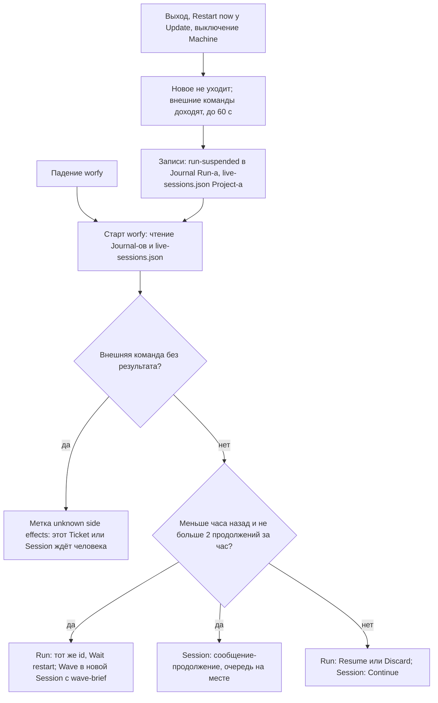

# worfy-continuity: «Работа переживает перезапуск worfy и compaction: Run и Session продолжаются с того же места»

Status: черновик 2026-11-13 из исследования конкурентов, владельцем не принят
Critic: [docs/product/critic/worfy-continuity-2026-11-14.md](../../docs/product/critic/worfy-continuity-2026-11-14.md) — Reorder.
Source: исследование конкурентов 2026-11-13, папка
[docs/research/2026-11-13-competitors](../../docs/research/2026-11-13-competitors/); две проверенные идеи из него:
reliability-cost-16 (Session-ы и Run переживают перезапуск, Update, падение и перезагрузку) и memory-context-1
(состояние задачи после compaction). Досье:
[Codex app](../../docs/research/2026-11-13-competitors/codex-app-codex-in-the-chatgpt-desktop-app.md),
[Claude Code Agent View](../../docs/research/2026-11-13-competitors/claude-code-agent-view.md),
[Orca](../../docs/research/2026-11-13-competitors/orca.md),
[Kiro](../../docs/research/2026-11-13-competitors/kiro.md),
[Division Swarm](../../docs/research/2026-11-13-competitors/division-swarm.md),
[Factory Droids](../../docs/research/2026-11-13-competitors/factory-droids.md),
[OpenAI Symphony](../../docs/research/2026-11-13-competitors/openai-symphony.md).
Зависит от: Epic-и worfy-update (16/16 Ticket-ов `done`), worfy-autopilot-queue (21/21), worfy-retry (14/14) и
worfy-flight-recorder (28/28) — все четыре закрыты.
Ticket-ы: Epic `worfy-continuity`, 15 Ticket-ов, нумерация с `01`. Issue-файлов пока нет: список — в разделе
«Ticket-ы».

## Проблема

Update Stable copy, падение или перезагрузка обрывают идущие Session-ы и Run: после старта worfy не знает, какие
Ticket-ы были в работе, и их раздают заново вручную. После compaction агент теряет цель, пункты «Готово, когда»
(Done when) и решения, принятые в начале разговора.

### Перезапуск

- Session, которую запустил worfy, принадлежит приложению и кончается вместе с ним (`docs/features/sessions.md:19–20`):
  на `will-quit` registry закрывает все Session-ы (`src/main/agent/app-registry.ts:49`). Background task живёт, пока
  жив процесс Claude Code её Session (CONTEXT.md, «Background task»). Implementer-ы, которых Orchestrator запустил в
  фоне, кончаются вместе с ним и после старта видны как Interrupted (ADR-0085; `docs/features/sessions.md:421–424`).
- Очередь сообщений не переживает свою Session (`docs/features/sessions.md:87`). Строки `notice` Auto-continue,
  например «not retried: `git push …` may or may not have run», живут только в событиях живой Session и после
  перезапуска пропадают (`src/main/agent/orchestrator-continue.ts`, шапка файла).
- Выход останавливает каждый Run с причиной `app-quit` и ждёт его конца не дольше 3 с (`src/main/ipc/autopilot.ts:141`,
  `:269–277`; `docs/features/autopilot-faults.md:108`). Ticket-ы в работе эта остановка не называет: их передаёт
  только `user-force-stop` (`src/shared/autopilot/cycle.ts:283`), и поле `interrupted` заполняется только при
  `user-force-stop` и `session-error` (`src/main/autopilot/run.ts:2909`).
- `resumable` — Ticket-ы, которые следующий Run продолжит сам, — живёт в памяти main (`src/main/autopilot/run.ts:1007`,
  `:1143`). После перезапуска список пуст (`docs/adr/0050-autopilot-user-stop-interrupts-orchestrator.md:67`;
  `docs/features/autopilot-faults.md:105`). Хранить его в Journal ADR-0050 отложил (`:86`).
- Нынешнее поведение после SIGKILL посреди Wave закреплено e2e test-ом: при старте Orchestrator-у не уходит ничего,
  Run history показывает старый Run с «no stop in the Journal», кнопка начинает новый Run
  (`test/e2e/autopilot-faults.spec.ts:36–114`; строка — `src/renderer/flight-recorder/RunHistoryView.tsx:75`).
  Ticket 01 того test-а уже в `work`, поэтому новый Run его не берёт: в его Wave только 02
  (`autopilot-faults.spec.ts:85–92`). 01 ждёт человека.
- Update. "Restart now" предлагается, только пока ничего не работает; пока что-то работает — только "Restart when
  idle" (`docs/features/updates.md:114–119`; отказ `BUSY` — `src/main/update/restart.ts:35`). Run в Wait (Limits,
  Start window, budget) тоже считается работой (`src/main/update/idle.ts:30–32`), так что ночной Run держит Update до
  своего конца. Так решил владелец в worfy-update (решение 7, `.scratch/worfy-update/spec.md:138–140`), когда работа
  после перезапуска ещё терялась.
- Выключение системы worfy не замечает: в `src/main` нет обработчиков `powerMonitor` `shutdown` и `session-end`
  окна. После перезагрузки worfy сам не стартует.
- Сейчас последствия перезапуска разбирает человек. После каждого Update Stable copy Orchestrator владельца
  записывает, какие Ticket-ы были в работе, и раздаёт их заново по skill-у epic-wave, раздел «How to resume a wave»
  (`harness/skills/epic-wave/SKILL.md:1834`; `:1890–1892`: worktree без PR — продолжить `/worfy:ship-ticket` в этом
  worktree). Это видно из рабочих заметок Orchestrator-а владельца, вне репозитория.

### Compaction

- worfy замечает compaction только по сообщению `compact_boundary` и после него заново спрашивает заполнение
  контекста (`src/main/vendors/claude/session.ts:527`; `src/shared/vendors/claude/events.ts:439`). Больше ничего не
  происходит: ни строки в Session view, ни возврата состояния.
- В `harness/hooks/hooks.json` нет `PreCompact` и `PostCompact`. `SessionStart` стоит без matcher-а, а по типам SDK
  его `source` бывает `'compact'` (`SessionStartHookInput` в `sdk.d.ts` пакета `@anthropic-ai/claude-agent-sdk`).
  Но `harness/hooks/inject-rules.mjs` и `harness/hooks/session-start.mjs` на `source` не смотрят и вставляют то же,
  что при старте: правила роли, а не Ticket, Wave и решения.
- Места в правилах нет: `harness/hooks/rules/orchestrator.md` занимает 9644 знака, а Claude Code режет один кусок
  `additionalContext` после 10 000 (`harness/hooks/inject-rules.mjs:29–30`).
- Codex: worfy не знает, когда Codex сжимает контекст (`src/main/vendors/codex/items.ts:123`), хотя в протоколе есть
  элемент `contextCompaction` (`src/main/vendors/codex/protocol/ts/v2/ThreadItem.ts:144`) и настройка `compact_prompt`
  (`src/main/vendors/codex/protocol/ts/v2/Config.ts:25`).
- Где это бьёт. Каждая Wave Autopilot-а после первой обычно начинается в новой Session с `wave-brief` — когда
  Orchestrator свободен и у Harness есть `wave-brief` (`src/main/autopilot/run.ts:14–21`;
  `src/main/actions/launch.ts:138–139`). Compaction бьёт внутри одной длинной Session: Orchestrator ведёт Wave с
  rework-раундами и `land` (скрипт `harness/bin/land`, который вливает готовые PR), implementer ведёт Ticket от claim
  до merge. Окно
  autocompact по умолчанию — 400K токенов у Orchestrator-а и его Subagent-ов, 500K у остальных Session-ов
  (`src/shared/settings/app-settings.ts:106`).
- worfy-reliability вынес compaction за свои рамки (`.scratch/worfy-reliability/spec.md:89–90`).

## Решение

Epic делает две вещи.

1. **Перезапуск больше не стирает работу.** worfy записывает, что шло: Run — в свой Journal, Session-ы с turn-ом или
   очередью — в файл Project-а. При выходе и при Update он даёт внешним командам дойти, до 60 с. После старта он
   продолжает с того же места: Run — тем же id, Session — сообщением-продолжением в тот же разговор. Работу,
   оборванную больше часа назад, и третий перезапуск за час он сам не продолжает, а показывает кнопки.
2. **Compaction больше не стирает цель.** Harness говорит модели, что сохранить в summary, и после compaction
   возвращает агенту состояние: Orchestrator-у — `wave-brief` его Epic-а, implementer-у — его Ticket и `git status`.

Процессы агентов по-прежнему живут внутри worfy. Daemon, который держит их вне приложения (как у Orca и Agent View),
— шаг 2, он не в этом Epic-е (вопрос Q5).

### Набросок: поток пользователя

1. Пользователь выходит из worfy, жмёт "Restart now" у Update или выключает Machine. Или worfy падает.
2. worfy перестаёт отправлять новое: очереди Session-ов держатся, Run не начинает Wave, таймеры Auto-continue и
   Wait-ов не срабатывают.
3. Если у какой-то Session или её Subagent-а есть внешняя команда без результата (`git push`, `gh pr merge`), worfy
   показывает окно «Quitting worfy»: эти команды, счётчик времени и кнопку Quit now. Окно уходит само, когда у команд
   есть результат или прошло 60 с. Без таких команд выход идёт сразу, без окна.
4. worfy прерывает turn-ы (Interrupt), ждёт выхода процессов Claude Code и Codex (ADR-0064) и пишет записи: в Journal
   Run-а — `run-suspended`, в `live-sessions.json` Project-а — что было у каждой Session. При падении записи о выходе
   нет, но есть то, что записано по ходу: Journal пишется на каждое событие, `live-sessions.json` — на каждое
   изменение.
5. После старта worfy читает Journal-ы Run-ов без конца и `live-sessions.json` каждого Project-а.
6. Оборвано меньше часа назад, и это не третий раз за час:
   - Run продолжается тем же id. Время перезапуска — Wait с причиной `restart`. Wait, в котором Run стоял (Limits,
     Start window, budget), идёт дальше со своим сроком. Иначе следующая Wave уходит в новую Session Orchestrator-а с
     `wave-brief`, и Ticket-ы оборванной Wave в работе идут в ней как продолженные — так же, как после Force stop.
   - Session получает одно сообщение-продолжение: worfy перезапустился, turn оборван, такие-то Subagent-ы стали
     Interrupted, вот их Ticket-ы. Очередь возвращается как была; если она была held, она held и остаётся.
7. Иначе Run показывает в строке Autopilot `cut off by restart · 14:05` с кнопками Resume и Discard, и приходит toast;
   у Session Node — chip «Interrupted by restart» и кнопка Continue.
8. Ticket, implementer которого стал Interrupted посреди внешней команды, в продолженную Wave не идёт: на нём метка
   «unknown side effects», toast с кнопкой «Checked, include». Session с такой командой сама не продолжается.
9. Compaction: в Session view встаёт строка «Context compacted (auto) · 812K → 41K», и агент сразу получает своё
   состояние.



### Набросок: экран

Тексты UI — по-английски, как весь UI worfy.

```text
Окно выхода (только когда есть внешние команды без результата)
┌───────────────────────────────────────────────────────────────┐
│ Quitting worfy                                                │
│ 2 commands are finishing: git push, gh pr merge 1234          │
│ 0:42                                           [ Quit now ]   │
└───────────────────────────────────────────────────────────────┘

Рамка Epic-а, строка Autopilot после старта
  Wave 3 · running                                     продолжено само, меньше часа
  waiting for limits · resumes 14:20                   Run стоял в Wait: Wait идёт дальше
  cut off by restart · 14:05      [ Resume ] [ Discard ]   старше часа или третий раз за час

Ticket в рамке Epic-а
  03  unknown side effects          tooltip: "gh pr merge 1234 may or may not have run"

Toast
  Unknown side effects: `gh pr merge 1234` may or may not have run     [ Checked, include ]

Node Session на Canvas
┌ Session ─────────────────────────────── Interrupted by restart ┐
│ …последние строки разговора…                                    │
│                                                 [ Continue ]    │
└─────────────────────────────────────────────────────────────────┘

Session view, строки notice
  worfy: restarted at 14:05 (update), sent "continue"
  worfy: not continued: `git push origin …` may or may not have run
  Context compacted (auto) · 812K → 41K

Run history, дорожка Wait-ов
  restart (update) · 3 min
```

## Как это сделано у конкурентов

- **Codex app** ([досье](../../docs/research/2026-11-13-competitors/codex-app-codex-in-the-chatgpt-desktop-app.md),
  строки 553–556 и 714–726). Daemon при остановке ждёт `shutdownGraceSeconds`: 60 с по умолчанию, от 0 до 300. Идущие
  ходы приостанавливаются, история пишется на диск, после перезапуска ход продолжается под тем же turn ID; это
  работает только для одного локального окружения. Берём grace в 60 с и продолжение в том же разговоре.
- **Claude Code Agent View** ([досье](../../docs/research/2026-11-13-competitors/claude-code-agent-view.md), строки
  727–750). Supervisor перезапускает неожиданно завершившуюся сессию и сообщает ей о сбое; прерванный ответ старше
  примерно часа не продолжается; после auto-update простаивающие сессии переносятся, работающие не прерываются. Цена
  (строки 1057–1066): самый большой кластер жалоб, 213 заголовков; два остановленных фоновых агента ожили и работали
  21 час, около 160 тыс. токенов. Берём правило часа и добавляем cap.
- **Orca** ([досье](../../docs/research/2026-11-13-competitors/orca.md), строки 657, 872–880, 1059–1063). Daemon
  терминалов владеет процессами агентов, и они переживают выход, обновление и падение. Цена: после обновлений
  оставались daemons старых версий; на экране было 8 сессий при примерно 46 живых процессах, остановка старых daemons
  завершила 370 процессов (#9138). Это довод отложить шаг 2.
- **Kiro** ([досье](../../docs/research/2026-11-13-competitors/kiro.md), строки 219 и 919–967). Checkpoint на каждой
  границе узла. После падения запуски, которые координируются через git, продолжаются сами, остальные открываются в
  Paused с пометкой о неизвестных побочных эффектах. `MAX_RECOVERIES` 2. Берём метку и предел в 2.
- **Division Swarm** ([досье](../../docs/research/2026-11-13-competitors/division-swarm.md), строки 640–645 и
  674–678). Уже стартовавшие внешние попытки при восстановлении становятся `outcome_uncertain` и повторно не
  отправляются. Контрольная точка при сжатии контекста — разделы Intent, Essential facts, Completed work, Errors,
  Pending work, Next action. Берём разделы.
- **Factory Droids** ([досье](../../docs/research/2026-11-13-competitors/factory-droids.md), строки 811–822).
  «Якорные» итеративные summary обязаны сохранить цель, ход работы и затронутые файлы. Своя оценка Factory по probes
  (контрольным вопросам): 3,70 у Factory, 3,44 у Anthropic, 3,35 у OpenAI; хуже всего у всех держится список
  затронутых файлов — 2,45, 2,33 и 2,19. Предел summary подняли с 8 до 16 тыс. токенов. Берём раздел Files touched и
  оценку по probes.
- **OpenAI Symphony** ([досье](../../docs/research/2026-11-13-competitors/openai-symphony.md), строки 810–816).
  Состояние только в памяти: таймеры повторов и работающие сессии после перезапуска не восстанавливаются. Так сейчас
  устроен и worfy.

## Истории пользователя

1. Как владелец, я жму "Restart now" у Update посреди ночного Run-а, и после перезапуска тот же Run продолжается с той
   же Wave, а не стоит с причиной `app-quit`.
2. Как владелец, я закрываю worfy, пока implementer-ы работают, и через 10 минут открываю снова. Orchestrator сам
   получает сообщение, какие Subagent-ы стали Interrupted и над какими Ticket-ами они работали, и продолжает эти
   Ticket-ы по «How to resume a wave».
3. Как пользователь, я выхожу из worfy, когда Session посреди `git push`. worfy ждёт результата команды до 60 с и
   только потом выходит; Quit now выходит сразу.
4. Как пользователь, после падения worfy я вижу у Session Node chip «Interrupted by restart» и одной кнопкой Continue
   продолжаю разговор. Очередь сообщений на месте.
5. Как владелец, после перезапуска я вижу на Ticket-е метку «unknown side effects» с командой, которая могла пройти или
   не пройти, и сам решаю, включать ли его обратно.
6. Как владелец, утром я открываю Run history и вижу один Run с Wait-ом `restart`, его причиной (Update, выход,
   падение) и длительностью, а не оборванный Run и новый.
7. Как владелец, я не боюсь, что worfy в цикле падений без конца продолжает Run: после 2 продолжений за час он ждёт
   меня.
8. Как Orchestrator (агент), после compaction я получаю обратно Epic, номер Wave, PR в работе и решения без владельца,
   не перечитывая транскрипт.
9. Как implementer (агент), после compaction я получаю обратно свой Ticket, пункты «Готово, когда» с отметками и
   `git status` своего worktree.
10. Как пользователь, я вижу в Session view, что контекст сжат и насколько.
11. Как пользователь Linked machine с Full access, я вижу `cut off by restart` и могу нажать Resume или Discard; с
    Read only — только вижу строку.

## Решения по реализации

Имена новых файлов — предложение; implementer сверяет их с `main`.

### Grace при выходе и при Update (Ticket 04)

- Сейчас выход ведут независимые обработчики. `before-quit` Autopilot-а ждёт `stopAll()` не дольше 3 с
  (`src/main/ipc/autopilot.ts:141`, `:269–277`). `before-quit` Update-а только снимает ожидание "Restart when idle"
  (`src/main/ipc/update.ts:130`, `:374`). `will-quit` закрывает Session-ы (`src/main/agent/app-registry.ts:49`) и ждёт
  shell-ы Terminal-а до 3 с (`src/main/ipc/terminal.ts:145`).
- Новый модуль `src/main/quit-grace.ts` — один координатор выхода. Он встаёт первым в `before-quit`, делает
  `preventDefault` и проводит выход по шагам:
  1. Переводит worfy в состояние «уходим». Registry не шлёт новых сообщений, очереди держатся. Run получает событие
     цикла `suspend` (не `stop`; `src/shared/autopilot/cycle.ts`) и не начинает Wave. Auto-continue и `LimitsWait` не
     шлют продолжений (`src/main/agent/orchestrator-continue.ts`).
  2. Ждёт, пока у Session-ов не останется внешних вызовов без результата — `externalActions(...)` с `done: false`
     (`src/shared/agent/continue-plan.ts:330`), — но не дольше 60 с.
  3. Прерывает turn-ы (`halt()`, `src/main/agent/session.ts:493`) и ждёт выхода процессов по ADR-0064: 7,5 с, затем
     SIGKILL и ещё 2 с.
  4. Пишет каждому Run-у `run-suspended` и отпускает выход. Нынешнее ожидание `stopAll()` уходит: Run не
     останавливается, а приостанавливается.
- `externalActions` берёт только вызовы верхнего уровня: вызов с `parentToolUseId` он пропускает
  (`continue-plan.ts:336`). Вызовы Subagent-ов координатор читает из их транскриптов — там же, где worfy берёт статус
  Subagent-а (`src/shared/transcript/subagents.ts`).
- Окно «Quitting worfy» — на Dialog kit-а (`src/renderer/theme/kit/Dialog.tsx`), как окна Machine, Autopilot и First
  run (worfy-ui-kit 06). Quit now переходит сразу к шагу 3.
- Выключение системы: новые обработчики `powerMonitor` `shutdown` (macOS, Linux) и `session-end` окна (Windows) пишут
  записи и выходят без grace — система ждать не будет.
- "Restart now" у Update идёт через тот же координатор (`src/main/update/restart.ts`). Swap-helper ждёт выхода worfy до
  2 мин (`docs/features/updates.md:127–128`): 60 с grace и выход процессов в это укладываются.

### Запись о работающих Session-ах (Ticket 03)

- Файл `live-sessions.json` в подпапке Project-а, рядом с `bindings.json` (таблица —
  `docs/features/storage-and-diagnostics.md:169–183`). Это собственное состояние worfy: не в репозитории Project-а и
  не в `~/.claude` (ADR-0005).
- Запись на Session: id Node-а; session id SDK или thread id Codex; Vendor; вид — Orchestrator или Session Node;
  состояние — `busy` или ждёт разрешения; очередь — тексты, ссылки на вложения, held или нет; id Run-а, если Session
  им владеет; время последнего события; счёт автоматических продолжений за час. На весь файл — поле `version`.
- Пишет только main, атомарно (временный файл и rename), на каждое изменение. Запись Session уходит, когда она стала
  idle с пустой очередью. Незнакомая `version` или битый JSON — файл не читается, в log одна строка.
- Пишет новый наблюдатель `src/main/agent/live-sessions.ts`, подписанный на `observe` и `observeInput` registry
  (`src/main/agent/session/registry.ts`), как Auto-continue.
- Binding в файл не копируется: при старте он читается заново из транскриптов (ADR-0002;
  `src/main/layout/bindings.ts:10–11`).

### Journal Run-а — его checkpoint (Ticket 02)

- Новые события в `src/shared/autopilot/journal.ts`:
  - `run-suspended {cause: quit | update | shutdown, wave, tickets, wait}` — Ticket-ы Wave в работе и открытый Wait с
    его `until`;
  - `run-continued {after: quit | update | shutdown | crash}`. Имя `resumed` уже занято концом Wait-а Limits (И4),
    поэтому новое имя другое.
- Чистый reader `src/shared/autopilot/checkpoint.ts` поверх `parseJournal` (`src/shared/autopilot/journal.ts:877`)
  восстанавливает состояние Run-а: Epic-и и очередь (`run-started`, `queue-changed`, `epic-started`,
  `epic-finished`), названные Ticket-ы, Run mode, Vendor, Auto-approval, номер Wave, Ticket-ы Wave в работе
  (`wave-started`, `ticket-status`), `resumable`, открытый Wait (`waiting-until`, `start-window`, `budget-stop`,
  `limits-hit`) и счёт повторов (`turn-retry`).
- Run оборван, если последняя строка его Journal-а — `run-suspended` или `run-stopped` нет вовсе (после падения).
  Такому Run-у Flight Recorder уже даёт исход `cut-off` (`src/shared/flight-recorder/facts.ts:22`).
- Продолжение пишет в тот же файл тем же id: Journal дописывается с O_APPEND (`src/main/autopilot/journal.ts`).
- `resumable` берётся из checkpoint, а не из `last` в памяти (`src/main/autopilot/run.ts:1007`, `:1143`). Это тот
  вариант, который ADR-0050 отложил (`docs/adr/0050-autopilot-user-stop-interrupts-orchestrator.md:86`).
- Discard пишет `run-stopped` с новой причиной `discarded` (таблица причин —
  `docs/features/autopilot-faults.md:132–156`). Ticket-ы Wave в работе становятся `resumable`, как после Force stop,
  и следующий Run этого Epic-а берёт их из checkpoint. `app-quit` остаётся в таблице для старых Journal-ов; новый
  выход его не пишет.

### Продолжение Session (Ticket 05)

- Новый модуль `src/main/agent/continuity.ts` после открытия Project-ов (`src/main/agent/app-orchestrators.ts`) читает
  `live-sessions.json` каждого Project-а.
- Session Node продолжается через `NodeSessions.start(projectId, nodeId)` (`src/main/agent/node-sessions.ts:283`).
  Orchestrator — через свой `open()`, который и так продолжает сохранённую Session (`src/main/agent/orchestrator.ts`,
  шапка файла; `docs/features/sessions.md:256`). Codex — через `thread/resume` (`src/main/vendors/codex/session.ts:972`).
- Сообщение-продолжение собирает новая функция `restartText(...)` рядом с `retryText`
  (`src/shared/agent/continue-plan.ts:1031`). Текст английский: worfy перезапустился в 14:05 (Update, выход или
  падение), turn оборван; вот Subagent-ы, ставшие Interrupted, и их Binding-и (Ticket); продолжай с того места, а
  Ticket в работе веди по skill-у epic-wave, «How to resume a wave». Как и `retryText`, текст всегда просит проверить,
  что сделала каждая команда, прежде чем повторять её: скрипт (`node <file>`) читается как локальный, но может
  push-ить (`docs/features/autopilot-faults.md:37–47`). Исходное сообщение снова не уходит.
- Очередь возвращается как была, held — held («Send queued», `docs/features/sessions.md:84–88`).
- В Session view — строка `notice`, как у Auto-continue: «worfy: restarted at 14:05 (update), sent "continue"».
- Старше часа или после cap — chip «Interrupted by restart» и кнопка Continue на Node
  (`src/renderer/canvas/nodes/SessionNode.tsx`: chip — `:302`, Resume — `:463`, `:645`). Continue — это Resume плюс
  `restartText`.
- Session, которой владеет Run, этот модуль пропускает: её продолжает Run. Так же Auto-continue молчит, пока Run
  владеет Session (`orchestrator-continue.ts`, шапка файла).
- Возраст считается от последней записи о Session до старта. Cap — 2 автоматических продолжения на Session за час.
- Перед продолжением worfy проверяет, что прежний процесс Claude Code этой Session не жив: после падения worfy он мог
  остаться без родителя и ещё писать в транскрипт. Registry такой процесс не знает: его отказ «Session … is already
  live» (`src/main/agent/session/registry.ts:101`) — только о процессах этого запуска worfy. Как найти чужой процесс
  копии, Ticket сверяет со swap-helper-ом Update-а, который уже ищет процессы копии
  (`docs/features/updates.md:127–135`).

### Продолжение Run-а (Ticket 06)

- `Autopilot` (`src/main/autopilot/run.ts`) получает вход `continueRun(checkpoint)`: восстанавливает Run из
  checkpoint и ведёт тот же цикл (`src/shared/autopilot/cycle.ts`).
- Восстановленный Wait (Limits, Start window, budget) ждёт дальше со своим `until`. Иначе следующая Wave уходит сразу:
  новая Session Orchestrator-а с `waveBriefText` (`src/main/actions/launch.ts:138`), и Ticket-ы оборванной Wave в
  работе идут в ней как продолженные (`resumedTickets`, `src/shared/actions/render-template.ts:97`) — путь Force stop
  из ADR-0050. Implementer Ticket-а без PR продолжает `/worfy:ship-ticket` в своём worktree
  (`harness/skills/epic-wave/SKILL.md:1890–1892`).
- Занятый Orchestrator — как при любом старте: Wait `orchestrator-busy`.
- На Codex продолжение отказывает так же, как старт, пока hook-и Harness не одобрены в Codex (`CODEX_HOOKS_REFUSAL`,
  `src/main/vendors/codex/harness-hooks.ts:45`).
- Старше часа или после cap: строка `cut off by restart · 14:05` с кнопками Resume и Discard
  (`src/renderer/canvas/actions/AutopilotAction.tsx`; таблица строк — `docs/features/autopilot.md:106–121`) и toast.
  Cap считается по строкам `run-continued` в Journal-е.
- Linked machine: Resume и Discard — только с Full access, как Start Autopilot (ADR-0066); с Read only строка видна,
  кнопок нет.

### Unknown side effects (Ticket 07)

- После старта, до продолжения, worfy для каждой оборванной Session и каждого её Interrupted Subagent-а считает
  внешние вызовы без результата: `externalActions` над событиями Session (`continue-plan.ts:330`) и над транскриптом
  Subagent-а.
- Ticket такого implementer-а (по его Binding-у, `src/shared/binding/resolve.ts`) не идёт в продолженную Wave и сам не
  продолжается. На нём метка «unknown side effects» с tooltip-ом о вызове; приходит toast «Unknown side effects:
  `gh pr merge 1234` may or may not have run» с кнопкой «Checked, include»; в Journal — строка
  `unknown-side-effects {ticket, actions}`.
- «Checked, include» возвращает Ticket в `resumable`: его берёт следующая Wave или следующий Run.
- Session с таким вызовом сама не продолжается: строка `notice` «worfy: not continued: … may or may not have run» и
  chip с кнопкой Continue.
- Правило то же, что отказ `in-flight` у Auto-continue (`retryDecision`, `src/shared/agent/continue-plan.ts:992`;
  `docs/features/autopilot-faults.md:37–47`).

### Update во время работы (Ticket 08)

- По Q1: "Restart now" и во время работы, рядом с "Restart when idle". Отказ `BUSY` (`src/main/update/restart.ts:35`)
  уходит; нажатие — согласие на grace и приостановку.
- Run в Wait (Limits, Start window, budget) больше не держит "Restart when idle" (`src/main/update/idle.ts:30–32`): он
  приостанавливается и продолжает после перезапуска со своим Wait-ом.
- Причина перезапуска уходит в `restart.json` (`src/main/update/restart.ts:41`), чтобы `run-continued` и `notice`
  сказали `update`, а не `crash`.
- Toast-ы и строки Settings — `docs/features/updates.md:51–52`, `:67–71`.

### Run history и Work track (Ticket 09)

- Новая причина Wait `restart` в `WAIT_CAUSES` (`src/shared/flight-recorder/facts.ts:31`). `from-journal.ts`
  (`src/shared/flight-recorder/from-journal.ts`) строит её Span от `run-suspended` (после падения — от последнего
  события) до `run-continued` и берёт причину оттуда: quit, update, shutdown или crash.
- Продолженный Run — один Run с Wait-ом внутри. Исход `cut-off` (`facts.ts:22`) и строка «no stop in the Journal»
  (`src/renderer/flight-recorder/RunHistoryView.tsx:75`) остаются за Run-ом, который так и не продолжили.
- Work track показывает тот же Wait на дорожке Run-а (`docs/features/work-track.md`).

### Compaction (Ticket-ы 01, 10, 11, 12, 13)

- **Spike сначала (01).** В `scripts/spikes/`, рядом с `scripts/spikes/harness-plugin/probe.ts`: реальная модель (по
  умолчанию haiku), руками, вне CI. Вопросы:
  1. приходит ли `SessionStart` с `source: 'compact'` в главной Session и в Subagent-е;
  2. чему следует модель, которая пишет summary: разделу в правилах, `custom_instructions` у `PreCompact`, тексту
     `/compact <text>` или дописке к system prompt;
  3. что лежит в `compact_summary` у `PostCompact`;
  4. переживает ли compaction дописка к system prompt (`instructions`, `src/main/vendors/claude/options.ts:379–384`);
  5. Codex: `compact_prompt` на thread через `config` (`config` уже уходит в `thread/start`,
     `src/main/vendors/codex/session.ts:961–967`) и приходит ли элемент `contextCompaction`;
  6. как Claude Code продолжает транскрипт, оборванный посреди вызова (`tool_use` без `tool_result`), — это нужно
     Ticket-ам 05 и 06.

  Типы SDK — `SessionStartHookInput`, `PreCompactHookInput`, `PostCompactHookInput`, `SDKCompactBoundaryMessage` в
  `sdk.d.ts`. Spike идёт на версии, которую закрепляет `package.json:29` (0.3.322).
- **Инструкции summary (10).** Новый кусок правил `harness/hooks/rules/compaction.md`, по-английски, как весь Harness
  (ADR-0074): в `orchestrator.md` места нет. Разделы summary — Intent, Essential facts, Completed work, Files touched,
  Errors, Pending work, Next action: разделы Swarm плюс Files touched по оценке Factory. По ролям: Orchestrator —
  Epic, номер Wave, PR в работе, решения без владельца (журнал решений `decisions.tsv`, skill epic-wave);
  implementer — Ticket, каждый пункт «Готово, когда» с отметкой, worktree и ветка. Каким путём модель получает эти
  инструкции, решает spike.
- **Hook ветки `compact` (11).** `harness/hooks/after-compact.mjs` на `SessionStart` с matcher-ом `compact` (у Codex —
  `sessionStart`, `src/main/vendors/codex/harness-hooks.ts:51–66`) возвращает `additionalContext`. Orchestrator-у —
  вывод `wave-brief <epic>`; Epic берётся из `WORFY_EPIC`, иначе из ветки, иначе первый из «Epics in play»
  (`harness/hooks/stage-lines.mjs`). Implementer-у — файл его Ticket-а и `git status --short`. Вне worfy и без
  Ticket-а hook молчит. Запасная строка в `harness/hooks/rules/common.md` — после compaction перечитать свой Ticket и
  `git status`, прежде чем идти дальше, — на случай, если для Subagent-а hook не срабатывает.
- **worfy (12).** `WORFY_EPIC` в окружении Session Orchestrator-а, которую запустил Run или действие «Run wave»
  (`src/main/actions/launch.ts`), рядом с `WORFY_SESSION_KIND` (`src/main/vendors/claude/options.ts:388`; `sessionEnv`
  — `:716`). Epic и Ticket-ы Wave — ещё и в дописке к system prompt (`instructions`), если spike покажет, что она
  переживает compaction. Codex получает `compact_prompt` с теми же инструкциями. На `compact_boundary` (его уже ловит
  `src/main/vendors/claude/session.ts:527`) Session view показывает строку «Context compacted (auto) · 812K → 41K» из
  `compact_metadata`: `trigger`, `pre_tokens` и `post_tokens`, когда он есть.
- **Eval (13).** Кейс `harness/evals/compaction-state`: длинная Session по сценарию, `/compact`, затем probes по
  образцу Factory — цель, Ticket, пункты «Готово, когда», затронутые файлы, решения, следующий шаг. Сравнение без
  hook-а и с ним. Реальная модель, руками, вне CI: `scripts/eval-harness.mjs --dry-run` сначала, затем с
  `--max-cost-usd`.

## Решения по test-ам

- Ни один test в CI не зовёт модель. Claude Code — на `WORFY_AGENT=fake` (`src/main/agent/fake-query.ts`, сценарии в
  `test/fixtures/agent-scripts/`), Codex — на `WORFY_CODEX=fake`
  (`test/fixtures/codex-app-server/fake-app-server.mjs`).
- Каждый Ticket с кодом начинается с падающего test-а.
- Unit:
  - `checkpoint.ts` на fixture-Journal-ах: к `test/fixtures/autopilot-faults/` добавляются Run, приостановленный
    посреди Wave, в Wait Limits и в Wait Start window, Run без конца после падения, с рваной последней строкой и после
    Discard;
  - `restartText`;
  - правило часа и cap;
  - reader `live-sessions.json`: незнакомая `version`, битый JSON.
- Contract — на `faultRun()` (`test/contract/autopilot-faults-setup.ts`), часы двигает test:
  - выход посреди Wave → `run-suspended`; старт → тот же id, `run-continued`, одна новая команда Wave с продолженными
    Ticket-ами;
  - падение без `run-suspended` → то же;
  - выход в Wait Limits → после старта Wait идёт до своего `until`, команда раньше не уходит;
  - третий старт за час → продолжения нет, строка `cut off by restart`;
  - fake agent держит `git push` без результата → выход ждёт его, но не дольше 60 с по часам test-а; Quit now выходит
    сразу; после старта Ticket не в Wave, в Journal-е — `unknown-side-effects`;
  - Session Node в turn-е → после старта одно сообщение-продолжение, очередь held на месте (рядом с
    `test/contract/node-sessions.test.ts`);
  - Update: "Restart now" во время работы, если Q1 — (а), и Run в Wait не держит "Restart when idle" (рядом с
    `test/contract/update-restart.test.ts`).
- Recovery invariants (`test/autopilot-invariants.ts`, `checkRecovery`; И1–И8, на странице Feature — I1–I8,
  `docs/features/autopilot-faults.md:225–235`):
  - И1 не меняется: у каждой Wave одна команда, команда оборванной Wave снова не уходит;
  - И4: выход оставляет `run-suspended`, а не `run-stopped` с `app-quit`; продолженный Run несёт `run-continued`;
  - И6: после перезапуска тот же Run продолжается в своём Journal-е; новый Journal начинается только после Discard
    или остановки.
- e2e:
  - `test/e2e/autopilot-faults.spec.ts:36` меняет ожидание: после SIGKILL и старта уходит ровно одна новая команда
    Wave — 01 как продолженный и 02; Run history показывает один Run с Wait-ом `restart`;
  - новый test: Session Node после SIGKILL продолжается (рядом с `test/e2e/session-resume.spec.ts`);
  - Update во время работы — рядом с `test/e2e/update-toasts.spec.ts`, `update-toolbar.spec.ts` и
    `update-settings.spec.ts`.
- Harness: `harness/hooks/tests/session-hooks.test.sh` проверяет ветку `compact` — Orchestrator получает `wave-brief`,
  implementer свой Ticket, вне worfy hook молчит; `harness/hooks/tests/rules-hooks.test.sh` — `compaction.md`
  вставляется и укладывается в предел.
- Codex: contract на fake app-server — продолжение через `thread/resume`, `compact_prompt` в `config`.
- Spike 01 и eval 13 — руками, с реальной моделью, вне CI; eval сначала с `--dry-run`.
- Вердикт — зелёные job-ы CI macOS и Windows на SHA последнего merge (ADR-0071).

## Не в этом Epic-е

- **Шаг 2: daemon**, который держит процессы агентов вне worfy, чтобы они переживали выход и Update без перезапуска
  (Orca, Agent View, Codex daemon). Решать после замеров этого Epic-а (Q5). У других это главный источник жалоб:
  Orca #9138, 213 заголовков о supervisor-е Agent View.
- **Продолжение того же turn-а**, как у Codex daemon (тот же turn ID). worfy продолжает новым сообщением в тот же
  разговор.
- **Subagent как Subagent.** Interrupted остаётся Interrupted (ADR-0085). Его работу продолжает Orchestrator по «How
  to resume a wave».
- **Автостарт worfy после перезагрузки** (login item). worfy запускает пользователь.
- **Shell-ы Terminal-а.** worfy закрывает их процессы при выходе (`docs/features/updates.md:118`); их вывод не
  восстанавливается.
- **Session-ы из терминала и Claude desktop.** worfy их не ведёт, только показывает и продолжает по Resume
  (`docs/features/sessions.md:17`).
- **Своё сжатие контекста** («якорные» summary, как у Factory). Сжимает Vendor; Epic даёт инструкции и возвращает
  состояние.
- **Run-ы других Machine.** Каждая Machine продолжает свои Run-ы сама.

## Ticket-ы

1. Spike: compaction в Claude Code и Codex (`SessionStart` с `compact` в Session и Subagent-е, чему следует summary,
   `compact_summary`, `compact_prompt`, `contextCompaction`) и продолжение транскрипта, оборванного посреди вызова;
   отчёт, без кода продукта.
2. Journal как checkpoint Run-а: события `run-suspended` и `run-continued`, чистый reader
   `src/shared/autopilot/checkpoint.ts`, `resumable` из Journal-а вместо памяти, причина `discarded`.
3. `live-sessions.json`: запись Session-ов с turn-ом или очередью — атомарно, с `version`; наблюдатель registry.
4. Grace при выходе и при Update: координатор выхода, остановка отправки, ожидание внешних команд до 60 с, окно
   «Quitting worfy» с Quit now, `run-suspended` вместо `app-quit`, выключение системы.
5. Продолжение Session: чтение записей при старте, `restartText`, правило часа и cap, очередь назад, `notice`, chip
   «Interrupted by restart» и Continue, Codex через `thread/resume`, проверка прежнего процесса.
6. Продолжение Run-а: тот же id, восстановленный Wait, Wave в новой Session с `wave-brief` и продолженными Ticket-ами,
   строка `cut off by restart` с Resume и Discard, toast, Full access на Linked machine.
7. Unknown side effects: внешние вызовы без результата у Session-ов и Interrupted Subagent-ов, метка Ticket-а, toast
   с «Checked, include», строка Journal-а.
8. Update во время работы: "Restart now" рядом с "Restart when idle" (по Q1), Run в Wait не держит "Restart when
   idle", причина перезапуска в `restart.json`.
9. Run history и Work track: Wait `restart` с причиной; продолженный Run — один Run.
10. Harness: инструкции summary по ролям в `harness/hooks/rules/compaction.md` и запасная строка в `common.md`.
11. Harness: hook ветки `compact` — `wave-brief` Orchestrator-у, Ticket и `git status` implementer-у, Codex
    `sessionStart`; shell test-ы.
12. worfy: `WORFY_EPIC` и дописка к system prompt у Session-ов Wave, Codex `compact_prompt`, строка «Context
    compacted» в Session view.
13. Eval-кейс `harness/evals/compaction-state` с probes; запуск руками, сначала `--dry-run`, числа — в результате
    Ticket-а.
14. Документация: страницы Feature en и ru (`sessions.md`, `autopilot.md`, `autopilot-faults.md`, `updates.md`,
    `flight-recorder.md`, `work-track.md`, `skills-agents-and-hooks.md` и их копии в `docs/features/ru/`), Amendment
    к ADR-0050, новый ADR о продолжении после перезапуска, термины CONTEXT.md (причина Wait `restart`, «unknown side
    effects»).
15. Приёмка владельцем: Mac Stable (Update посреди Run-а, выход посреди Wave с `git push`, kill worfy) и Windows.

## Волны

| Wave | Ticket-ы | Blocked by | Почему так |
|---|---|---|---|
| 1 | 01, 02, 03 | — | spike и две записи состояния; файлы не пересекаются: `scripts/spikes/`, `src/shared/autopilot/` с `run.ts`, `src/main/agent/live-sessions.ts` |
| 2 | 04, 09, 10 | 04 — 02, 03; 09 — 02; 10 — 01 | выход пишет то, что ввели 02 и 03; Run history читает новые события; правила — по итогу spike |
| 3 | 05, 06, 11 | 05 — 03, 04; 06 — 02, 04; 11 — 01, 10 | Session (`src/main/agent/`), Run (`src/main/autopilot/`) и Harness (`harness/hooks/`): общих файлов нет |
| 4 | 07, 08, 12 | 07 — 05, 06; 08 — 04, 06; 12 — 11 | метке нужны оба продолжения; Update — Run в Wait; worfy-часть compaction — после hook-а |
| 5 | 13, 14 | 13 — 10, 11, 12; 14 — 02–12 | eval меряет готовый hook; документация — по сделанному |
| 6 | 15 | 01–14 | приёмка |

Wave, которую берут в работу, вычисляется заново в момент запуска (CONTEXT.md, термин Wave); таблица — прогноз.

## Риски

1. **Два процесса на одном транскрипте.** После падения worfy процессы Claude Code могут остаться без родителя и ещё
   писать в транскрипт. Продолжение рядом с ними — ровно то, от чего защищает ADR-0064. Ответ: Ticket 05 сначала
   находит такой процесс и ждёт его выхода или завершает его.
2. **Цикл падений.** Если продолжение само роняет worfy, каждый старт продолжает снова. Ответ: не больше 2
   автоматических продолжений за час на Run и на Session (у Kiro `MAX_RECOVERIES` 2), дальше — кнопки.
3. **Расход Limits.** Ожившие агенты Agent View работали 21 час, около 160 тыс. токенов. Ответ: продолжение — одно
   сообщение; правило часа; cap; Run продолжается в своём Run mode, с его budget и Start window.
4. **Выключение системы.** macOS и Windows не ждут приложение долго, grace при выключении не будет. Ответ: записи
   пишутся по ходу, поэтому выключение для продолжения — то же, что падение.
5. **Новый Harness после Update.** Продолженная Session идёт под Harness-ом новой копии: нажатие Update — согласие и
   на него (`docs/features/updates.md:129–130`). Правила на `resume` придут новые; `restartText` говорит, что worfy
   обновился.
6. **Замки.** `harness/bin/worktree-lock` считает Session живой 60 мин после её последней отметки (`:177`); при
   падении SessionEnd, который снимает замок, не срабатывает. Продолжение в пределах часа попадает как раз в эти 60
   мин. Так же e2e-замок implementer-а, убитого посреди e2e, снимает только следующий запуск, когда замку больше 30
   мин (ADR-0050, «Последствия»; `scripts/e3-sandbox.sh:399`). Ответ: Ticket-ы 05 и 06 проверяют, кто держит замки
   после продолжения, и снимают замки оборванных Session-ов.
7. **Формат между сборками.** `live-sessions.json` и новые события Journal-а может читать и сборка старее — после
   отката на `worfy-stable.previous` (`docs/features/updates.md:129`). Ответ: `version` в файле; Ticket 02 закрепляет
   test-ом, что `parseJournal` пропускает незнакомые события.
8. **Транскрипт, оборванный посреди вызова** (`tool_use` без `tool_result`). Как Claude Code продолжит такой
   разговор, выясняет spike 01, до Ticket-ов 05 и 06.
9. **Пропущенный внешний вызов.** Скрипт (`node <file>`, любой скрипт Harness-а) читается как локальный, хотя может
   push-ить и merge-ить (`docs/features/autopilot-faults.md:37–47`). Метка «unknown side effects» его не поймает.
   Ответ: `restartText`, как и `retryText`, всегда просит проверить каждую команду перед повтором.
10. **Codex.** worfy запускает свой app-server на каждую Session (`src/main/vendors/codex/app-server.ts`), а не daemon
    Codex, поэтому приостановка хода у Codex здесь не действует: продолжение — новое сообщение после `thread/resume`.
11. **Модель не следует инструкциям summary.** Ответ: главный механизм — состояние, которое возвращает hook; eval 13
    меряет оба.
12. **Предел `additionalContext`.** Claude Code режет кусок после 10 000 знаков (`harness/hooks/inject-rules.mjs:29–30`),
    а `wave-brief` укладывается только в 11 000 байт (`harness/bin/wave-brief:46`). Ответ: hook отдаёт Stage-строку,
    Ticket-ы в работе и открытые PR первыми и режет остальное.
13. **Hook не видит окружения Session.** Тот же риск уже записан для `WORFY_SESSION_KIND`
    (`src/main/vendors/claude/options.ts:379–384`). Запас — Epic в дописке к system prompt и Epic из ветки.
14. **Приватность.** Тексты очереди ложатся в папку данных worfy; черновики полей ввода там уже лежат
    (`docs/features/sessions.md:80`). В репозиторий Project-а и в `~/.claude` файл не попадает (ADR-0005).

## Вопросы владельцу

1. **Q1. Update во время работы.** (а) "Restart now" и во время работы, рядом с "Restart when idle": работа
   приостанавливается и продолжается после перезапуска; (б) как сейчас — во время работы только "Restart when idle".
   (а) меняет решение 7 в worfy-update (`.scratch/worfy-update/spec.md:138–140`). **Рекомендую (а):** решение 7
   принято, когда работа после перезапуска терялась, а ночной Run сейчас держит Update до утра.
2. **Q2. Выход во время работы.** (а) ждать до 60 с, пока внешние команды получат результат, с окном и кнопкой Quit
   now; (б) выходить сразу, как сейчас. **Рекомендую (а):** обрыв посреди `git push` или `gh pr merge` — ровно то,
   что потом проверяют руками; Codex ждёт те же 60 с.
3. **Q3. Само или по кнопке.** (а) работа, оборванная меньше часа назад, продолжается сама, не больше 2 раз за час, а
   более старая ждёт кнопки; (б) всегда кнопки; (в) всегда сама. **Рекомендую (а):** Update и выход — это минуты, а
   не часы; правило часа взято у Agent View, cap защищает от цикла падений.
4. **Q4. Unknown side effects.** (а) такой Ticket всегда ждёт человека, как при отказе `in-flight` в worfy-retry;
   (б) продолженная Wave сама сверяет git и GitHub (push, PR, merge) и включает Ticket, если всё сходится.
   **Рекомендую (а) в первой версии:** (б) — ещё одна проверка, которая может ошибиться в обе стороны; её стоит
   делать, когда станет видно, как часто метка встаёт.
5. **Q5. Шаг 2 — daemon.** (а) решать после замеров этого Epic-а: сколько работы ещё теряется на перезапуске; (б)
   spike daemon-а сейчас. **Рекомендую (а):** у Orca и Agent View daemon — главный источник жалоб, а если продолжение
   закроет большую часть потерь, он не нужен.

## Готово, когда

- [ ] "Restart now" у Update посреди Run-а на Mac Stable: после перезапуска тот же Run продолжается; в Journal-е
      `run-suspended`, затем `run-continued`; команда оборванной Wave снова не ушла; Run history показывает один Run
      с Wait-ом `restart`.
- [ ] Выход посреди Wave с идущим `git push`: worfy ждёт результата не дольше 60 с, окно называет команду, Quit now
      выходит сразу.
- [ ] SIGKILL посреди Wave и старт меньше чем через час: Run продолжается сам; `test/e2e/autopilot-faults.spec.ts`
      закрепляет это вместо «nothing goes to the Orchestrator at the start».
- [ ] Session Node в turn-е при выходе: после старта — одно сообщение-продолжение, очередь на месте; старше часа —
      chip «Interrupted by restart» и Continue.
- [ ] Ticket с внешней командой без результата не идёт в продолженную Wave, на нём метка и toast; «Checked, include»
      возвращает его.
- [ ] Третий перезапуск за час сам не продолжает: строка `cut off by restart` с Resume и Discard.
- [ ] Recovery invariants И1–И8 обновлены (И4, И6) и зелёные во всех Fault scenario-ах; job-ы CI macOS и Windows
      зелёные на SHA последнего merge.
- [ ] Compaction: shell test-ы hook-а зелёные; eval `compaction-state` показывает, что с hook-ом probes о Ticket-е,
      пунктах «Готово, когда» и следующем шаге отвечены лучше, чем без него (числа — в результате Ticket-а 13).
- [ ] Session view показывает строку «Context compacted».
- [ ] Страницы Feature en и ru, Amendment к ADR-0050, новый ADR и термины CONTEXT.md влиты.
- [ ] (manual) Владелец принял Epic на Mac Stable и на Windows.
