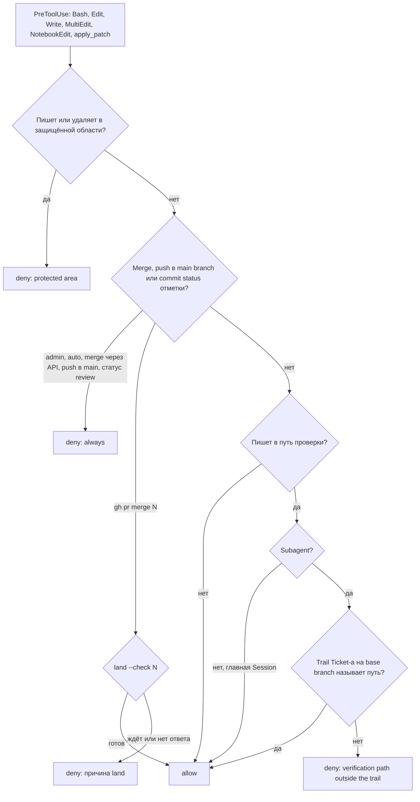

# worfy-harness-guarantees: гарантии Harness нельзя обойти — агент не правит проверки, которые его судят, не сливает PR мимо условия merge, guard-ы держатся в любом режиме и на новой версии Claude Code

Status: черновик 2026-11-13 из исследования конкурентов, владельцем не принят
Critic: [docs/product/critic/worfy-harness-guarantees-2026-11-14.md](../../docs/product/critic/worfy-harness-guarantees-2026-11-14.md) — Reorder.
Source: исследование конкурентов 2026-11-13 ([папка досье](../../docs/research/2026-11-13-competitors/)), четыре
проверенные идеи: review-quality-3 «Ticket или PR не может ослабить проверки, которые его судят», review-quality-8
«Hook не пускает merge и опасные действия с GitHub мимо условия merge», safety-3 «Guard-ы в любом permission mode: hard
deny в hook, защищённые файлы правил, проверка при старте», reliability-cost-20 «Contract eval Harness на каждой новой
версии Claude Code». Досье:
[Claude Code agent teams](../../docs/research/2026-11-13-competitors/claude-code-agent-teams.md),
[GitHub Copilot cloud agent и Agent HQ](../../docs/research/2026-11-13-competitors/github-copilot-cloud-agent-and-agent-hq-mission-.md),
[Claude Code cloud sessions](../../docs/research/2026-11-13-competitors/claude-code-cloud-sessions-and-projects.md),
[OpenHands](../../docs/research/2026-11-13-competitors/openhands.md),
[Devin](../../docs/research/2026-11-13-competitors/devin.md),
[Devin Desktop](../../docs/research/2026-11-13-competitors/devin-desktop-formerly-windsurf.md),
[Codex app](../../docs/research/2026-11-13-competitors/codex-app-codex-in-the-chatgpt-desktop-app.md),
[Kiro](../../docs/research/2026-11-13-competitors/kiro.md),
[Factory Droids](../../docs/research/2026-11-13-competitors/factory-droids.md),
[Google Antigravity](../../docs/research/2026-11-13-competitors/google-antigravity.md),
[Claude Code plugins и marketplaces](../../docs/research/2026-11-13-competitors/claude-code-plugins-and-marketplaces.md).
[CONTEXT.md](../../CONTEXT.md) — термины Harness, Profile, Session, Subagent, Orchestrator, Product Session, Autopilot,
Run, Run history, Wave, Ticket, Epic, Stage, Pipeline, Gate, Quarantine, Windows exception, Windows verdict,
Auto-approval, Approval policy, Vendor, Machine, Settings, Full mode, Silent mode, Workflow folder.
Зависит от: [worfy-harness](../worfy-harness/spec.md) — guard, gate, Profile, `land`;
[worfy-auto-approve](../worfy-auto-approve/spec.md) — Approval policy и её hard deny (ADR-0098);
[worfy-throughput](../worfy-throughput/spec.md) — `ci-ok` на каждом PR, Quarantine, `land` по условию PR;
[worfy-pipeline](../worfy-pipeline/spec.md) — Stage-и и отметки агентов на SHA (ADR-0067);
[worfy-multi-vendor](../worfy-multi-vendor/spec.md) — Codex, вход его hook-ов и часть `harnessHooks` driver-а
(ADR-0094).
Ticket-ы: Epic `worfy-harness-guarantees`, 13 Ticket-ов, нумерация с `01`. Файлов Ticket-ов пока нет: их пишут после
того, как владелец примет spec.

## Проблема

Зелёный gate, зелёный `ci-ok` и вердикт review VERIFIED верны, только пока агент не может их подправить. Сегодня это
держится на тексте prompt-ов и на том, что агент спрашивает разрешения. Открыты четыре пути.

**1. Агент правит проверки, которые его судят.**

- Implementer правит только файлы trail-а своего Ticket-а — раздела `## Где в коде`
  (`harness/agents/implementer.md:87-90`). Это текст. guard проверяет только Bash:
  `if (payload?.tool_name !== "Bash") ok()` (`harness/hooks/guard.mjs:73`), а `apply_patch` на Codex отказывает только
  reviewer-у и scout-у (`guard.mjs:65-72`). Matcher hook-а — `Bash|apply_patch` (`harness/hooks/hooks.json:157`):
  Edit и Write не проверяет никто.
- CI идёт на `pull_request` (`.github/workflows/ci.yml:91-99`), поэтому workflow и scope-скрипты CI
  (`scripts/ci-scope.mjs`, `scripts/ci-ok.mjs`, `scripts/affected-tests.mjs` и его таблица,
  `scripts/e2e-specs.table.json`, `scripts/e2e-shard.mjs`, `scripts/windows-verdict-scope.mjs`) берутся из ветки самого
  PR. Правила worfy говорят это прямо: run Windows у PR с правкой workflow-ов CI «идёт уже с изменённым workflow»
  (`~/.claude/worfy-harness/projects/worfy/rules-merge.md:43-44`). PR может сделать `ci-ok` зелёным, поменяв то, что
  `ci-ok` проверяет.
- У Quarantine есть пределы: не больше 15 записей по 14 дней, у Windows exception — 30 записей по 45 дней
  (`test/quarantine.ts:1-24`). Запись пишет «человек или Orchestrator, никогда команда»
  (`harness/skills/epic-wave/SKILL.md:1064-1067`) — тоже текст: implementer может добавить свой красный test в
  `test/quarantine/`, и его ничто не остановит.
- Порога coverage у worfy нет (`vitest.config.ts`). Тот же путь открыт для timeout-ов test-ов (правило «не поднимать по
  одному» — текст, `~/.claude/worfy-harness/projects/worfy/rules.md:41-45`), `eslint.config.js`, `tsconfig*.json`,
  скриптов lint (`package.json:17`: `scripts/check-*.mjs`, список исключений `scripts/check-personal.allow.json`),
  агентов reviewer и critic и самих hook-ов guard, gate и stop.
- Reviewer спрашивает, что изменение убрало (`harness/agents/reviewer.md:54-57`), и принимает намеренную поломку, только
  если её называет Ticket в тексте base branch (`reviewer.md:89-94`). Это чтение моделью, а не детерминированная
  проверка diff-а.
- Честной работе такие правки тоже нужны: из последних 300 commit-ов `origin/main` (с 2026-11-07) 24 трогали эти пути —
  workflow-ы 4, скрипты CI 4, Quarantine 2, настройки test-ов 6, скрипты проверок 3, агенты reviewer и critic 4, hook-и
  guard, gate и stop 3, helper-ы test-ов 1. Запрет целиком не подходит: нужно разрешение заранее и видимая отметка.

**2. Merge мимо условия.**

- Условие merge проверяет `land`: зелёный CI, тот же change, отметки `review` и `check/*`, main не красный
  (`harness/bin/land:8-44`, `ready()` — `land:507-515`). Сливает он `gh pr merge --squash --match-head-commit`
  (`land:568`).
- GitHub требует только `ci-ok`. Обязательного review нет, администратор может сделать push в аварии
  (`docs/adr/0083-ci-ok-on-every-pr-is-the-merge-condition.md:79-81`). Отметка `review` — условие Harness, а не
  обязательный check GitHub (`.scratch/worfy-throughput/issues/62-merge-queue-или-ci-пачками.md:79-84`).
- «Merge только через `bin/land`, без `gh pr merge` руками» (`harness/skills/epic-wave/SKILL.md:1202-1204`) и «Do not
  merge» у implementer-а (`implementer.md:94`) — текст. guard читает `gh pr merge` и `gh api …/merge` только ради следов
  workflow в Silent mode (`guard.mjs:231-250`). В Project-е Full mode с attribution он их не проверяет, и
  `gh pr merge --admin` проходит.
- Отметки `review` и `check/*` пишет «только `bin/ticket mark`»
  (`docs/adr/0067-pipeline-in-profile-and-sha-bound-agent-marks.md:49-50`, `harness/bin/ticket:37-44`). Но это обычный
  commit status. Тот же вызов `gh api … statuses/<sha>`, что делает сам `land` (`land:341`), может сделать любая Session:
  hook `gh-token-env.mjs` даёт каждому Bash `GH_TOKEN` аккаунта Profile-а (`harness/hooks/gh-token-env.mjs:1-14`).
- `land` не читает draft: в `PR_FIELDS` нет `isDraft` (`land:280`). Имя check-а CI и Check-и PR он берёт из state file,
  который пишет Orchestrator (`SKILL.md:1243-1250`).

**3. Hard deny Auto-approval не действует в `bypassPermissions`.**

- Hard deny Approval policy (`docs/adr/0098-approval-policy.md:38-44`; правила —
  `src/main/agent/auto-approve/policy.ts:226-237`, области — `roots.ts:184-198`, `:236-238`) судит только запросы
  разрешения, которые агент задаёт (`docs/features/auto-approval.md:135-136`). ADR-0098 сам пишет, чего политика не
  закрывает: `bypassPermissions`, sandbox и процессы того же пользователя (`0098-approval-policy.md:72-78`). Codex в Full
  access не спрашивает ничего (`:80-87`).
- Unattended Orchestrator идёт в `bypassPermissions` (`docs/features/autopilot.md:154`,
  `src/main/vendors/claude/options.ts:719`). Ручные Session-ы — тоже, если пользователь не выбрал другой режим
  (`options.ts:5`).
- Guard, который держится в любом режиме, есть только у Product Session: callback PreToolUse SDK внутри процесса worfy
  (`options.ts:743-744`, `src/main/agent/product-guard.ts`, `docs/features/product-session.md:126,138`).
- В `bypassPermissions` остаются три раздела guard.mjs: уничтоженная работа, pipe, который прячет exit code, следы Silent
  mode (`guard.mjs:157-250`). Запись в `~/.claude` (Harness, правила, Profile-и, registry gate
  `~/.claude/worfy-harness/gate/config.json` — `~/.claude/worfy-harness/projects/worfy/rules-history.md:36`), в данные
  worfy, в `~/.codex`, в настройки и mods Claude Code ничем не закрыта. Profile агент меняет обычной командой
  `profile-set` (`harness/bin/profile-set:1-6`); ADR-0098 говорит это в абзаце «Почему режим не в Profile» (`:68`).

**4. Новая версия Claude Code может молча сломать hooks Harness.**

- Для Claude Code проверки hooks Harness нет: «A Vendor that runs a plugin's hooks without an approval (Claude Code) has
  no such part, and nothing is checked for it» (`src/main/vendors/harness-hooks.ts:1-5`). У Codex она есть — `hooks/list`
  перед Run (`src/main/vendors/codex/harness-hooks.ts`, `docs/features/autopilot.md:159-163`).
- Из `system/init` worfy читает session_id, model, permissionMode, apiKeySource, cwd, claude_code_version и
  slash_commands (`src/shared/vendors/claude/events.ts:25-33`). Поля `plugins` и `plugin_errors`, где SDK говорит, что
  plugin не загрузился или загрузился без части (`sdk.d.ts` SDK 0.3.289, `:5942-5962`), выброшены. `hook_started` —
  тихое событие (`events.ts:162`).
- guard по замыслу пропускает, когда не может решить: вход не JSON — пропуск (`guard.mjs:57-61`); hook, который не
  уложился в лимит, Claude Code останавливает, и команда идёт без проверки (`guard.mjs:244-245`).
- Полный набор eval Harness идёт только при смене SDK, модели или Stable copy; CI eval-ов не запускает
  (`harness/README.md:247-251`). На настоящем binary проверяется только hook SessionStart
  (`test/contract/harness-plugin.test.ts:102-146`). Compatibility suite worfy-reliability 05
  (`.scratch/worfy-reliability/issues/05-compatibility-suite-для-версий-claude-code-и-agent-sdk.md`) сверяет сообщения
  SDK, а не hooks Harness.
- Session-ы worfy идут на своей копии Claude Code из SDK. Claude Code в терминале обновляется сам, и Health только
  предупреждает, если он старше (`src/main/first-run/checks.ts:8-9`, `docs/features/onboarding.md:46`). Harness в
  терминале работает на любой версии, и worfy не знает, на какой.
- Досье показывают, как такое ломается: с 2.1.215 Claude сам не запускает `/verify` и `/code-review`; новый тип источника
  `git-subdir` сломал старые клиенты; встроенный `sec-default` пропускает hooks пользовательских mods на первом prompt;
  с 2.1.321 собственные вызовы mods идут без запроса разрешения
  ([досье plugins](../../docs/research/2026-11-13-competitors/claude-code-plugins-and-marketplaces.md):566-567, 1104,
  1122, 386).

Итог: агент, которому велели сделать CI зелёным, может править test-ы вместо кода
([досье Copilot](../../docs/research/2026-11-13-competitors/github-copilot-cloud-agent-and-agent-hq-mission-.md):1117),
и worfy это не остановит и не покажет. Поломку hooks владелец видит только по странному поведению агентов.

## Решение

Гарантии переезжают из текста в код: в hook guard, который Claude Code и Codex зовут на каждый вызов инструмента в любом
permission mode, и в `land`, который проверяет diff детерминированно. Четыре части.

1. **Пути проверок.** Путь проверки (verification path) — файл, который судит работу: workflow CI, scope-скрипт,
   Quarantine, настройка test-ов и lint, агент review, hook Harness. Список — defaults Harness и поле Profile-а; Profile
   только добавляет. Subagent правит путь проверки, только если trail его Ticket-а на base branch этот путь называет,
   иначе guard отказывает с причиной. `land` проверяет то же по diff-у PR от merge-base: PR, который правит путь
   проверки вне trail-а, ждёт. Строка `land` и отчёт Wave называют пути проверок каждого PR.
2. **Merge только через `land`.** guard пропускает `gh pr merge` агента, только когда `land --check <N>` говорит, что
   условие выполнено. `--admin`, `--auto`, merge через REST или GraphQL, включение auto-merge и push в main branch он
   отказывает всегда. Commit status `review`, `check/*` и `deploy` пишет только `bin/ticket mark` главной Session:
   `gh api …/statuses` с этими именами и `ticket mark` из Subagent-а отказаны. Draft `land` не сливает.
3. **Hard deny в hook-е.** guard отказывает запись и удаление в областях hard deny Approval policy — `~/.claude`,
   `~/.codex`, секреты и rc-файлы home, данные worfy, `Library` и `%APPDATA%` — и в `.git/hooks/` и `.git/config`, а ещё команды
   настроек ОС и `curl | sh`. В `bypassPermissions` и в Codex Full access тоже. Чтение не отказывается: правила Harness
   агенты читают. Память Claude Code (`~/.claude/projects/*/memory/`) остаётся открытой.
4. **Проверка при старте и на новой версии.** worfy читает `plugins` и `plugin_errors` из `system/init` и говорит в
   Session, что Harness не загрузился. У Claude Code появляется часть `harnessHooks`, и Autopilot без Harness не
   стартует — как уже на Codex. Contract set без модели (настоящий Claude Code и local stand-in Messages API) идёт в
   `pnpm test` на binary SDK и в Health на Claude Code терминала — один раз на пару версий Claude Code и Harness.
   Провал — toast и красная строка.

Отказы guard попадают в Journal и Run history: владелец видит, что агент пытался сделать и что его остановило.

### Набросок функции

**Путь владельца по шагам.**

1. Владелец запускает Autopilot на Wave. Перед стартом worfy делает запрос к Claude Code без модели и читает
   `system/init`: plugin `worfy` загружен, записи в `plugin_errors` нет, hooks PreToolUse и Stop в списке. Если нет,
   Autopilot не стартует и называет причину, как сегодня на Codex.
2. Implementer Ticket-а 07 пишет в `.github/workflows/ci.yml`, а trail Ticket-а на `origin/main` этот файл не называет.
   guard отказывает: «.github/workflows/ci.yml is a verification path, and the trail of worfy-x 07 does not name it.
   Write the need into your report; the Orchestrator adds the path to the trail». Implementer пишет это в отчёт, Wave
   идёт дальше.
3. Orchestrator дописывает путь в trail documents PR-ом. Такой PR расширяет trail на путь проверки и по Q3 (а) ждёт
   отметки владельца: кнопка Allow verification change в виде PR.
4. После merge implementer правит файл, guard пропускает. Строка `land` и отчёт Wave называют путь.
5. В ручной Session Orchestrator пишет `gh pr merge 1851 --admin` — guard отказывает всегда. На `gh pr merge 1851` guard
   зовёт `land --check 1851`, тот отвечает «waits — draft», и guard отказывает с этой причиной.
6. После Run Run history показывает блок Guard: два отказа — кто, какое правило, какая команда.
7. Claude Code в терминале обновился. worfy замечает новую версию, один раз запускает contract set без модели и пишет
   строку в Health. Если guard на новой версии не отказал, приходит toast, а строка краснеет с именем case-а.

**Экраны.** Тексты UI — на английском.

Notice в Session, где Harness не загрузился:

```text
┌ Harness did not load ───────────────────────────────────────────────┐
│ worfy · hook-load-failed: <message from Claude Code>                 │
│ Guards and the gate do not hold in this Session.                     │
│ [Open Health]  [Copy details]                                        │
└──────────────────────────────────────────────────────────────────────┘
```

Settings → Health:

```text
Health
  ✓ Claude Code              2.1.330 in the terminal · worfy runs 2.1.322
  ✓ Harness on Claude Code   2.1.322 (worfy) · 6 of 6 checks · Nov 14, 10:02
  ✗ Harness on Claude Code   2.1.330 (terminal) · the guard did not refuse "git reset --hard"
                             [Run again]  [Copy details]
```

Run history → Run → блок Guard:

```text
Guard · 2 refused
  10:14  impl-07        verification path outside the trail   Write .github/workflows/ci.yml
  10:31  Orchestrator   merge outside land                    gh pr merge 1851 --admin
```

Вид PR при Q3 (а) или (б):

```text
#1852  Docs: trail of worfy-x 07                       CI ✓   Review ✓
Verification paths: adds .github/workflows/ci.yml to the trail of worfy-x 07
[Allow verification change]
```

Строки `land`:

```text
#1850: merged — verification paths: .github/workflows/ci.yml (trail of worfy-x 07)
#1851: waits — draft
#1853: waits — verification paths outside the trail of worfy-x 09: test/quarantine/x.json
```

Решение guard по одному вызову инструмента:



## Как это сделано у конкурентов

- **Проверку правит тот, кого она судит.** В проекте компилятора C проверка задачи должна быть почти идеальной, иначе
  Claude решает не ту задачу; в декомпиляции агенты пытались обмануть проверку и править проверяющий код, а
  агент-reviewer принимал плохие отклонения
  ([Claude Code agent teams](../../docs/research/2026-11-13-competitors/claude-code-agent-teams.md):493, 926).
- **Правила берутся из целевой ветки.** Autoapprover Devin читает `APPROVAL_POLICY.md` из целевой ветки, поэтому PR не
  может переписать свои правила одобрения
  ([Devin Desktop](../../docs/research/2026-11-13-competitors/devin-desktop-formerly-windsurf.md):771,
  [Devin](../../docs/research/2026-11-13-competitors/devin.md):316). В OpenHands skills проверки `verify-*` только для
  чтения у исполнителей и меняются отдельным PR
  ([OpenHands](../../docs/research/2026-11-13-competitors/openhands.md):941, 1619-1622).
- **Агент не сливает сам.** Cloud agent Copilot не может пометить свой PR готовым, одобрить его или слить; workflows на его
  PR ждут кнопки человека
  ([Copilot](../../docs/research/2026-11-13-competitors/github-copilot-cloud-agent-and-agent-hq-mission-.md):221-228).
  Классификатор Claude Code в облаке по умолчанию блокирует merge без одобрения человека, одобрение своего PR и
  отключение CI. Без такого запрета в issue #97924 два PR слиты при красном CI, один — через 4 секунды после выхода из
  draft, и 4 слитых PR откатили
  ([Claude Code cloud sessions](../../docs/research/2026-11-13-competitors/claude-code-cloud-sessions-and-projects.md):391,
  507, 640-646).
- **Свои настройки защищены в любом режиме.** Профили Codex на основе `:workspace` держат `.git`, `.agents`, `.codex` и
  `.aws` только для чтения; hook работает только после доверия, привязанного к hash
  ([Codex app](../../docs/research/2026-11-13-competitors/codex-app-codex-in-the-chatgpt-desktop-app.md):661-663, 222).
  Kiro всегда запрещает запись в свои настройки и всегда спрашивает перед записью в `.git/**` и в папки hooks; prompt
  injection могла переписать его настройки и разрешить любые команды
  ([Kiro](../../docs/research/2026-11-13-competitors/kiro.md):1037-1038, 1090). У Antigravity `.git` в sandbox только для
  чтения, а rule проекта перезаписывал глобальный `mcp_config.json`
  ([Google Antigravity](../../docs/research/2026-11-13-competitors/google-antigravity.md):252, 542).
- **Hooks фиксируются и проверяются.** Набор hooks Factory фиксируется при старте, организация может разрешить только
  managed hooks ([Factory Droids](../../docs/research/2026-11-13-competitors/factory-droids.md):957-961). Plugin Claude
  Code с 2.1.323 может объявить `engines["claude-code"]`; каталог plugins каждую ночь запускает
  `claude plugin validate` на новых SHA и откатывает не прошедшие
  ([Claude Code plugins](../../docs/research/2026-11-13-competitors/claude-code-plugins-and-marketplaces.md):235-236,
  1310, 917-923).

Что берём: правило из base branch (Devin, OpenHands), запрет агенту сливать мимо условия (Copilot), защиту своих
настроек в любом режиме (Codex, Kiro), проверку hooks при старте и на новой версии (Factory, каталог plugins). Что не
берём: LLM-классификатор опасных действий — правила worfy детерминированные; кнопку человека на каждый run CI — CI worfy
идёт на `pull_request` с токеном только для чтения и без secrets
(`docs/adr/0083-ci-ok-on-every-pr-is-the-merge-condition.md:36`).

## Истории пользователя

1. Как владелец, я хочу, чтобы implementer не мог изменить workflow CI, Quarantine или настройку test-ов в своём PR, если
   Ticket этого не просит, чтобы зелёный `ci-ok` значил то же, что вчера.
2. Как владелец, я хочу, чтобы разрешение на правку проверки стояло в trail-е Ticket-а на base branch, чтобы PR не мог
   выдать его себе сам.
3. Как Orchestrator, я хочу получить от guard причину отказа и следующий шаг, чтобы Wave не вставала.
4. Как владелец, я хочу видеть в строке `land` и в отчёте Wave, какой PR менял пути проверок, чтобы смотреть именно их.
5. Как владелец, я хочу, чтобы ни одна Session агента не слила PR мимо `land`: ни `gh pr merge --admin`, ни merge через
   API, ни auto-merge, ни push в main branch.
6. Как владелец, я хочу, чтобы отметки `review` и `check/*` писал только `bin/ticket mark` Orchestrator-а, а не любой
   `gh api` с моим токеном.
7. Как владелец, я хочу, чтобы draft не сливался, даже если CI и review зелёные.
8. Как владелец, я хочу, чтобы hard deny действовал и в `bypassPermissions`, и в Codex Full access: запись в `~/.claude`,
   `~/.codex`, данные worfy, настройки ОС.
9. Как владелец, я хочу, чтобы агенты по-прежнему читали правила Harness и писали свою память, чтобы защита не сломала
   обычную работу.
10. Как владелец, я хочу знать до старта Autopilot, что Harness загрузился в Claude Code, как это уже есть на Codex.
11. Как пользователь, я хочу, чтобы Session, где Harness не загрузился, сказала об этом сразу, а не странным поведением
    агента.
12. Как владелец, я хочу, чтобы после обновления Claude Code worfy сам и бесплатно проверил hooks Harness и показал
    результат в Health.
13. Как разработчик worfy, я хочу, чтобы PR, который поднимает версию SDK, краснел, если hooks Harness на новом binary не
    работают.
14. Как владелец, я хочу видеть в Run history, что guard отказал, кому и почему.

## Решения по реализации

- **Список путей проверок — один модуль Harness.** `harness/lib/verification-paths.cjs` (новый) хранит defaults, читает
  поле Profile-а `verification.paths` (glob-ы; имя поля — предложение) и сравнивает пути: `/` и `\`, регистр на
  Windows. Profile только добавляет: убрать default нельзя.
  - Defaults для любого Project-а: `.github/workflows/**`, `.github/actions/**`, `CLAUDE.md`, `AGENTS.md`, `.claude/**`,
    `.codex/**`, `.mcp.json`.
  - Profile worfy добавляет: `scripts/ci-*.mjs`, `scripts/affected-tests*`, `scripts/e2e-*`, `scripts/windows-*.mjs`,
    `scripts/vitest-electron.mjs`, `scripts/check-*`, `test/quarantine.ts`, `test/quarantine/**` (по Q4),
    `test/e2e/quarantine.ts`, `test/flaky.ts`, `test/flaky-reporter.ts`, `test/e2e/flaky-reporter.ts`,
    `vitest.config.ts`, `playwright*.config.ts`, `eslint.config.js`, `tsconfig*.json`, `harness/agents/reviewer.md`,
    `harness/agents/critic.md`, `harness/hooks/hooks.json`, `harness/hooks/{guard,gate,gate-*,stop,codex-input}.mjs`,
    `harness/hooks/gate.sh`, `harness/lib/{privacy,verification-paths}.cjs`,
    `harness/bin/{land,verdict,silent-check,evidence-check}`.
  - Второе новое поле — `workflow.ci_check`, итоговый check CI (`ci-ok` у worfy). Сегодня его имя знают только правила
    Project-а (`SKILL.md:1243-1244`).
  - Контракт полей — `harness/profiles/README.md` и `harness/profiles/draft.schema.json`. `bin/profile --field
    verification.paths` печатает итоговый список; форма Edit profile показывает его только для чтения.
  - Profile worfy лежит в `~/.claude/worfy-harness/projects/worfy/profile.json`, а настоящий `~/.claude` меняет только
    владелец (`~/.claude/worfy-harness/projects/worfy/rules-history.md:31-32`): Ticket даёт ему одну команду
    `profile-set`.
- **guard: путь проверки — только по trail-у.**
  - Matcher в `hooks.json:157` — `Bash|apply_patch|Edit|Write|MultiEdit|NotebookEdit`.
  - Путь записи: у Edit, Write и MultiEdit — `tool_input.file_path`, у NotebookEdit — `notebook_path`, у `apply_patch` —
    заголовки `*** Add File:`, `*** Update File:`, `*** Delete File:` и `*** Move to:`. У Bash — цели записи, которые уже
    находят лексер (`guard.mjs:397`) и разбор путей (`guard.mjs:706-730`: `~`, `$HOME`, переменные команды, Git Bash на
    Windows).
  - Subagent узнаётся по `agent_type`: `worfy:implementer` на Claude Code, `worfy-implementer` на Codex
    (`harness/hooks/codex-input.mjs:8-9`, `:23-33`; `docs/adr/0048-harness-plugin-spike-results.md:46-50`).
  - Ticket — по ветке worktree и шаблону `tickets.branch` (`<epic>/<NN>`), файл — по `tickets.path`, текст —
    `git show <worktree.base>:<путь>`, раздел — `tickets.trail_section`. Так уже читает Ticket reviewer
    (`reviewer.md:89-94`), и PR не может выдать разрешение себе сам. `git fetch` guard не делает: `origin/main` свежий
    после preflight каждой Wave (`src/main/autopilot/harness-drift.ts:15-17`).
  - Главная Session не отказывается: Orchestrator пишет Quarantine сам (`SKILL.md:1064-1067`), а его PR проходят `land`,
    как все. Subagent без Ticket-а (ветка не по шаблону) путь проверки не правит.
  - Silent mode: Ticket-ы лежат вне репозитория, и `git show` их не видит. guard читает trail из файла Ticket-а в
    Workflow folder и отказывает Subagent-у правку этого раздела. Это слабее; риск записан.
  - Тот же раздел отказывает Subagent-у `ticket mark`, а любой Session агента — `profile-set` полей, от которых зависят
    условия: `verification.*`, `workflow.ci_check`, `workflow.pipeline`, `workflow.merge`. Их меняет владелец — формой
    Edit profile или в терминале.
- **Один helper отказа.** `deny()` в guard.mjs пишет причину и следующий шаг по-английски, как весь Harness
  (`docs/adr/0074-harness-neutral-by-language-and-project.md`). Если в окружении есть `WORFY_GUARD_LOG` (имя —
  предложение), он дописывает туда строку JSON: время, id правила, агент, Ticket, сокращённая команда. Без переменной —
  например, в терминале — guard ничего не пишет.
- **`land`: пути проверок, draft, `land --check`.**
  - `ready()` (`land:507-515`) получает шаг `verified(st, pr, head)`: пути diff-а от merge-base — как у `documentsOnly`
    (`land:483-495`) — сверяются со списком из `verification-paths.cjs` и Profile-а, никогда из state file.
  - Ticket PR-а — по ветке и `tickets.branch`, его trail — `git show <merge-base>:<путь>`. Путь проверки вне trail-а —
    PR ждёт с причиной. PR без Ticket-а с путём проверки ждёт владельца.
  - PR, который дописывает путь проверки в trail любого Ticket-а (diff в `tickets.root`), сам считается правкой путей
    проверок и идёт по Q3.
  - `isDraft` добавляется в `PR_FIELDS` (`land:280`): draft ждёт.
  - Имя check-а CI — из `workflow.ci_check`: state file с другим именем `land` отказывает.
  - При Q3 (а) или (б) нужная отметка — commit status `owner` на head PR. Её пишет только worfy по кнопке владельца
    (Ticket 10).
  - Новый режим `land --check <N>`: условие одного PR без state file, по Profile-у. Exit 0 — готов, 1 — ждёт (причина
    одной строкой), 2 — не может сказать.
  - Строка `land` и отчёт Wave (skill `epic-wave`, раздел 4) называют пути проверок PR.
- **guard: merge и история main branch.** Разбор `gh` уже есть — `ghCommand` (`guard.mjs:571`), `GH_API_WRITES`
  (`:588-596`), `ghApi` (`:605-681`), — но сегодня он работает только ради следов Silent mode. Новый раздел действует в
  каждом Project-е с Profile-ем и в любом режиме.
  - `gh pr merge <N>`: guard зовёт `land --check <N>` с бюджетом внутри лимита hook-а 30 s (`hooks.json:162`). Exit 0 —
    пропуск, иначе отказ с причиной `land`. Нет ответа вовремя — отказ «run land», а не пропуск: для merge guard при сбое
    закрыт.
  - Всегда отказ: `--admin`, `--auto`, `gh api` PUT `…/pulls/<N>/merge`, GraphQL `mergePullRequest` и
    `enablePullRequestAutoMerge`; `git push` в main branch (`worktree.base`) или её удаление; force push без lease,
    `--mirror`, `--all`. Push с `--force-with-lease=<ветка>:<sha>` в ветку PR проходит: skill велит так делать после
    rebase (`SKILL.md:927-930`).
  - `gh api …/statuses/<sha>` с context `review`, `check/*`, `deploy` или `owner` — отказ любой Session агента;
    `ticket mark … owner` — тоже.
  - `workflow.merge: null` (сливают люди) — любой merge агента отказан.
  - Без Profile-а (незарегистрированная папка) раздел молчит, как раздел 3.
  - `land` сам зовёт `gh` из node (`land:568`): hook этого не видит, путь через `land` открыт.
- **guard: защищённые области.**
  - Области — те же, что у hard deny Approval policy: `HOME_AREAS` (`roots.ts:184-198`: `.claude`, `.codex`, `.ssh`,
    `.gnupg`, `.config/gh`, `.gitconfig`, `.git-credentials`, `.config/git`, `.npmrc`, rc-файлы shell, `Library`),
    `%APPDATA%` на Windows, данные worfy и Harness home (`roots.ts:236-238`). Путь данных worfy guard берёт из окружения,
    которое worfy задаёт Session-у; без него — платформенный default. Плюс `.git/hooks/` и `.git/config` любого
    репозитория как прямой путь записи; команды git идут как прежде.
  - Отказ — запись и удаление. Чтение не отказывается: агенты читают
    `~/.claude/worfy-harness/projects/*/rules*.md`. Чтение секретов по-прежнему отказывает Approval policy там, где
    видит запрос.
  - Исключения: память Claude Code (`~/.claude/projects/*/memory/`), файлы, которые Claude Code ведёт инструментами
    Session (список даёт spike 01), папка Card-ов Project-а (`options.ts:222`).
  - Команды — из правил hard deny (`policy.ts:226-237`): `os-settings` и `run-download`. Категории, которые зависят от
    корней Run-а (`chmod-outside`, `send-outside`, `other-session`, `other-worktree`), остаются у политики: корней Run-а
    guard не знает.
  - Команда, которую guard не прочёл, проходит (`guard.mjs:23-26`). Ручные Session-ы — по Q2.
- **Один список в двух языках.** Contract test сверяет области и id правил guard-а с `roots.ts` и `policy.ts`. Одна
  таблица команд проходит через `src/main/agent/auto-approve/shell.ts` и через guard и даёт одно hard-решение. Одно
  расхождение записано в таблице: политика считает `--force-with-lease` force push-ем (`shell.ts:1083`), а guard
  пропускает lease в ветку PR.
- **Проверка Harness при старте на Claude Code.**
  - `sdkInit` (`events.ts:25-33`) читает `plugins` и `plugin_errors`. Session, которой worfy дал Harness
    (`sessionHarnessPlugin`, `options.ts:655-657`; у legacy Harness — plugin по имени), без plugin `worfy` в `plugins`
    или с записью `plugin_errors` для него получает notice.
  - Новый `src/main/vendors/claude/harness-hooks.ts` — часть `HarnessHooksPart`
    (`src/main/vendors/harness-hooks.ts:8-16`). `trust(cwd)` делает запрос без модели с plugin-ами Session, как
    `inventoryOptions` (`options.ts:694-700`), и читает `system/init`. Если spike подтвердит, он читает и ответ control
    request `get_hooks_listing` (`sdk.d.ts:4049`): hooks PreToolUse и Stop plugin-а `worfy` в списке и не выключены.
  - Ответ — `approved` или `unknown` с причиной; `unattendedRefusal` (`src/main/agent/orchestrator.ts:542-560`)
    отказывает Autopilot, как на Codex. Комментарий `harness-hooks.ts:1-5` меняется.
- **Contract set без модели.**
  - `src/main/harness/contract/` (новый): case-ы, runner и stand-in Messages API. Stand-in переезжает из
    `test/contract/messages-api-stand-in.ts`, чтобы набор запускало и приложение.
  - Runner: `claude -p --output-format stream-json --verbose --permission-mode bypassPermissions` с копией Harness как
    plugin-ом. Окружение — `claudeEnv` (`messages-api-stand-in.ts:131-149`: фиктивный ключ, HOME во временной папке).
    Stand-in отвечает заранее записанными tool_use.
  - Шесть case-ов: (1) plugin загружен, `plugin_errors` пуст; (2) правила SessionStart пришли — сегодня это проверяет
    `harness-plugin.test.ts:102-146`; (3) skills и агенты `worfy:` есть в init; (4) `git reset --hard` при
    незакоммиченной правке отказан; (5) Stop hook держит ход при красном gate (gate — stub); (6) hook Subagent-а видит
    `agent_type`, если spike покажет, что stand-in ведёт ход Subagent-а. Ticket 06 добавляет case-ы своих областей и
    правила Ticket-а 03, Ticket 05 — case merge.
  - `test/contract/harness-guarantees.test.ts` запускает набор в `pnpm test` на binary SDK: PR, который поднимает SDK
    (`package.json:29`), краснеет, если Harness сломался. Это дополняет compatibility suite worfy-reliability 05.
- **Health: Harness на версии Claude Code.**
  - Check `harness-claude` (имя — предложение) рядом с `claude-version` и `harness`
    (`src/main/first-run/checks.ts:208-228`); строка в Settings → Health (`src/renderer/settings/HealthSection.tsx`).
  - Версии: копия worfy (binary SDK) и Claude Code терминала — `claude --version`, как `checks.ts:8-9`, и поле
    `version` строк transcript-ов, которые worfy уже читает (`src/main/work-track/service.ts:43`).
  - Набор идёт один раз на пару — версия Claude Code и версия Harness (`bundledHarnessVersion()`,
    `src/main/harness/bundled.ts`); итог кэшируется в данных worfy, есть Run again. Провал — toast (как у check-а
    Harness, `checks.ts:23-28`) и красная строка с case-ом и Copy details.
  - `engines["claude-code"]` в `harness/.claude-plugin/plugin.json` (сегодня там только name, description и author) —
    нижняя версия, на которой набор прошёл. Ставится, только если spike покажет, что невыполненный `engines` Claude Code
    называет ошибкой, а не молча пропускает plugin. Test без version в manifest-е (`harness-plugin.test.ts:51-53`)
    остаётся.
  - Платный `pnpm eval:harness` с `CLAUDE_BIN` (`scripts/eval-harness.mjs:51-52`) — только по Q6.
- **Отказы guard в Journal и Run history.**
  - worfy задаёт `WORFY_GUARD_LOG` в окружении Session-ов, которые запускает, — Claude (`options.ts`) и Codex, — и
    переносит строки в Journal Run-а новым видом `guard-deny` (`src/shared/autopilot/journal.ts:423`, как
    `auto-approval` на `:582`).
  - Run history (`src/renderer/flight-recorder/RunHistoryView.tsx`, `DetailPanel.tsx`) показывает блок Guard и строку в
    конце Run-а.
  - Кнопка Allow verification change при Q3 (а) или (б) живёт в виде PR (`docs/features/pr-inbox.md:84`), commit status
    `owner` пишет main-процесс. Это вторая запись main на GitHub после ответа на review
    (`docs/adr/0105-pr-reply-only-on-the-users-click.md:51-52`), поэтому код записи — один модуль.

## Решения по test-ам

- **Seams.**
  - guard — shell test-ы подают JSON PreToolUse на stdin и читают решение, как `harness/hooks/tests/rules-hooks.test.sh`
    и `guard-silent.test.sh`; новые файлы — по одному на раздел (пути проверок, merge, области). Вход Codex —
    `test/contract/harness-codex-hooks.test.ts`.
  - `land` — `harness/bin/tests/land.test.sh` с gh stand-in (`harness/bin/tests/gh-stand-in.sh`): draft, путь проверки
    вне trail-а, trail на merge-base, PR, который расширяет trail, `land --check`.
  - Список путей — unit test-ы `verification-paths.cjs`: glob-ы, `\` и регистр на Windows, Profile только добавляет.
  - Один список hard deny в двух языках — contract test `test/contract/guard-policy-parity.test.ts` (имя —
    предложение).
  - worfy — разбор `system/init` с `plugins` и `plugin_errors` по fixture из spike-а (`test/fixtures/sdk-messages/`);
    часть `harnessHooks` Claude на fake query; `unattendedRefusal` с этой частью.
  - Contract set — `test/contract/harness-guarantees.test.ts` на binary SDK и stand-in, без модели.
  - e2e — строка Health и toast; notice в Session по fake init с `plugin_errors`; блок Guard в Run history.
- **Сначала падающий test.**
  - 03: Edit от `worfy:implementer` в `.github/workflows/ci.yml` сегодня проходит (`guard.mjs:73`); test ждёт deny.
  - 04: draft сегодня сливается (`land:280`); test ждёт «waits — draft».
  - 05: `gh pr merge 1 --admin` в Project-е Full mode сегодня проходит; test ждёт deny.
  - 06: `echo x > ~/.claude/settings.json` в `bypassPermissions` сегодня проходит; test ждёт deny.
  - 07: init с записью `plugin_errors` для `worfy` сегодня не даёт notice; test ждёт notice.
  - 08: копия Harness со сломанным `hooks.json` (fixture) должна дать красный case.
- **Mutation testing.** Reviewer Ticket-ов 03, 05 и 06 убирает каждое правило deny в отдельной копии репозитория; хотя бы
  один test должен покраснеть.
- **Windows.** Разбор путей guard-а на win32 (`guard.mjs:727-729`), Git Bash, `%APPDATA%`; `land.test.sh` в Git Bash;
  contract set на Windows-binary. Платформенные Ticket-ы ждут Windows verdict до merge
  (`docs/adr/0056-windows-checks-and-two-sessions.md`).
- **Без модели и без денег.** Ни один test не ходит к модели; настоящий Codex binary test-ы не запускают. Платный eval —
  только по Q6.

## Не в этом Epic-е

- LLM-классификатор опасных действий, как у Claude Code в облаке: правила остаются детерминированными.
- Защита на стороне GitHub — rulesets, `enforce_admins`, обязательный статус `review` — кроме ответа Q5 (б).
- Кнопка человека на каждый run CI в PR агента.
- Sandbox ОС для Session-ов.
- Доверие по hash и проверка чужих plugin-ов и mods (`sec-default`, mods 2.1.321): Epic проверяет только Harness.
- Порог coverage: у worfy его нет, и Epic его не вводит.
- Изменение самой Approval policy, кроме Amendment ADR-0098.
- Действия владельца в его терминале: guard видит только вызовы инструментов агентов.
- Платный eval на каждой версии Claude Code — только по Q6.

## Ticket-ы

01. **Spike: hooks Harness в Claude Code и Codex** — на SDK 0.3.322: поля `plugins` и `plugin_errors` при сломанном
    `hooks.json`; ответ `get_hooks_listing`; срабатывает ли matcher `Edit|Write|MultiEdit|NotebookEdit` в
    `bypassPermissions` у главной Session и у Subagent-а и какой у них `agent_type`; спрашивает ли человека
    `permissionDecision: "ask"` в `bypassPermissions`; что делает Claude Code при невыполненном `engines["claude-code"]`;
    ведёт ли stand-in ход Subagent-а в `claude -p --output-format stream-json`; какие пути `~/.claude` Claude Code пишет
    инструментами Session. Ответы — факты в Ticket-е. Агент, review low.
02. **Список путей проверок** — `harness/lib/verification-paths.cjs`: defaults и сравнение путей; поля Profile-а
    `verification.paths` и `workflow.ci_check` в `harness/profiles/README.md` и `draft.schema.json`; `bin/profile`
    печатает итоговый список; форма Edit profile показывает его; команда владельцу для списка worfy. Агент, review
    medium.
03. **guard: путь проверки — только по trail-у** — matcher `hooks.json`; пути Edit, Write, MultiEdit, NotebookEdit,
    `apply_patch` и целей Bash; Subagent по `agent_type`; trail на `worktree.base` через `git show`; Silent mode; отказ
    `profile-set` полей условий и `ticket mark` из Subagent-а; строка отказа в `WORFY_GUARD_LOG`; тексты implementer-а и
    skill `epic-wave` о шаге после отказа. Агент, review high, платформенный. Blocked by: 01, 02.
04. **`land`: пути проверок, draft, `land --check`** — шаг `ready()` по diff-у и trail-у на merge-base; PR, который
    расширяет trail; PR без Ticket-а; `isDraft`; `workflow.ci_check` вместо имени из state file; отметка `owner` по Q3;
    режим `land --check <N>`; строка `land` и отчёт Wave. Агент, review high, платформенный. Blocked by: 02.
05. **guard: merge только через `land`** — `gh pr merge` через `land --check` с отказом без ответа; всегда отказ
    `--admin`, `--auto`, merge через REST и GraphQL, auto-merge, push в main branch и её удаление, force push без lease;
    отказ статусов `review`, `check/*`, `deploy`, `owner`; `workflow.merge: null`; case contract set-а. Агент, review
    max, платформенный. Blocked by: 04, 06.
06. **guard: защищённые области в любом режиме** — области и команды hard deny по `roots.ts` и `policy.ts`; исключения
    (память, файлы Session по spike-у, Card-ы); `.git/hooks/` и `.git/config`; путь данных worfy из окружения; ручные
    Session-ы по Q2; contract test равенства с `roots.ts` и таблица команд с `shell.ts`; case-ы contract set-а для 03 и
    06. Агент, review high, платформенный. Blocked by: 01, 03, 08.
07. **Проверка Harness при старте на Claude Code** — `events.ts` читает `plugins` и `plugin_errors`; notice в Session;
    часть `harnessHooks` Claude (`src/main/vendors/claude/harness-hooks.ts`) с запросом без модели; `unattendedRefusal`
    отказывает Autopilot. Агент, review medium. Blocked by: 01.
08. **Contract set без модели** — stand-in переезжает в `src/main/harness/contract/`; runner и шесть case-ов;
    `test/contract/harness-guarantees.test.ts` в `pnpm test` на binary SDK, на macOS и Windows. Агент, review medium,
    платформенный. Blocked by: 01.
09. **Health: Harness на версии Claude Code** — check `harness-claude`; версии копии worfy и терминала; набор один раз
    на пару версий, кэш в данных worfy, Run again, toast; `engines` в `plugin.json` по ответу spike-а; ссылка на
    changelog при Q7 (б); платный eval только при Q6 (б). Агент, review medium, платформенный. Blocked by: 08.
10. **Отказы guard в Journal и Run history; кнопка владельца** — `WORFY_GUARD_LOG` в окружении Session-ов Claude и
    Codex; Journal kind `guard-deny`; блок Guard в Run history и строка в конце Run-а; кнопка Allow verification change
    в виде PR и commit status `owner` при Q3 (а) или (б). Агент, review high. Blocked by: 03.
11. **Заметка о новой версии Claude Code** — только при Q7 (а): при новой паре версий worfy пишет в Workflow folder
    версии, итог contract set-а и ссылку на changelog; Orchestrator читает заметку в preflight Wave. При (б) и (в)
    Ticket снимается. Агент, review low. Blocked by: 09.
12. **Документация** — Feature pages `harness.md`, `gate-and-github.md`, `auto-approval.md`, `autopilot.md` и их копии в
    `docs/features/ru/`; термин Verification path в `CONTEXT.md`; новый ADR о гарантиях в hook-е и в `land`; Amendments
    ADR-0067, ADR-0083, ADR-0094, ADR-0098; contract set в `harness/README.md`. Агент, review low. Blocked by: 03–11.
13. **Приёмка владельца** — шаги на Machine: отказ implementer-у вне trail-а, ожидание draft и пути вне trail-а в
    `land`, отказ `--admin`, отказ записи в `~/.claude` в `bypassPermissions`, notice при сломанном Harness, строка
    Health после смены версии. (вручную) Владелец. Blocked by: 12.

## Волны

| Wave | Ticket-ы | Почему так |
|---|---|---|
| 1 | 01, 02 | spike только читает и пишет факты в свой Ticket; список путей — `harness/lib/`, `harness/profiles/`: общих файлов нет, ответы обоих нужны дальше |
| 2 | 03, 04, 07, 08 | guard (`harness/hooks/guard.mjs`, `hooks.json`), `land` (`harness/bin/land`), проверка при старте (`src/shared/vendors/claude/events.ts`, `src/main/vendors/claude/`, `src/main/agent/orchestrator.ts`), contract set (`src/main/harness/contract/`, `test/contract/`): общих файлов нет |
| 3 | 06, 09, 10 | второй раздел guard — после 03 в том же файле, его case-ы — в наборе 08; Health (`src/main/first-run/checks.ts`, `src/renderer/settings/`) запускает набор 08, не трогая список case-ов; Journal и Run history (`src/shared/autopilot/journal.ts`, `src/renderer/flight-recorder/`) читают строки отказов из 03 |
| 4 | 05, 11 | merge-правило зовёт `land --check` из 04 и правит `guard.mjs` после 06; заметка о версии — после Health 09 |
| 5 | 12 | документация по сделанному |
| 6 | 13 | приёмка |

Wave в работе Orchestrator считает заново по Blocked by и общим файлам (skill `epic-wave`); таблица — план.
Платформенный Ticket — скрипт Harness, hook или путь ОС: PR ждёт Windows verdict до merge (ADR-0056).

## Риски

- **Отказ мешает честной работе.** За неделю 24 commit-а трогали пути проверок. Если trail не назвал файл, Wave ждёт
  documents PR с trail-ом. Отказ называет следующий шаг, а строка в Journal показывает, сколько таких ожиданий было.
- **Лексический guard обходится.** Скрипт, который сам пишет файл (`node -e "…writeFileSync…"`), guard не читает
  (`guard.mjs:23-26`). Для путей проверок есть вторая, детерминированная проверка — `land` при merge. Для защищённых
  областей второй проверки нет: это сила самого агента, и по правилу соразмерности она описывается
  (`docs/adr/0105-pr-reply-only-on-the-users-click.md:55-57`).
- **Сбой guard открывает проход.** guard пропускает при нечитаемом входе и при превышении лимита (`guard.mjs:57-61`,
  `:244-245`), а `land --check` ходит в сеть. Для merge guard сам отказывает до лимита; hook, который не работает
  совсем, ловит contract set.
- **Новая версия Claude Code меняет вход hook-а.** Имена инструментов, `agent_type` или matcher могут поменяться. Между
  обновлением терминала и строкой Health guard может молчать в терминале. Session-ы worfy закреплены на версии SDK
  (`package.json:29`), и PR, который её поднимает, краснеет на contract set.
- **Ticket только на ветке.** Ticket, которого ещё нет на base branch, не даёт trail-а: Subagent не правит путь
  проверки, пока Ticket не в main.
- **Silent mode слабее.** trail читается из Workflow folder, а не из base branch.
- **Память Claude Code открыта.** Запись в `~/.claude/projects/*/memory/` разрешена; агент может оставить там текст,
  который прочтёт следующая Session, как rule проекта у Antigravity
  ([досье](../../docs/research/2026-11-13-competitors/google-antigravity.md):542). Описано, не закрыто.
- **Отметка владельца на GitHub.** Статус `owner` (Q3 (а) или (б)) — вторая запись main-процесса на GitHub. Тот же
  токен может записать его и скриптом, который guard не читает: это тоже сила самого агента.
- **Windows.** `%APPDATA%`, Git Bash, регистр путей; разбор путей guard-а на win32 (`guard.mjs:727-729`). Платформенные
  Ticket-ы ждут Windows verdict.
- **Epic правит свои же пути проверок.** Ticket-ы 03–06 правят `guard.mjs`, `hooks.json` и `land` — пути проверок
  worfy. Их trail-ы называют эти файлы; при Q3 (б) каждый PR Epic-а ждёт отметки владельца.
- **Stand-in отстаёт от API.** Новый Claude Code может ждать поле, которого stand-in не шлёт, и case упадёт не из-за
  Harness. Runner отличает «не смог запустить» от «guard не отказал» и пишет это в строке Health.

## Вопросы владельцу

1. **Q1. Рамка Epic-а и правило соразмерности защиты.** Угроза, для которой нужны права самого агента, описывается, а
   не закрывается (`docs/adr/0105-pr-reply-only-on-the-users-click.md:55-57`). Все четыре пути — права самого агента.
   (а) Закрыть механизмами этого Epic-а. Рекомендация: эти пути ломают верность вердикта — зелёный CI, VERIFIED,
   merge, — а не только безопасность, и агенты идут по ним без злого умысла (досье agent teams :926, Copilot :1117).
   Обход мимо лексического guard-а (скрипт, который сам пишет файл) остаётся описанным.
   (б) Только описать (ADR и Feature page) и закрыть дешёвое: draft в `land` и `--admin` в guard. Ticket-ы 03 и 06–10
   снимаются.
2. **Q2. Защищённые области в ручных Session-ах.**
   (а) Отказ везде, где загружен Harness: и в ручных Session-ах, и в терминале. Файлы в `~/.claude` правит только
   владелец сам.
   (б) Отказ только в Session-ах без человека (Autopilot); ручные — как сегодня.
   (в) В Session-ах без человека — отказ, в ручных — `ask`: Claude Code спрашивает человека даже в
   `bypassPermissions`. Рекомендация, если spike 01 подтвердит, что `ask` в этом режиме работает; иначе (а).
3. **Q3. Кто одобряет PR, который меняет пути проверок.** За последние 300 commit-ов таких было 24.
   (а) Хватает trail-а на base branch; отметки владельца ждёт только PR, который дописывает путь проверки в trail.
   Рекомендация: разрешение даёт trail, написанный до работы, и владелец смотрит только расширение trail-а, а не каждый
   из двух десятков PR в неделю.
   (б) Каждый PR с путём проверки ждёт отметки владельца.
   (в) Без шага владельца: trail на base branch, вопрос reviewer-а «что изменение убрало» и строка в отчёте Wave.
4. **Q4. Записи Quarantine.**
   (а) Путь проверки: запись — только в Ticket-е, чей trail называет файл Quarantine, или в PR Orchestrator-а через
   `land`. Рекомендация: пределы `test/quarantine.ts:1-24` остаются, а путь «замолчать свой красный test своим же PR»
   закрывается.
   (б) Исключение: Quarantine — не путь проверки; её держат пределы файла и reviewer.
5. **Q5. Сторона GitHub.**
   (а) Только guard и `land`; branch protection как сейчас: обязателен только `ci-ok`, администратор может сделать push
   в аварии (`docs/adr/0083-ci-ok-on-every-pr-is-the-merge-condition.md:79-81`). Рекомендация: агенты работают токеном
   владельца, `enforce_admins` закрыл бы и его аварийный путь, а обязательный статус `review` тот же токен может
   записать.
   (б) Ещё `enforce_admins` и статус `review` обязательным check-ом GitHub: merge мимо условия падает и на GitHub, даже
   из скрипта, который guard не читает. Аварийный путь владельца — выключить защиту руками.
6. **Q6. Платный eval на новой версии Claude Code терминала.**
   (а) Нет: только бесплатный contract set; полный eval — как сейчас, при смене SDK, модели или Stable copy
   (`harness/README.md:247-251`). Рекомендация.
   (б) Да: на каждой новой версии один запуск `pnpm eval:harness` с этим binary и потолком цены, который назовёт
   владелец.
7. **Q7. Changelog Claude Code при новой версии.**
   (а) worfy пишет в Workflow folder заметку о новой версии: версии, итог contract set-а, ссылку на changelog;
   Orchestrator читает её в preflight Wave (Ticket 11).
   (б) Только ссылка на changelog в строке Health (Ticket 09); Ticket 11 снимается. Рекомендация.
   (в) Ничего; Ticket 11 снимается.

## Готово, когда

- [ ] Subagent на Claude Code и на Codex не правит путь проверки вне trail-а своего Ticket-а на base branch, в любом
      permission mode; отказ называет путь и следующий шаг.
- [ ] `land` не сливает draft и PR с путём проверки вне trail-а на merge-base; PR, который расширяет trail, идёт по Q3;
      строка `land` и отчёт Wave называют пути; `land --check <N>` отвечает за один PR.
- [ ] `gh pr merge` агента проходит, только когда `land --check` говорит «готов»; `--admin`, `--auto`, merge через API,
      push в main branch и запись статусов `review`, `check/*`, `deploy`, `owner` отказаны.
- [ ] Запись в защищённые области отказана в `bypassPermissions` и в Codex Full access, в Session-ах по Q2; память Claude
      Code и чтение правил открыты; список равен `roots.ts` по contract test-у.
- [ ] Session, где Harness не загрузился, показывает notice; Autopilot на Claude Code без Harness не стартует.
- [ ] Contract set без модели идёт в `pnpm test` на binary SDK и в Health на Claude Code терминала, один раз на пару
      версий; провал — toast и красная строка.
- [ ] Отказы guard видны в Journal и Run history.
- [ ] Feature pages en и ru, термин Verification path в `CONTEXT.md`, новый ADR и Amendments ADR-0067, ADR-0083,
      ADR-0094, ADR-0098.
- [ ] (вручную) Владелец принял Epic.
