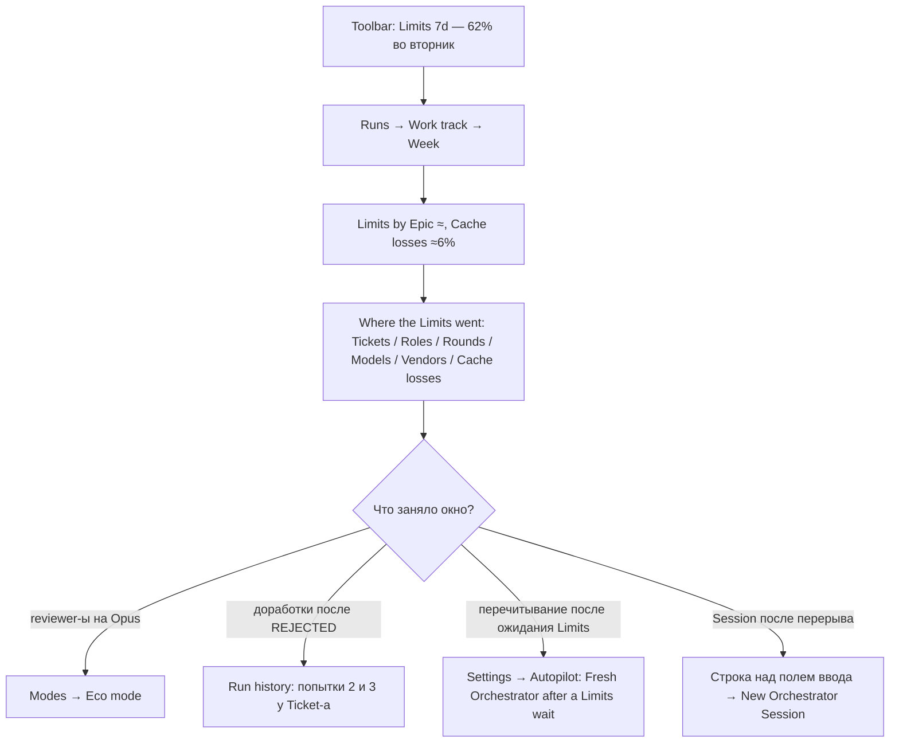

# worfy-limits-ledger: Куда ушли Limits: расход по Session, роли, Ticket-у и модели и потери prompt cache с их ценой

Status: черновик 2026-11-13 из исследования конкурентов, владельцем не принят
Critic: [docs/product/critic/worfy-limits-ledger-2026-11-14.md](../../docs/product/critic/worfy-limits-ledger-2026-11-14.md) — Split.
Critic: не запускался.
Source: исследование конкурентов 2026-11-13 ([папка](../../docs/research/2026-11-13-competitors/)), идеи
`reliability-cost-3` (куда ушли Limits: по Session, роли, Ticket-у и модели) и `reliability-cost-6` (потери prompt
cache: причина, цена перечитывания разговора, новый разговор). Досье:
[openhands](../../docs/research/2026-11-13-competitors/openhands.md),
[orca](../../docs/research/2026-11-13-competitors/orca.md),
[factory-droids](../../docs/research/2026-11-13-competitors/factory-droids.md),
[claude-code-cloud-sessions-and-projects](../../docs/research/2026-11-13-competitors/claude-code-cloud-sessions-and-projects.md),
[claude-code-agent-teams](../../docs/research/2026-11-13-competitors/claude-code-agent-teams.md),
[claude-code-agent-view](../../docs/research/2026-11-13-competitors/claude-code-agent-view.md),
[claude-code-plugins-and-marketplaces](../../docs/research/2026-11-13-competitors/claude-code-plugins-and-marketplaces.md),
[codex-app-codex-in-the-chatgpt-desktop-app](../../docs/research/2026-11-13-competitors/codex-app-codex-in-the-chatgpt-desktop-app.md),
[jetbrains-air](../../docs/research/2026-11-13-competitors/jetbrains-air.md),
[devin-desktop-formerly-windsurf](../../docs/research/2026-11-13-competitors/devin-desktop-formerly-windsurf.md),
[kiro](../../docs/research/2026-11-13-competitors/kiro.md). Замеры worfy: `scripts/agent-cost.mjs` и
[worfy-throughput, Ticket 19](../worfy-throughput/issues/19-замер-стоимости-и-простоев-агентов-по-транскриптам.md).
Зависит от: [worfy-resource-planner](../worfy-resource-planner/spec.md) (доля окна на Wave из журнала, Epic forecast),
[worfy-flight-recorder](../worfy-flight-recorder/spec.md) (факты Run-а, попытки Span-а),
[worfy-work-track](../worfy-work-track/spec.md) (чтение транскриптов «только названия», кэш в памяти),
[worfy-multi-vendor](../worfy-multi-vendor/spec.md) (Vendor Codex, окна Limits Vendor-а).
Ticket-ы: Epic `worfy-limits-ledger`, 14 Ticket-ов, нумерация с `01`; файлов `issues/` пока нет.
Термины — по [CONTEXT.md](../../CONTEXT.md). Слово «расход» осталось только в названии Epic-а; в тексте — «сколько
Limits ушло», «доля окна», token-ы. Термины «Оценка доли Limits» и «Потеря cache» Ticket 13 вносит в CONTEXT.md.

## Проблема

Пользователь видит, что неделя Limits быстро кончается, но не видит, что её съело: какой Ticket, какая роль, первый
проход или доработка после REJECTED (вердикт reviewer-а «не принято»). Не видно и того, сколько ушло на перечитывание
разговора после потери prompt cache, поэтому решать, где включить Eco mode (роли Subagent-ов на моделях подешевле) или
начать разговор заново, не на чем.

Что есть сейчас:

- **Только доли окон.** Toolbar показывает «Limits» — полосу на каждое окно Vendor-а
  (`docs/features/transcripts-and-usage.md:180-212`). Чем окно занято, он не говорит.
- **Cost — только у Orchestrator-а и в долларах API.** В шапке Session «Cost» показывает число только у
  Orchestrator-а, у остальных Session — прочерк (`docs/features/sessions.md:216-218`). Node Orchestrator-а показывает
  сумму с tooltip «Cost of this Session» (`src/renderer/canvas/nodes/OrchestratorNode.tsx:158`). Это `total_cost_usd`
  из SDK (`src/shared/vendors/claude/events.ts:322-329`), который суммирует `CostCounter`
  (`src/main/agent/orchestrator.ts:103`): цена по прайсу API, а не доля подписки. После «New Orchestrator Session»
  счёт начинается с нуля (`docs/features/sessions.md:253-256`). Codex всегда даёт `costUsd: 0`
  (`src/main/vendors/codex/items.ts:372`).
- **Числа cache приходят, но не показаны.** Событие `result` несёт `cacheCreationInputTokens` и `cacheReadInputTokens`
  (`src/shared/agent/events.ts:349-354`), событие `context` — размер контекста (`:140`). Ни один экран не показывает,
  какая доля входа прочитана из cache и где cache потерян.
- **Run history и Work track считают время, а не Limits.** Сводка Run-а называется «Where the time went»
  (`src/renderer/flight-recorder/SummaryStrip.tsx:31`), сводка Work track — «Hours by Epic»
  (`src/renderer/work-track/SummaryRow.tsx:38`). Readers обоих оставляют от ответа модели только роль и названия:
  `kept.message = { role, content }` (`src/main/work-track/transcripts.ts:195`,
  `src/main/flight-recorder/transcripts.ts:196`). `message.usage` и `message.model` отбрасываются.
- **Журнал знает рост окна на Wave, но не на Ticket.** Строки `wave-started` и `wave-finished` несут доли окон
  (`src/shared/autopilot/journal.ts:200-214`), `run-stopped` — фактическую долю Run-а
  (`docs/features/run-planning.md:179-182`). Рост окна за Wave делится на её Ticket-ы поровну
  (`src/shared/autopilot/limits-estimate.ts:2-3`, `:63-67`). Все Ticket-ы весят одинаково, долг «Размер Ticket-а в
  прогнозе» открыт (`.scratch/worfy-resource-planner/spec.md:247`).
- **Замер есть, но только у разработчика worfy.** `scripts/agent-cost.mjs` считает token-ы и доллары API по ролям
  (`:297-308`), по Ticket-ам (`--by-ticket`, `:54-59`) и перезаписи cache после простоя (`--idle`, `:67-73`). Его
  числа уже меняли решения. За неделю 20–27.10 перезаписи cache после простоя дольше 5 min заняли $687,76, 24,6 % всего
  (`.scratch/worfy-throughput/issues/19-замер-стоимости-и-простоев-агентов-по-транскриптам.md:81`), доля
  Orchestrator-а — 21,1 % (`:83`). После 1 h cache у implementer-ов 782 перезаписи ($771,79) сменились нулём
  (`.scratch/worfy-throughput/issues/31-1h-prompt-cache-ролям-с-неизбежным-ожиданием.md:121`). Но это терминал,
  доллары API вместо доли недели и только машина разработчика. В Ticket-е Eco mode записано, что базы «сколько token-ов
  уходит на агентов одного Ticket-а» нет (`.scratch/worfy-throughput/issues/36-режим-eco-агентов-на-ticket-поле-profile.md:20`).
- **Потерю cache не видно в момент решения.**
  - После ожидания Limits Autopilot шлёт одно сообщение-продолжение в ту же Session
    (`src/main/autopilot/limits-wait.ts:37-43`, `docs/features/autopilot-faults.md:34-35`). Ожидание сброса окна
    длится часы (окно 5 часов) или дни (окно 7 дней), а cache main conversation на подписке живёт 1 h
    (`.scratch/worfy-throughput/spec.md:501-504`). Первый ответ после ожидания пишет в cache весь разговор заново.
    Новую Session Autopilot берёт только между Wave-ами (`src/main/autopilot/run.ts:2171-2173`).
  - Picker модели в Session (`src/renderer/session/composer/Pickers.tsx`) не говорит, что смена модели перечитает
    весь разговор: cache у каждой модели свой, смена его теряет
    (`node_modules/@anthropic-ai/claude-agent-sdk/sdk.d.ts:2717`).
  - Session, к которой вернулись после перерыва, ничего не говорит о том, что cache уже нет: context meter показывает
    только заполнение до порога autocompact (`docs/features/sessions.md:237-241`).
- Поэтому Eco mode (`docs/features/orchestrator-modes.md:28-32`) и «New Orchestrator Session» выбирают без данных.

## Решение

worfy берёт каждый ответ модели на этой Machine с его token-ами и сводит их по Session, роли, Ticket-у, раунду
(первый проход или доработка), модели и Vendor-у. Отдельно он находит потери cache: ответы, которые записали в prompt
cache больше половины своего контекста, хотя разговор уже шёл. У каждой потери есть причина и цена. Token-ы
переводятся в оценку доли 7-дневного окна по журналам Autopilot-а: сколько окна в прошлых Wave-ах приходилось на
единицу token-ов. Всё считается при открытии и нигде не хранится, как у Run history и Work track (ADR-0092).

Единица на экране — оценка доли недели со знаком «≈» и token-ы рядом. Пока калибровки нет (меньше 5 Wave-ов с
данными), экран показывает только token-ы и «not enough data». Доллары по прайсу API — только в tooltip-е, с пометкой
«API-equivalent» (Q1, Q2).

### Где это видно

1. **Run history: блок «Where the Limits went»** под сводкой «Where the time went». Вкладки Tickets, Roles, Rounds,
   Models, Cache losses. Итог: «≈22% of the week by tokens · actual 24% (journal)». Строка «Not counted» — разница
   факта журнала и оценки: другие Machine, claude.ai, Live summary, Terminal AI.
2. **Work track.** Рядом с «Hours by Epic» — «Limits by Epic» и итог периода «≈ % of the week». Щелчок открывает
   панель периода с теми же вкладками и вкладкой Vendors. Панель Span-а показывает token-ы, долю чтения из cache и
   оценку доли.
3. **Chip на карточке Ticket-а и на Node Session и Orchestrator-а**: `≈3% · 91% cached`. Tooltip: первый проход и
   доработка, роли, модели, потери cache.
4. **Строка перед действием, которое теряет cache.** В picker-е модели: «Switching to Sonnet re-reads ≈180K tokens of
   this conversation (≈0.7% of the week)». Над полем ввода Session, которая простояла дольше жизни cache: «Not cached
   any more: the next message re-reads ≈210K tokens (≈1.6% of the week)». У Orchestrator-а рядом — «New Orchestrator
   Session» с оценкой нового старта. Строка ничего не блокирует (Q4). Та же оценка — в строке Auto-continue перед
   продолжением.
5. **Правило Autopilot-а: новый Orchestrator после ожидания Limits.** Когда окно сбросилось, а перечитывание старой
   Session дороже старта новой на порог и больше, Run начинает новую Session Orchestrator-а. Она читает
   `wave-brief <epic>` и продолжает Wave по «How to resume a wave». Строка журнала `resumed` говорит, что Session новая
   и сколько token-ов перечитала бы старая. В Settings → Autopilot — переключатель и порог (Q3). Только Claude.

### Как пользователь этим пользуется



1. Во вторник toolbar показывает 62 % недели. Пользователь открывает Runs → Work track, период Week.
2. В сводке: «Limits by Epic» — `worfy-ui-kit` ≈18 %, без Epic-а ≈9 %; «Cache losses ≈6% of the week».
3. Щелчок по сводке открывает «Where the Limits went» за неделю. Вкладка Roles: reviewer-ы на Opus — ≈11 %. Под
   таблицей подсказка: Eco mode переводит роли Subagent-ов на Sonnet (Q6). Пользователь включает Eco mode в Modes.
4. Вкладка Rounds: доработки после REJECTED — ≈7 %, больше всего у Ticket-а 06. Щелчок по строке открывает Run history
   этого Run-а с попытками `#2` и `#3`.
5. Вкладка Cache losses: «after a Limits wait ≈3%» — три продолжения в ту же Session по 400K token-ов. Пользователь
   включает «Fresh Orchestrator after a Limits wait» в Settings → Autopilot.
6. После обеда он возвращается к Orchestrator-у. Над полем ввода — строка о перечитывании. Он нажимает «New
   Orchestrator Session» или пишет дальше, зная цену.

### Экран

```
Runs ▸ Work track ▸ Week · Nov 10–16
┌ Hours by Epic ─────────────────┐ ┌ Limits by Epic · estimate from tokens ─┐
│ worfy-ui-kit  ▇▇▇▇▇▇▇ 31 h     │ │ worfy-ui-kit  ▇▇▇▇▇▇▇ ≈18%             │
│ (no Epic)     ▇▇ 9 h           │ │ (no Epic)     ▇▇▇▇ ≈9%                 │
└────────────────────────────────┘ │ ≈41% of the week · cache losses ≈6%    │
                                   └────────────────────────────────────────┘

Where the Limits went · Nov 10–16 · estimate from tokens, calibrated on 10 Waves
[Tickets] [Roles] [Rounds] [Models] [Vendors] [Cache losses]
 worfy-ui-kit/06   ▇▇▇▇▇▇   ≈5.1%   4.2M tok   91% cached   first ≈3.0 · rework ≈2.1
 worfy-ui-kit/10   ▇▇▇      ≈2.4%   2.0M tok   94% cached   first ≈2.4
 Orchestrator      ▇▇▇▇▇▇▇  ≈7.9%   9.8M tok   95% cached
 No Ticket         ▇▇       ≈1.8%   1.5M tok   88% cached
 Other Projects on this Machine     ≈4.0%

[Cache losses]
 cause                  losses   re-written   ≈ week
 after a Limits wait         3       1.2M     ≈3.1%
 pause > cache life         41       2.0M     ≈1.9%
 model switch                2       0.3M     ≈0.4%
 compaction                  5       0.2M     ≈0.2%
 unknown                     4       0.1M     ≈0.1%

Run history: the same block under «Where the time went», plus
 Not counted (journal − estimate)   ≈3%   other Machines, claude.ai, Live summary, Terminal AI

Ticket card                            Session view, above the input field
┌ 06 Kit Dialog ─────────────────┐    ┌────────────────────────────────────────────────────┐
│ ●●●○ Review · PR #1839         │    │ Not cached any more: the next message re-reads     │
│ [gate ✓] [CI ✓] [VERIFIED]     │    │ ≈210K tokens (≈1.6% of the week).                  │
│ [≈3% · 91% cached]             │    │ [New Orchestrator Session · starts with ≈30K]      │
└────────────────────────────────┘    └────────────────────────────────────────────────────┘
```

## Как это сделано у конкурентов

- **OpenHands** считает token-ы по каждому id, вплоть до `task:<id>`, панель Usage называет сумму оценкой по ценам API,
  есть Budget meter и цена в Activity Log ([openhands](../../docs/research/2026-11-13-competitors/openhands.md),
  «Лимиты и стоимость», строки 975–997). Берём: честную метку «оценка» и разбивку до задачи.
- **Orca**: Stats — token-ы по дню, проекту и модели, доля повторного чтения cache, ходы без чтения cache, «Est.
  API-equivalent cost» с пометкой «inferred pricing» ([orca](../../docs/research/2026-11-13-competitors/orca.md),
  строки 287–289). Там же видно, что бывает без связи учёта с оркестрацией: heartbeat-ы заняли 5-часовое окно
  примерно за 2,5 h, оркестрация на окно не смотрит. Берём: долю чтения из cache; привязки к Ticket-у и раунду у Orca нет.
- **Factory Droids**: новые tools добавляются в конец списка, 98 % входа читается из cache, монитор называет, что
  сбросило cache; смена модели без учёта cache стоила 2,12–2,37 × базы, с учётом — 0,19–0,28 ×; команды `/limits`,
  `/cost`, `/stats`, `/context`, письма на 80 % и 100 %
  ([factory-droids](../../docs/research/2026-11-13-competitors/factory-droids.md), строки 670–674, 929). Берём: причину
  потери cache и строку перед сменой модели.
- **Claude Code, облачные Session**: cache живёт 1 h, ветка после простоя перечитывает весь разговор; CLI v2.1.304
  предупреждает перед дорогим resume; пользователь с 476M token-ов на 8 ветках не смог узнать, куда они ушли (#108111);
  первый запрос после сброса занял 30–40 % окна (#68973)
  ([claude-code-cloud-sessions-and-projects](../../docs/research/2026-11-13-competitors/claude-code-cloud-sessions-and-projects.md),
  §14–15, строки 635, 708). Берём: строку перед продолжением остывшего разговора.
- **Claude Code agent teams и agent view**: lead тратил 13 % входа (22,2 % с пробуждениями) на уведомления;
  пользователи просят dashboard token-ов по агентам (#24537); в agent view нет колонки token-ов на Session
  ([claude-code-agent-teams](../../docs/research/2026-11-13-competitors/claude-code-agent-teams.md), строки 833, 886;
  [claude-code-agent-view](../../docs/research/2026-11-13-competitors/claude-code-agent-view.md), строки 473–476).
  Подтверждает спрос на разбивку по ролям.
- **Claude Code plugins**: 71 % недели ушло на перечитывание контекста; `/usage` показывает долю по
  plugin-ам; отчёты session-report и receipts читают транскрипты вместе с транскриптами Subagent-ов
  ([claude-code-plugins-and-marketplaces](../../docs/research/2026-11-13-competitors/claude-code-plugins-and-marketplaces.md),
  строки 319, 488, 1084–1085). Берём: чтение транскриптов Subagent-ов.
- **Codex app**: доля окна выросла на 67 пунктов за 38 s, опрос ждущих агентов занял 19,8 % token-ов, fan-out на ~12
  Session — ~50 % 5-часового окна за 10 s; в telemetry есть `codex.turn.cost_microusd`
  ([codex-app-codex-in-the-chatgpt-desktop-app](../../docs/research/2026-11-13-competitors/codex-app-codex-in-the-chatgpt-desktop-app.md),
  строки 752–754, 846–851). Подтверждает, что учёт нужен по Session и по Vendor-у.
- **JetBrains Air** показывает цену Session с пометкой «точная», «приблизительная» или «нет данных»
  ([jetbrains-air](../../docs/research/2026-11-13-competitors/jetbrains-air.md), строки 268–276). Берём: метку
  точности.
- **Devin Desktop**: `/session-stats`, token-ы на ответ и таймер prompt cache
  ([devin-desktop-formerly-windsurf](../../docs/research/2026-11-13-competitors/devin-desktop-formerly-windsurf.md),
  строки 486–491). Берём: «cache уже нет» как строку в Session.
- **Kiro**: прогноз дня, когда кончатся credits, и предупреждения на 80 %
  ([kiro](../../docs/research/2026-11-13-competitors/kiro.md), строки 331, 488). Не берём: прогноз у worfy уже есть
  (Epic forecast).

Token-ы к Ticket-у и раунду ревью не привязывает никто из них. Этого и не хватает, и это делает worfy.

## Истории пользователя

1. Как пользователь, я хочу видеть, какую долю недели заняли Epic-и, Ticket-ы и Session-ы за день, неделю и месяц,
   чтобы понять, чем занято окно.
2. Как пользователь, я хочу видеть долю по ролям (Orchestrator, implementer, verifier, reviewer, scout) и моделям,
   чтобы решить, где включить Eco mode.
3. Как пользователь, я хочу видеть, сколько ушло на доработку после REJECTED против первого прохода, по Ticket-у и в
   сумме, чтобы находить Ticket-ы, которые дорого переделываются.
4. Как пользователь, я хочу видеть долю Ticket-а на его карточке, чтобы не открывать Run history ради одного числа.
5. Как пользователь, я хочу видеть потери prompt cache с причиной и ценой, чтобы знать, сколько уходит на
   перечитывание разговоров.
6. Как пользователь, я хочу перед сменой модели знать, сколько token-ов перечитает разговор, чтобы сменить её в начале
   или начать новую Session.
7. Как пользователь, я хочу, вернувшись к Session после перерыва, знать, что cache уже нет и сколько стоит следующее
   сообщение против нового разговора.
8. Как пользователь, я хочу, чтобы Autopilot после ожидания Limits начинал новую Session Orchestrator-а, когда так
   дешевле, и писал это в журнал.
9. Как пользователь, я хочу видеть, насколько оценка точна: на скольких Wave-ах она откалибрована, что не посчитано и
   насколько оценка Run-а разошлась с журналом, чтобы не принимать оценку за факт.
10. Как пользователь, я хочу видеть Codex рядом с Claude по token-ам и доле чтения из cache, чтобы сравнивать Vendor-ы
    на одной работе.
11. Как пользователь, я хочу, чтобы в учёт не попадал текст ходов и имена Project-ов других папок.

## Решения по реализации

- **Правило ответа — в общем модуле.** Правило из `scripts/agent-cost.mjs` переезжает в `src/shared/usage/response.mjs`
  с типами в `response.d.mts`: plain JavaScript без Node-модулей, как `src/shared/workflow/verdict.mjs:1-4`, чтобы
  script импортировал его без сборки. Правило: ответ считается один раз по `message.id` во всех файлах — самое раннее
  время и наибольшее значение каждого счётчика (`agent-cost.mjs:433-449`); модель `<synthetic>` пропускается (`:365`);
  `cache_creation` делится на `ephemeral_5m_input_tokens` и `ephemeral_1h_input_tokens` (`:368-388`); контекст —
  input + cache read + обе записи (`:410`); перезапись — ответ, записавший больше половины контекста (`:573`). Веса —
  отношения цен `PRICES` (`:26-32`) и `FAST_MULTIPLIER` (`:35`); веса подписки не опубликованы, отношения цен API — их
  замена. Модуль задаёт и форму записи ответа `UsageRecord`: Session, Subagent, время, модель, счётчики. Отчёт script-а
  после переезда тот же.
- **Readers оставляют числа, текст — нет.** `NamesOnly.record` Work track (`src/main/work-track/transcripts.ts:157-200`)
  и такой же фильтр Flight Recorder (`src/main/flight-recorder/transcripts.ts:196`) оставляют от `message` ещё `id`,
  `model` и числовые поля `usage`. Текст по-прежнему не проходит (решение владельца «Только названия»,
  `.scratch/worfy-work-track/spec.md:62`). Reader отдаёт список `UsageRecord` рядом с фактами, а не внутри них: потерям
  cache нужна последовательность ответов разговора, а не сумма Span-а. Кэш транскриптов в памяти (`TranscriptCache`,
  `src/main/work-track/transcripts.ts:261`) держит и этот список.
- **Чистые модули.**
  - `src/shared/usage/ledger.ts` — срезы по Epic-у, Ticket-у, Session, роли, раунду, модели, Vendor-у. Ответ относится
    к факту Work track или Flight Recorder, внутри которого он по Session и времени.
  - `src/shared/usage/cache-loss.ts` — потери cache. Потеря — не первый ответ разговора, который записал больше
    половины своего контекста. Причина — первая подходящая по порядку: compaction (перед ответом строка
    `isCompactSummary`, она уже в `KEPT_FIELDS`, `src/main/flight-recorder/transcripts.ts:128`); смена модели (у
    прошлого ответа другая `model`); ожидание Limits (пауза покрывает `limits-hit` и `resumed` журнала,
    `src/shared/autopilot/journal.ts:575-577`); пауза дольше жизни cache (5 min или 1 h — по тому, куда писал прошлый
    ответ); смена списка tools (только живая Session worfy, по событию `mcp`, `src/shared/agent/events.ts:141-147`);
    иначе «unknown». Цена потери — записанные token-ы × (вес записи − вес чтения): столько бы не ушло, будь cache жив.
    Там же оценка перечитывания для строк перед действием: контекст × вес записи против контекста × вес чтения.
  - `src/shared/usage/share-estimate.mjs` — калибровка, plain JavaScript для script-а. Выборка — Wave-ы из журналов
    Autopilot-а всех Project-ов этой Machine (`journalDir`, `src/main/autopilot/journal.ts:40-42`): окно Limits одно на
    аккаунт. Рост окна за Wave — `waveGrowth` (`src/shared/autopilot/limits-estimate.ts:50-61`, там же отброс сброса
    окна и старых чисел). Делитель — взвешенные token-ы всех транскриптов этой Machine за время Wave. Оценка —
    медиана последних 10 выборок (`ESTIMATE_WAVES`, `:19`); меньше 5 (`FORECAST_MIN_SAMPLES`,
    `src/shared/autopilot/forecast.ts:13`) — оценки нет. Codex — отдельно, по Run-ам на Codex, с порогом
    `VENDOR_ESTIMATE_MIN_WAVES` (`src/shared/autopilot/budget-window.ts:24`).
  - `src/shared/autopilot/fresh-after-wait.ts` — решение Autopilot-а (ниже).
- **Роли.** Orchestrator; другая Session; implementer; verifier (agent `worfy:reviewer` с линзой «implementer's
  report», имя `verify-<NN>`, `harness/skills/epic-wave/SKILL.md:383-387`, `:523`); reviewer (остальные reviewer-ы и
  sceptic-и); scout; другой Subagent. Роль берётся из `agentType` и имени Subagent-а в фактах. `roleOf` script-а
  считает verifier reviewer-ом, а любую Session — Orchestrator-ом (`scripts/agent-cost.mjs:297-308`); учёт их
  разделяет, потому что Eco mode называет verifier отдельной ролью (CONTEXT.md, Eco mode), а script остаётся как есть.
- **Orchestrator — своя строка уровня Epic-а.** `--by-ticket` делит Orchestrator-а поровну между Ticket-ами Wave
  (`scripts/agent-cost.mjs:54-59`). Учёт так не делает: доля Orchestrator-а (21,1 % в замере Ticket-а 19) — сама по
  себе находка, а ровная делёжка прячет её в Ticket-ах.
- **Раунды.** Внутри Run-а — номер попытки и `retryOf` Span-а (`src/shared/flight-recorder/spans.ts:96-98`,
  `:413-416`): попытка 1 — первый проход; 2 и больше — доработка, её причина — Span с исходом rejected или stopped.
  Строки `narrow-round` журнала (`src/shared/autopilot/journal.ts:568`) — узкий раунд после вердикта `NARROW:`
  (`harness/skills/epic-wave/SKILL.md:681-683`). Вне Run-а — по фактам Work track: implementer того же Ticket-а после
  вердикта REJECTED (`verdictOf`, `src/main/work-track/transcripts.ts:126`). Orchestrator по раундам не делится.
- **Ticket ответа.** Внутри Run-а — Ticket факта Flight Recorder (`src/shared/flight-recorder/facts.ts:172-212`); вне
  Run-а — `ticket` и `epic` фактов Work track (`src/shared/work-track/facts.ts:56-80`), которые reader ставит, только
  когда уверен; на Canvas вживую — Binding Session или Subagent-а (`src/shared/binding/resolve.ts`). Не нашлось —
  строка «No Ticket»: при сомнении лучше она, чем чужой Ticket.
- **Codex.** Вживую — `thread/tokenUsage/updated` (`src/main/vendors/codex/items.ts:254-262`) со счётчиками хода,
  включая `cachedInputTokens` и `cacheWriteInputTokens`
  (`src/main/vendors/codex/protocol/ts/v2/TokenUsageBreakdown.ts`). История — новый необязательный `usage(id)` у
  `HistoryPart` (`src/main/vendors/history.ts:21-29`): запрос `account/usage/read` с `threadId`
  (`protocol/ts/v2/GetAccountTokenUsageParams.ts`) отвечает `ThreadUsage` с группами по модели
  (`ThreadUsageBreakdownGroup.ts`). Сейчас worfy зовёт только `account/rateLimits/read`
  (`src/main/vendors/codex/limits.ts:120`). У `Turn` счётчиков нет, поэтому история Codex — суммы по thread-у, а потери
  cache Codex видны только для ходов, прошедших при открытом worfy. `estimatedUsageCreditsMicros` не показывается.
- **Строки перед действием.** Контекст — из события `context` (`src/shared/agent/events.ts:140`); время последнего
  ответа и жизнь cache — из последнего ответа (куда он писал: 5 min или 1 h). Оценка нового старта — контекст первого
  ответа последней новой Session Orchestrator-а этого Project-а; без неё — первого ответа любой новой Session
  Project-а. Канал учёта отдаёт коэффициент калибровки, renderer считает строку сам: picker
  (`src/renderer/session/composer/Pickers.tsx`), поле ввода (`src/renderer/session/MessageInput.tsx`), Auto-continue
  (`src/renderer/session/composer/ContinueCountdown.tsx`).
- **Hook-и SDK.** `options.hooks` сейчас ставит только `toolUseHooks` (`src/main/vendors/claude/options.ts:427`,
  `:744`); новые callbacks добавляются к ним, а не вместо. `SessionStart` с source `resume` даёт
  `seconds_since_last_response`, `prompt_cache_likely_expired` и `context_tokens`
  (`node_modules/@anthropic-ai/claude-agent-sdk/sdk.d.ts:6478-6500`): строка для Session, которую worfy продолжил после
  перерыва (Orchestrator при открытии, `docs/features/sessions.md:256`). `PostModelSwitch` даёт `prompt_cache_warm`,
  `cache_ttl` и `context_tokens` (`sdk.d.ts:2572-2608`): точная причина следующей потери. `PreModelSwitch` не ставится:
  строка worfy показывается до смены, а ответ hook-а `ask` в Session без человека отменяет смену (`sdk.d.ts:2731-2738`).
  Compaction worfy уже видит сам (`src/shared/vendors/claude/events.ts:438-443`, `src/main/vendors/claude/session.ts:527`).
- **Правило Autopilot-а.** `fresh-after-wait.ts` отвечает «новая Session» после ожидания Limits, когда верно всё:
  (1) включено в Settings; (2) Vendor Run-а — Claude; (3) Harness не `legacy`; (4) Orchestrator свободен — нет хода,
  живой задачи и сообщения в очереди: те же условия, что у новой Session между Wave-ами
  (`src/main/autopilot/run.ts:2173`); (5) оценка перечитывания старой Session минус оценка нового старта не меньше
  порога. Тогда `newSession(run)` (`run.ts:2248-2285`) и текст: выполнить `wave-brief <epic>`
  (`harness/skills/epic-wave/SKILL.md:1826`), продолжить Wave по «How to resume a wave» (`:1834`) и, как сейчас,
  записать паузу в HANDOFF (`src/main/autopilot/limits-wait.ts:37-43`). Иначе — как сейчас, продолжение в ту же
  Session. Строка `resumed` (сейчас без полей, `src/shared/autopilot/journal.ts:577`) получает необязательные `fresh`
  и `reread` (token-ы, которые перечитала бы старая Session); старые строки читаются как раньше. Настройка — новое поле
  рядом с `autopilotBudget` и `autopilotRun` (`src/shared/settings/app-settings.ts:43-52`), экран —
  `src/renderer/settings/AutopilotSection.tsx`. Auto-continue ручного хода (`src/main/agent/orchestrator-continue.ts`)
  Session не меняет: там решает пользователь, строка только показывает оценку.
- **Service и каналы.** `src/main/usage/service.ts` берёт записи ответов у readers Work track и Flight Recorder (их кэш
  в памяти), журналы и Codex. Каналы — `src/shared/ipc/ledger.ts` и `src/main/ipc/ledger.ts`, по образцу
  `src/shared/ipc/work-track.ts` и `src/main/ipc/work-track.ts`. Ответ — срезы и итог для периода, Run-а, Ticket-а или
  Session и коэффициент калибровки с числом Wave-ов.
- **Chip.** `src/renderer/canvas/badges/LimitsShare.tsx` в slot-ах badges (`src/renderer/canvas/badges/index.ts`,
  subject — ticket, session или epic). Высота карточки Ticket-а считается из данных, и место под chip из snapshot-а
  main получает только карточка, которую snapshot называет, как у chip-ов ревью (`src/renderer/canvas/ticket-card.ts:56-70`;
  `src/renderer/canvas/nodes/TicketNode.tsx:23-35` требует места под всё новое).
- **Run history и Work track.** `src/renderer/flight-recorder/LimitsBlock.tsx` под `SummaryStrip.tsx` в
  `RunHistoryView.tsx`. В Work track — `SummaryRow.tsx` («Limits by Epic» рядом с «Hours by Epic»), новый
  `LimitsPanel.tsx` для панели периода, строки token-ов в `SpanPanel.tsx`.
- **Хранение и приватность.** На диск ничего не пишется; всё считается при открытии и живёт в памяти (ADR-0092).
  Только эта Machine: Linked machine не читается. От транскриптов других папок берутся только числа ответа, время и
  модель, имена их Project-ов не показываются — одна строка «Other Projects on this Machine» (Q7). Тексты UI —
  английские.
- **Документация.** Новая страница Feature `docs/features/limits-ledger.md` и перевод
  `docs/features/ru/limits-ledger.md`; ссылки из `docs/features/transcripts-and-usage.md` (раздел Limits) и
  `docs/features/run-planning.md`.

## Решения по test-ам

- Test-ы проверяют поведение снаружи: что видно на экране и что записано в журнал. Внутренние структуры не проверяются.
- **Без моделей и без сети.** Session — `WORFY_AGENT=fake` (`src/main/agent/fake-query.ts`), Codex — `WORFY_CODEX=fake`
  (`test/fixtures/codex-app-server/fake-app-server.mjs`), транскрипты и журналы — fixture-ы во временных
  `CLAUDE_CONFIG_DIR` и `WORFY_DATA_DIR`.
- **Seam 1 — unit, чистые модули.** `response.mjs`: ответ в двух файлах считается один раз, `<synthetic>` пропущен,
  записи 5m и 1h разведены. `cache-loss.ts`: fixture на каждую причину и на «unknown», порядок причин, цена.
  `share-estimate.mjs`: меньше 5 Wave-ов — оценки нет; Wave со сбросом окна — без выборки; медиана последних 10.
  `ledger.ts`: Orchestrator — строка Epic-а, раунды, «No Ticket». `fresh-after-wait.ts`: таблица из пяти условий.
  UI — рядом с `test/unit/ticket-card.test.tsx`, `test/unit/pickers-captions.test.tsx`,
  `test/unit/flight-recorder-view.test.tsx`, `test/unit/work-track-panel.test.tsx`.
- **Отчёт script-а не меняется.** `test/unit/agent-cost.test.ts` на fixture-ах
  `test/fixtures/agent-cost/{by-ticket,idle,project,waits}` проходит без правок после переезда правила (Ticket 01).
- **Seam 2 — contract.** Readers: `test/contract/work-track-transcripts.test.ts` и
  `test/contract/flight-recorder-transcripts.test.ts` — числа `usage` доходят, текст ходов по-прежнему нет. Codex: fake
  app-server отвечает на `account/usage/read` и шлёт `thread/tokenUsage/updated`. SDK: `test/contract/sdk-compat.test.ts`
  держит поля hook-ов `SessionStart` и `PostModelSwitch` закреплённой версии. Журнал:
  `test/contract/autopilot-journal.test.ts` — `resumed` с `fresh` и без. Settings: `test/contract/app-settings.test.ts`.
  Contract test-ы readers идут и на Windows runner-е (пути транскриптов).
- **Seam 3 — e2e.** Fixture-транскрипты и журналы двух Run-ов: блок в Run history (`test/e2e/flight-recorder.spec.ts`),
  «Limits by Epic» и панель периода (`test/e2e/work-track.spec.ts`), chip на карточке Ticket-а, строка в picker-е
  модели у fake Session, Run с fake отказом Limits — новая Session после ожидания и `resumed` с `fresh`
  (`test/e2e/autopilot.spec.ts`). Новый e2e spec — строка в `scripts/e2e-specs.table.json`.
- **Сначала падающий test** в каждом Ticket-е с кодом.
- Fixture-ы без домашних путей и имён Machine.

## Не в этом Epic-е

- Деньги как главная единица: доллары API — только в tooltip-е.
- Работа на Linked machine и в claude.ai: видна только как «Not counted» в Run history.
- Live summary и Terminal AI: они не оставляют транскрипта (`persistSession: false`,
  `src/main/vendors/claude/narrator.ts:60`, `src/main/vendors/claude/terminal-ai.ts:51`).
- Автоматический Eco mode и выбор модели по цене: учёт только показывает и подсказывает.
- Бюджет Limits на Ticket и остановка Ticket-а по нему.
- Размер Ticket-а в Epic forecast (долг worfy-resource-planner): учёт даёт для него данные, прогноз не меняет.
- Окна по семейству моделей (`seven_day_opus`, `src/shared/agent/limits.ts:47`): оценка — от общего 7-дневного окна.
- Своё хранилище и история дольше жизни транскриптов (`cleanupPeriodDays` 35, `.scratch/worfy-work-track/spec.md:60`).
- Новая Session для Auto-continue ручного хода и правило новой Session после ожидания для Codex.
- Ответ на вопрос «что было в ходе, который занял окно»: текст ходов учёт не читает.

## Ticket-ы

Номер пункта — номер Ticket-а (`01`–`14`). Все Ticket-ы, кроме 14, делает агент.

1. **Правило ответа и веса в общем модуле** — `src/shared/usage/response.mjs`, `UsageRecord`, script импортирует их,
   его отчёт не меняется. Blocked by: —.
2. **Калибровка доли окна** — `src/shared/usage/share-estimate.mjs` и `agent-cost.mjs --calibrate`; коэффициент и
   его разброс на машине владельца — в отчёт Ticket-а. Blocked by: 01.
3. **Срезы** — `src/shared/usage/ledger.ts`: роли, раунды, Ticket ответа, Orchestrator уровня Epic-а, «No Ticket».
   Blocked by: 01.
4. **Потери cache** — `src/shared/usage/cache-loss.ts`: правило, причины по порядку, цена, оценка перечитывания.
   Blocked by: 01.
5. **Readers Claude** — `id`, `model` и числа `usage` в readers Work track и Flight Recorder, список ответов, только
   числа из других папок. Blocked by: 01.
6. **Usage Codex** — живые счётчики хода, `usage(id)` у `HistoryPart` через `account/usage/read`, fake app-server.
   Blocked by: 01.
7. **Service и каналы** — `src/main/usage/service.ts`, `src/shared/ipc/ledger.ts`, `src/main/ipc/ledger.ts`,
   коэффициент калибровки для renderer-а. Blocked by: 02, 03, 04, 05, 06.
8. **Блок в Run history** — «Where the Limits went» под сводкой Run-а, итог с фактом журнала, «Not counted».
   Blocked by: 07.
9. **Work track** — «Limits by Epic», итог периода, панель периода, token-ы в панели Span-а. Blocked by: 07.
10. **Chip-ы** — `LimitsShare` на карточке Ticket-а и на Node Session и Orchestrator-а, место в `ticket-card.ts`.
    Blocked by: 07.
11. **Строки перед потерей cache** — picker модели, строка над полем ввода, Auto-continue, hook-и `SessionStart` и
    `PostModelSwitch`. Blocked by: 07.
12. **Новый Orchestrator после ожидания Limits** — `fresh-after-wait.ts`, `newSession` в Run-е, `resumed` с `fresh`,
    Settings → Autopilot. Blocked by: 07.
13. **Документация и термины** — `docs/features/limits-ledger.md` en и ru, ссылки, два термина в CONTEXT.md.
    Blocked by: 08, 09, 10, 11, 12.
14. **Приёмка владельцем** — владелец смотрит свою неделю в «Where the Limits went» и сверяет итог с toolbar.
    Blocked by: 01–13.

## Волны

| Wave | Ticket-ы | Почему так |
|---|---|---|
| 1 | 01 | правило ответа и `UsageRecord`, на которые опираются все остальные |
| 2 | 02, 03, 04, 05, 06 | чистые модули в разных файлах `src/shared/usage/`, readers Claude (`src/main/work-track/`, `src/main/flight-recorder/`), Codex (`src/main/vendors/codex/`): общих файлов нет |
| 3 | 07 | service и каналы собирают всё из Wave 2 |
| 4 | 08, 09, 10, 11, 12 | Run history (`src/renderer/flight-recorder/`), Work track (`src/renderer/work-track/`), Canvas (`src/renderer/canvas/`), Session (`src/renderer/session/`, `src/main/vendors/claude/options.ts`), Autopilot (`src/main/autopilot/`, Settings): общих файлов нет |
| 5 | 13 | документация по сделанному |
| 6 | 14 | приёмка |

Wave — Ticket-ы, которые можно брать параллельно: блокеры закрыты, общих файлов в «Где в коде» нет. Wave, которую
берут в работу, вычисляется заново в момент запуска (CONTEXT.md, термин Wave). Имена новых файлов в «Где в коде» —
предложение; implementer сверяет их с `main`. Ticket 02 стоит во второй Wave нарочно: число калибровки на реальных
журналах приходит до UI, и если разброс широкий, Wave 4 узнаёт это до того, как рисовать долю.

## Риски

- **Веса подписки не опубликованы.** Оценка берёт отношения цен API (`PRICES`). Если подписка считает Opus и Sonnet в
  другом отношении, доли ролей на разных моделях сдвигаются. Калибровка правит общий масштаб, но не отношение моделей.
  Ticket 02 меряет разброс по Wave-ам с разной смесью моделей; везде стоит «≈».
- **Калибровка шумная.** Если p10–p90 коэффициента шире половины медианы, экраны показывают token-ы первыми, а долю —
  в tooltip-е. Service (Ticket 07) отдаёт разброс вместе с коэффициентом, экраны Ticket-ов 08–11 по нему выбирают, что
  показать первым; порог уточняется по числам Ticket-а 02.
- **Работа вне этой Machine.** Другие Machine, claude.ai, Live summary и Terminal AI занимают окно, но транскриптов
  здесь нет: калибровка завышает долю на token. Медиана 10 Wave-ов сглаживает это, Run history показывает разницу как
  «Not counted».
- **Окна по семейству моделей.** Работа на Opus может упереться в `seven_day_opus` раньше общего окна, а учёт считает
  долю общего 7-дневного окна.
- **Чтение транскриптов дорого.** Месяц транскриптов — 4,1 GB и ~12 s при первом открытии
  (`.scratch/worfy-work-track/spec.md:96`), калибровка читает ещё и другие папки. Читаются только строки ответов,
  файлы вне времени выборки пропускаются по времени изменения, результат держит кэш в памяти.
- **Формат транскрипта меняется.** Поля `usage` и `cache_creation` — не публичный контракт. Contract test-ы на
  fixture-ах ловят смену; ответ без полей идёт в «Not counted», а не в ноль.
- **Codex отдаёт неполные числа.** Счётчики группы `ThreadUsageBreakdownGroup` могут быть `null`; история Codex — только
  суммы по thread-у. Строка без чисел показывает «unknown», а не ноль.
- **Новая Session посреди Wave.** Orchestrator теряет рабочую память: каких агентов ждал, что уже решил. Правило
  срабатывает, только когда ничего не идёт; `wave-brief` и «How to resume a wave» уже рассчитаны на продолжение после
  перерыва; e2e проверяет, что Wave доходит до конца.
- **Ticket ответа угадан неверно.** Вне Run-а Ticket берётся эвристикой; ошибка переносит долю между Ticket-ами. При
  сомнении ответ идёт в «No Ticket».
- **Оценку примут за факт.** Везде «≈», в заголовке — число Wave-ов калибровки, в Run history — факт журнала рядом.
- **Высота карточки Ticket-а.** Chip добавляет строку только карточкам с данными; `test/unit/ticket-card.test.tsx`
  держит высоту.
- **Версия SDK.** Hook-и есть в 0.3.289 из `node_modules` этого worktree, а `package.json:29` закрепляет 0.3.322. Если
  поля сменятся, строки работают на оценке worfy, hook-и только уточняют причину.

## Вопросы владельцу

1. **Единица на экране.** (а) Оценка доли недели «≈», без калибровки — token-ы *(рекомендую: так же говорит toolbar
   и Epic forecast)*; (б) только token-ы; (в) доллары по прайсу API, как у Orca и OpenHands.
2. **Cost в долларах у Orchestrator-а и в шапке Session.** (а) Заменить на оценку доли недели, доллары — в tooltip-е
   *(рекомендую)*; (б) оставить доллары и добавить долю рядом; (в) убрать доллары совсем.
3. **Новый Orchestrator после ожидания Limits.** (а) Включено по умолчанию, порог — 150K token-ов разницы
   *(рекомендую)*; (б) выключено по умолчанию; (в) всегда новая Session после ожидания, без порога.
4. **Строка перед потерей cache.** (а) Строка, ничего не блокирует *(рекомендую)*; (б) подтверждение перед сменой
   модели и перед сообщением в остывшую Session.
5. **Chip на карточке Ticket-а.** (а) Всегда, когда есть данные; карточка с данными выше на строку *(рекомендую)*;
   (б) без chip-а на карточке: доля только в Run history и в tooltip-е Node.
6. **Подсказка про Eco mode во вкладке Roles.** (а) Да, только текст со ссылкой на Modes *(рекомендую)*; (б) нет.
7. **Транскрипты других Project-ов этой Machine для калибровки.** (а) Да, только числа ответов, одна строка «Other
   Projects on this Machine» *(рекомендую: окно Limits одно на аккаунт)*; (б) нет, только этот Project — оценка
   завышает долю на token.

## Готово, когда

- [ ] Run history показывает «Where the Limits went» с вкладками Tickets, Roles, Rounds, Models, Cache losses, итог с
      фактом журнала и «Not counted».
- [ ] Work track показывает «Limits by Epic» и итог периода; панель периода — те же вкладки и Vendors; панель Span-а —
      token-ы, долю чтения из cache и оценку.
- [ ] Доработка после REJECTED отделена от первого прохода по Ticket-у и в сумме; Orchestrator — своя строка уровня
      Epic-а.
- [ ] Потери cache показаны с причиной (compaction, смена модели, ожидание Limits, пауза дольше жизни cache, смена
      tools, unknown) и оценкой доли.
- [ ] Без калибровки (меньше 5 Wave-ов) экраны показывают token-ы и «not enough data»; с калибровкой — «≈» и число
      Wave-ов.
- [ ] Chip `≈ · cached` есть на карточке Ticket-а и на Node Session и Orchestrator-а.
- [ ] Picker модели и Session после простоя показывают оценку перечитывания; у Orchestrator-а рядом «New Orchestrator
      Session» с оценкой нового старта.
- [ ] Autopilot после ожидания Limits начинает новую Session по правилу и порогу из Settings → Autopilot; строка
      `resumed` журнала говорит `fresh` и `reread`; Wave доходит до конца.
- [ ] Codex виден по token-ам и доле чтения из cache рядом с Claude.
- [ ] Отчёт `scripts/agent-cost.mjs` не изменился; `--calibrate` печатает коэффициент и его разброс.
- [ ] Текст ходов и имена Project-ов других папок не попадают ни в учёт, ни на экран; на диск учёт ничего не пишет.
- [ ] Страница Feature en и ru описывает Epic; два термина есть в CONTEXT.md.
- [ ] (manual) Владелец принял Epic.
