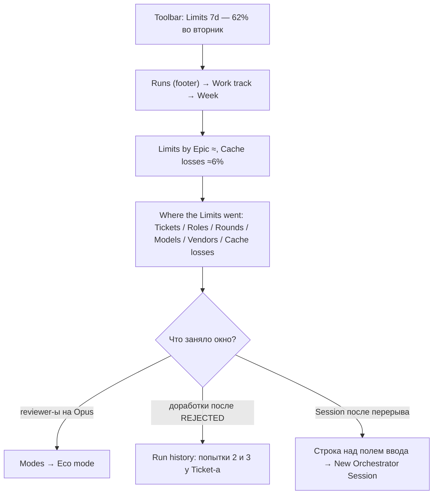

# worfy-limits-ledger: Куда ушли Limits: расход по Session, роли, Ticket-у и модели и потери prompt cache с их ценой

Status: черновик, переписан 2026-11-28 по решению владельца (Split); ждёт приёмки владельцем. Первый черновик —
2026-11-13 из исследования конкурентов.
Critic: [docs/product/critic/worfy-limits-ledger-2026-11-28.md](../../docs/product/critic/worfy-limits-ledger-2026-11-28.md) — Split;
возражения 1 (калибровка по текущему 7-дневному окну, а не по Wave-ам Autopilot), 2 (правило Autopilot-а Ticket-а 12 —
в Epic 2) и 3 (замена Cost на долю недели — в Ticket-е 10) и альтернатива (Split) приняты владельцем 2026-11-28.
Critic: [docs/product/critic/worfy-limits-ledger-2026-11-14.md](../../docs/product/critic/worfy-limits-ledger-2026-11-14.md) — Split;
его возражения 1–3 повторены в разборе 2026-11-28 почти дословно и решены там.
Решение владельца 2026-11-28: Split по разбору critic-а 2026-11-28 — Epic 1, учёт токенов: Ticket-ы 01, 03–11, Ticket 02
калибрует долю недели по текущему 7-дневному окну (не по Wave-ам Autopilot), замена Cost на долю недели — в Ticket-е 10;
Epic 2 позже — правило Autopilot Ticket-а 12, когда вкладка Cache losses покажет случай. Очерёдность — после
worfy-harness-guarantees; spec переписать перед приёмкой.
Source: исследование конкурентов 2026-11-13 ([папка](../../docs/research/2026-11-13-competitors/)), идеи
`reliability-cost-3` (куда ушли Limits: по Session, роли, Ticket-у и модели) и `reliability-cost-6` (потери prompt
cache: причина, цена перечитывания разговора, новый разговор). Досье:
[openhands](../../docs/research/2026-11-13-competitors/openhands.md),
[orca](../../docs/research/2026-11-13-competitors/orca.md),
[factory-droids](../../docs/research/2026-11-13-competitors/factory-droids.md),
[claude-code-cloud-sessions-and-projects](../../docs/research/2026-11-13-competitors/claude-code-cloud-sessions-and-projects.md),
[claude-code-agent-teams](../../docs/research/2026-11-13-competitors/claude-code-agent-teams.md),
[claude-code-agent-view](../../docs/research/2026-11-13-competitors/claude-code-agent-view.md),
[claude-code-plugins-and-marketplaces](../../docs/research/2026-11-13-competitors/claude-code-plugins-and-marketplaces.md),
[codex-app-codex-in-the-chatgpt-desktop-app](../../docs/research/2026-11-13-competitors/codex-app-codex-in-the-chatgpt-desktop-app.md),
[jetbrains-air](../../docs/research/2026-11-13-competitors/jetbrains-air.md),
[devin-desktop-formerly-windsurf](../../docs/research/2026-11-13-competitors/devin-desktop-formerly-windsurf.md),
[kiro](../../docs/research/2026-11-13-competitors/kiro.md). Замеры worfy: `scripts/agent-cost.mjs` и
[worfy-throughput, Ticket 19](../worfy-throughput/issues/19-замер-стоимости-и-простоев-агентов-по-транскриптам.md).
[CONTEXT.md](../../CONTEXT.md) — термины Session, Subagent, Orchestrator, Autopilot, Run, Run history, Work track, Span,
Wave, Ticket, Epic, Vendor, Machine, Linked machine, Limits, Eco mode, Orchestrator modes, Assistant, Settings.
Зависит от (все закрыты, кроме multi-vendor 43 — финальной приёмки): [worfy-resource-planner](../worfy-resource-planner/spec.md)
(доля окна в журнале, `actual` Run-а), [worfy-flight-recorder](../worfy-flight-recorder/spec.md) (факты Run-а, попытки
Span-а), [worfy-work-track](../worfy-work-track/spec.md) (чтение транскриптов «только названия», кэш в памяти),
[worfy-multi-vendor](../worfy-multi-vendor/spec.md) (Vendor Codex, окна Limits Vendor-а).
Связан с: [worfy-assistant](../worfy-assistant/spec.md), Ticket 27 (PR #2284) — журнал расхода Assistant-а
`<WORFY_DATA_DIR>/assistant/usage.json` и его оценка доли окна методом `cost-share` (Q8);
[worfy-harness-guarantees](../worfy-harness-guarantees/spec.md) — идёт раньше этого Epic-а (решение владельца), его
Ticket 10 добавляет блок Guard в тот же `RunHistoryView.tsx`, что и Ticket 08 здесь;
[worfy-limits-autopilot-rule](../worfy-limits-autopilot-rule/spec.md) — Epic 2, черновик: правило Autopilot-а бывшего
Ticket-а 12, ждёт данных вкладки Cache losses этого Epic-а.
Ticket-ы: Epic `worfy-limits-ledger`, 13 Ticket-ов — `01`–`11`, `13`, `14` (12 ушёл в Epic 2), файлы — [issues/](issues/).
Номера черновика сохранены, чтобы строки решения владельца читались как есть.
Слово «расход» осталось только в названии Epic-а; в тексте — «сколько Limits ушло», «доля окна», token-ы. Термины
«Оценка доли Limits» и «Потеря cache» Ticket 13 вносит в CONTEXT.md.

## Проблема

Пользователь видит, что неделя Limits быстро кончается, но не видит, что её съело: какой Ticket, какая роль, первый
проход или доработка после REJECTED (вердикт reviewer-а «не принято»). Не видно и того, сколько ушло на перечитывание
разговора после потери prompt cache. Поэтому решать, где включить Eco mode (меньше агентов на Ticket, роли Subagent-ов на
моделях подешевле) или начать разговор заново, не на чем.

Что есть сейчас (проверено по `origin/main` 2026-11-28, `c66e7215a`):

- **Только доли окон.** Toolbar показывает Limits — секцию на каждый Vendor и строку на каждое окно
  (`docs/features/transcripts-and-usage.md:183-217`, `src/renderer/shell/toolbar/LimitsMeter.tsx`). Чем окно занято, он
  не говорит.
- **Cost — только у Orchestrator-а и в долларах API.** В шапке Session view «Cost» показывает число только у
  Orchestrator-а, у остальных Session — прочерк (`docs/features/sessions.md:283-286`,
  `src/renderer/session/SessionView.tsx:416`). Node Orchestrator-а показывает сумму с tooltip «Cost of this Session»
  (`src/renderer/canvas/nodes/OrchestratorNode.tsx:158-159`). Это `total_cost_usd` из SDK
  (`src/shared/vendors/claude/events.ts:106`, `:370`), который складывает `CostCounter`
  (`src/main/agent/orchestrator.ts:104-112`): цена по прайсу API, а не доля подписки. После «New Orchestrator Session»
  счёт начинается с нуля (`docs/features/sessions.md:328-330`). Codex всегда даёт `costUsd: 0`
  (`src/main/vendors/codex/items.ts:386`, `src/main/vendors/codex/session.ts:542`).
- **Доля окна есть только у Assistant-а.** worfy-assistant Ticket 27 (PR #2284) делит процент окна по цене:
  доля Assistant-а = процент окна × цена его вызовов / цена всех ходов worfy с начала окна (`limitsShare`, метод
  `cost-share`, `src/shared/assistant/budget.ts:204-220`). Цены других ходов приносит `src/main/agent/turn-cost.ts` в
  журнал `<WORFY_DATA_DIR>/assistant/usage.json` (`src/main/assistant/budget/ledger.ts:1-15`), по часам, без ролей,
  Ticket-ов и token-ов. Ходы Claude Code в терминале, мимо worfy, этот журнал не видит. Session Assistant-а не
  оставляет транскрипта (`persistSession: false`, `src/main/vendors/claude/assistant-session.ts:86`): её token-ы есть
  только в `usage.json`.
- **Числа cache приходят, но не показаны.** Событие `result` несёт `cacheCreationInputTokens` и `cacheReadInputTokens`
  (`src/shared/agent/events.ts:367-372`), событие `context` — размер контекста (`:140`). Ни один экран не показывает,
  какая доля входа прочитана из cache и где cache потерян.
- **Run history и Work track считают время, а не Limits.** Сводка Run-а называется «Where the time went»
  (`src/renderer/flight-recorder/SummaryStrip.tsx:32`), сводка Work track — «Hours by Epic»
  (`src/renderer/work-track/SummaryRow.tsx:38`). Readers обоих оставляют от ответа модели только роль и содержимое без
  текста: `kept.message = { role, content }` (`src/main/work-track/transcripts.ts:195`,
  `src/main/flight-recorder/transcripts.ts:196`). `message.usage`, `message.model` и `message.id` отбрасываются.
- **Журнал Autopilot-а знает рост окна на Wave, но выборок почти нет.** Строки `wave-started` и `wave-finished` несут
  доли окон (`src/shared/autopilot/journal.ts:215`), `run-stopped` — фактическую долю Run-а `actual`
  (`docs/features/run-planning.md:179-182`). Рост окна за Wave делится на её Ticket-ы поровну
  (`src/shared/autopilot/limits-estimate.ts:1-3`, `:63-67`). Доля хранится в целых процентах (`0.58` в `limits.json`
  этой Machine 2026-11-28). Последний журнал Autopilot-а на этом Mac — 2026-11-19, из последних 10 Wave-ов четыре
  выросли на 0 (critic 2026-11-28, возражение 1). Поэтому калибровка по Wave-ам — шум, и черновик от неё отказался.
- **Замер есть, но только у разработчика worfy.** `scripts/agent-cost.mjs` считает token-ы и доллары API по ролям
  (`roleOf`, `:297-308`), по Ticket-ам (`--by-ticket`, `:54-59`) и перезаписи cache после простоя (`--idle`, `:67-73`).
  Его числа уже меняли решения. За неделю 20–27.10 перезаписи cache после простоя дольше 5 min заняли $687,76, 24,6 %
  всего (`.scratch/worfy-throughput/issues/19-замер-стоимости-и-простоев-агентов-по-транскриптам.md:81`), доля
  Orchestrator-а — 21,1 % (`:83`). После 1 h cache у implementer-ов 782 перезаписи ($771,79) сменились нулём
  (`.scratch/worfy-throughput/issues/31-1h-prompt-cache-ролям-с-неизбежным-ожиданием.md:121`). Но это терминал,
  доллары API вместо доли недели и только машина разработчика. В Ticket-е Eco mode записано, что базы «сколько
  token-ов уходит на агентов одного Ticket-а» нет (`.scratch/worfy-throughput/issues/36-режим-eco-агентов-на-ticket-поле-profile.md:20`).
- **Потерю cache не видно в момент решения.**
  - Picker модели под полем ввода Session (`src/renderer/session/composer/Pickers.tsx`) не говорит, что смена модели
    перечитает весь разговор: cache у каждой модели свой. SDK 0.3.322 сам описывает это в hook-е `PreModelSwitch`:
    «Whether the current model's prompt cache is likely still warm (a switch then forfeits it)»
    (`node_modules/@anthropic-ai/claude-agent-sdk/sdk.d.ts:2832-2834`, версия `package.json:29`).
  - Session, к которой вернулись после перерыва, ничего не говорит о том, что cache уже нет: context meter показывает
    только заполнение до порога autocompact (`docs/features/sessions.md:305-310`). Cache main conversation на подписке
    живёт 1 h, Subagent-ов — 5 min, если роли не дали 1 h (`.scratch/worfy-throughput/spec.md:499-504`).
  - Продолжение после ожидания Limits идёт в ту же Session тремя путями: Run Autopilot-а
    (`src/main/autopilot/limits-wait.ts:37-43`), Auto-continue Orchestrator-а (`src/main/agent/orchestrator-continue.ts`)
    и закрытый список действий Assistant-а для Session-ов Canvas-а (`src/main/assistant/actions/limits-waits.ts:1-9`).
    Ожидание длится часы или дни, первый ответ после него пишет в cache весь разговор заново.
- Поэтому Eco mode (`docs/features/orchestrator-modes.md:28-32`, кнопка Modes под полем ввода) и «New Orchestrator
  Session» выбирают без данных.

## Решение

worfy берёт каждый ответ модели на этой Machine с его token-ами и сводит их по Session, роли, Ticket-у, раунду (первый
проход или доработка), модели и Vendor-у. Отдельно он находит потери cache: ответы, которые записали в prompt cache
больше половины своего контекста, хотя разговор уже шёл. У каждой потери есть причина и цена.

Token-ы переводятся в оценку доли 7-дневного окна по текущему окну: доля окна сейчас, делённая на взвешенные token-ы
всех ответов этой Machine с начала окна (`resetsAt` минус 7 дней). Это одна выборка в десятки целых процентов с
ошибкой округления около 1 пункта, а не медиана Wave-ов по 0–3 пункта (critic 2026-11-28, возражение 1). Всё считается
при открытии и нигде не хранится, как у Run history и Work track (ADR-0092).

Единица на экране — оценка доли недели со знаком «≈» и token-ы рядом (Q1 следует из решения владельца). Пока оценки
нет (окно сброшено и занято меньше чем на 5 %, или доли окна нет), экран показывает только token-ы и «not enough data
yet». Доллары по прайсу API — только в tooltip-е, с пометкой «API-equivalent» (Q2).

### Где это видно

1. **Run history: блок «Where the Limits went»** под сводкой «Where the time went». Вкладки Tickets, Roles, Rounds,
   Models, Cache losses. Итог: «≈22% of the week by tokens · actual 24% (journal)». Строка «Not counted» — разница
   факта журнала и оценки: другие Machine, claude.ai, Live summary, Terminal AI.
2. **Work track.** Рядом с «Hours by Epic» — «Limits by Epic» и итог периода «≈ % of the week». Щелчок открывает
   панель периода с теми же вкладками и вкладкой Vendors. Панель Span-а показывает token-ы, долю чтения из cache и
   оценку доли.
3. **Chip на карточке Ticket-а и на Node Session и Orchestrator-а**: `≈3% · 91% cached`. Tooltip: первый проход и
   доработка, роли, модели, потери cache. У Orchestrator-а chip встаёт на место суммы в долларах; в шапке Session view
   поле Cost показывает долю недели этой Session (Ticket 10, Q2).
4. **Строка перед действием, которое теряет cache.** В picker-е модели: «Switching to Sonnet re-reads ≈180K tokens of
   this conversation (≈0.7% of the week)». Над полем ввода Session, которая простояла дольше жизни cache: «Not cached
   any more: the next message re-reads ≈210K tokens (≈1.6% of the week)». У Orchestrator-а рядом — «New Orchestrator
   Session» с оценкой нового старта. Та же оценка — в строке Auto-continue перед продолжением. Строка ничего не
   блокирует (Q4).

Правило Autopilot-а «новый Orchestrator после ожидания Limits» в этот Epic не входит: это Epic 2
([worfy-limits-autopilot-rule](../worfy-limits-autopilot-rule/spec.md)). Здесь только причина потери «after a Limits
wait» во вкладке Cache losses: она и покажет, нужен ли Epic 2.

### Как пользователь этим пользуется



1. Во вторник toolbar показывает 62 % недели. Пользователь нажимает Runs (кнопка View в footer по умолчанию,
   `docs/features/work-track.md:15`) → Work track, период Week.
2. В сводке: «Limits by Epic» — `worfy-ui-kit` ≈18 %, без Epic-а ≈9 %; «Cache losses ≈6% of the week».
3. Щелчок по сводке открывает «Where the Limits went» за неделю. Вкладка Roles: reviewer-ы на Opus — ≈11 %. Под
   таблицей подсказка про Eco mode (Q6). Пользователь включает Eco mode в Modes.
4. Вкладка Rounds: доработки после REJECTED — ≈7 %, больше всего у Ticket-а 06. Щелчок по строке открывает Run history
   этого Run-а с попытками `#2` и `#3`.
5. Вкладка Cache losses: «pause > cache life ≈1.9%», «after a Limits wait ≈0.4%». Пользователь видит, сколько стоит
   возвращаться к остывшим разговорам.
6. После обеда он возвращается к Orchestrator-у. Над полем ввода — строка о перечитывании. Он нажимает «New
   Orchestrator Session» или пишет дальше, зная цену.

### Экран

```
Runs ▸ Work track ▸ Week · 10 Nov – 16 Nov 2026
┌ Hours by Epic ─────────────────┐ ┌ Limits by Epic · estimate from tokens ─┐
│ worfy-ui-kit  ▇▇▇▇▇▇▇ 31 h     │ │ worfy-ui-kit  ▇▇▇▇▇▇▇ ≈18%             │
│ —             ▇▇ 9 h           │ │ —             ▇▇▇▇ ≈9%                 │
└────────────────────────────────┘ │ ≈41% of the week · cache losses ≈6%    │
                                   └────────────────────────────────────────┘

Where the Limits went · 10–16 Nov · estimate from tokens at this window's rate (week at 58%)
[Tickets] [Roles] [Rounds] [Models] [Vendors] [Cache losses]
 worfy-ui-kit/06   ▇▇▇▇▇▇   ≈5.1%   4.2M tok   91% cached   first ≈3.0 · rework ≈2.1
 worfy-ui-kit/10   ▇▇▇      ≈2.4%   2.0M tok   94% cached   first ≈2.4
 Orchestrator      ▇▇▇▇▇▇▇  ≈7.9%   9.8M tok   95% cached
 Assistant         ▇        ≈0.6%   0.4M tok   80% cached
 No Ticket         ▇▇       ≈1.8%   1.5M tok   88% cached
 Other Projects on this Machine     ≈4.0%

[Cache losses]
 cause                  losses   re-written   ≈ week
 pause > cache life         41       2.0M     ≈1.9%
 after a Limits wait         1       0.4M     ≈0.4%
 model switch                2       0.3M     ≈0.4%
 compaction                  5       0.2M     ≈0.2%
 unknown                     4       0.1M     ≈0.1%

Run history: the same block under «Where the time went», plus
 Not counted (journal − estimate)   ≈3%   other Machines, claude.ai, Live summary, Terminal AI

Ticket card                            Session view, above the input field
┌ 06 Kit Dialog ─────────────────┐    ┌────────────────────────────────────────────────────┐
│ ●●●○ Review · PR #1839         │    │ Not cached any more: the next message re-reads     │
│ [gate ✓] [CI ✓] [VERIFIED]     │    │ ≈210K tokens (≈1.6% of the week).                  │
│ [≈3% · 91% cached]             │    │ [New Orchestrator Session · starts with ≈30K]      │
└────────────────────────────────┘    └────────────────────────────────────────────────────┘
```

## Как это сделано у конкурентов

- **OpenHands** считает token-ы по каждому id, вплоть до `task:<id>`, панель Usage называет сумму оценкой по ценам API,
  есть Budget meter и цена в Activity Log ([openhands](../../docs/research/2026-11-13-competitors/openhands.md),
  «Лимиты и стоимость», строки 975–997). Берём: честную метку «оценка» и разбивку до задачи.
- **Orca**: Stats — token-ы по дню, проекту и модели, доля повторного чтения cache, ходы без чтения cache, «Est.
  API-equivalent cost» с пометкой «inferred pricing» ([orca](../../docs/research/2026-11-13-competitors/orca.md),
  строки 287–289). Там же видно, что бывает без связи учёта с оркестрацией: heartbeat-ы заняли 5-часовое окно
  примерно за 2,5 h. Берём: долю чтения из cache; привязки к Ticket-у и раунду у Orca нет.
- **Factory Droids**: новые tools добавляются в конец списка, 98 % входа читается из cache, монитор называет, что
  сбросило cache; смена модели без учёта cache стоила 2,12–2,37 × базы, с учётом — 0,19–0,28 ×; команды `/limits`,
  `/cost`, `/stats`, `/context`, письма на 80 % и 100 %
  ([factory-droids](../../docs/research/2026-11-13-competitors/factory-droids.md), строки 670–674, 929). Берём: причину
  потери cache и строку перед сменой модели.
- **Claude Code, облачные Session**: cache живёт 1 h, ветка после простоя перечитывает весь разговор; CLI v2.1.304
  предупреждает перед дорогим resume; пользователь с 476M token-ов на 8 ветках не смог узнать, куда они ушли (#108111);
  первый запрос после сброса занял 30–40 % окна (#68973)
  ([claude-code-cloud-sessions-and-projects](../../docs/research/2026-11-13-competitors/claude-code-cloud-sessions-and-projects.md),
  §14–15, строки 635, 708). Берём: строку перед продолжением остывшего разговора.
- **Claude Code agent teams и agent view**: lead тратил 13 % входа (22,2 % с пробуждениями) на уведомления;
  пользователи просят dashboard token-ов по агентам (#24537); в agent view нет колонки token-ов на Session
  ([claude-code-agent-teams](../../docs/research/2026-11-13-competitors/claude-code-agent-teams.md), строки 833, 886;
  [claude-code-agent-view](../../docs/research/2026-11-13-competitors/claude-code-agent-view.md), строки 473–476).
  Подтверждает спрос на разбивку по ролям.
- **Claude Code plugins**: 71 % недели ушло на перечитывание контекста; `/usage` показывает долю по plugin-ам; отчёты
  session-report и receipts читают транскрипты вместе с транскриптами Subagent-ов
  ([claude-code-plugins-and-marketplaces](../../docs/research/2026-11-13-competitors/claude-code-plugins-and-marketplaces.md),
  строки 319, 488, 1084–1085). Берём: чтение транскриптов Subagent-ов.
- **Codex app**: доля окна выросла на 67 пунктов за 38 s, опрос ждущих агентов занял 19,8 % token-ов, fan-out на ~12
  Session — ~50 % 5-часового окна за 10 s; в telemetry есть `codex.turn.cost_microusd`
  ([codex-app-codex-in-the-chatgpt-desktop-app](../../docs/research/2026-11-13-competitors/codex-app-codex-in-the-chatgpt-desktop-app.md),
  строки 752–754, 846–851). Подтверждает, что учёт нужен по Session и по Vendor-у.
- **JetBrains Air** показывает цену Session с пометкой «точная», «приблизительная» или «нет данных»
  ([jetbrains-air](../../docs/research/2026-11-13-competitors/jetbrains-air.md), строки 268–276). Берём: метку точности.
- **Devin Desktop**: `/session-stats`, token-ы на ответ и таймер prompt cache
  ([devin-desktop-formerly-windsurf](../../docs/research/2026-11-13-competitors/devin-desktop-formerly-windsurf.md),
  строки 486–491). Берём: «cache уже нет» как строку в Session.
- **Kiro**: прогноз дня, когда кончатся credits, и предупреждения на 80 %
  ([kiro](../../docs/research/2026-11-13-competitors/kiro.md), строки 331, 488). Не берём: прогноз у worfy уже есть
  (Epic forecast).

Token-ы к Ticket-у и раунду ревью не привязывает никто из них. Этого и не хватает, и это делает worfy.

## Истории пользователя

1. Как пользователь, я хочу видеть, какую долю недели заняли Epic-и, Ticket-ы и Session-ы за день, неделю и месяц,
   чтобы понять, чем занято окно.
2. Как пользователь, я хочу видеть долю по ролям (Orchestrator, implementer, verifier, reviewer, scout, Assistant) и
   моделям, чтобы решить, где включить Eco mode.
3. Как пользователь, я хочу видеть, сколько ушло на доработку после REJECTED против первого прохода, по Ticket-у и в
   сумме, чтобы находить Ticket-ы, которые дорого переделываются.
4. Как пользователь, я хочу видеть долю Ticket-а на его карточке, а долю Orchestrator-а — на его Node вместо долларов,
   чтобы не открывать Run history ради одного числа.
5. Как пользователь, я хочу видеть потери prompt cache с причиной и ценой, чтобы знать, сколько уходит на
   перечитывание разговоров и бывают ли потери после ожидания Limits.
6. Как пользователь, я хочу перед сменой модели знать, сколько token-ов перечитает разговор, чтобы сменить её в начале
   или начать новую Session.
7. Как пользователь, я хочу, вернувшись к Session после перерыва, знать, что cache уже нет и сколько стоит следующее
   сообщение против нового разговора.
8. Как пользователь, я хочу видеть, насколько оценка точна: от какой доли окна она посчитана, что не посчитано и
   насколько оценка Run-а разошлась с журналом, чтобы не принимать оценку за факт.
9. Как пользователь, я хочу видеть Codex рядом с Claude по token-ам и доле чтения из cache, чтобы сравнивать Vendor-ы
   на одной работе.
10. Как пользователь, я хочу, чтобы в учёт не попадал текст ходов и имена Project-ов других папок.

## Решения по реализации

- **Правило ответа — в общем модуле.** Правило из `scripts/agent-cost.mjs` переезжает в `src/shared/usage/response.mjs`
  с типами в `response.d.mts`: plain JavaScript без Node-модулей, как `src/shared/workflow/verdict.mjs:1-4`, чтобы
  script импортировал его без сборки. Правило: ответ считается один раз по `message.id` во всех файлах — самое раннее
  время и наибольшее значение каждого счётчика (`agent-cost.mjs:9-11`, `:428-446`); модель `<synthetic>` пропускается
  (`:365`); `cache_creation` делится на `ephemeral_5m_input_tokens` и `ephemeral_1h_input_tokens` (`:368-388`);
  контекст — input + cache read + обе записи (`:410`); перезапись — ответ, записавший больше половины контекста
  (`:573`). Веса — отношения цен `PRICES` (`:26-32`) и `FAST_MULTIPLIER` (`:35`); веса подписки не опубликованы,
  отношения цен API — их замена. Единица веса — доллары API (API-equivalent), та же, что `total_cost_usd` SDK и `costUsd`
  журнала Assistant-а. Модуль задаёт и форму записи ответа `UsageRecord`: Session, Subagent, время, модель, счётчики и
  две отметки reader-а — `compacted` (перед ответом строка `isCompactSummary`) и `limitsRefused` (ответ — отказ Limits).
  Отчёт script-а после переезда тот же.
- **Readers оставляют числа и отметки, текст — нет.** `NamesOnly.record` Work track
  (`src/main/work-track/transcripts.ts:157-200`) и такой же фильтр Flight Recorder
  (`src/main/flight-recorder/transcripts.ts:165`, `:196`) оставляют от `message` ещё `id`, `model` и числовые поля
  `usage`. Текст по-прежнему не проходит (решение владельца «Только названия», `.scratch/worfy-work-track/spec.md:62`).
  Отметку `limitsRefused` reader ставит сам: ответ `<synthetic>`, чей текст — отказ Limits (`isLimitsMessage`,
  `src/shared/autopilot/resume-at.ts:155`); сам текст дальше не идёт, как вердикт у `verdictOf`
  (`src/main/work-track/transcripts.ts:127`). Reader отдаёт список `UsageRecord` рядом с фактами, а не внутри них:
  потерям cache нужна последовательность ответов разговора, а не сумма Span-а. Кэш транскриптов в памяти
  (`TranscriptCache`, `src/main/work-track/transcripts.ts:261`) держит и этот список.
- **Транскрипты других папок — только числа.** Окно Limits одно на аккаунт, поэтому делитель калибровки — ответы всех
  папок `~/.claude/projects` этой Machine (Q7). Для чужих папок отдельный проход читает только строки ответов и берёт
  время, модель, Session и счётчики; файлы, изменённые до начала окна, пропускаются по времени изменения. Имя папки и
  `cwd` дальше не идут: на экране это одна строка «Other Projects on this Machine».
- **Чистые модули.**
  - `src/shared/usage/ledger.ts` — срезы по Epic-у, Ticket-у, Session, роли, раунду, модели, Vendor-у. Ответ относится
    к факту Work track или Flight Recorder, внутри которого он по Session и времени.
  - `src/shared/usage/cache-loss.ts` — потери cache. Потеря — не первый ответ разговора, который записал больше
    половины своего контекста. Причина — первая подходящая по порядку: compaction (отметка `compacted`; поле
    `isCompactSummary` уже в `KEPT_FIELDS`, `src/main/flight-recorder/transcripts.ts:128`); смена модели (у прошлого
    ответа другая `model`); ожидание Limits (между прошлым ответом и этим — ответ с `limitsRefused`, или пауза
    покрывает строки `limits-hit` и `resumed` журнала Run-а, `src/shared/autopilot/journal.ts:649-651`); пауза дольше
    жизни cache (5 min или 1 h — по тому, куда писал прошлый ответ); смена списка tools (только живая Session worfy,
    по событию `mcp`, `src/shared/agent/events.ts:147`); иначе «unknown». Цена потери — записанные token-ы × (вес
    записи − вес чтения): столько бы не ушло, будь cache жив. Там же оценка перечитывания для строк перед действием:
    контекст × вес записи против контекста × вес чтения.
  - `src/shared/usage/share-estimate.mjs` — калибровка, plain JavaScript для script-а (Ticket 02, ниже).
- **Калибровка по текущему 7-дневному окну** (возражение 1 critic-а 2026-11-28, решение владельца).
  - Доля окна `U` — `seven_day` из состояния Limits main (`LimitsTracker`, `src/main/agent/limits.ts:83`, файл
    `limits.json`; поля `utilization`, `resetsAt`, `receivedAt`, `src/shared/agent/limits.ts:28-36`). Начало окна — `resetsAt`
    минус длина окна (`claudeWindowMinutes`, `src/shared/agent/limits.ts:126`), как у `limitsShare` Assistant-а
    (`src/shared/assistant/budget.ts:207-209`).
  - Делитель `W` — взвешенные token-ы всех ответов этой Machine от начала окна до `receivedAt`: транскрипты всех папок
    и вызовы Assistant-а из `usage.json` (их `costUsd` — та же единица).
  - Коэффициент `k = U / W` — доля окна на доллар API. Доля среза за любой период — `k ×` его вес. Разброс — от
    округления `U` до целого процента: `(U ± 0.005) / W`.
  - Оценки нет, когда нет `seven_day`, когда `W = 0` и когда `U` меньше 5 пунктов (`MIN_UTILIZATION`; там округление
    даёт больше 10 % ошибки) — обычно первые часы после сброса окна. Тогда экраны показывают token-ы и «not enough data
    yet». Порог уточняется по числам Ticket-а 02.
  - Период раньше начала окна считается по тому же `k` («at this window's rate» в заголовке): веса подписки между
    неделями не меняются, а прошлых `k` worfy не хранит (ADR-0092).
  - `agent-cost.mjs --calibrate` печатает `U`, начало окна, `W` (эта папка и остальные), `k` и его разброс. Доля окна
    берётся из `limits.json` папки данных worfy (`WORFY_DATA_DIR` или папка по умолчанию) или из `--utilization` и
    `--resets-at`.
  - Codex: в этом Epic-е только token-ы и доля чтения из cache, без оценки доли окна. История Codex — суммы по thread-у
    без времени ответа, и делителя «с начала окна» из неё не собрать.
- **Роли.** Orchestrator; другая Session; implementer; verifier (agent `worfy:reviewer` с линзой «implementer's
  report», имя `verify-<NN>`, `harness/skills/epic-wave/SKILL.md:421`, `:559`); reviewer (остальные reviewer-ы и
  sceptic-и); scout; Assistant (вызовы из `usage.json`, Session и проверки источников); другой Subagent. Роль берётся
  из `agentType` и имени Subagent-а в фактах. `roleOf` script-а считает verifier reviewer-ом, а любую Session —
  Orchestrator-ом (`scripts/agent-cost.mjs:297-308`); учёт их разделяет, потому что Eco mode называет verifier
  отдельной ролью (CONTEXT.md, Eco mode), а script остаётся как есть.
- **Orchestrator — своя строка уровня Epic-а.** `--by-ticket` делит Orchestrator-а поровну между Ticket-ами Wave
  (`scripts/agent-cost.mjs:54-59`). Учёт так не делает: доля Orchestrator-а (21,1 % в замере Ticket-а 19) — сама по
  себе находка, а ровная делёжка прячет её в Ticket-ах.
- **Раунды.** Внутри Run-а — номер попытки и `retryOf` Span-а (`src/shared/flight-recorder/spans.ts:96-98`, `:413`):
  попытка 1 — первый проход; 2 и больше — доработка, её причина — Span с исходом rejected или stopped. Причины
  повторов Flight Recorder уже собирает из журнала: `narrow-round`, `session-error`, `ticket-continued`
  (`src/shared/flight-recorder/facts.ts:67`). Вне Run-а — по фактам Work track: implementer того же Ticket-а после
  вердикта REJECTED (`verdictOf`, `src/main/work-track/transcripts.ts:127`). Orchestrator по раундам не делится.
- **Ticket ответа.** Внутри Run-а — Ticket факта Flight Recorder (`WorkFact.ticket`,
  `src/shared/flight-recorder/facts.ts:174-186`); вне Run-а — `ticket` и `epic` фактов Work track
  (`src/shared/work-track/facts.ts:73-75`), которые reader ставит, только когда уверен; на Canvas вживую — Binding
  Session или Subagent-а (`resolveBinding`, `src/shared/binding/resolve.ts:242`). Не нашлось — строка «No Ticket»: при
  сомнении лучше она, чем чужой Ticket.
- **Codex.** Вживую — `thread/tokenUsage/updated` (`src/main/vendors/codex/items.ts:259-267`) со счётчиками хода,
  включая `cachedInputTokens` и `cacheWriteInputTokens`
  (`src/main/vendors/codex/protocol/ts/v2/TokenUsageBreakdown.ts`). История — новый необязательный `usage(id)` у
  `HistoryPart` (`src/main/vendors/history.ts:21-29`): запрос `account/usage/read` с `threadId`
  (`protocol/ts/v2/GetAccountTokenUsageParams.ts`) отвечает `ThreadUsage` с группами по модели
  (`ThreadUsageBreakdownGroup.ts`). Сейчас worfy зовёт только `account/rateLimits/read`
  (`src/main/vendors/codex/limits.ts:122`). У `Turn` счётчиков нет, поэтому история Codex — суммы по thread-у, а потери
  cache Codex видны только для ходов, прошедших при открытом worfy. `estimatedUsageCreditsMicros` не показывается.
- **Строки перед действием.** Контекст — из события `context` (`src/shared/agent/events.ts:140`); время последнего
  ответа и жизнь cache — из последнего ответа (куда он писал: 5 min или 1 h). Оценка нового старта — контекст первого
  ответа последней новой Session Orchestrator-а этого Project-а; без неё — первого ответа любой новой Session
  Project-а. Канал учёта отдаёт коэффициент калибровки, renderer считает строку сам: picker
  (`src/renderer/session/composer/Pickers.tsx`), поле ввода (`src/renderer/session/MessageInput.tsx`), Auto-continue
  (`src/renderer/session/composer/ContinueCountdown.tsx`).
- **Hook-и SDK.** `options.hooks` сейчас ставит только `toolUseHooks` (`src/main/vendors/claude/options.ts:474`, `:820`);
  новые callbacks добавляются к ним, а не вместо. В SDK 0.3.322 (`package.json:29`; проверено в установленной копии
  этой версии) `SessionStart` с source `resume` даёт `seconds_since_last_response`, `context_tokens` и
  `prompt_cache_likely_expired` (`sdk.d.ts:6968-6990`): строка для Session, которую worfy продолжил после перерыва
  (Orchestrator при открытии, `docs/features/sessions.md:331`). `PostModelSwitch` даёт `context_tokens`,
  `prompt_cache_warm` и `cache_ttl` (`sdk.d.ts:2687-2722`): точная причина следующей потери. Поле
  `estimated_cache_write_usd` тех же hook-ов worfy не показывает: строка считает долю своими весами, чтобы числа
  сходились с экранами учёта. `PreModelSwitch` не ставится: строка worfy показывается до смены, а ответ hook-а `ask` в
  Session без человека отменяет смену («a headless session refuses instead», `sdk.d.ts:2846-2852`). Compaction worfy
  уже видит сам (`compact_boundary`, `src/shared/vendors/claude/events.ts:185-206`; `src/main/vendors/claude/session.ts:535`).
- **Cost → доля недели (Ticket 10, возражение 3 critic-а).** Поле Cost шапки Session view
  (`src/renderer/session/SessionView.tsx:416`) и сумма на Node Orchestrator-а (`OrchestratorNode.tsx:158-159`,
  `costNumber`, `src/renderer/session/format.ts:37`) показывают оценку доли недели Session с «≈»; без оценки — token-ы.
  Доллары — в tooltip-е с пометкой «API-equivalent» (Q2). У других Session поле показывает их долю, а не прочерк.
  `CostCounter` и цена хода для журнала Assistant-а (`src/main/agent/turn-cost.ts`) не меняются: меняется только экран.
- **Assistant.** Строка Assistant-а в учёте — из `usage.json` (`appAssistantUsage`,
  `src/main/assistant/budget/ledger.ts`). Своя оценка доли Assistant-а (`cost-share`) делит окно только между ходами
  worfy и для тех же вызовов даёт больше, чем учёт, который видит и терминал. Что показывают раздел Assistant-а
  (`src/renderer/assistant/AssistantPanel.tsx`) и Settings → Assistant (`src/renderer/settings/AssistantSection.tsx`) —
  Q8.
- **Service и каналы.** `src/main/usage/service.ts` берёт записи ответов у readers Work track и Flight Recorder (их кэш
  в памяти), проход по чужим папкам, `usage.json` Assistant-а, состояние Limits, журналы и Codex. Каналы —
  `src/shared/ipc/ledger.ts` и `src/main/ipc/ledger.ts`, по образцу `src/shared/ipc/work-track.ts` и
  `src/main/ipc/work-track.ts`. Ответ — срезы и итог для периода, Run-а, Ticket-а или Session и коэффициент калибровки с
  его разбросом и долей окна, от которой он посчитан.
- **Chip.** `src/renderer/canvas/badges/LimitsShare.tsx` в slot-ах badges (`src/renderer/canvas/badges/index.ts:19-21`,
  subject — ticket, session или epic). Высота карточки Ticket-а считается из данных, и место под chip из snapshot-а
  main получает только карточка, которую snapshot называет, как у chip-ов ревью (`REVIEW_LINE`, `reviewChips`,
  `src/renderer/canvas/ticket-card.ts:66-71`, `:374`; `src/renderer/canvas/nodes/TicketNode.tsx:43-45` требует места
  под всё новое).
- **Run history и Work track.** `src/renderer/flight-recorder/LimitsBlock.tsx` под `SummaryStrip` в
  `RunHistoryView.tsx:231`. В Work track — `SummaryRow.tsx` («Limits by Epic» рядом с «Hours by Epic»), новый
  `LimitsPanel.tsx` для панели периода, строки token-ов в `SpanPanel.tsx`.
- **Хранение и приватность.** На диск ничего не пишется; всё считается при открытии и живёт в памяти (ADR-0092).
  Только эта Machine: Linked machine не читается. От транскриптов других папок берутся только числа ответа, время и
  модель, имена их Project-ов не показываются (Q7). Тексты UI — английские (ADR-0074).
- **Документация.** Новая страница Feature `docs/features/limits-ledger.md` и перевод
  `docs/features/ru/limits-ledger.md`; ссылки из `docs/features/transcripts-and-usage.md` (раздел Limits),
  `docs/features/run-planning.md`, `docs/features/flight-recorder.md`, `docs/features/work-track.md`; Cost в
  `docs/features/sessions.md`; доля Assistant-а в `docs/features/assistant.md` — по Q8.

## Решения по test-ам

- Test-ы проверяют поведение снаружи: что видно на экране и что печатает script. Внутренние структуры не проверяются.
- **Без моделей и без сети.** Session — `WORFY_AGENT=fake` (`src/main/agent/fake-query.ts`), Codex — `WORFY_CODEX=fake`
  (`test/fixtures/codex-app-server/fake-app-server.mjs`), транскрипты, `limits.json` и `usage.json` — fixture-ы во
  временных `CLAUDE_CONFIG_DIR` и `WORFY_DATA_DIR`.
- **Seam 1 — unit, чистые модули.** `response.mjs`: ответ в двух файлах считается один раз, `<synthetic>` пропущен,
  записи 5m и 1h разведены. `cache-loss.ts`: fixture на каждую причину и на «unknown», порядок причин, цена; ожидание
  Limits узнаётся и по `limitsRefused`, и по строкам журнала. `share-estimate.mjs`: `k = U / W` на fixture-е окна; `U`
  ниже порога, нет `seven_day`, `W = 0` — оценки нет; разброс от округления; ответы до начала окна в делитель не идут.
  `ledger.ts`: Orchestrator — строка Epic-а, Assistant — своя роль, раунды, «No Ticket». UI — рядом с
  `test/unit/ticket-card.test.tsx`, `test/unit/pickers-captions.test.tsx`, `test/unit/flight-recorder-view.test.tsx`,
  `test/unit/work-track-panel.test.tsx`.
- **Отчёт script-а не меняется.** `test/unit/agent-cost.test.ts` на fixture-ах
  `test/fixtures/agent-cost/{by-ticket,idle,project,waits}` проходит без правок после переезда правила (Ticket 01).
- **Seam 2 — contract.** Readers: `test/contract/work-track-transcripts.test.ts` и
  `test/contract/flight-recorder-transcripts.test.ts` — числа `usage` и отметки доходят, текст ходов по-прежнему нет.
  Codex: fake app-server отвечает на `account/usage/read` и шлёт `thread/tokenUsage/updated`. SDK:
  `test/contract/sdk-compat.test.ts` держит поля hook-ов `SessionStart` и `PostModelSwitch` закреплённой версии.
  Contract test-ы readers идут и на Windows runner-е (пути транскриптов).
- **Seam 3 — e2e.** Fixture-транскрипты, `limits.json` и журналы двух Run-ов: блок в Run history
  (`test/e2e/flight-recorder.spec.ts`), «Limits by Epic» и панель периода (`test/e2e/work-track.spec.ts`), chip на
  карточке Ticket-а и доля вместо долларов на Node Orchestrator-а, строка в picker-е модели у fake Session. Новый e2e
  spec — строка в `scripts/e2e-specs.table.json`.
- **Сначала падающий test** в каждом Ticket-е с кодом.
- Fixture-ы без домашних путей и имён Machine.

## Не в этом Epic-е

- **Правило Autopilot-а «новый Orchestrator после ожидания Limits»** (бывший Ticket 12) — Epic 2,
  [worfy-limits-autopilot-rule](../worfy-limits-autopilot-rule/spec.md), черновик. Его открывают, когда вкладка Cache
  losses покажет потери «after a Limits wait» на данных владельца. Отдельный черновик, а не только строка здесь: у
  правила свои вопрос владельцу (бывший Q3), ссылки на код (`newSession`, строка `resumed`) и условие начала; строка в
  закрытом Epic-е потерялась бы, а папка черновика видна в `epic-status`.
- Деньги как главная единица: доллары API — только в tooltip-е.
- Оценка доли окна Codex: token-ы и доля чтения из cache есть, доли окна нет.
- Калибровка по Wave-ам Autopilot-а (`limits-estimate.ts`): Epic forecast продолжает пользоваться ею, учёт — нет.
- Работа на Linked machine и в claude.ai: видна только как «Not counted» в Run history.
- Live summary и Terminal AI: они не оставляют транскрипта (`persistSession: false`,
  `src/main/vendors/claude/narrator.ts:68`, `src/main/vendors/claude/terminal-ai.ts:51`); их цена есть в журнале
  Assistant-а только суммой по часам, без token-ов.
- Автоматический Eco mode и выбор модели по цене: учёт только показывает и подсказывает.
- Бюджет Limits на Ticket и остановка Ticket-а по нему.
- Размер Ticket-а в Epic forecast (долг worfy-resource-planner, `.scratch/worfy-resource-planner/spec.md:247`): учёт
  даёт для него данные, прогноз не меняет.
- Окна по семейству моделей (`seven_day_opus`, `src/shared/agent/limits.ts:47`): оценка — от общего 7-дневного окна.
- Своё хранилище и история дольше жизни транскриптов (`cleanupPeriodDays` 35, `.scratch/worfy-work-track/spec.md:60`).
- Ответ на вопрос «что было в ходе, который занял окно»: текст ходов учёт не читает.

## Ticket-ы

Номер пункта — номер Ticket-а. Номера черновика сохранены; 12 ушёл в Epic 2. Все Ticket-ы, кроме 14, делает агент.

01. **Правило ответа и веса в общем модуле** — `src/shared/usage/response.mjs`, `UsageRecord` с отметками
    `compacted` и `limitsRefused`, script импортирует их, его отчёт не меняется. Агент, review medium. Blocked by: —.
02. **Калибровка доли окна по текущему 7-дневному окну** — `src/shared/usage/share-estimate.mjs`: `k = U / W`,
    разброс от округления, порог `MIN_UTILIZATION`; `agent-cost.mjs --calibrate`; `U`, `W`, `k` и разброс на машине
    владельца — в «Итог» Ticket-а. Агент, review medium. Blocked by: 01.
03. **Срезы** — `src/shared/usage/ledger.ts`: роли с Assistant-ом, раунды, Ticket ответа, Orchestrator уровня Epic-а,
    «No Ticket». Агент, review medium. Blocked by: 01.
04. **Потери cache** — `src/shared/usage/cache-loss.ts`: правило, причины по порядку (ожидание Limits — по
    `limitsRefused` и по журналу), цена, оценка перечитывания. Агент, review medium. Blocked by: 01.
05. **Readers Claude** — `id`, `model`, числа `usage` и отметки в readers Work track и Flight Recorder, список ответов,
    проход по чужим папкам — только числа. Агент, review high, платформенный. Blocked by: 01.
06. **Usage Codex** — живые счётчики хода, `usage(id)` у `HistoryPart` через `account/usage/read`, fake app-server.
    Агент, review medium. Blocked by: 01.
07. **Service и каналы** — `src/main/usage/service.ts`, `usage.json` Assistant-а, состояние Limits,
    `src/shared/ipc/ledger.ts`, `src/main/ipc/ledger.ts`, коэффициент с разбросом для renderer-а. Агент, review medium.
    Blocked by: 02, 03, 04, 05, 06.
08. **Блок в Run history** — «Where the Limits went» под сводкой Run-а, итог с фактом журнала, «Not counted». Агент,
    review medium. Blocked by: 07.
09. **Work track** — «Limits by Epic», итог периода, панель периода, token-ы в панели Span-а. Агент, review medium.
    Blocked by: 07.
10. **Chip-ы и доля вместо Cost** — `LimitsShare` на карточке Ticket-а и на Node Session и Orchestrator-а, место в
    `ticket-card.ts`; Cost шапки Session view и Node Orchestrator-а — доля недели, доллары по Q2; доля Assistant-а по
    Q8. Агент, review medium. Blocked by: 07.
11. **Строки перед потерей cache** — picker модели, строка над полем ввода, Auto-continue, hook-и `SessionStart` и
    `PostModelSwitch`. Агент, review high. Blocked by: 07.
13. **Документация и термины** — `docs/features/limits-ledger.md` en и ru, ссылки, два термина в CONTEXT.md. Агент,
    review low. Blocked by: 08, 09, 10, 11.
14. **Приёмка владельцем** — владелец смотрит свою неделю в «Where the Limits went» и сверяет итог с toolbar. Blocked
    by: 01–11, 13.

## Волны

| Wave | Ticket-ы | Почему так |
|---|---|---|
| 1 | 01 | правило ответа и `UsageRecord`, на которые опираются все остальные; `scripts/agent-cost.mjs` |
| 2 | 02, 03, 04, 05, 06 | чистые модули в разных файлах `src/shared/usage/` (02 ещё правит `scripts/agent-cost.mjs`, его 01 уже отпустил), readers Claude (`src/main/work-track/`, `src/main/flight-recorder/`, новый проход по чужим папкам), Codex (`src/main/vendors/codex/`, `src/main/vendors/history.ts`): общих файлов нет |
| 3 | 07 | service и каналы собирают всё из Wave 2 |
| 4 | 08, 09, 10, 11 | Run history (`src/renderer/flight-recorder/`), Work track (`src/renderer/work-track/`), Canvas, шапка Session и Assistant (`src/renderer/canvas/`, `SessionView.tsx`, `src/renderer/assistant/`), строки перед действием (`src/renderer/session/composer/`, `MessageInput.tsx`, `src/main/vendors/claude/options.ts`): общих файлов нет |
| 5 | 13 | документация по сделанному |
| 6 | 14 | приёмка |

Wave — Ticket-ы, которые можно брать параллельно: блокеры закрыты, общих файлов в «Где в коде» нет. Wave в работе
Orchestrator считает заново по Blocked by и общим файлам (skill `epic-wave`); таблица — план. Имена новых файлов в «Где
в коде» — предложение; implementer сверяет их с `main`. Ticket 02 стоит во второй Wave нарочно: число калибровки на
машине владельца приходит до UI, и если `k` ведёт себя странно, Wave 4 узнаёт это до того, как рисовать долю.
Платформенный Ticket — путь ОС, скрипт Harness или hook: PR ждёт Windows verdict до merge (ADR-0056); здесь это 05.
Epic берут после worfy-harness-guarantees (решение владельца 2026-11-28).

## Риски

- **Веса подписки не опубликованы.** Оценка берёт отношения цен API (`PRICES`). Если подписка считает Opus и Sonnet в
  другом отношении, доли ролей на разных моделях сдвигаются. Калибровка правит общий масштаб, но не отношение моделей.
  Везде стоит «≈».
- **Работа вне этой Machine.** Другие Machine, claude.ai, Live summary и Terminal AI занимают окно, но транскриптов
  здесь нет: `U` растёт, `W` нет, и `k` завышает долю на token. Run history показывает разницу с фактом журнала как
  «Not counted»; в tooltip-е итога — «work outside this Machine is not counted».
- **Начало окна.** Первые часы после сброса `U` мал, и округление до целого процента даёт большую ошибку. Ниже
  `MIN_UTILIZATION` оценки нет; порог Ticket 02 уточняет по числам владельца.
- **Прошлые недели по нынешнему `k`.** Месяц Work track считается по коэффициенту этого окна. Если смесь моделей или
  веса подписки менялись, старые доли сдвигаются; заголовок говорит «at this window's rate».
- **Окна по семейству моделей.** Работа на Opus может упереться в `seven_day_opus` раньше общего окна, а учёт считает
  долю общего 7-дневного окна.
- **Чтение транскриптов дорого.** Месяц транскриптов — 4,1 GB и ~12 s при первом открытии
  (`.scratch/worfy-work-track/spec.md:96`), калибровка читает ещё и другие папки, но только с начала окна. Читаются
  только строки ответов, файлы вне времени выборки пропускаются по времени изменения, результат держит кэш в памяти.
- **Формат транскрипта меняется.** Поля `usage` и `cache_creation` — не публичный контракт. Contract test-ы на
  fixture-ах ловят смену; ответ без полей идёт в «Not counted», а не в ноль.
- **Codex отдаёт неполные числа.** Счётчики группы `ThreadUsageBreakdownGroup` могут быть `null`; история Codex — только
  суммы по thread-у. Строка без чисел показывает «unknown», а не ноль.
- **Ticket ответа угадан неверно.** Вне Run-а Ticket берётся эвристикой; ошибка переносит долю между Ticket-ами. При
  сомнении ответ идёт в «No Ticket».
- **Оценку примут за факт.** Везде «≈», в заголовке — доля окна, от которой посчитан `k`, в Run history — факт журнала
  рядом.
- **Две оценки доли Assistant-а.** Раздел Assistant-а и учёт делят окно по разным делителям; без решения Q8 пользователь
  увидит два разных числа для одних вызовов.
- **Высота карточки Ticket-а.** Chip добавляет строку только карточкам с данными; `test/unit/ticket-card.test.tsx`
  держит высоту.
- **Версия SDK.** Hook-и проверены в 0.3.322 (`package.json:29`), а `node_modules` основного checkout-а ещё держит
  0.3.289. Если поля сменятся, строки работают на оценке worfy, hook-и только уточняют причину;
  `test/contract/sdk-compat.test.ts` краснеет на смене.

## Вопросы владельцу

Решение владельца 2026-11-28 (Split) уже ответило на часть вопросов черновика: Q1 следует из него, Q3 ушёл в Epic 2.
Остальные ждут ответа при приёмке spec-а; у каждого — рекомендация.

1. **Q1. Единица на экране.** Решено 2026-11-28: оценка доли недели «≈», откалиброванная по текущему 7-дневному окну;
   без оценки — token-ы. Так говорят toolbar и Epic forecast. Не спрашивается.
2. **Q2. Доллары после замены Cost на долю недели** (Ticket 10; замену решил владелец).
   (а) Доллары — в tooltip-е поля Cost и Node, с пометкой «API-equivalent». Рекомендация: число полезно для сравнения с
   OpenHands и Orca и с отчётом `agent-cost.mjs`, а за долю его никто не примет.
   (б) Убрать доллары совсем.
3. **Q3.** Правило Autopilot-а после ожидания Limits — в Epic 2
   ([worfy-limits-autopilot-rule](../worfy-limits-autopilot-rule/spec.md), там его Q1). Здесь не спрашивается.
4. **Q4. Строка перед потерей cache.**
   (а) Строка, ничего не блокирует. Рекомендация: смена модели и сообщение в остывшую Session — решения человека, ему
   нужна цена, а не ещё один диалог; так делают Devin Desktop и CLI Claude Code.
   (б) Подтверждение перед сменой модели и перед сообщением в остывшую Session.
5. **Q5. Chip на карточке Ticket-а.**
   (а) Всегда, когда есть данные; карточка с данными выше на строку. Рекомендация: история 4 — доля без Run history.
   (б) Без chip-а на карточке: доля только в Run history и в tooltip-е Node.
6. **Q6. Подсказка про Eco mode во вкладке Roles.**
   (а) Да, только текст со ссылкой на Modes. Рекомендация: учёт показывает, где Eco mode сэкономит, и не решает за
   человека.
   (б) Нет.
7. **Q7. Транскрипты других Project-ов этой Machine для калибровки.**
   (а) Да, только числа ответов, одна строка «Other Projects on this Machine». Рекомендация: окно Limits одно на
   аккаунт; без чужих папок `W` меньше, и `k` завышает долю на token на всю их работу.
   (б) Нет, только этот Project — оценка завышает долю на token.
8. **Q8. Доля Assistant-а в его разделе и в Settings → Assistant.** Сегодня там «≈N% · estimate» по своему методу
   `cost-share` (worfy-assistant Ticket 27): окно делится между ходами, которые видел worfy.
   (а) Показывать долю строки Assistant из учёта, когда у учёта есть оценка; `cost-share` — запасной, пока её нет.
   Делает Ticket 10. Рекомендация: учёт видит и терминал, его число точнее, а два разных числа для одних вызовов
   читаются как ошибка.
   (б) Оставить как есть; Feature page объясняет, почему числа разные.

## Готово, когда

- [ ] Run history показывает «Where the Limits went» с вкладками Tickets, Roles, Rounds, Models, Cache losses, итог с
      фактом журнала и «Not counted».
- [ ] Work track показывает «Limits by Epic» и итог периода; панель периода — те же вкладки и Vendors; панель Span-а —
      token-ы, долю чтения из cache и оценку.
- [ ] Доработка после REJECTED отделена от первого прохода по Ticket-у и в сумме; Orchestrator — своя строка уровня
      Epic-а; Assistant — своя роль.
- [ ] Потери cache показаны с причиной (compaction, смена модели, ожидание Limits, пауза дольше жизни cache, смена
      tools, unknown) и оценкой доли.
- [ ] Оценка доли считается по текущему 7-дневному окну; без оценки (нет доли окна или она ниже порога) экраны
      показывают token-ы и «not enough data yet»; с оценкой — «≈» и долю окна, от которой она посчитана.
- [ ] Chip `≈ · cached` есть на карточке Ticket-а и на Node Session и Orchestrator-а; Cost в шапке Session view и на
      Node Orchestrator-а показывает долю недели, доллары — по Q2.
- [ ] Picker модели и Session после простоя показывают оценку перечитывания; у Orchestrator-а рядом «New Orchestrator
      Session» с оценкой нового старта.
- [ ] Codex виден по token-ам и доле чтения из cache рядом с Claude.
- [ ] Отчёт `scripts/agent-cost.mjs` не изменился; `--calibrate` печатает `U`, `W`, `k` и разброс.
- [ ] Текст ходов и имена Project-ов других папок не попадают ни в учёт, ни на экран; на диск учёт ничего не пишет.
- [ ] Страница Feature en и ru описывает Epic; два термина есть в CONTEXT.md.
- [ ] (вручную) Владелец принял Epic.
