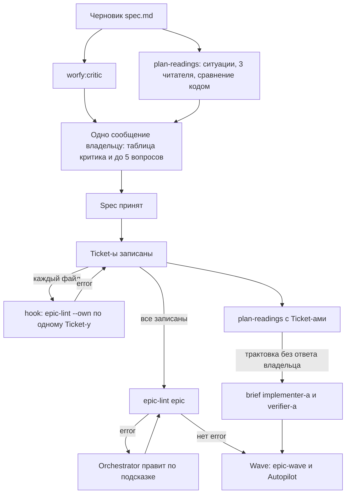

# План Epic-а проверен до работы: `epic-lint` по Ticket-ам и разбор черновика spec-а на неоднозначности и покрытие

Status: черновик 2026-11-13 из исследования конкурентов, владельцем не принят
Critic: [docs/product/critic/worfy-plan-lint-2026-11-14.md](../../docs/product/critic/worfy-plan-lint-2026-11-14.md) — Split.
Critic: ещё не запускался; критик идёт до приёмки (`harness/hooks/rules/orchestrator.md:116-118`)
Source: [исследование конкурентов 2026-11-13](../../docs/research/2026-11-13-competitors/) — идеи planning-1 (`epic-lint` без модели) и planning-2 (разбор черновика на неоднозначности и покрытие); досье [Kiro](../../docs/research/2026-11-13-competitors/kiro.md), [Gas Town](../../docs/research/2026-11-13-competitors/gas-town.md), [Division Swarm](../../docs/research/2026-11-13-competitors/division-swarm.md), [Claude Code agent teams](../../docs/research/2026-11-13-competitors/claude-code-agent-teams.md), [OpenAI Symphony](../../docs/research/2026-11-13-competitors/openai-symphony.md); прежняя оценка той же идеи — [оценка идей PR #1580, идея 2](../../docs/research/2026-11-07-оценка-идей-pr-1580.md)
Ticket-ы: Epic `worfy-plan-lint`, 10 Ticket-ов, нумерация с `01`. Шапка — `Type:` / `Status:` / `Blocked by:` / `Source:`
Опирается на: `worfy-skills` (закрыт, 5/5), `worfy-evidence` (закрыт, 13/13), `worfy-product-session` (21/32), `worfy-multi-repo-ticket` (7/8, открыта только приёмка 08)

## Проблема

Ticket уходит в работу, и только там выясняется, что план записан с дефектом. Ниже пять таких случаев. Каждый
виден в коде или в Ticket-ах этого репозитория.

1. **Нет секции «Готово, когда».**
   - `ticket evidence` отказывает с exit 2: у Ticket-а «0 checkbox item(s)» (`harness/bin/ticket:978`).
   - `ticket done` в этом случае молчит: сводку Evidence он печатает, только если пункты есть
     (`harness/bin/ticket:740-749`).
   - Шаблон `/worfy:to-tickets` пишет пункты-checkbox без заголовка секции
     (`harness/skills/to-tickets/SKILL.md:69-82`). Поэтому первая Wave нового Project-а падает именно на
     `ticket evidence` (`docs/product/roadmap-worfy/drafts/roadmap-section.md:29-30`).
   - Правку шаблона 2026-11-09 отдали Ticket-у `worfy-polish`, который идёт до `worfy-harness-standalone`
     (`docs/product/roadmap-worfy/drafts/worfy-harness-standalone.md:5-6`, `:57-61`). Его нет: Ticket-ы
     `worfy-polish` дошли до номера 113, и ни один не о шаблоне.
   - В этом репозитории открытый polish 112 (e2e test позднего окна на macOS) держит под «## Готово, когда»
     простые пункты списка без checkbox, а файлы — под `## Trail` вместо «## Где в коде»
     (`.scratch/worfy-polish/issues/112-quiet-windows-позднее-окно-зависает-на-macos.md:37-43`).
2. **`Repo:` называет репозиторий не из Project-а.**
   - `ticket claim --repo` сверяет имя с репозиториями Profile-а (`harness/bin/ticket:650-655`).
   - Строку `Repo:`, записанную в файл руками, проверяет только `ticket mark` — когда verdict уже получен и
     работа сделана (`harness/bin/ticket:1217`, `:1233`).
3. **`Blocked by:` не разбирается или её нет вовсе.**
   - `epic-status` ставит `blockedParsed: false` в обоих случаях (`harness/bin/epic-status:347-369`).
   - Wave Harness-а такой Ticket не берёт, пока строку не поправят (`harness/skills/epic-wave/SKILL.md:260-261`).
     Кнопка запуска Ticket-а в worfy тоже выключена (`src/shared/actions/render-template.ts:135`).
   - А Wave, которую считает сам worfy, принимает отсутствующую строку за «блокеров нет»
     (`src/shared/workflow/waves.ts:125`: `unparsed` только при `blockedRaw !== null`). Autopilot отправит такой
     Ticket. Если Orchestrator строку не поправит, Run получит тот же набор готовых Ticket-ов и остановится с
     `no-progress` (`src/shared/autopilot/cycle.ts:274`).
   - Номер блокера, которого нет в Epic-е, `epic-status` молча выкидывает из своей строки
     (`harness/bin/epic-status:544`).
   - Сейчас `blockedParsed: false` у 44 из 1005 Ticket-ов репозитория. Не закрыты три: product-session 28, 30
     и 31, у них строки `Blocked by:` нет вовсе.
4. **Пункт spec-а, который не покрыл ни один Ticket.**
   - Критик `worfy-harness-standalone` нашёл такой пункт «Готово, когда» случайно
     (`docs/product/critic/worfy-harness-standalone-2026-11-09.md:16-18`).
   - Покрытия нет в списке того, что критик ищет: порядок, размер, предпосылки, время, цена, история
     (`harness/agents/critic.md:61-79`).
5. **Двусмысленный пункт «Готово, когда».**
   - Implementer и reviewer читают его по-разному. Видно это только как `REJECTED`
     (`harness/agents/reviewer.md:239`).
   - `REJECTED` — ровно один круг доработки (`harness/skills/epic-wave/SKILL.md:774-776`). На глубине ревью
     `high` круг стоит 5,3–6,4 млн токенов Subagent-ов на Ticket (`harness/skills/epic-wave/SKILL.md:625-627`,
     замер 2026-10-12 — `harness/skills/ship-ticket/step-7-review.md:36`).
   - Живой пример — строка «gate full — exit 0 …». Она стояла в Ticket-ах, где gate full на деле запускал
     Orchestrator; одни Ticket-ы это оговаривали, другие нет
     (`.scratch/worfy-throughput/issues/03-implementer-гоняет-только-свои-e2e.md:25-28`).
   - Сколько `REJECTED` выросло из разного прочтения, никто не мерил. Круги `REJECTED`, просмотренные для этого
     черновика, были о дефектах кода.

Общее у всех пяти: форму Ticket-а сейчас проверяет текст skill-а (`harness/skills/epic-wave/SKILL.md:248-270`),
а «шаг в тексте можно пропустить, exit code — нельзя» (`harness/bin/preflight:6-7`). Правило в тексте здесь уже
проигрывало: строку Stage пришлось отдать hook-у, потому что два платных запуска eval-а с правкой текста правил не
изменили ни одного ответа модели
(`.scratch/worfy-polish/issues/73-status-block-epic-status-до-блока.md:43-44`).

История вопроса. Идею «Ambiguity Gate» 2026-11-07 не взяли как отдельный gate: лишние вопросы съедают внимание
владельца (`docs/research/2026-11-07-оценка-идей-pr-1580.md:89-113`). Roadmap держит реестр неоднозначностей как
работу советника, не gate, — кандидатом после первого Epic-а направления (`docs/roadmap.md:415-416`). Этот
черновик идёт тем же путём: часть 2 ничего не блокирует, а где и когда её запускать — вопрос Q2.

## Решение

Две части разной природы.

**Часть 1 — `epic-lint`: проверка формы, без модели.**

- Новый скрипт Harness-а проверяет Ticket-ы Epic-а, которые ещё могут попасть в Wave.
- Что проверяет: есть ли «Готово, когда» с пунктами-checkbox; разбирается ли `Blocked by:`; есть ли блокеры в
  Epic-е и нет ли цикла; есть ли репозиторий из `Repo:` в Project-е; не старая ли шапка.
- Каждая находка — одна строка: файл и строка, id проверки, что не так, как исправить.
- Ticket с находкой уровня error Wave не берёт — ни в Harness-е, ни в worfy. Остальные Ticket-ы Wave идут.
- Hook на запись файла Ticket-а показывает агенту ошибки формы сразу, пока он помнит, что писал.

**Часть 2 — `plan-readings`: проверка смысла. Модели предлагают, код сравнивает.**

- Агент `worfy:plan-reader` пишет к каждому пункту «Готово, когда» и к каждой истории spec-а 2–4 пограничные
  ситуации (Given/When).
- Три независимых читателя отвечают на каждую ситуацию: пункт выполнен, не выполнен или не понять. И называют
  Ticket-ы, которые этот пункт покрывают.
- Скрипт сравнивает ответы. Ответы разошлись — пункт неоднозначный. Кто-то ответил «не понять» — неясный. Двое
  из трёх не нашли Ticket-а для пункта spec-а — пункт не покрыт.
- Владелец получает не больше 5 вопросов. У каждого — ситуация и рекомендуемый ответ (ответ большинства).
  Остальное лежит в файле-реестре.
- Часть 2 не блокирует ни приёмку, ни Wave: это работа советника, как и записано в roadmap.

### Путь пользователя

1. Orchestrator пишет черновик spec-а. Перед приёмкой он запускает критика и (по ответу на Q2) `plan-readings`.
   Владелец получает одно сообщение: таблицу критика и до 5 вопросов.
2. Владелец отвечает. Ответы ложатся в строки `Owner decision:` реестра, текст spec-а правится. В шапке spec-а
   появляется строка `Readings:` со ссылкой на реестр.
3. Orchestrator записывает Ticket-ы (`/worfy:to-tickets` или руками). Hook проверяет каждый записанный файл и
   сразу возвращает агенту error формы. Когда записаны все, `epic-lint <epic>` проверяет связи между Ticket-ами:
   блокеры вне Epic-а и циклы.
4. `plan-readings` идёт второй раз, уже с файлами Ticket-ов: покрыт ли каждый пункт spec-а и однозначны ли пункты
   «Готово, когда» самих Ticket-ов.
5. Перед Wave `preflight --epic` пишет одну строку-предупреждение. epic-wave не отправляет Ticket-ы с error и
   называет их в отчёте.
6. В worfy Ticket с error стоит в колонке Needs attention с текстом находки. Окно Start Autopilot показывает,
   какие Ticket-ы Run пропустит. Если готовы только такие, Run останавливается с причиной `plan-defects` и их
   номерами.
7. В brief implementer-а и verifier-а Ticket-а попадает одна и та же рекомендуемая трактовка пункта, на который
   владелец не ответил.

### Где что проверяется



### Как это выглядит

`epic-lint` в терминале (Epic `demo` Project-а из двух репозиториев, `lib` и `app`):

```
$ epic-lint demo
.scratch/demo/issues/05-export.md:1: error done-when-missing: no "## Done when" section; 2 checkbox items above it, from line 9 — fix: put them under "## Done when"
.scratch/demo/issues/07-import.md:4: error blocked-by-unparsed: "Blocked by: after the export" is not a list of tickets — fix: "Blocked by: 05" or "Blocked by: none"
.scratch/demo/issues/08-sync.md:5: error repo-unknown: "Repo: billing" is not a repository of the project (lib, app) — fix: one of lib, app
.scratch/demo/issues/09-report.md:14: warning done-when-unverifiable: item 3 names no command, test, file or manual mark — fix: say how it is checked, or mark it "(manual)"
epic-lint demo: 3 errors, 1 warning, 0 hints in 6 tickets
$ echo $?
1
```

Колонка Needs attention на рамке Epic-а (`src/renderer/canvas/epic-layout.ts:158`):

```
┌ demo ──────────────────────────────────────────────────────────────────┐
│ Done      Level 0      Level 1           Needs attention               │
│ 01  02    06           09 waits for 06   ┌───────────────────────────┐ │
│                                          │ 05 Export                 │ │
│                                          │ no “Done when” section +1 │ │
│                                          └───────────────────────────┘ │
│                                          ┌───────────────────────────┐ │
│                                          │ 07 Import                 │ │
│                                          │ “Blocked by: after the    │ │
│                                          │ export” is not a list …   │ │
│                                          └───────────────────────────┘ │
└────────────────────────────────────────────────────────────────────────┘
```

Окно Start Autopilot, строка Epic-а в очереди (`src/renderer/autopilot/QueueList.tsx`):

```
☑ demo · 2 Waves
  2 tickets skipped — plan defects: 05, 07        (tooltip: the first finding of each)
```

Сообщение владельцу перед приёмкой:

```
Критик: Keep, одно возражение — таблица ниже.
Вопросы по трактовкам: 2 из 6, остальные — в readings-2026-11-14.md.

1. Пункт 05:done:2 «gate full — exit 0 …».
   Ситуация: implementer запустил только gate fast; gate full перед merge запустил Orchestrator.
   Пункт выполнен?
   (а) да — так прочли 2 читателя из 3, рекомендую;
   (б) нет, gate full запускает implementer — 1 из 3.
2. Пункт spec:done:4 «…» не покрыт: двое из трёх читателей не нашли для него Ticket-а
   (читатель 1 — Ticket 06, читатели 2 и 3 — ни одного). Рекомендую: Ticket 06.
```

Реестр рядом со spec-ом (`.scratch/demo/readings-2026-11-14.md`):

```
# Plan readings — demo, 2026-11-14

Plan: .scratch/demo/spec.md, issues 01–09 (sha256 of each file in the skeleton)
Readers: opus, sonnet, opus · 14 items · 41 situations

## Uncovered
### spec:done:4 — "…"
Item sha256: 9c1e…
Owners: reader 1 — 06 · reader 2 — none · reader 3 — none
Recommended: 06
Owner decision:

## Ambiguous
### 05:done:2 — "gate full — exit 0 …"
Item sha256: 47ab…
Situation 2. Given: the implementer ran gate fast only; the Orchestrator ran gate full before merge. When: the item is checked.
Answers: done — readers 1, 3 · not done — reader 2 ("the item names nobody, so the implementer runs it")
Recommended: done
Owner decision:
```

## Как это сделано у конкурентов

- **Kiro** ([досье](../../docs/research/2026-11-13-competitors/kiro.md), разделы «Specs» и «Планирование и
  декомпозиция»). Analyze Requirements проверяет требования до дизайна. Модель несколько раз независимо
  переводит каждый критерий в формальную логику; переводы группируют по эквивалентности, и расхождение групп
  считают неоднозначностью; solver ищет противоречия; каждая находка — вопрос с двумя вариантами
  (`kiro.md:128-134`, `:753-757`). Принцип продукта: решает детерминированный код, модели только предлагают
  (`kiro.md:621`). Берём независимые прочтения, сравнение кодом и вопрос с вариантами. Не берём solver: наши
  пункты — свободный текст, а не логика.
- **Gas Town** ([досье](../../docs/research/2026-11-13-competitors/gas-town.md), «Планирование и разбиение»).
  `mol-idea-to-plan` разбирает черновик в 6 параллельных направлениях, среди них пробелы и неоднозначность; у
  человека одна точка решения — уточняющие вопросы; beads (их единицы работы) трижды сверяют с планом.
  `gt convoy stage` отказывает при циклах и при beads, которым некуда уйти (`gas-town.md:522-537`). Берём сверку
  Ticket-ов с планом и одну точку вопросов.
- **Division Swarm** ([досье](../../docs/research/2026-11-13-competitors/division-swarm.md), «Статический
  анализатор»). `swarm verify` проверяет пакет до запуска: 49 именованных проверок; каждая находка называет id
  проверки и путь к полю, чтобы модель исправила её сама; error останавливает загрузку целиком
  (`division-swarm.md:139-145`). Вендор сам признаёт, что строгий анализатор мешает, пока контракт не дописан
  (`:892`). А за день до первого релиза verify сообщил «всё в порядке», когда одобрение человеком не работало
  (`:896`, issue #1249). Берём стабильные id и подсказку «как исправить». Не берём «всё или ничего»: Ticket с
  error пропускается, Wave идёт.
- **Claude Code agent teams** ([досье](../../docs/research/2026-11-13-competitors/claude-code-agent-teams.md),
  «Quality gates: hooks и mods»). Hooks `TaskCreated` и `TaskCompleted` отказывают с exit 2 и возвращают модели
  сообщение; gates живут в hooks, а не в prompt (`claude-code-agent-teams.md:322-327`, `:458`). Harness уже так
  ставит gate на `TaskCompleted` (`harness/hooks/hooks.json`). Берём hook на запись Ticket-а.
- **OpenAI Symphony** ([досье](../../docs/research/2026-11-13-competitors/openai-symphony.md), «Эталонный процесс
  агента» и «Что ругают»). Требование, чтобы у issue были разделы Validation и Test Plan, живёт только в prompt
  (`openai-symphony.md:836-838`). Пользователи спрашивают, что будет с размытой issue (`:1079`, Discussions #59
  и #63). В таком состоянии worfy сейчас держит «Готово, когда».

Вывод для worfy: форму проверяет код — с exit code и стабильными id; смысл — несколько независимых прочтений,
которые сравнивает код; ни один дефект не останавливает всю Wave.

## Истории пользователя

1. Как Orchestrator, после записи Ticket-ов я запускаю одну команду и вижу каждый дефект формы строкой «файл:строка,
   id, что не так, как исправить» — до первой Wave, а не на `ticket evidence`.
2. Как агент, который пишет файл Ticket-а, я сразу после записи вижу его error формы и правлю, пока помню контекст.
3. Как Orchestrator в Wave без человека, я не отправляю Ticket с error и называю его в отчёте; остальные Ticket-ы
   Wave идут.
4. Как Product owner, я вижу Ticket с дефектом плана в колонке Needs attention с текстом находки, а не готовым в
   колонке уровня.
5. Как Product owner, я вижу Ticket без строки `Blocked by:` там же, где его видит Harness: в Needs attention.
6. Как Product owner, в окне Start Autopilot я вижу, какие Ticket-ы Run пропустит из-за дефектов плана, — до
   старта.
7. Как Product owner, утром я вижу, что Run остановился с причиной «дефекты плана» и номерами Ticket-ов, а не «нет
   готовой Wave».
8. Как Product owner Project-а из нескольких репозиториев, я узнаю о `Repo:` с чужим именем, когда Ticket
   записан, а не на `ticket mark` после работы.
9. Как Product owner, перед приёмкой spec-а я получаю одним сообщением таблицу критика и не больше 5 вопросов — о
   пунктах, которые читатели поняли по-разному, и о пунктах без Ticket-а — с рекомендуемым ответом.
10. Как Product owner, у каждого вопроса я вижу конкретную ситуацию (Given/When) и сколько читателей ответили так
    или иначе.
11. Как implementer и verifier одного Ticket-а, мы получаем в brief одну и ту же трактовку пункта, на который
    владелец не ответил.
12. Как Product owner в Product Session, я прошу проверку черновика, и её вопросы становятся узлами «Вопрос» Mind
    map.
13. Как автор своего скрипта вокруг Harness-а, я беру `epic-lint --json` и получаю стабильные id проверок и номера
    строк.

## Решения по реализации

### Часть 1. `epic-lint` (Ticket-ы 01, 02, 03)

**Файлы и контракт.**

- `harness/lib/plan-lint.cjs` — чистые функции. Их проверяют через `require` без git, как у `preflight`
  (`harness/bin/preflight:48-54`).
- `harness/bin/epic-lint` — Node (ADR-0055, скрипты Harness-а на Node), текст на английском (ADR-0074, Harness
  нейтрален к языку и Project-у). Шапка файла — его контракт, как у `review-draft-lint`
  (`harness/bin/review-draft-lint:1-48`).
- Вызов: `epic-lint [<epic>] [--tickets NN,NN] [--own] [--json] [--status -] [--root <dir>]`.
  - Без `<epic>` — все Epic-и.
  - `--tickets` — только названные Ticket-ы.
  - `--own` — только проверки самого Ticket-а, без связей с другими. Это для hook-а: пока Ticket-ы пишутся,
    Ticket 01 вправе назвать ещё не записанный 02.
  - `--status -` — вывод `epic-status --json` со stdin: worfy его уже прочёл и второй раз не запускает.
  - `--root` — как у `epic-status` (`harness/bin/epic-status:18-21`): Silent mode и Ticket-ы над несколькими
    репозиториями.

**Что и откуда читает.** Один разборщик на каждую часть Ticket-а, чтобы lint и остальной Harness не расходились:

- шапку (статус, `Blocked by:`, `Repo:`) — из `epic-status --json`: `bin/ticket` её единственный писатель,
  `epic-status` — единственный читатель (`harness/bin/TICKETS.md:20-21`);
- «Готово, когда» — `parseDoneSection` из `harness/lib/evidence.cjs:152` с заголовком и отметкой из Profile-а, как
  `doneItems` у `ticket` (`harness/bin/ticket:830`);
- секцию файлов — по полю `tickets.trail_section` Profile-а (`harness/profiles/README.md:177`);
- репозитории — `_resolved.repos` Profile-а, как `ticket claim` (`harness/bin/ticket:650-655`).

Без Profile-а — заголовки по умолчанию (`## Done when`, `manual`, `## Where in code`) и одна строка об этом в
stderr.

**Какие Ticket-ы.** `open`, `blocked` и без статуса — те, что ещё могут попасть в Wave. Закрытые и взятые в работу
не проверяются: у 43 закрытых Ticket-ов этого репозитория нет пунктов-checkbox, и переписывать историю незачем.

**Проверки.**

| id | Уровень | Что ловит | Почему это дефект |
|---|---|---|---|
| `done-when-missing` | error | нет секции «Готово, когда» (`tickets.done_section`); если выше есть пункты-checkbox, подсказка — перенести их под заголовок | `ticket evidence` — exit 2 (`harness/bin/ticket:978`); так пишет шаблон `/worfy:to-tickets` (`harness/skills/to-tickets/SKILL.md:69-82`) |
| `done-when-empty` | error | секция есть, пунктов-checkbox в ней нет | polish 112 (`.scratch/worfy-polish/issues/112-quiet-windows-позднее-окно-зависает-на-macos.md:37-41`); `ticket evidence` видит 0 пунктов (`harness/bin/ticket:964`) |
| `done-when-unverifiable` | warning | пункт не говорит, чем он проверяется: нет code span, пути, ссылки, номера PR, отметки ручного пункта, строки `needs:`, заголовка того же Ticket-а (например «Итог») и слов вроде test, e2e, screenshot | грубая эвристика находит 153 из 1967 пунктов Ticket-ов со статусом от 2026-11-01 (около 8%) |
| `blocked-by-missing` | error | строки `Blocked by:` нет | `blockedParsed: false` (`harness/bin/epic-status:349`); Wave Harness-а не берёт, пока строку не поправят (`harness/skills/epic-wave/SKILL.md:260-261`) |
| `blocked-by-unparsed` | error | значение не читается как список номеров или «нет» | `harness/bin/TICKETS.md:226-233` |
| `blocked-by-unknown` | error | номер, которого нет в Epic-е | `epic-status` молча выкидывает его (`harness/bin/epic-status:544`) |
| `blocked-by-cycle` | error | Ticket блокирует сам себя через другие | тот же поиск циклов, что у worfy (`src/shared/workflow/waves.ts:74-119`) |
| `repo-unknown` | error | `Repo:` не из репозиториев Project-а | сейчас его ловит только `ticket mark` (`harness/bin/ticket:1217`, `:1233`) |
| `status-old-header` | error | старая шапка статуса | `epic-status` пишет «old header» (`harness/bin/epic-status:345`); правка — `ticket migrate` |
| `trail-missing` | hint | нет секции файлов (`tickets.trail_section`); находка называет заголовки, которые в Ticket-е есть (`## Trail` у polish 112) | файлы доищет scout (`harness/skills/epic-wave/SKILL.md:267-269`), но это лишний Subagent |

- `--own` пропускает `blocked-by-unknown` и `blocked-by-cycle`.
- Уровни. Error — Ticket не уходит в Wave. Warning — уходит, а находка попадает в отчёт Wave и в brief
  implementer-а. Hint — только в выводе `epic-lint`.
- Слова для эвристики `done-when-unverifiable` лежат в `harness/lib/input-words.json`: там Harness уже держит
  слова того, что пишут люди (`harness/lib/README.md:42`).

**Вывод и exit code.**

- Текст — одна строка на находку: `<file>:<line>: <level> <id>: <message> — fix: <how>`. Не больше 30 строк
  находок, потом итог: `epic-lint <epic>: N errors, M warnings, K hints in T tickets`. Если строк больше — ещё
  «… more, --json for all».
- `--json` — объект `{"schema": 1, "findings": […], "counts": {…}}`. У находки поля `id`, `level`, `epic`,
  `ticket`, `file`, `line`, `message`, `fix`; в `counts` — `error`, `warning`, `hint`, `tickets`. Id проверок
  стабильны: на них опираются worfy, hook и test-ы.
- Exit code: 0 — нет error (warning и hint могут быть); 1 — есть error; 2 — ошибка вызова или ввода (нет такого
  Epic-а, stdin не JSON). В отличие от `review-draft-lint` (`harness/bin/review-draft-lint:48`), warning не даёт
  1: иначе Wave стояла бы из-за эвристики.

**Где Harness запускает `epic-lint`** (Ticket 02).

- `harness/bin/TICKETS.md`. Новый раздел «Plan check»: что значит каждый id и как его исправить. В «Wayfinding
  operations» (`harness/bin/TICKETS.md:255`) — `epic-lint <epic>` после записи Ticket-ов. Тексты `/worfy:to-tickets`
  и `/worfy:to-spec` остаются версии 1.3.1: расхождения с worfy переводит один раздел `TICKETS.md`
  (`.scratch/worfy-skills/spec.md:256-258`).
- epic-wave, раздел 1, «What goes into the wave» (`harness/skills/epic-wave/SKILL.md:248-270`):
  `epic-lint <epic> --tickets <Ticket-ы Wave> --json`.
  - Ticket с error не отправляется и называется в отчёте — то же правило, что для Ticket-а, не прошедшего проверку
    файлов (`:255`).
  - Правку с механической подсказкой (пункты-checkbox вне секции; пустая `Blocked by:` у Ticket-а, которому spec не
    назначил блокеров) Orchestrator делает сам и записывает «решено без владельца, подтвердить» (`:369-372`).
  - Содержательную правку — какие пункты «Готово, когда» нужны — Orchestrator не выдумывает: Ticket ждёт.
- `preflight --epic`, шаг 9 (`harness/bin/preflight:783-800`): одна строка вида
  `! epic-lint: 2 errors in 05, 07 (not dispatched)`. Итог остаётся GO: Wave идёт с другими Ticket-ами.
- `ticket claim` — по ответу на Q1.
- `ticket done`: если пунктов «Готово, когда» нет, одна строка в stderr; exit остаётся 0, как решено в
  `worfy-evidence` (Q1(а), `.scratch/worfy-evidence/spec.md:262`).
- `harness/hooks/rules/orchestrator.md`: одна строка рядом с правилом о критике (`:116-118`). Правила входят в
  каждую Session, поэтому только одна.
- Новый ADR «План проверяется до работы»; номер резервирует `/worfy:ship-ticket`.

**Hook на запись Ticket-а** (Ticket 03).

- `harness/hooks/plan-lint.mjs`, в `harness/hooks/hooks.json` — event `PostToolUse` с matcher `Write|Edit|MultiEdit`,
  limit 10 s. Сейчас у Harness-а hook-и на SessionStart, UserPromptSubmit, SubagentStart, TaskCompleted,
  TeammateIdle, Stop, SubagentStop, SessionEnd и PreToolUse (`harness/hooks/hooks.json`); `PostToolUse` — новый.
- Вход hook читает так же, как другие (`harness/hooks/hook-stdin.mjs`).
- Путь не `<tickets root>/<epic>/issues/NN-*.md` — exit 0 сразу, без Profile-а и без `epic-lint`: hook срабатывает
  на каждую запись в каждой Session.
- Путь Ticket-а — `epic-lint <epic> --tickets NN --own --json`. Есть error — они идут в stderr, exit 2: Claude
  Code показывает stderr агенту после записи. Файл уже записан, hook ничего не откатывает. Warning и hint hook не
  показывает.
- Собственный сбой hook-а (нет Profile-а, нет `epic-lint`, вышел limit) — exit 0 и одна строка в stderr: hook
  подсказывает, а не ломает Session.
- Статус пишет `ticket` через shell, а не через Write или Edit (`harness/bin/TICKETS.md:20-21`), поэтому смена
  статуса hook не будит.

### Часть 1 в worfy (Ticket-ы 04, 05)

**Чтение.**

- Reader, прочитав `epic-status --json`, запускает `epic-lint --json --status -` того же Harness-а с тем же
  корнем Ticket-ов и отдаёт ему тот же JSON. Только для checkout-а: ветки с `--ref` несут Ticket-ы в работе, а их
  lint не проверяет. Скрипты Harness-а reader находит так же, как `epic-status`
  (`src/main/workflow/reader.ts:120-124`). Сбой кешируется, как у `epic-status` (`src/main/workflow/reader.ts:95`).
- У Ticket-а появляется необязательное поле `plan` — его error-находки `epic-lint`. Нет поля — значит, не
  проверялось: старый Harness без `epic-lint` или Linked machine со старым worfy. Так устроены и другие
  необязательные факты (`src/shared/workflow/types.ts:60-63`).
- worfy по-прежнему только читает (ADR-0002, worfy — вид поверх workflow). `epic-lint` — второй читатель
  Harness-а рядом с `epic-status`; ADR этого Epic-а записывает это.

**Wave** (`src/shared/workflow/waves.ts`).

- Отсутствующая строка `Blocked by:` — `unparsed` с `raw: null`, как в Harness-е
  (`harness/skills/epic-wave/SKILL.md:260-261`) и у кнопки запуска (`src/shared/actions/render-template.ts:135`).
  Правка — первая строка `ownProblem` (`src/shared/workflow/waves.ts:124-131`).
- Новая причина ожидания `{ kind: 'plan'; ids }` — у открытого Ticket-а есть error `epic-lint`, кроме
  `blocked-by-*`. Их worfy и так считает сам, и двух сообщений об одном дефекте не будет.
- Такой Ticket не получает номера Wave (`waveNumbers`, `src/shared/workflow/waves.ts:225-245`), как и Ticket с
  циклом.

**Холст и кнопка запуска.**

- `Attention` (`src/renderer/canvas/ticket-card.ts:370`) получает вид `plan`. `attentionText` (`:372-381`)
  показывает текст первой находки и «+N», если их больше. Ticket стоит в колонке Needs attention
  (`src/renderer/canvas/epic-layout.ts:154-158`).
- Кнопка запуска Ticket-а выключена с тем же текстом (`src/shared/actions/render-template.ts:133-136`).
- Warning и hint worfy не показывает: они в выводе `epic-lint` и в отчёте Wave.

**Autopilot и окно Start Autopilot.**

- `nothingReady` (`src/shared/autopilot/cycle.ts:251-255`): готовых нет, а хотя бы один открытый Ticket ждёт
  `plan` — Run останавливается с новой причиной `plan-defects` (список `AUTOPILOT_STOP_REASONS`, `:52-75`) и
  называет Ticket-ы. Эта причина идёт раньше `blocked-tickets`: правка плана — работа на минуты, и подсказка к ней
  уже написана.
- В очереди Epic-ов `plan-defects` ведёт себя как `blocked-tickets`: Run переходит к следующему Epic-у
  (`src/main/autopilot/run.ts:2059-2068`).
- Новую причину знают текст остановки (`src/main/autopilot/run.ts:2898`), journal
  (`src/shared/autopilot/journal.ts`), IPC (`src/shared/ipc/runs.ts`), очередь (`src/shared/autopilot/epic-queue.ts`)
  и Flight Recorder (`src/shared/flight-recorder/from-journal.ts:151`).
- В окне Start Autopilot строка Epic-а в очереди (`src/renderer/autopilot/QueueList.tsx`) говорит
  «2 tickets skipped — plan defects: 05, 07»; tooltip — первая находка каждого.
- Autopilot план сам не правит.

### Часть 2. `plan-readings` и `worfy:plan-reader` (Ticket-ы 06, 07, 08)

**Пункты и их id** (Ticket 06: `harness/bin/plan-readings`, `harness/lib/plan-readings.cjs`).

- `plan-readings items <epic> [--draft <file>]` печатает каркас в JSON: файлы плана с sha256 и пункты с id.
  - `spec:story:7` — седьмая история spec-а (нумерованный список под заголовком историй);
  - `spec:done:3` — третий пункт «Готово, когда» spec-а;
  - `05:done:2` — второй пункт «Готово, когда» Ticket-а 05, в той же нумерации, что у `ticket evidence`
    (`harness/lib/evidence.cjs:152`, `harness/bin/ticket:978`).
- Кандидаты в Ticket-ы, покрывающие пункт, — файлы Ticket-ов Epic-а. Пока их нет — список Ticket-ов в самом spec-е.
- Заголовок историй — новое поле Profile-а `tickets.stories_section`. По умолчанию `## User Stories`, как в
  шаблоне `/worfy:to-spec` (`harness/skills/to-spec/SKILL.md:31`); здесь — «## Истории пользователя». Поле устроено,
  как соседние (`harness/profiles/README.md:177-179`, значения по умолчанию — `harness/bin/profile:369`).
- Spec скрипт находит по полю `tickets.spec` Profile-а, черновик Product Session — по `--draft`.

**Агент `worfy:plan-reader`** (Ticket 07: `harness/agents/plan-reader.md`). Два режима; ответ — только JSON в
файл, который назвал brief.

- `situations` — один вызов. На каждый пункт 2–4 пограничные ситуации (Given/When): там, где неочевидно, выполнен
  ли пункт. Ожидаемого ответа агент не пишет.
- `read` — один читатель. Без контекста других читателей он отвечает по каждой ситуации `done`, `not-done` или
  `cannot-tell` с одной строкой «почему» и называет Ticket-ы, которые покрывают каждый пункт spec-а.
- Три читателя идут параллельно: первый и третий — `opus`, второй — `sonnet`. Модель задаёт параметр Agent
  `model`, как epic-wave задаёт её для каждой роли (`harness/skills/epic-wave/SKILL.md:383-390`). Разные модели
  реже ошибаются одинаково. В Eco mode все трое — `sonnet`.

**Сравнение кодом.** `plan-readings compare <каркас> <ситуации> <ответ 1> <ответ 2> <ответ 3> --out <реестр>`.

- `uncovered` — у пункта spec-а нет Ticket-а, которого назвали хотя бы два читателя.
- `ambiguous` — ответы на одну ситуацию разошлись.
- `unclear` — хотя бы один читатель ответил `cannot-tell`.
- Рекомендуемый ответ — ответ большинства. Для `uncovered` — Ticket, которого назвали чаще, или «новый Ticket».
- Вопросов владельцу — не больше 5: сначала `uncovered`, потом `ambiguous`, потом `unclear`. Остальные находки
  лежат в реестре.
- Exit code: 0 — реестр записан, с находками или без; 2 — ошибка вызова, ввод не JSON или файл плана изменился
  после `items` (ответы читателей уже не про этот текст).

**Реестр и ответы владельца.**

- Реестр — Markdown рядом с планом: `<tickets root>/<epic>/readings-<YYYY-MM-DD>.md`; для черновика Product
  Session — `docs/product/<topic>/drafts/<epic>-readings-<YYYY-MM-DD>.md`.
- У каждой находки — sha256 текста пункта и строка `Owner decision:`. Пустая строка значит «ждёт», как у
  возражений критика (`harness/agents/critic.md:131-133`).
- Шапка spec-а получает строку `Readings:` со ссылкой на реестр, рядом со строкой `Critic:`
  (`harness/agents/critic.md:152-154`).
- Реестр — файл папки Ticket-ов. Его проверяет `evidence-check --changed`, как любой такой файл
  (`harness/bin/evidence-check:1-5`).

**Где идёт часть 2** (Ticket 07; когда — по ответу на Q2).

- Перед приёмкой spec-а — рядом с критиком. Владелец получает одно сообщение: таблицу критика и до 5 вопросов.
- После записи Ticket-ов — ещё раз, с файлами Ticket-ов: покрытие пунктов spec-а и неоднозначность пунктов самих
  Ticket-ов.
- В Product Session — по просьбе. Каждый вопрос становится узлом «Вопрос» Mind map
  (`harness/hooks/rules/product.md:40-55`). Черновик лежит в `docs/product/<topic>/drafts/<epic>.md`
  (`harness/hooks/rules/product.md:34-37`).
- В Wave — строка `Reading:` в brief implementer-а и verifier-а: рекомендуемая трактовка находки без ответа
  владельца, если sha256 текста пункта не изменился. Brief-ы уже несут общие строки, и verifier получает их так же
  (`harness/skills/epic-wave/SKILL.md:447-471`). Строка `Reading:` есть только у Ticket-а с такой находкой.
- Ничего не блокирует. Вопрос без ответа решается рекомендуемым вариантом с пометкой «решено без владельца,
  подтвердить», как любой вопрос в Wave без человека (`harness/skills/epic-wave/SKILL.md:369-372`).

**Цена.** Оценка, не замер. Spec на 300–400 строк и 10 Ticket-ов — около 40 пунктов и 120 ситуаций; каждый из
четырёх вызовов читает план целиком. Это порядка 0,3–0,5 млн токенов на запуск — меньше десятой части одного круга
`REJECTED` на глубине `high`. Замер — в eval-е (Ticket 08).

### ADR

Один новый ADR «План проверяется до работы» (Ticket 02):

- форму Ticket-а проверяет код (`epic-lint`) — по одному разборщику на каждую часть Ticket-а;
- Ticket с error не уходит в Wave, остальные идут;
- смысл проверяет работа советника: модели предлагают, код сравнивает, ничего не блокируется;
- worfy читает `epic-lint --json` вторым после `epic-status --json` и по-прежнему ничего не пишет (ADR-0002).

### Решено без владельца, подтвердить

- `done-when-unverifiable` — warning, не error. Эвристика задевает около 8% пунктов, и часть из них проверяема
  (например, «записано в «Итог»»).
- Без `--fix`: подсказка говорит, как править, а правит агент или человек.
- Закрытые и взятые в работу Ticket-ы не проверяются.
- В текстовом выводе не больше 30 строк находок; полный список — `--json`.
- Пункт покрыт, если Ticket назвали хотя бы два читателя из трёх.
- Не больше 5 вопросов владельцу за раз.

## Решения по test-ам

- Сначала падающий test, потом код — как требует `/worfy:ship-ticket`.
- Shell test-ы Harness-а подхватываются сами: `harness/{bin,hooks}/tests/*.test.sh` идут через
  `test/contract/harness-scripts-<n>.test.ts` (`harness/README.md:88-94`), на Linux и в двух Windows jobs CI
  (`.github/workflows/ci.yml:53-57`).
- Ticket 01 — `harness/bin/tests/epic-lint.test.sh`:
  - fixture-ы `demo` (один репозиторий) и `acme` (`lib` и `app`, как в `harness/bin/tests/multi-repo.test.sh`): по
    Ticket-у на каждую проверку и один чистый;
  - точные строки вывода, exit 0, 1 и 2, ключи `--json`, предел 30 строк;
  - `--status -` даёт то же, что запуск без него;
  - Profile с заголовками по умолчанию и с русскими заголовками;
  - `--own` не даёт `blocked-by-unknown` и `blocked-by-cycle`;
  - паритет: `blocked-by-*` у `epic-lint` совпадает с `blockedParsed` у `epic-status --json` на тех же fixture-ах;
  - чистые функции `harness/lib/plan-lint.cjs` — через `require`, без git.
- Ticket 02 — `preflight.test.sh` (одна строка `! epic-lint`, итог GO); `ticket-header.test.sh` (`ticket claim`
  по Q1); `ticket-evidence.test.sh` (предупреждение `ticket done` с exit 0); `skill-blocks.test.sh` и
  `epic-wave-ship-ticket.test.sh` (новый шаг epic-wave).
- Ticket 03 — `harness/hooks/tests/plan-lint.test.sh`, вход hook-а на stdin:
  - путь не Ticket-а — exit 0, `epic-lint` не запускался (его подменяет stub, который пишет вызовы в файл);
  - Ticket с error — exit 2, находка в stderr;
  - чистый Ticket, закрытый Ticket, Project без Ticket-ов, битый вход — exit 0;
  - время на пути не Ticket-а записывается в «Итог» Ticket-а.
- Ticket 04 — unit `test/unit/waves.test.ts` (нет строки `Blocked by:` — `unparsed`; error `epic-lint` — `plan`;
  номера Wave нет), `test/unit/epic-layout.test.ts`, `test/unit/ticket-card.test.tsx`,
  `test/unit/render-template.test.ts`; contract `test/contract/workflow-reader.test.ts` (JSON `epic-status` уходит в
  stdin `epic-lint`; Harness без `epic-lint` — поля `plan` нет и ошибки нет; сбой кешируется); e2e
  `test/e2e/epic-frame.spec.ts`.
- Ticket 05 — все unit и contract test-ы Autopilot (`test/unit/autopilot-*.test.ts`, `test/unit/epic-queue.test.ts`,
  `test/unit/flight-recorder-*.test.ts`, `test/contract/autopilot*.test.ts`); e2e
  `test/e2e/autopilot-start-modal.spec.ts`.
- Ticket 06 — `harness/bin/tests/plan-readings.test.sh`: `items` (id и хеши); `compare` с ответами читателей из
  файлов — все три вида находок, не больше 5 вопросов, `uncovered` первыми; изменённый план и битый JSON — exit 2.
  Модель в test-ах не вызывается. `profile.test.sh` — новое поле.
- Все Ticket-ы, которые правят `harness/`, — `plugin-neutral.test.sh`: файлы plugin-а не называют владельца и
  внутренности репозитория worfy, а правила не ссылаются на ADR и номера Ticket-ов этого репозитория
  (`harness/bin/tests/plugin-neutral.test.sh:1-4`, ADR-0074). Fixture-ы называются `demo` и `acme`.
- Ticket 07 — `agents-text.test.sh` (он проверяет тексты `implementer` и `reviewer`) и
  `harness/evals/lib/coverage.json`: новый агент — файл правил, и он стоит ровно в одном списке, иначе падает
  `test/contract/harness-evals-run.test.ts` (`harness/README.md:195-200`). Ticket 07 ставит его в `uncovered`,
  Ticket 08 переносит под свой eval.
- Ticket 08 — eval `harness/evals/plan-readings/`, устроенный как `harness/evals/critic-verdict/`: план с
  подложенными неоднозначным и непокрытым пунктами и чистый план для контроля. Сначала
  `scripts/eval-harness.mjs --dry-run`, потом запуск с `--max-cost-usd` (`scripts/eval-harness.mjs:27-30`).

## Не в этом Epic-е

- Правка шаблонов `/worfy:to-tickets` и `/worfy:to-spec` — это Ticket `worfy-polish`, решённый 2026-11-09 до
  `worfy-harness-standalone` (`docs/product/roadmap-worfy/drafts/worfy-harness-standalone.md:57-61`). `epic-lint`
  ловит дефект и без неё.
- `epic-lint --fix`.
- Solver и формальная логика, как у Kiro.
- Codex как читатель и hook для записи через `apply_patch`.
- e2e test-ы из Given/When/Then — отдельный кандидат roadmap: сценарии приёмки, которые Product owner пишет словами
  (`docs/roadmap.md:417`).
- Job CI, который запускает `epic-lint` по Ticket-ам репозитория.
- Блокировка приёмки spec-а частью 2.
- Проверка закрытых Ticket-ов.
- Таблица Wave-ов и порядок Ticket-ов в spec-е — это проверяет критик («Order», `harness/agents/critic.md:61-79`).
- Оценка Evidence моделью — `worfy-evidence` от неё отказался (`.scratch/worfy-evidence/spec.md:400`).
- Отказ `ticket done` — решён в `worfy-evidence` (`.scratch/worfy-evidence/spec.md:262`, `:398`).
- Правка плана самим Autopilot-ом.

## Ticket-ы

1. **01 — `epic-lint`:** скрипт, библиотека проверок, shell test с fixture-ами. Blocked by: нет. Платформенный. Ревью `high`.
2. **02 — Где Harness запускает `epic-lint`:** `TICKETS.md`, epic-wave, `preflight`, `ticket claim` и `done`, правило Orchestrator-а, ADR. Blocked by: 01. Платформенный. Ревью `medium`.
3. **03 — Hook на запись файла Ticket-а:** `PostToolUse`, проверки самого Ticket-а, exit 2 с находками. Blocked by: 01. Платформенный. Ревью `high`.
4. **04 — worfy читает `epic-lint`:** поле `plan`, причина ожидания `plan`, Needs attention, строка `Blocked by:` как в Harness-е. Blocked by: 01. Ревью `high`.
5. **05 — Autopilot:** причина остановки `plan-defects` и пропущенные Ticket-ы в окне Start Autopilot. Blocked by: 04. Ревью `medium`.
6. **06 — `plan-readings`:** каркас пунктов, сравнение ответов, реестр, поле Profile-а `tickets.stories_section`. Blocked by: нет. Платформенный. Ревью `medium`.
7. **07 — Агент `worfy:plan-reader` и где он идёт:** приёмка, после записи Ticket-ов, Product Session, строка `Reading:` в brief. Blocked by: 02, 06. Ревью `medium`.
8. **08 — Eval `plan-readings`:** подложенные дефекты, чистый план, цена запуска. Blocked by: 07. Ревью `low`.
9. **09 — Документация:** страницы фич en и ru, `harness/README.md`. Blocked by: 03, 05, 07. Ревью `low`.
10. **10 — Приёмка:** `epic-lint` по репозиторию и правка найденного, часть 2 на двух spec-ах, проверка владельцем на Mac Stable copy. Blocked by: 08, 09. Ревью `low`.

Платформенный Ticket — скрипт Harness, hook или путь ОС: PR ждёт Windows verdict до merge (ADR-0056, проверки на
Windows и две Session).

## Волны

| Wave | Ticket-ы | Почему так |
|---|---|---|
| 1 | 01, 06 | два новых скрипта без общих файлов; на `epic-lint` опираются 02, 03 и 04 |
| 2 | 02, 03, 04 | всем нужен `epic-lint`; файлы разные: тексты и скрипты Harness-а, hook, `src/` |
| 3 | 05, 07 | 05 ждёт поле `plan` из 04; 07 правит те же тексты Harness-а, что 02, и зовёт скрипт из 06 |
| 4 | 08, 09 | eval-у нужен готовый агент; документация описывает hook, worfy, Autopilot и агента |
| 5 | 10 | приёмка — после eval-а и документации |

| Ticket | Файлы (предложение) |
|---|---|
| 01 | `harness/bin/epic-lint`, `harness/lib/plan-lint.cjs`, `harness/lib/input-words.json`, `harness/bin/tests/epic-lint.test.sh`, `harness/bin/tests/fixtures/plan-lint/` |
| 06 | `harness/bin/plan-readings`, `harness/lib/plan-readings.cjs`, `harness/bin/profile`, `harness/profiles/README.md`, `harness/bin/tests/plan-readings.test.sh`, `harness/bin/tests/profile.test.sh` |
| 02 | `harness/bin/TICKETS.md`, `harness/skills/epic-wave/SKILL.md`, `harness/bin/preflight`, `harness/bin/ticket`, `harness/hooks/rules/orchestrator.md`, `docs/adr/<номер>-plan-checked-before-work.md`, `harness/bin/tests/{preflight,ticket-header,ticket-evidence,skill-blocks,epic-wave-ship-ticket}.test.sh` |
| 03 | `harness/hooks/plan-lint.mjs`, `harness/hooks/hooks.json`, `harness/hooks/tests/plan-lint.test.sh` |
| 04 | `src/main/workflow/reader.ts`, `src/shared/workflow/types.ts`, `src/shared/workflow/waves.ts`, `src/renderer/canvas/ticket-card.ts`, `src/renderer/canvas/epic-layout.ts`, `src/shared/actions/render-template.ts` и их test-ы |
| 05 | `src/shared/autopilot/cycle.ts`, `src/shared/autopilot/epic-queue.ts`, `src/shared/autopilot/journal.ts`, `src/shared/ipc/runs.ts`, `src/shared/flight-recorder/from-journal.ts`, `src/main/autopilot/run.ts`, `src/renderer/autopilot/QueueList.tsx` и их test-ы |
| 07 | `harness/agents/plan-reader.md`, `harness/agents/implementer.md`, `harness/agents/reviewer.md`, `harness/skills/epic-wave/SKILL.md`, `harness/bin/TICKETS.md`, `harness/hooks/rules/orchestrator.md`, `harness/hooks/rules/product.md`, `harness/evals/lib/coverage.json` |
| 08 | `harness/evals/plan-readings/`, `harness/evals/lib/coverage.json` |
| 09 | `docs/features/{workflow,epic-frames,autopilot,skills-agents-and-hooks,product-session}.md`, те же файлы в `docs/features/ru/`, `harness/README.md` |
| 10 | Ticket 10 («Итог»); Ticket-ы, которые найдёт `epic-lint` (сейчас `.scratch/worfy-polish/issues/112-…` и `.scratch/worfy-product-session/issues/{28,30,31}-…`); реестры `readings-*.md` |

Wave — Ticket-ы, которые можно брать параллельно: открыты, блокеры закрыты, общих файлов нет. Wave, которую берут
в работу, вычисляется заново в момент запуска (`CONTEXT.md`, термин Wave). Имена новых файлов — предложение;
implementer сверяет их с `main`.

## Риски

1. **Вопросы съедают внимание владельца.** Из-за этого идею не взяли 2026-11-07
   (`docs/research/2026-11-07-оценка-идей-pr-1580.md:113`). Защита: не больше 5 вопросов, одним сообщением с
   критиком, ничего не блокирует. Мерка — доля находок, которые изменили текст spec-а. Она пишется в «Итог»
   Ticket-а 10, и по ней владелец решает, оставлять ли часть 2 на каждой приёмке.
2. **Эвристика `done-when-unverifiable` ошибается.** Она задевает около 8% пунктов, поэтому это warning: Ticket
   из-за неё не стоит.
3. **Чистый lint — не рабочий план.** У Division Swarm verify сообщил «всё в порядке», когда одобрение человеком не
   работало (`division-swarm.md:896`). Шапка `epic-lint` перечисляет, чего он не проверяет, — как шапка
   `evidence-check`.
4. **Строгий lint мешает, пока план не дописан** (`division-swarm.md:892`). Error — только то, что ломает
   следующий шаг: `ticket evidence`, `ticket mark`, порядок Wave. Ticket с error пропускается, Wave идёт.
5. **Hook на каждую запись.** Node стартует на каждый Write и Edit в каждой Session, на Windows — дольше. Путь не
   Ticket-а отсекается до чтения Profile-а; время меряет Ticket 03. Если hook заметно тормозит Session, он
   уходит, а lint остаётся в `preflight`, в Wave и в worfy.
6. **Цена части 2.** Четыре вызова на запуск, два запуска на Epic. Цену меряет eval (Ticket 08); в Eco mode
   модели дешевле.
7. **Читатели ошибаются одинаково.** Две разные модели, и в вопросе владельцу — сама ситуация: видно, о чём спор.
8. **Реестр устарел.** `compare` сверяет хеши файлов плана; строка `Reading:` попадает в brief, только если хеш
   текста пункта не изменился.
9. **Старый Harness без `epic-lint`.** worfy не показывает находок и работает как раньше; строку `Blocked by:` при
   этом считает так же, как Harness.
10. **Первый запуск находит старые дефекты.** В этом репозитории — 4 открытых Ticket-а: polish 112 и
    product-session 28, 30, 31. В новом Project-е, пока шаблон не исправлен, каждый Ticket `/worfy:to-tickets`
    получит `done-when-missing`. Подсказка «перенести пункты под заголовок» механическая, и Orchestrator выполняет
    её без владельца.
11. **worfy меняет поведение для всех Project-ов.** Ticket без строки `Blocked by:` переезжает из колонки уровня в
    Needs attention. Страницы фич это описывают (Ticket 09).
12. **Windows.** Четыре платформенных Ticket-а: два новых скрипта Node, hook и правки `preflight` и `ticket`. Shell
    test-ы идут в Windows jobs CI; PR ждёт Windows verdict (ADR-0056).

## Вопросы владельцу

**Q1. Что делает `ticket claim`, если у Ticket-а есть error `epic-lint`?**

- (а) Пишет находки в stderr и выходит с 0. Ticket не пускают Wave Harness-а и worfy. Так же в `worfy-evidence`
  решён `ticket done` (Q1(а), `.scratch/worfy-evidence/spec.md:262`). Fixture-ы test-ов не меняются.
  **Рекомендую.**
- (б) Отказывает с exit 1 и списком находок; `--force` пропускает. Ручной `/worfy:ship-ticket` тоже не начнёт
  Ticket с дефектом. Цена — fixture-ы: в 9 из 12 shell test-ов, где встречается `claim`, у Ticket-ов нет секции
  «Готово, когда».
- Почему спрашиваю: насколько жёстко Harness отказывает на команду человека — тот же выбор, что владелец делал для
  `ticket done`.

**Q2. Часть 2 (`plan-readings`): где и когда?**

- (а) В этом Epic-е. Идёт перед каждой приёмкой spec-а рядом с критиком и ещё раз после записи Ticket-ов; не больше
  5 вопросов; ничего не блокирует. **Рекомендую:** критик уже идёт в этот момент, вопросы приходят одним
  сообщением, а непокрытый пункт уже находили случайно
  (`docs/product/critic/worfy-harness-standalone-2026-11-09.md:16-18`).
- (б) В этом Epic-е, но только по просьбе владельца или из Product Session.
- (в) Отдельным Epic-ом после pilot-а `worfy-product-session`, как записано в roadmap (`docs/roadmap.md:415-416`).
  Тогда здесь остаются Ticket-ы 01–05, 09 и 10.
- Почему спрашиваю: это внимание и деньги владельца, и это пересматривает решение 2026-11-07 («не берём») и место
  идеи в roadmap.

**Q3. Когда идёт этот Epic?** Сейчас идут `worfy-mcp-live` (9/11) и `worfy-ui-kit` (14/19).
`worfy-harness-standalone` принят 2026-11-09, папки Ticket-ов у него пока нет. Правило — «Новый Epic — не больше
одного за раз» (`docs/product/roadmap-worfy/drafts/roadmap-section.md:21-22`).

- (а) После `worfy-harness-standalone`. Принятый порядок не меняется, а шаблон «Done when» чинит Ticket
  `worfy-polish`, который идёт до него (`docs/product/roadmap-worfy/drafts/worfy-harness-standalone.md:5-6`).
  **Рекомендую.**
- (б) До `worfy-harness-standalone`: его первая Wave в чужом Project-е упадёт как раз на дефекте, который ловит
  `epic-lint` (`docs/product/roadmap-worfy/drafts/roadmap-section.md:29-30`).
- (в) Ticket 01 сейчас — Ticket-ом `worfy-polish`, остальное — после `worfy-harness-standalone`.
- Почему спрашиваю: какие Epic-и идут и в каком порядке, решает только владелец
  (`harness/hooks/rules/product.md:9-11`).

## Готово, когда

- [ ] `epic-lint` в Harness-е: проверки из таблицы, вывод «файл:строка», `--json` со `schema: 1`, exit 0, 1 и 2;
  `harness/bin/tests/epic-lint.test.sh` зелёный на Linux и в Windows jobs CI.
- [ ] `epic-lint` без аргумента по этому репозиторию — exit 0 после правок Ticket-а 10; время записано в его «Итог»
  (ожидание — меньше 2 s: сейчас `epic-status --json` идёт 0,23 s, разбор всех секций «Готово, когда» — 0,13 s).
- [ ] Wave Harness-а не отправляет Ticket с error и называет его в отчёте; `preflight --epic` пишет одну строку
  `! epic-lint …` и остаётся GO (`preflight.test.sh`, `skill-blocks.test.sh`).
- [ ] `ticket claim` на Ticket-е с error ведёт себя по ответу на Q1; `ticket done` без пунктов «Готово, когда» пишет
  одно предупреждение и выходит с 0 (`ticket-header.test.sh`, `ticket-evidence.test.sh`).
- [ ] Hook: запись файла Ticket-а с error возвращает агенту находки с exit 2; запись другого файла не запускает
  `epic-lint`; время на таком пути записано в «Итог» Ticket-а 03 (`harness/hooks/tests/plan-lint.test.sh`).
- [ ] worfy: Ticket с error `epic-lint` стоит в колонке Needs attention с текстом первой находки; Ticket без строки
  `Blocked by:` — там же; с Harness-ом без `epic-lint` worfy работает как раньше (`test/unit/waves.test.ts`,
  `test/contract/workflow-reader.test.ts`).
- [ ] Autopilot: Run, у которого готовы только Ticket-ы с error плана, останавливается с `plan-defects` и
  номерами; в очереди Epic-ов переходит к следующему; окно Start Autopilot называет пропускаемые Ticket-ы
  (`test/unit/autopilot-cycle.test.ts`, `test/e2e/autopilot-start-modal.spec.ts`).
- [ ] `plan-readings items` и `compare` по ответам из файлов, без модели: находки трёх видов, не больше 5 вопросов,
  непокрытые первыми, изменённый план — exit 2 (`harness/bin/tests/plan-readings.test.sh`).
- [ ] Eval `harness/evals/plan-readings/`: подложенные неоднозначный и непокрытый пункты найдены минимум в 2 запусках
  из 3; на чистом плане — ни одного вопроса; цена запуска записана в «Итог» Ticket-а 08.
- [ ] Часть 2 (при ответе (а) или (б) на Q2) прошла по spec-у этого Epic-а и ещё одного; реестры лежат рядом со
  spec-ами; в «Итог» Ticket-а 10 записано, сколько находок изменили текст spec-а.
- [ ] Новый ADR «План проверяется до работы» в `docs/adr/`; раздел «Plan check» в `harness/bin/TICKETS.md`.
- [ ] Страницы фич en и ru (`docs/features/` и `docs/features/ru/`): `workflow`, `epic-frames`, `autopilot`,
  `skills-agents-and-hooks`, `product-session`; `harness/README.md` называет новые скрипты, hook и агента.
- [ ] Windows verdict зелёный для платформенных Ticket-ов 01, 02, 03, 06 (ADR-0056).
- [ ] (вручную) Владелец увидел на Mac Stable copy Ticket с находкой `epic-lint` в Needs attention и окно Start
  Autopilot с пропущенными Ticket-ами.
- [ ] (вручную) Владелец принял Epic.
