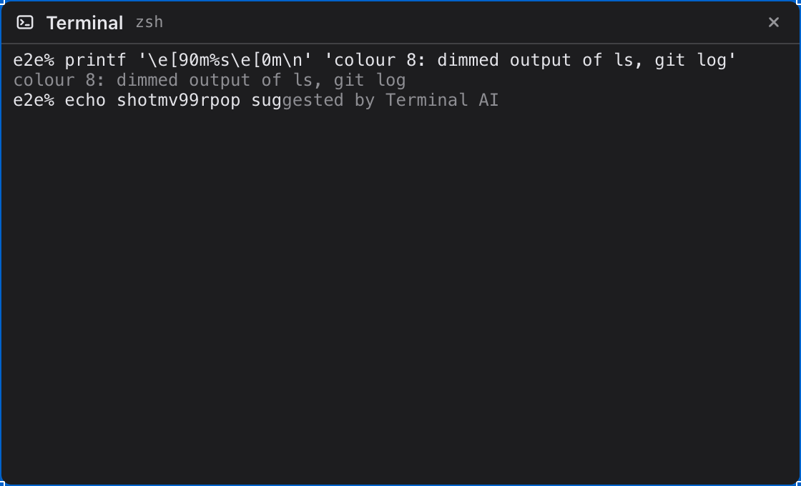
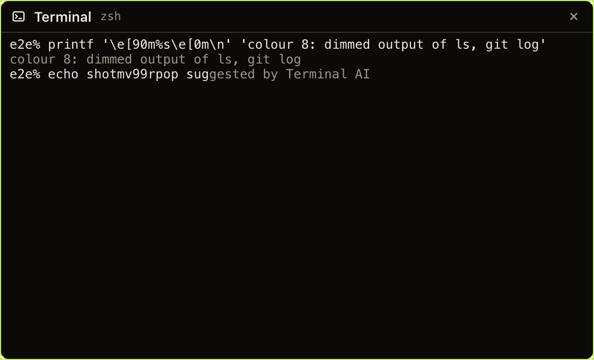

# 02 — Цвет 8 Terminal-а и серый Suggestion Terminal AI: контраст ≥ 4,5:1 в обеих темах

Type: task
Status: claimed — 2026-10-15
Branch: worfy-polish/02
Blocked by: —
Source: [spec.md](../spec.md), кандидат U6 и решение 1; «Итог»
[`worfy-terminal-ai` 03](../../worfy-terminal-ai/issues/03-zle-widget-socket-и-suggestion-из-истории.md),
пункт «На решение владельца (Consider, [med])»; `HANDOFF.md`, «Ждёт владельца» — строка
`worfy-terminal-ai`; `docs/design/F-SPEC.md:40` («Contrast ≥ 4.5:1 for text»).

## Что происходит

- Suggestion Terminal AI zsh рисует цветом 8 палитры: `fg=8` в `src/main/terminal/zsh/rc.d/10-assist.zsh:80`.
- Тема xterm.js задаёт только фон, текст, курсор и выделение (`themeOf`,
  `src/renderer/canvas/nodes/TerminalNode.tsx:69-75`); цвет 8 (`brightBlack`) остаётся по умолчанию
  xterm.js, `#555753`. Контраст на фоне Terminal-а — 2,30:1 в светлой теме и 2,71:1 в тёмной при
  требовании ≥ 4,5:1.
- Фон Terminal-а тёмный в обеих темах: `#1D1D1F` и `#0B0A09` (`docs/design/F-SPEC.md:38`). Значит, один
  серый проходит 4,5:1 в обеих: например, `#8E8E93` — около 5,2:1 и 6,0:1 (точные числа считает test).

## Что делаем

1. Токен `--terminal-dim` в `src/renderer/theme/tokens.css` для светлой и тёмной темы: серый,
   контраст с `--terminal-bg` той же темы ≥ 4,5:1 и заметно тусклее `--terminal-text` (контраст с
   текстом ≥ 1,6:1, чтобы подсказка оставалась подсказкой).
2. `themeOf` отдаёт `brightBlack` из `--terminal-dim`. `themeOf` выносится в экспорт (или в
   `terminal-views.ts`), чтобы его читал unit test. Смена темы уже пересчитывает `themeOf` —
   проверить, что и `brightBlack` меняется без перезапуска Terminal-а.
3. Строка таблицы «terminal node» в `docs/design/F-SPEC.md` — плюс цвет 8 обеих тем.
4. zsh-код Suggestion не меняется: он и дальше пишет `fg=8`.

## Готово, когда

- [x] `test/unit/contrast.test.ts`: `--terminal-dim` на `--terminal-bg` ≥ 4,5:1 в обеих темах, и тусклее
      `--terminal-text`.
- [x] Unit test: `themeOf` отдаёт `brightBlack` из токена текущей темы.
- [x] e2e `terminal-ai-suggest` зелёный; снимок Suggestion в светлой и тёмной теме — в «Итог».
- [ ] (вручную; не проверено: шаг владельца на Stable copy после влития) Stable copy: `ls --color` и `git log --oneline --decorate` в Terminal-е — цвет 8 читается
      в обеих темах.
- [ ] `pnpm lint`, `pnpm typecheck`, `pnpm test` — exit 0; gate full — exit 0 и строка
      `[gate] зелено (full)`; Linux CI зелёный.

## Тесты

- `test/unit/contrast.test.ts` — пара `--terminal-dim` / `--terminal-bg` по образцу пар токенов, что уже есть.
- `test/unit/terminal-theme.test.tsx` — новый: `themeOf` на элементе с токенами светлой и тёмной темы.
- Сначала красный: test контраста — токена нет.
- Мутанты: `brightBlack` не задан; токен одной темы ниже 4,5:1; цвет 8 равен цвету текста. Каждый
  краснит свой test.

## Где в коде

- `src/renderer/theme/tokens.css`
- `src/renderer/canvas/nodes/TerminalNode.tsx`
- `test/unit/contrast.test.ts`
- `test/unit/terminal-theme.test.tsx`
- `docs/design/F-SPEC.md`

Только читать (не в списке, чтобы не давать ложных пересечений Wave):
`src/main/terminal/zsh/rc.d/10-assist.zsh`, `src/renderer/canvas/nodes/TerminalNode.css`,
`test/e2e/terminal-ai-suggest.spec.ts`.

## Вне скоупа

- Остальные 15 цветов ANSI-палитры.
- Свой цвет только для Suggestion (`fg=#…` в zsh): цвет 8 — тот же серый текст у других программ, и
  требование 4,5:1 касается и его.

## Риски

- Цвет 8 других программ (`ls`, `git log`, подсказки zsh) станет светлее. Это и есть исправление, но
  владелец может решить иначе (spec, решение 1): тогда revert одного коммита.

## Итог

Токен `--terminal-dim` (`src/renderer/theme/tokens.css`): `#8E8E93` в светлой теме, `#9C968D` в
тёмной. `themeOf` (`src/renderer/canvas/nodes/TerminalNode.tsx`) отдаёт его xterm.js как
`brightBlack` — цвет 8, которым zsh рисует Suggestion (`fg=8`, zsh-код не менялся). Строка
«terminal node» в `docs/design/F-SPEC.md` называет цвет 8 обеих тем.

| Тема | Фон | Цвет 8 был (`#555753`, по умолчанию xterm.js) | Цвет 8 стал | Цвет 8 к тексту |
| --- | --- | --- | --- | --- |
| светлая | `#1D1D1F` | 2,30:1 | `#8E8E93` — 5,16:1 | 2,60:1 |
| тёмная | `#0B0A09` | 2,71:1 | `#9C968D` — 6,75:1 | 2,40:1 |

Тёмной теме дан тёплый серый палитры Graphite (тот же, что `--text-muted`), а не `#8E8E93`
из примера Ticket-а: к тёплому тексту `#ECE8E1` он ближе по тону. **Решено без владельца,
подтвердить.**

`themeOf` не вынесен в экспорт: правило ESLint `react-refresh/only-export-components` не даёт
экспортировать функцию из файла компонента, а `terminal-views.ts` вне «Где в коде». Test проверяет
`themeOf` через сам Node: подменный `Terminal` xterm.js хранит свои `options`, и видно и тему при
создании, и тему после смены системной темы.

Test-ы:
- `test/unit/contrast.test.ts` — пара `--terminal-dim` / `--terminal-bg` ≥ 4,5:1 в обеих темах и
  test «--terminal-dim is clearly dimmer than --terminal-text»: яркость цвета 8 между фоном и текстом,
  контраст с текстом ≥ 1,6:1.
- `test/unit/terminal-theme.test.tsx` (новый) — на странице настоящие токены одной темы, затем
  другой: `brightBlack`, фон и текст xterm.js совпадают с токенами светлой и тёмной темы; смена
  системной темы перекрашивает тот же Terminal (новый не создаётся) и обратно.

Мутанты (на копиях, восстановлены с `cmp`): `brightBlack` не задан — красные три test-а
`terminal-theme`; `brightBlack` из `--terminal-text` — те же три; `--terminal-dim` `#555753` в
светлой или в тёмной теме — красная пара контраста своей темы; `--terminal-dim` равен
`--terminal-text` — красный test «dimmer»; смена темы не обновляет `options.theme` — красный test
смены темы.

e2e `test/e2e/terminal-ai-suggest.spec.ts` на собранном приложении — код 0. Снимки Suggestion и
строки цвета 8 (`printf '\e[90m…'`) после правки; цвет серых ячеек на экране — `rgb(142, 142, 147)`
в светлой теме и `rgb(156, 150, 141)` в тёмной, до правки `rgb(85, 87, 83)` в обеих:

Откат: если владелец решит иначе (spec, решение 1), revert squash-коммита этого PR возвращает цвет 8
xterm.js по умолчанию.
