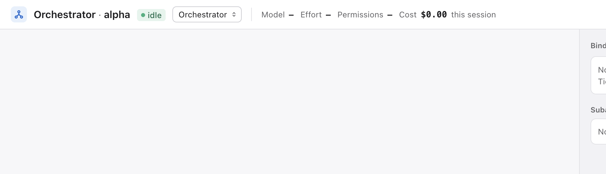
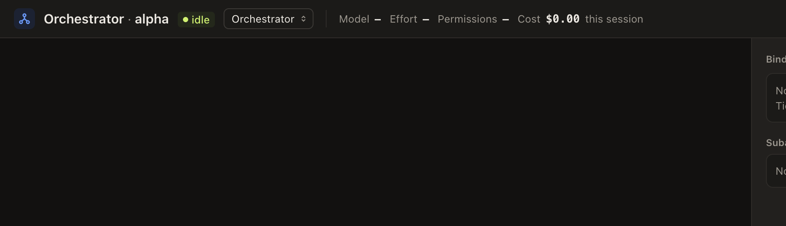
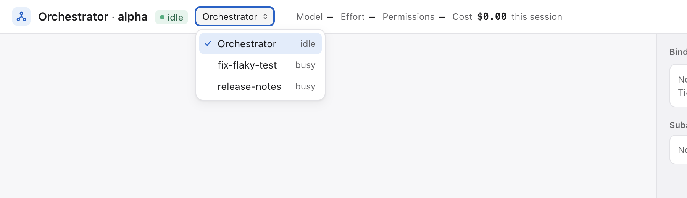
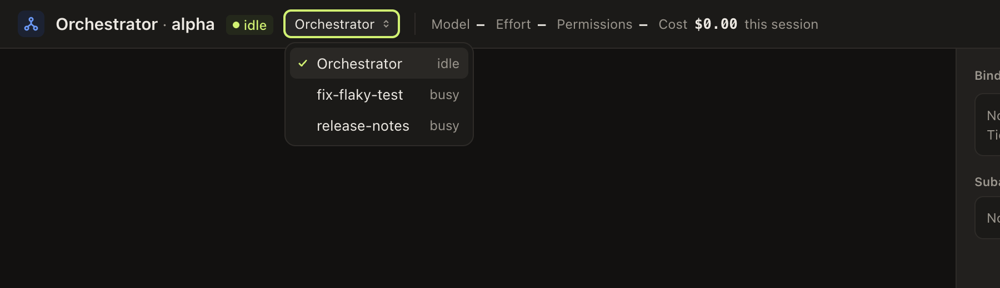

# 44 — Вкладка Session: выбор Session-а в самой вкладке, клик в сайдбаре по текущему виду, последняя Session у каждого Project-а

Type: task
Status: done 2026-10-27T09:12Z
PR: #855
Branch: worfy-polish/44
Blocked by: —
Source: отзыв пользователя через владельца 2026-10-26: пользователь пришёл из Claude Code CLI; вкладка
«Session» в шапке показывала какую-то случайную Session, и показать другую можно было, только найдя её
Node на Canvas и дважды кликнув. Решения владельца Q1–Q3 — 2026-10-26 (ниже, все приняты). Строки — по
main `7d258313`.

Приоритет — после Epic-а worfy-link (слово владельца 2026-10-26). От других Ticket-ов не зависит.

## Что происходит

- Вкладки шапки — `SegmentedControl` «View»: Canvas, Session, Pipeline (`src/renderer/shell/Toolbar.tsx:11`
  — тип `ShellView`, `:19` — варианты, `:94` — сам переключатель; имена областей —
  `src/renderer/shell/AppShell.tsx:58`). Клик по вкладке — `setView` (`src/renderer/main.tsx:68`).
- Что показывает Session view, решает одно глобальное zustand-хранилище `{ view, opened }`
  (`src/renderer/session/navigation.ts:21-27`, начальное `{ view: 'canvas', opened: null }`). Оно одно на
  окно, не по Project-у и не сохраняется. `SessionView` показывает `opened`, если его `projectId` — активный
  Project, иначе Orchestrator (`src/renderer/session/SessionView.tsx:318`); `opened.external` — transcript
  только для чтения (`:327-329`).
- `opened` не сбрасывается ничем, кроме «Go to → Orchestrator» в Command palette
  (`src/renderer/palette/commands.ts:384` → `openOrchestrator`, `navigation.ts:52-53`). Клик по вкладке
  (`setView`, `navigation.ts:29-31`) и «Switch to Session» в палитре (`commands.ts:281-284`) оставляют
  прежний `opened` — ту Session, которую когда-то открыли двойным кликом, даже если её Node уже закрыт или
  в архиве. Отсюда «случайная Session».
- Кто зовёт `openSession` (`navigation.ts:39-43`): двойной клик по Node-ам Orchestrator-а
  (`src/renderer/canvas/nodes/OrchestratorNode.tsx:116`), Session (`SessionNode.tsx:369`, `:370`, `:526`),
  Subagent-а (`SubagentNode.tsx:80`); строка transcript-а в палитре (`CommandPalette.tsx:323`);
  `FirstEpic.tsx:101`; `NotificationTarget.tsx:106`; `question-toast.ts:29`; значки `WaitsForAnswer.tsx:27`,
  `NeedsPermission.tsx:28`; «назад» и ссылки окна Subagent-а (`ExternalSessionPanel.tsx:55`, `:62`, `:165`);
  rail Subagent-ов (`SubagentsRail.tsx:162`).
- Строка Session-а в сайдбаре (Sessions) всегда уводит на Canvas: `setView('canvas')`, `showNode`,
  `focusSessionNode` (`src/renderer/shell/sidebar/SessionsSection.tsx:104-110`), даже когда пользователь
  смотрит вкладку Session. Так же «Resume» и «Show» в History (`src/renderer/session/HistoryPopover.tsx:145-149`,
  Resume — `:165-170`, переход — `:168`).
- Выбора Session-а внутри вкладки нет: шапка `SessionPanel` (`SessionView.tsx:133`, `<header>` — `:224`)
  и `ExternalSessionPanel` (`ExternalSessionPanel.tsx:145`) показывают только заголовок и статус.

## Решения владельца (2026-10-26)

1. **Q1 — список Session-ов во вкладке.** Над transcript-ом во вкладке Session — dropdown со всеми
   Session-ами этого Project-а: первым Orchestrator, затем работающие, затем остальные открытые (Node на
   Canvas). У каждой строки — заголовок и статус. Выбор сразу переключает вкладку на эту Session.
2. **Q2 — клик в сайдбаре по текущему виду.** Клик по строке Session-а в сайдбаре учитывает, где
   пользователь: во вкладке Session — показывает эту Session там же; на Canvas — фокусирует её Node, как
   сейчас. То же для «Resume» в History: продолженная Session открывается там, где пользователь.
3. **Q3 — память по Project-у.** Клик по вкладке Session показывает последнюю открытую Session ЭТОГО
   Project-а: значение у каждого Project-а своё, не одно на окно. Если её Node закрыт, в архиве или скрыт,
   вкладка показывает Orchestrator.

## Что делаем

1. `navigation.ts`: вместо одного `opened` — последняя открытая Session у каждого Project-а
   (`projectId` → `OpenedSession`). `openSession` пишет запись своего Project-а; `openOrchestrator` стирает
   её. Хелпер «что показать для Project-а X» возвращает запись, только если её Node есть в Layout и виден
   (`shownOnCanvas`, `src/shared/layout/derived.ts:65`); для окна Subagent-а и transcript-а проверяется
   Node, на котором его открыли (`opened.nodeId`). Иначе — Orchestrator. Память живёт, пока живёт окно, как
   сейчас; сохранять её между запусками не нужно.
2. `SessionView.tsx` берёт Session через этот хелпер; ветка `external` — тоже.
3. Dropdown (Q1) в шапке обоих panel-ей или строкой над transcript-ом — на выбор исполнителя; снимки в
   «Итог». Данные — те же, что у сайдбара и Node-ов: Layout (`useLayout`), `useOrchestratorViews`,
   `useSessionNodeViews`, `worfySessions` / `sessionRow` и `sessionStatus`
   (`src/renderer/claude-home/session-nodes.ts:92`, `:141`, `:189`). Работающая — у которой есть живой
   процесс (worfy или registry Claude Code). Subagent-ы в список не входят: они в rail. Выбор зовёт
   `openSession` с той же записью, что двойной клик по Node-у (с `external` для Session-а, которую worfy не
   ведёт). Управление с клавиатуры и `aria`-роль — как у других dropdown-ов приложения.
4. Сайдбар и History (Q2): при `view === 'session'` строка сайдбара возвращает скрытый или архивный Node
   (`showNode`, как сейчас, один шаг ⌘Z) и зовёт `openSession`; на Canvas — прежний путь. «Resume» в
   History — так же. «Show» в History и «New session» в сайдбаре не меняются: их смысл — Node на Canvas.
5. На экране только для чтения (Linked machine, worfy-link 25) dropdown переключает Session-ы, ничего не
   записывая: `openSession` и сейчас не шлёт `touch` с такого экрана (`navigation.ts:41`).

## Где в коде

- `src/renderer/session/navigation.ts` — память по Project-у, хелпер выбора Session-а.
- `src/renderer/session/SessionView.tsx`, `src/renderer/session/ExternalSessionPanel.tsx` — dropdown в
  шапке; новый компонент, например `src/renderer/session/SessionPicker.tsx`.
- `src/renderer/shell/sidebar/SessionsSection.tsx`, `src/renderer/session/HistoryPopover.tsx` — Q2.
- `src/renderer/palette/commands.ts` — «Switch to Session» показывает то же, что клик по вкладке (без своей
  логики).
- Test-ы: `test/unit/session-back.test.tsx` (`:92` и ещё 5 мест сверяют форму хранилища
  `{ view, opened }`), `test/unit/session-view.test.tsx`, `test/unit/palette-commands.test.tsx`,
  `test/unit/palette-transcripts.test.tsx`, `test/unit/pipeline-board.test.tsx`,
  `test/unit/question-card.test.tsx`, `test/unit/subagent-nodes.test.tsx` (тоже читают или ставят
  `useNavigation`), `test/unit/session-nodes.test.tsx`, `test/unit/linked-read-only.test.tsx`,
  `test/unit/history-popover.test.tsx`, `test/unit/show-archived-node.test.tsx`, `test/unit/focus-mode.test.tsx`;
  e2e `test/e2e/session-view.spec.ts:123`, `test/e2e/session-back.spec.ts:116`,
  `test/e2e/sidebar-sections.spec.ts`, `test/e2e/session-resume.spec.ts`; новый
  `test/e2e/session-picker.spec.ts`.

Только читать: `src/shared/layout/derived.ts`, `src/renderer/claude-home/session-nodes.ts`,
`src/renderer/session/node-sessions.ts`, `src/renderer/canvas/nodes/orchestrator-view.ts`,
`src/renderer/canvas/show-node.ts`, `src/renderer/claude-home/focus.ts`.

Платформенный PR — нет: только renderer, без путей, процессов и shell (ADR-0056).

## Готово, когда

- [ ] Q1, unit: dropdown перечисляет Session-ы только этого Project-а — Orchestrator первым, затем
  работающие, затем остальные открытые, с заголовком и статусом; выбор сразу показывает выбранную Session
  (и Session, которую worfy не ведёт, — только для чтения).
- [ ] Q2, unit: клик по строке сайдбара во вкладке Session показывает эту Session там же и не уводит на
  Canvas; на Canvas — фокус на Node, как сейчас; архивный Node возвращается. «Resume» в History — то же в
  обоих видах.
- [ ] Q3, unit: память по Project-у — Session, открытая в Project-е A, не показывается в Project-е B, и
  после переключения A → B → A вкладка снова на Session A; клик по вкладке и «Switch to Session» показывают
  последнюю Session этого Project-а; если её Node закрыт, в архиве или скрыт — Orchestrator; «Go to
  Orchestrator» стирает память Project-а.
- [ ] e2e: dropdown во вкладке Session переключает Session; клик по строке сайдбара во вкладке Session
  показывает Session там же (`test/e2e/session-picker.spec.ts` или существующие spec-и выше).
- [ ] Снимки UI dropdown-а (закрытый и открытый) в светлой и тёмной теме — в «Итог»; reviewer их
  проверил.
- [ ] `pnpm lint`, `pnpm typecheck`, `pnpm test` — exit 0; затронутые e2e — exit 0.

## Вне скоупа

- Сохранять последнюю Session между запусками worfy.
- «Show» в History и «New session» в сайдбаре — остаются на Canvas.
- Subagent-ы в dropdown-е.

## Итог

Память по Project-у — `src/renderer/session/navigation.ts`: хранилище `{ view, opened, withoutNode }`,
`opened` — последняя открытая Session у каждого Project-а (`projectId` → `OpenedSession`).
`openSession` пишет запись своего Project-а, `openOrchestrator` стирает только её. `shownSession` /
`useOpenedSession` — что показать для Project-а: запись, пока её Node (для окна Subagent-а и
transcript-а — Node, на котором его открыли) есть в Layout и `shownOnCanvas`; иначе Orchestrator.
`SessionView` берёт Session через `useOpenedSession`, ветка `external` — тоже. «Switch to Session»
в палитре и клик по вкладке — один и тот же `setView('session')`: своей логики в `commands.ts` нет.

Отступление от текста Ticket-а: Session открывают и тогда, когда её Node нет на Canvas — строка
transcript-а в палитре (`CommandPalette.tsx:322`, Node `session:<id>` может не быть или он в архиве
после автоархива, ADR-0076), клик по уведомлению (`NotificationTarget.tsx:106`), toast вопроса
(`question-toast.ts:29`) при скрытом Node. По букве правила «Node нет, в архиве или скрыт —
Orchestrator» такой явный переход показывал бы Orchestrator. Поэтому `openSession` отмечает Project в
`offCanvas`, если Node этого id не на Canvas в момент открытия (нет в Layout, в архиве или скрыт):
такая Session показывается, пока её Node не окажется на Canvas. Как только он там, отметка
снимается, и закрытый, архивный или скрытый после этого Node ведёт к Orchestrator. Отметку снимает
подписка на `layout.changed` уровня хранилища (работает, даже когда вкладка Session этого Project-а
не нарисована) и проверка в `useOpenedSession` для Layout-а, прочитанного через `layout.get`.
**Решено без владельца, подтвердить.**

Dropdown (Q1) — `src/renderer/session/SessionPicker.tsx` в шапке обоих panel-ей, сразу после статуса;
строки — `src/renderer/session/session-picker.ts` (`pickerSessions`). Это общий `Select`
(`theme/Select.tsx`): роль `combobox` / `listbox`, клавиатура как у остальных Select-ов. Строки:
Orchestrator, затем работающие (живой процесс worfy или запись в registry Claude Code), затем
остальные Node-ы Session-ов на Canvas, внутри группы — порядок Layout-а; у строки — заголовок и
статус (как на Node-е). Выбор зовёт `openSession` с той же записью, что двойной клик по Node-у
(`nodeSession` в `navigation.ts`). Session, которая показана, но не входит в список (окно
Subagent-а, transcript без Node), стоит первой строкой, неактивной, с пометкой `shown`. Pure-логика
вынесена в отдельный файл `session-picker.ts`: правило ESLint `react-refresh/only-export-components`
не даёт экспортировать функции из файла компонента.

Q2 — `SessionsSection.tsx`: во вкладке Session строка возвращает скрытый или архивный Node
(`showNode`, один шаг ⌘Z) и зовёт `openSession`; на Canvas — прежний путь. `HistoryPopover.tsx`:
«Resume» во вкладке Session возвращает Node и открывает продолженную Session там же; на Canvas —
фокус на Node, как раньше. «Show» и «New session» не менялись.

Снимки dropdown-а (закрытый и открытый, светлая и тёмная тема):
- 
- 
- 
- 

Test-ы:
- `test/unit/session-picker.test.tsx` (новый) — Q1: порядок и статусы строк, только Session-ы этого
  Project-а, выбор показывает Session сразу (live и только для чтения), клавиатура, `touch` при выборе
  и его отсутствие на экране только для чтения; Q3: A → B → A, вкладка и «Switch to Session»,
  Node закрыт / в архиве / скрыт → Orchestrator, «Go to Orchestrator» стирает память только своего
  Project-а, transcript без Node; Session с архивным или скрытым Node, открытая явно, показывается;
  Node, появившийся и закрытый, пока вкладка не нарисована, ведёт к Orchestrator.
- `test/unit/show-archived-node.test.tsx` — Q2: строка сайдбара во вкладке Session (архивный Node
  возвращается, вид не меняется, ⌘Z), живая Session worfy, путь на Canvas; «Resume» в обоих видах
  (во вкладке Session — скрытый Node: архивный main восстанавливает сам); пользователь, ушедший на
  Canvas, пока main отвечал, там и остаётся — для строки сайдбара и для «Resume».
- Форма хранилища обновлена в `session-back`, `session-view`, `palette-commands`,
  `palette-transcripts`, `permission-card`, `question-card`, `subagent-nodes`.
- e2e `test/e2e/session-picker.spec.ts` (новый): dropdown переключает Session, строка сайдбара во
  вкладке Session показывает Session там же, вкладка возвращается к последней Session, снимки.

### Ревью и merge (2026-10-27)

PR #855: ревью medium. Первый круг — REJECTED: [med] явное открытие Session-а, чей Node в архиве или
скрыт (строка transcript-а в Command palette, клик по уведомлению, toast с вопросом), показывало
Orchestrator — регрессия против main; три low. Второй круг по доработке `c07fc48e..413b0081` — VERIFIED.
Windows — skipped: PR не платформенный (только renderer, ADR-0056). gate full на Mac: первый прогон
красный на двух test-ах вне PR (`wave-gate-lock.test.sh`, случай со сменой летнего времени, — отдельно на
main 2 из 2 зелёный; `browser.spec.ts:510` — приложение не закрылось за 20 s), повтор — зелёный; merge
`68225764`. Долг: `[low] debt:` ошибка подписки на `layout.changed` пишется только в console, без toast
(`src/renderer/session/navigation.ts:79-82`); `[low] debt:` «Resume» архивной Session-и из вида Session
test-ом не покрыт.
