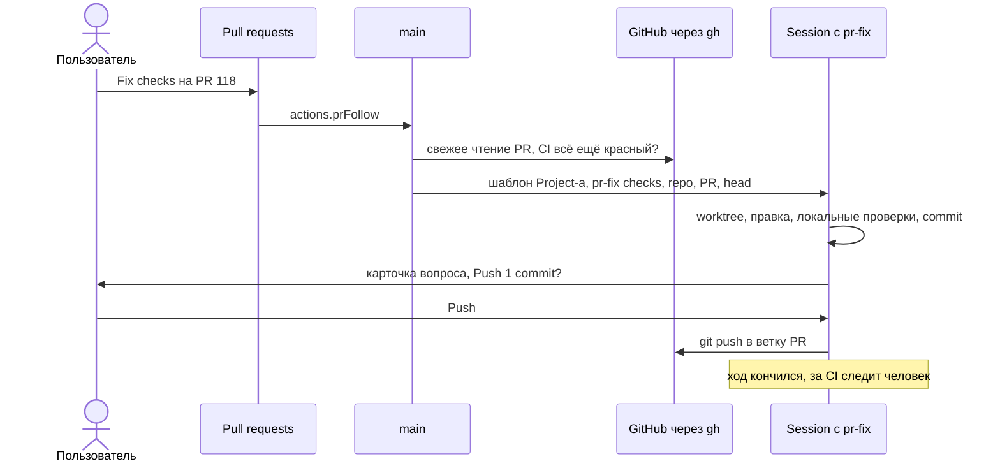
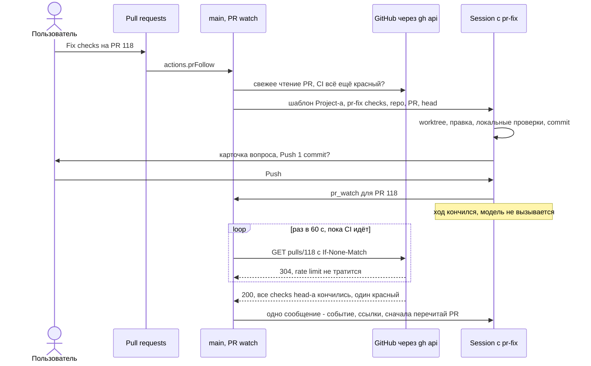

# worfy-pr-follow: PR доводится до merge — часть 1: действия Fix checks, Resolve conflicts, Address comments и skill pr-fix; часть 2 (позже): Session просыпается на события PR

Status: принят владельцем 2026-11-18 по указанию «сразу бери следующий», часть 1
Critic: [docs/product/critic/worfy-pr-follow-2026-11-14.md](../../docs/product/critic/worfy-pr-follow-2026-11-14.md) — Split;
применён: возражение 1 — Epic разрезан на две части, в этом spec-е Ticket-ы только части 1 (три действия и skill
`pr-fix`, без PR watch), кнопки доходят до пользователя в Wave 2; PR watch — раздел «Часть 2 — позже», без Ticket-ов.
Возражение 2 (в snapshot PR inbox нет id review и `authorAssociation`) — перенесено в часть 2 вместе с этим фактом.
Возражение 3 — часть 1 продолжает Session тем путём, который уже влили Ticket-ы 05, 06 и 12 worfy-continuity
(`NodeSessions.started`, `Session.send`, `Session.notice`; ADR-0108, пункт 5), своего ADR о «main шлёт сообщение
Session» не пишет.
Source: [исследование конкурентов 2026-11-13](../../docs/research/2026-11-13-competitors/), три проверенные идеи:
review-quality-1 («Кнопка Fix для PR: красный CI, конфликт, замечания ревью → Session на ветке PR»), review-quality-6
(«Наблюдение за PR без вызова модели: Session будят только на событие»), orchestration-4 («Доводка PR Ticket-а по его
событиям: CI, review threads, конфликт»). Досье:
[GitHub Copilot app](../../docs/research/2026-11-13-competitors/github-copilot-app.md) (Agent Merge, кнопки Fix),
[GitHub Copilot cloud agent](../../docs/research/2026-11-13-competitors/github-copilot-cloud-agent-and-agent-hq-mission-.md)
(«Fix with Copilot», «Watch and fix»),
[Cursor](../../docs/research/2026-11-13-competitors/cursor-agents-window-cloud-agents-and-automation.md) (Subscriptions,
Auto-fix CI, `/autopilot`), [Kiro](../../docs/research/2026-11-13-competitors/kiro.md) (узел `watch`, recipe
`publish-pr`), [OpenHands](../../docs/research/2026-11-13-competitors/openhands.md) (доработка с точным head SHA,
`/iterate`), [Devin](../../docs/research/2026-11-13-competitors/devin.md) (Auto-Fix),
[Claude Code desktop app](../../docs/research/2026-11-13-competitors/claude-code-desktop-app.md) (Auto-fix, кнопки
thread-ов Projects),
[Claude Code cloud sessions and Projects](../../docs/research/2026-11-13-competitors/claude-code-cloud-sessions-and-projects.md)
(Auto-fix для PR), [Claude Code Agent View](../../docs/research/2026-11-13-competitors/claude-code-agent-view.md) (выбор
Session, которая уже работает над PR), [Orca](../../docs/research/2026-11-13-competitors/orca.md) («Fix broken checks»,
«Resolve with AI», action recipes),
[Warp](../../docs/research/2026-11-13-competitors/warp-agent-management-panel-oz-cloud-agents-and-.md) (события вместо
опроса), [OpenAI Symphony](../../docs/research/2026-11-13-competitors/openai-symphony.md) (`Rework`). Строки кода и
документов разделов «Проблема», «Часть 1» и Ticket-ов сверены заново с `c3295fc3b` (2026-11-18); строки раздела
«Часть 2 — позже» — с `04fc90f3a`, их сверяют, когда часть 2 принимают.
Depends on: [worfy-pr-inbox](../worfy-pr-inbox/spec.md) (closed, 8/8: PR inbox, чтение GitHub из main, решения Q2 и
Q9), [worfy-pipeline](../worfy-pipeline/spec.md) (closed, 10/10: Stage, флаги CI failing и rework, CI без отметок
агентов) и [worfy-continuity](../worfy-continuity/spec.md) (Ticket-ы 05, 06, 12 влиты: main продолжает Session Node и
шлёт ей сообщение и `notice`). ADR [0002](../../docs/adr/0002-worfy-is-a-view-over-the-workflow.md) (worfy — вид над workflow),
[0005](../../docs/adr/0005-worfy-own-state-inventory.md) (собственное состояние worfy),
[0076](../../docs/adr/0076-auto-archive-of-finished-sessions.md) (автоархив Session-ов),
[0105](../../docs/adr/0105-pr-reply-only-on-the-users-click.md) (ответ в PR только по щелчку пользователя),
[0108](../../docs/adr/0108-work-continues-after-a-restart-of-worfy.md) (продолжение Session после перезапуска);
[CONTEXT.md](../../CONTEXT.md) — термины PR inbox, Session, Binding, Orchestrator, Autopilot, Limits, Auto-continue, Fix,
Linked machine, Full mode, Silent mode.
Ticket-ы: Epic `worfy-pr-follow`, часть 1 — 7 Ticket-ов: `issues/01`–`issues/07`. Двенадцать Ticket-ов черновика
перенумерованы под часть 1; у части 2 Ticket-ов нет.

## Проблема

PR inbox показывает, что PR нужна правка — красный CI, конфликт или запрос изменений, — но чинить приходится руками:
открыть Session, пересказать, что упало, и снова следить за PR. Агент, который сам ждёт CI, тратит на опрос ходы
модели и Limits.

- **Причина видна, действия нет.** Группа Needs a fix — свой PR пользователя с красным CI, `CHANGES_REQUESTED` или
  конфликтом `DIRTY` (`src/main/github/inbox-groups.ts:119`, `docs/features/pr-inbox.md:36`). Полоса «что дальше» у
  такого PR даёт одну кнопку — Open checks, ссылку на страницу checks на GitHub
  (`src/renderer/pr-inbox/usePrInbox.ts:354-363`). На Ticket Node те же сигналы: badge открытых нитей и «changes
  requested» (`src/renderer/canvas/badges/ReviewThreads.tsx:11-15`), флаг rework (`src/renderer/pipeline/Stepper.tsx:182-186`),
  Stage CI с подсостоянием `failing` (`src/shared/workflow/pipeline.ts:405`). Щелчок по badge открывает вид Pull
  requests, и только.
- **Draft replies код не правит.** Skill `pr-reply` пишет черновики ответов; commit, push и checkout в checkout человека
  ему запрещены (`harness/skills/pr-reply/SKILL.md:12-19`). Его `fixPlan` — план правки для человека, он никуда не
  уходит (`harness/skills/pr-reply/SKILL.md:100-101`).
- **Пересказ.** Чтобы починить, человек открывает Session и пересказывает ей имя check-а, лог, текст замечания или файлы
  конфликта. После push он снова сам смотрит, прошёл ли CI и не пришло ли новое замечание.
- **Ожидание CI стоит ходов модели.** Ship ticket ждёт CI одной командой `gh run watch` в Bash с timeout 10 минут и
  повторяет её, пока CI не кончится (`harness/skills/ship-ticket/step-8-pr-and-ci.md:130`). Orchestrator в Wave ждёт
  так же (`harness/skills/epic-wave/SKILL.md:949`). Каждый повтор — ход модели над всем контекстом Session. Prompt
  cache живёт 5 минут, поэтому после 10-минутного ожидания контекст читается заново без cache — часто 100k токенов и
  больше (`harness/skills/epic-wave/SKILL.md:779-780`). Всё это время Session `busy`, и сообщение человека ждёт в
  очереди.
- **Ожидание review не ведёт никто.** Session кончила ход и молчит, пока человек не вспомнит о PR. Main сам продолжает
  только Orchestrator — после временной ошибки API или отказа Limits (Auto-continue); «A regular Session is never
  continued» (`docs/features/orchestrator-modes.md:64`, `src/main/agent/orchestrator-continue.ts:1-20`).

На что Epic опирается — это уже есть:

- **Main читает GitHub без модели.** Поиск PR inbox раз в 5 минут и детали сдвинувшихся PR
  (`docs/features/pr-inbox.md:208-209`; `PrInbox.refresh` — `src/main/github/inbox.ts:355`). Уведомления GitHub —
  условным запросом, ответ 304 которого не тратит rate limit (`src/main/github/inbox-notifications.ts:1-21`,
  `docs/features/gate-and-github.md:638-640`). Checks веток Ticket-ов — раз в 60 с (`src/main/github/prs.ts:41`,
  `checksOf` — `src/main/github/prs.ts:342`).
- **Main говорит с Session.** Шлёт текст — сразу или в очередь, пока идёт ход (`Session.send`,
  `src/main/agent/session.ts:461-475`). Продолжает законченную Session Node по транскрипту и отдаёт живую Session
  (`NodeSessions.started`, `src/main/agent/node-sessions.ts:322`; так продолжение после перезапуска шлёт своё
  сообщение — `src/main/agent/continuity.ts:23-25`, ADR-0108, пункт 5). Показывает свою строку, которую модель не
  видит (`Session.notice`, `src/main/agent/session.ts:349-351`).
- **Прошлые решения, которые Epic соблюдает.** Подпись кнопки — не голое «Fix»: этим словом в CONTEXT.md назван шаг
  Terminal AI (`.scratch/worfy-pr-inbox/spec.md:276-277`, `CONTEXT.md:372-374`). Fix «никогда не делает push сам; push —
  отдельный щелчок» (Q9, `.scratch/worfy-pr-inbox/spec.md:334`). Main публикует в PR только показанный ответ по щелчку
  Send и не делает push (ADR-0105, пункты 2 и 4).

## Решение

Две части. Ticket-ы этого spec-а — только часть 1.

1. **Часть 1 — три действия и skill `pr-fix`.** Fix checks, Resolve conflicts и Address comments — новые action
   templates Project-а, как Ship ticket и Draft replies (`src/shared/projects/action-templates.ts:22-31`). Кнопки стоят
   там, где worfy уже показывает причину: в полосе «что дальше» PR в Pull requests, на Ticket Node и в Command palette.
   Щелчок отдаёт PR Session с готовым текстом — шаблоном Project-а с `{repo}`, `{pr}` и `{sha}`. Skill `/worfy:pr-fix`
   сам читает упавшие checks, конфликт или нити; пересказывать нечего. После push Session кончает ход; за CI дальше
   следит человек, как сегодня.
2. **Часть 2 — PR watch (позже, без Ticket-ов).** Main сам следит за PR без модели и будит Session событием: красный
   CI, конфликт, замечание. Раздел «Часть 2 — позже» в конце spec-а.

Почему так (возражение 1 critic-а): действия и skill дают истории 1–4 без всякого наблюдения. Кнопки доходят до
пользователя в Wave 2, а владелец оценивает skill на живых PR раньше, чем строится дорогая часть 2 — состояние,
доставка, потолок, ожидание Limits, исключение из автоархива, каналы IPC и tool `pr_watch`.

Push остаётся за человеком (Q9 PR inbox). Skill спрашивает его через AskUserQuestion, а worfy показывает вопрос
карточкой с кнопками в любом permission mode (`docs/features/sessions.md:204`). Щелчок «Push» на карточке — и есть
отдельный щелчок Q9. Main по-прежнему не делает push и не пишет в PR ничего нового (ADR-0105, пункт 4).

### Куда идёт щелчок по действию

Main выбирает Session по порядку. Так Claude Code Agent View по номеру PR выбирает Session, которая уже над ним
работает, вместо новой.

1. **Session Node с Binding-ом manual или launch на Ticket этого PR** (`src/shared/binding/resolve.ts:4-8`), на Claude
   Code, не в архиве, если последняя запись её транскрипта моложе 24 часов (Q7; то же время `lastAt` читает
   автоархив, `src/main/layout/archive.ts:125-128`). Текст уходит в неё тем путём, который влил worfy-continuity:
   `NodeSessions.started` (`src/main/agent/node-sessions.ts:322-327`) продолжает Session по её транскрипту, если
   процесса нет, и отдаёт живую Session; `Session.send` (`src/main/agent/session.ts:461-475`) шлёт сразу или ставит в
   очередь, пока идёт ход; `Session.notice` (`src/main/agent/session.ts:349-351`) пишет строку «worfy: Fix checks
   for owner/web#118 sent to this Session», которую модель не видит.
2. **Иначе новая Session Node Project-а на Claude Code**, как у Draft replies (`src/main/actions/launch.ts:247-254`), с
   Binding-ом launch на Ticket PR-а, если он есть (`bindWhenKnown`, `src/main/actions/launch.ts:410`).

Шаг «Session, которая уже следит за этим PR» появляется только с PR watch — в части 2.

### Поток пользователя

**A. Свой PR вне workflow, красный CI.**

1. Pull requests → группа Needs a fix → строка `owner/web#118` с чипом «CI failing».
2. Полоса «что дальше»: «CI failing», кнопка **Fix checks** и ссылка **Open checks**.
3. Щелчок Fix checks. На Canvas появляется Session Node.
4. Session получает `/worfy:pr-fix checks owner/web#118 3f2a9c1…`. Skill делает worktree ветки PR на этом head, читает
   логи упавших checks, правит код, запускает локальные проверки с exit code и делает commit.
5. Карточка вопроса: «Push 1 commit to fix/retry-429?» — **Push** или **Not now**. Если окно не в фокусе — уведомление
   ОС «Asks: …» (`docs/features/notifications.md:16`).
6. Щелчок Push. Session делает push, говорит, какой CI теперь ждать, и кончает ход. Новое замечание или красный CI
   человек снова видит в Pull requests и снова жмёт кнопку.

**B. Ticket на Canvas, конфликт.**

1. На Ticket Node `worfy-x 07` — кнопка **Resolve conflicts**. На кнопке первая причина в порядке Resolve conflicts →
   Fix checks → Address comments: пока PR в `DIRTY`, CI не запускается
   (`harness/skills/ship-ticket/step-8-pr-and-ci.md:112`). Остальные причины — в меню ▾ той же кнопки.
2. Щелчок. Session Ticket-а, которую вчера запустил Ship ticket (Binding launch), продолжается и получает текст
   `/worfy:pr-fix conflicts …`; notice-строка говорит, что текст пришёл от кнопки. Дальше — как шаги 4–6 потока A; в
   Full mode вопрос о push называет `--force-with-lease` (Q4).

**C. Запрос изменений.** Свой PR с открытыми нитями стоит в Needs my answer раньше, чем в Needs a fix
(`src/main/github/inbox-groups.ts:116-119`). Там Address comments стоит рядом с Draft replies. Skill правит код,
ответы пишет черновиками в PR inbox (Send нажимает пользователь, ADR-0105) и спрашивает про push.

### Как это выглядит

```text
Pull requests · web-app                                                              [Refresh]
+-- Needs a fix (2) ---------------+   +-- owner/web#118  Retry on 429 -------------------------------+
| > owner/web#118 Retry on 429     |   |  fix/retry-429 -> main   +42 -7                              |
|   CI failing                     |   |  +-- CI failing ------------------------------------------+  |
|   owner/web#121 Cache headers    |   |  | Fix the failing checks in a Session, or open them.      |  |
|   Merge conflict                 |   |  | [Fix checks]   Open checks                              |  |
+-- Needs my answer (1) -----------+   |  +---------------------------------------------------------+  |
|   owner/api#77 Pagination        |   |  Threads (0 open)                                            |
+----------------------------------+   +--------------------------------------------------------------+

Ticket Node
+-- worfy-x 07  Retry on 429 -----------+
| CI · failing                          |
| [2 open threads]                      |
| [Fix checks v]   [Open PR]            |
|   +- Address comments                 |
+---------------------------------------+
```



## Как это сделано у конкурентов

- **GitHub Copilot, Agent Merge** ([app](../../docs/research/2026-11-13-competitors/github-copilot-app.md), «GitHub и
  путь PR до merge», «Механизмы» п. 1; [cloud agent](../../docs/research/2026-11-13-competitors/github-copilot-cloud-agent-and-agent-hq-mission-.md)).
  Включается вручную на один PR; Session чинит workflows, конфликты и замечания и делает merge, когда GitHub
  разрешает; переживает перезапуск; опрос раз в 10 минут. Жалобы: модель вызывают ради проверок, с которыми справился
  бы вызов API; включение по умолчанию на проект убрали — Agent Merge брал невыбранные PR. Кнопки Fix failing checks и
  «Fix with Copilot» у упавших Actions и конфликтов; облачный «Watch and fix» не работает со stacked PR и PR из fork.
- **Cursor** ([досье](../../docs/research/2026-11-13-competitors/cursor-agents-window-cloud-agents-and-automation.md),
  Subscriptions и «CI-цикл»). Агент подписывается на события PR и CI, кончает ход и спит; пачка событий — одно
  пробуждение, перед действием агент перечитывает источник. CI-подписка ждёт все checks, и один зависший check
  останавливает агента. Auto-fix CI — до 10 follow-up на PR, не после push человека и не если тот же check красный на
  базе.
- **Kiro** ([досье](../../docs/research/2026-11-13-competitors/kiro.md), узел `watch`, recipe `publish-pr`). GitHub раз
  в 60 с, модель не вызывается, пока ничего не происходит; сбой или конфликт будит агента один раз на head commit.
  Responder при конфликте делает merge commit базы, никогда rebase и force-push; перед изменением дизайна, объёма или
  UX спрашивает человека; merge — за человеком.
- **OpenHands** ([досье](../../docs/research/2026-11-13-competitors/openhands.md)). Задача доработки называет точный
  head SHA; агент исправляет каждое замечание или доказывает, что правка не нужна; push — в ту же ветку. Skill
  `/iterate` ведёт PR через CI и бота-ревьюера до зелёного.
- **Devin** ([досье](../../docs/research/2026-11-13-competitors/devin.md)). Auto-Fix: Session, открывшая PR, сортирует
  каждую находку — исправить, проверить или передать человеку. Merge-конфликты чинит в течение 12 часов активности
  Session.
- **Claude Code desktop и cloud** ([desktop](../../docs/research/2026-11-13-competitors/claude-code-desktop-app.md),
  [cloud](../../docs/research/2026-11-13-competitors/claude-code-cloud-sessions-and-projects.md)). Auto-fix чинит
  упавший CI и отвечает на review-комментарии; при неясном комментарии спрашивает; повторные события пропускает.
  Облачный на конфликты не реагирует: GitHub не шлёт для них webhook. Кнопки Resolve conflicts, Fix CI и Address
  comments у thread-ов Projects отправляют инструкцию как сообщение пользователя.
- **Claude Code Agent View** ([досье](../../docs/research/2026-11-13-competitors/claude-code-agent-view.md)). `#1234`
  или URL PR выбирает Session, которая уже работает над этим PR, вместо запуска новой.
- **Orca** ([досье](../../docs/research/2026-11-13-competitors/orca.md)). «Fix broken checks» отдаёт упавшие checks
  агенту, «Resolve with AI» — конфликт, рядом Abort merge и Abort rebase. Force-push with lease — отдельное, явно
  подписанное действие. Action recipes репозитория задают агента и шаблон prompt каждого AI-действия — как action
  templates worfy.
- **Warp** ([досье](../../docs/research/2026-11-13-competitors/warp-agent-management-panel-oz-cloud-agents-and-.md)).
  Родитель получает события, а не опрашивает детей; законченный ребёнок просыпается от нового сообщения.
- **OpenAI Symphony** ([досье](../../docs/research/2026-11-13-competitors/openai-symphony.md)). `Rework` — полный сброс:
  закрыть PR и начать новую ветку от `origin/main`. Для доводки живого PR не подходит.

Что берём: ожидание без модели и одно пробуждение на head (Kiro); склейку событий и «сначала перечитай» (Cursor); порог
для зависшего check-а (урок Cursor); явное включение на PR (урок Copilot); push отдельным явным действием (Orca, Q9);
выбор Session, которая уже работает над PR (Agent View); шаблоны действий (recipes Orca). Не берём: merge агентом
(Copilot), публикацию ответов агентом (Claude Code cloud; в worfy это Send пользователя, ADR-0105), сброс ветки
(Symphony).
Часть 1 берёт из этого явный запуск на один PR, push отдельным явным действием, выбор Session, которая уже работает
над PR, и шаблоны действий; ожидание без модели, склейку событий и порог зависшего check-а — часть 2.

## Истории пользователя

Часть 1 — истории 1–4 и 11; часть 2 — истории 5–10.

1. Как пользователь, я вижу в Pull requests свой PR с красным CI и одним щелчком отдаю его Session, не пересказывая,
   какой check упал.
2. Как пользователь, я разрешаю конфликт PR с базой одним щелчком, и мой checkout при этом никто не трогает.
3. Как пользователь, на запрос изменений я получаю правку кода и черновики ответов, а отправляю ответы сам.
4. Как пользователь, я хочу, чтобы push в ветку PR был только после моего щелчка.
5. (часть 2) Как пользователь, я не хочу тратить ходы модели и Limits, пока CI идёт или PR ждёт review.
6. (часть 2) Как пользователь, я хочу, чтобы Session проснулась сама, когда CI снова упал или пришло новое замечание, и
   чтобы несколько событий пришли одним сообщением.
7. (часть 2) Как пользователь, я хочу видеть на Session Node и в строке PR, что за PR следят, и выключать это одним
   щелчком.
8. (часть 2) Как пользователь, я хочу, чтобы Session, запущенная Ship ticket, ждала CI без опроса и сама продолжила,
   когда CI кончился.
9. (часть 2) Как пользователь, я хочу, чтобы наблюдение пережило перезапуск worfy и сон Mac.
10. (часть 2) Как пользователь, я хочу, чтобы worfy не будил Session без конца: после нескольких пробуждений без меня
    он останавливается и говорит об этом.
11. Как пользователь Linked machine с доступом read-only, я вижу причины на PR, но действий не запускаю.

## Решения по реализации

Имена новых файлов — предложение; implementer сверяет их с `main`.

### 1. Действия в main: action templates, `{sha}`, канал и маршрут (Ticket 01)

- `src/shared/projects/action-templates.ts`: `ACTIONS` (`:22`) получает `fixChecks`, `resolveConflicts`,
  `addressComments`; подписи (`:26-31`) — «Fix checks», «Resolve conflicts», «Address comments». Шаблоны старого
  Harness (`:47-55`) — пустые: такого skill-а у него нет, кнопки не будет, как у `prReply`. Шаблоны плагина (`:64-69`):
  - `fixChecks`: `/worfy:pr-fix checks {repo}#{pr} {sha}`;
  - `resolveConflicts`: `/worfy:pr-fix conflicts {repo}#{pr} {sha}`;
  - `addressComments`: `/worfy:pr-fix comments {repo}#{pr} {sha}`.
  Известные шаблоны по умолчанию (`:94-100`), схема (`:136-141`) и чтение старых settings без этих полей — как у
  `gateQueue` и `prReply`: `savedProjectSettingsSchema` (`:224`), `projectSettingsAnswerSchema` (`:244`),
  `projectSettingsInputSchema` (`:259`) и `src/main/projects/settings.ts:39-67`. Диалог Project settings перебирает
  `ACTIONS` (`src/renderer/shell/ProjectSettings.tsx:186`, `:232`), поэтому три поля появляются в нём сами.
- Плейсхолдер `{sha}` — head PR-а, 40 hex-символов и ничего больше: текст уходит в Session с `bypassPermissions`, как
  и `{repo}` (`src/shared/ipc/actions.ts:79-84`). Он входит в `PLACEHOLDERS` и их описания
  (`src/shared/projects/action-templates.ts:8-20`) и в комментарий-список `src/shared/actions/render-template.ts:7-15`;
  `prFollowState` — рядом с `prReplyState` (`src/shared/actions/render-template.ts:148-157`).
- Причины и порядок кнопок считает одна чистая функция (новый `src/shared/actions/pr-follow.ts`) для Pull requests,
  Ticket Node и Command palette — так `src/renderer/canvas/actions/gates.ts:1-3` считает Ship ticket и Run wave,
  чтобы кнопка и строка palette не расходились. Вход — строка PR inbox (`src/shared/ipc/pr-inbox.ts:55-89`): `DIRTY` →
  Resolve conflicts, `ci: 'failing'` → Fix checks, `CHANGES_REQUESTED` или нити, ждущие ответа (`waitingThreads`,
  `src/renderer/canvas/badges/review-threads.ts:16`), → Address comments; порядок — этот. `waitingThreads` и
  `ticketOfRow` (`src/renderer/pr-inbox/usePrInbox.ts:180`) переезжают в `src/shared`: `src/shared` не импортирует
  `src/renderer` (`eslint.config.js:24`), а main не может взять `usePrInbox.ts` — он тянет react, zustand и ipc
  renderer-а. Hook состояния кнопки (шаблон + строка PR + read-only) — в `src/renderer/canvas/actions/gates.ts`
  рядом с `useShipTicketState` (`:43-48`); его берут Ticket-ы 04 и 05. Отказ с причиной: PR не
  пользователя, из fork, закрыт, шаблон пуст, экран read-only.
- Новое поле `isCrossRepository` в `PULL_FIELDS` (`src/main/github/inbox.ts:69-77`) и в строке PR inbox: PR из fork
  действия не получают — push в чужой fork skill не сделает.
- Канал `actions.prFollow` в `src/shared/ipc/actions.ts` рядом с `actionsPrReply` (`:86-103`): `{ projectId, repo, pr,
  action, near? }` → `{ nodeId, sessionId, text, delivery: 'sent' | 'queued' | 'new' }`, `project`, `write`.
  Обработчик — `src/main/ipc/actions.ts:22-29`.
- `prFollow()` в `src/main/actions/launch.ts`:
  - свежее чтение PR перед запуском, как Ship ticket берёт вердикт снова по свежему чтению
    (`src/main/actions/launch.ts:6-8`): `PrInbox.refresh(repo, pr)` (`src/main/github/inbox.ts:355`) и строка из
    `snapshot` (`:386`). Причина ещё есть — CI красный на текущем head, `DIRTY`, запрос изменений или открытые нити;
    `{sha}` — текущий `headRefOid`. `refresh` пропускает аккаунт на паузе rate limit (`src/main/github/inbox.ts:368`,
    `:373-374`): тогда строка старая, и это принято — skill сам сверяет head (шаг 1);
  - маршрут — раздел «Куда идёт щелчок по действию». Binding-и — `sessionBindings` (`src/main/layout/archive.ts:605`)
    и `resolveBinding` (`src/shared/binding/resolve.ts:242`); Ticket PR-а — по строкам `PR:` или ветке, как
    `ticketOfRow` (`src/renderer/pr-inbox/usePrInbox.ts:180`);
  - отказ с причиной: пустой шаблон; идёт Autopilot (`src/main/actions/launch.ts:264` — так отказывает Run wave);
    Orchestrator с Binding-ом на Epic этого Ticket-а `busy` — его Wave сама чинит свои PR
    (`harness/skills/epic-wave/SKILL.md:520`); PR не пользователя, из fork или закрыт; причины больше нет.
- Английская страница `docs/features/projects.md` (шаблоны и плейсхолдеры, `:334-338`).

### 2. Skill `/worfy:pr-fix` (Harness; Ticket-ы 02 и 03)

- Новый `harness/skills/pr-fix/SKILL.md` — skill плагина, тот же в worfy и в терминале (ADR-0002). Аргументы:
  `<checks|conflicts|comments> <owner>/<repo>#<N> [<sha>]`.
- Шаги:
  1. Прочитать PR. Head не равен `<sha>` — сказать об этом и работать с текущим head.
  2. Worktree: worktree Ticket-а, если он на этом head и чистый; иначе новый worktree ветки PR. Checkout человека не
     трогать (`harness/skills/pr-reply/SKILL.md:19`).
  3. По режиму:
     - `checks` — упавшие checks и их логи (`gh pr checks`, `gh run view --log-failed`). Отметки агентов — не CI
       (`harness/skills/ship-ticket/step-8-pr-and-ci.md:101-104`). Check, красный и на head базы, — сообщить, не
       чинить (правило Cursor). Перезапуск check-а — только ответом человека в карточке вопроса;
     - `conflicts` — по политике Q4 (Ticket 03); сначала `git merge-tree`, чтобы назвать файлы конфликта;
     - `comments` — открытые нити, reviews с `CHANGES_REQUESTED`, `fixPlan` из черновиков
       (`harness/skills/pr-reply/SKILL.md:100-101`), комментарии-вердикты `REJECTED` со списком
       (`harness/skills/epic-wave/SKILL.md:44`). Перед изменением дизайна, объёма работы или UX — спросить (как
       responder Kiro). Ответы — черновиками через `harness/bin/pr-reply-draft`; публикует их пользователь кнопкой
       Send (ADR-0105).
  4. Локальные проверки с exit code: `commands.verify` Profile-а или gate fast.
  5. Commit. Guard hook проверяет тексты commit-ов на следы workflow (`harness/hooks/guard.mjs:236-246`); в Silent
     mode следов нет (`harness/skills/ship-ticket/silent-mode.md`).
  6. Push — только после ответа «Push» на AskUserQuestion «Push N commits to <branch>?». Если это rebase, вопрос
     называет `--force-with-lease`. Без человека (unattended) push нет, и отчёт говорит, что ждёт.
  7. Никогда: merge, комментарий, review, resolve, re-request review, метки — тот же список, что у pr-reply
     (`harness/skills/pr-reply/SKILL.md:12-19`).
  8. Конец: сказать, какой CI теперь ждать и что делать, если он снова красный или пришло замечание (кнопка в Pull
     requests или та же команда). Вызов `pr_watch` сюда добавит часть 2.
- Evals `harness/evals/pr-fix-*` — по образцу `harness/evals/pr-reply-guards` (`case.yaml`, `prompt.md`,
  `scaffold.sh`, `graders`); запуск — `scripts/eval-harness.mjs`, сначала `--dry-run`, затем с `--max-cost-usd`; цена
  каждого запуска — в «Итог» Ticket-а.
- Английские страницы `docs/features/skills-agents-and-hooks.md` (строка skill-а рядом с `pr-reply`, `:27`) и
  `docs/features/harness.md` (число skill-ов и eval-кейсов, `:301`, `:449`).

### 3. UI: Pull requests, Ticket Node, Command palette (Ticket-ы 04 и 05)

- **Pull requests (04).** `NextAction` (`src/renderer/pr-inbox/usePrInbox.ts:313`) получает вид `{ kind: 'pr-follow',
  action }`. `nextStep` для `needs-fix` (`src/renderer/pr-inbox/usePrInbox.ts:354-364`): главная кнопка — действие
  первой причины, остальные причины — кнопками рядом, Open checks остаётся ссылкой. Свой PR с нитями, ждущими ответа,
  попадает в Needs my answer раньше, чем в Needs a fix (`src/main/github/inbox-groups.ts:116-119`), поэтому там
  Address comments стоит рядом с Draft replies. Рисует `src/renderer/pr-inbox/PrInboxView.tsx:445-476` (полоса) и
  `:522` (кнопка Draft replies под нитями). Английская страница — `docs/features/pr-inbox.md` (`:80-81`).
- **Ticket Node (05).** Новый слот `src/renderer/canvas/actions/PrFollow.tsx` — слоты добавляются по файлу
  (`src/renderer/canvas/badges/index.ts:1-12`). Одна кнопка по первой причине и меню ▾ с остальными, как «Open PR» с
  меню (`src/renderer/canvas/actions/OpenPr.tsx:1-14`). Причины — строка PR inbox PR-а этого Ticket-а
  (`reviewsByTicket`, `src/renderer/canvas/badges/review-threads.ts:50-70`). Project с `"prInbox": false`
  (`src/shared/projects/action-templates.ts:213`) кнопки не получает: main не читает его GitHub. Новая Session Node
  встаёт у Ticket-а, как у Ship ticket (`near`, `src/shared/ipc/actions.ts:23-27`).
- **Command palette (05).** Строки «Fix checks owner/web#118» и так далее — из той же функции, что и кнопки, по
  образцу строки Ship ticket (`src/renderer/palette/commands.ts:325-341`); новый вид `CommandGate` (`:91-93`) рисует
  `src/renderer/palette/CommandPalette.tsx:251-264`. Английские страницы —
  `docs/features/workflow.md` (таблица действий, `:103-104`) и `docs/features/app-shell.md` (`:129`, `:140`).

### 4. Linked machine, Vendor, Autopilot

- Канал `actions.prFollow` — `write`, как Ship ticket и Draft replies (`src/shared/ipc/actions.ts:41`, `:102`).
  Linked machine с доступом read-only видит причины на полосе и на Ticket Node, кнопки у неё неактивны с причиной.
- Действия запускают Claude Code, как Draft replies (`PR_REPLY_VENDOR`, `src/shared/projects/action-templates.ts:156`):
  skill-ы Harness работают под Claude Code, пока worfy-multi-vendor не перенесёт их в Codex
  (`src/main/actions/launch.ts:14-17`). Session Ticket-а на Codex маршрут пропускает и запускает новую.
- Пока идёт Autopilot, действий нет; Session без человека их не получает: Autopilot ведёт только Orchestrator
  (`src/main/actions/launch.ts:39-45`).

### 5. Документы (Ticket 06)

- Нового ADR о «main шлёт сообщение Session» нет: этот путь записан в ADR-0108, пункт 5 (возражение 3 critic-а). Решения
  части 1 о push и конфликте — Amendment к ADR-0105: Session делает push только после ответа «Push» в карточке
  вопроса; main по-прежнему не пишет в PR и не пушит; конфликт — rebase с `--force-with-lease` в Full mode, merge
  commit в Silent mode.
- CONTEXT.md: три имени действий в статье PR inbox и строка `_Avoid_` с «Fix» (так назван шаг Terminal AI,
  `CONTEXT.md:372-374`). Термин PR watch — часть 2.
- Переводы в `docs/features/ru/`: `projects.md`, `pr-inbox.md`, `workflow.md`, `app-shell.md`,
  `skills-agents-and-hooks.md`, `harness.md` — по английским страницам на `main`. Английские страницы правят Ticket-ы поведения
  (ADR-0088).

## Решения по test-ам

- Каждый Ticket начинается с падающего test-а (skill `worfy:tdd`).
- Ни в одном test-е нет настоящего GitHub и настоящей модели. gh — stand-in `test/fixtures/gh/gh-stub.mjs` (миры —
  `test/contract/gh-world.ts`), агент — fake agent `WORFY_AGENT=fake` (`src/main/agent/fake-query.ts:1`).
- **Unit.** Шаблоны, `{sha}` и чтение старых settings — `test/unit/action-templates.test.ts` и
  `test/unit/render-template.test.ts`; причины и порядок кнопок — новый `test/unit/pr-follow.test.ts`; полоса «что
  дальше» — `test/unit/pr-inbox-view.test.tsx`; слот Ticket Node — `test/unit/canvas-actions.test.tsx`; строки palette —
  `test/unit/palette-commands.test.tsx`.
- **Contract.** Маршрут и отказы — `test/contract/actions.test.ts`: Session с Binding-ом моложе 24 часов получает текст
  (`sent`, `queued` во время хода, `resume` без процесса) и notice-строку; старше — новая Session Node; отказ при
  Autopilot, при `busy` Orchestrator-е Epic-а, для PR из fork; `{sha}` — head свежего чтения.
- **E2E.** `test/e2e/pr-inbox.spec.ts`: Fix checks создаёт Session Node с текстом шаблона. Canvas: кнопка на Ticket Node
  рядом с `test/e2e/ship-ticket.spec.ts`.
- **Harness.** Evals `harness/evals/pr-fix-*`: нет push без ответа «Push»; нет записей в PR; работа в worktree, а не в
  checkout; упавший check починен; check, красный и на базе, не тронут; в Full mode вопрос о push после rebase
  называет `--force-with-lease`, в Silent mode — merge commit и ни одного force-push.

## Не в этом Epic-е

- **PR watch и всё, что на нём стоит** — не в части 1: раздел «Часть 2 — позже».
- **Orchestrator и Autopilot.** Ожидание CI Orchestrator-ом в Wave (`harness/skills/epic-wave/SKILL.md:949`) остаётся
  как есть. Будить Orchestrator событиями PR — отдельный Epic.
- **Merge агентом или worfy.** Нет «Merge it» и auto-merge: merge остаётся за человеком или за шагом 9 ship-ticket.
- **Записи в PR.** Resolve нити, re-request review и ответ без щелчка Send — нет; ADR-0105 в силе.
- **Чужие PR и PR из fork.** Действия — только для своих открытых PR пользователя.
- **Хосты кроме GitHub** — GitLab, Bitbucket, Azure DevOps.
- **Действия на Codex.** Действия запускают Claude Code, пока skill-ы Harness не перенесены в Codex.
- **Разбор комментариев Haiku** — он остаётся следующим шагом PR inbox (`.scratch/worfy-pr-inbox/spec.md:272-274`).
- **Перезапуск упавшего check-а самим worfy.** Только ответом человека в карточке вопроса внутри skill-а.

## Ticket-ы

Часть 1. Двенадцать Ticket-ов черновика перенумерованы: действия (бывший 05 без включения PR watch) — 01, skill
(бывший 06) — 02 и 03, кнопки (бывшие 07 и 08 без переключателя и badge-а) — 04 и 05, документы — 06, приёмка — 07.

1. **Действия в main** — action templates `fixChecks`, `resolveConflicts`, `addressComments`, плейсхолдер `{sha}`,
   чистая функция причин и порядка кнопок, поле `isCrossRepository`, канал `actions.prFollow`, маршрут через
   `NodeSessions.started` и `Session.send` и отказы в `launch.ts`; страница `projects.md`; contract test-ы.
   Blocked by: —.
2. **Skill `/worfy:pr-fix`: режимы `checks` и `comments`** — `harness/skills/pr-fix/SKILL.md`: worktree на head,
   checkout человека не трогает, push только ответом «Push», без записей в PR; evals `pr-fix-checks` и
   `pr-fix-comments`; строка в `skills-agents-and-hooks.md`. Blocked by: —.
3. **Skill `/worfy:pr-fix`: режим `conflicts`** — политика Q4: rebase и `--force-with-lease`, названный в вопросе, в
   Full mode; merge commit в Silent mode; `git merge-tree`; eval `pr-fix-conflicts`. Blocked by: 02.
4. **Pull requests: кнопки по причинам** — `usePrInbox.ts`, `PrInboxView.tsx`: Resolve conflicts, Fix checks, Address
   comments в Needs a fix, Address comments рядом с Draft replies в Needs my answer, Open checks — ссылкой; страница
   `pr-inbox.md`; unit и e2e. Blocked by: 01.
5. **Ticket Node и Command palette** — слот `PrFollow.tsx` с меню ▾, строки palette из той же функции; страницы
   `workflow.md` и `app-shell.md`; unit и e2e. Blocked by: 01.
6. **Документы** — переводы `docs/features/ru/` (`projects.md`, `pr-inbox.md`, `workflow.md`, `app-shell.md`,
   `skills-agents-and-hooks.md`, `harness.md`), Amendment к ADR-0105, имена действий в CONTEXT.md. Blocked by: 01, 02, 03, 04, 05.
7. **Приёмка владельцем** — живой PR в тестовом репозитории: красный CI, конфликт, запрос изменений; push только по
   щелчку, checkout не тронут. Blocked by: 01, 02, 03, 04, 05, 06.

## Волны

| Wave | Ticket-ы | Blocked by | Почему так |
|---|---|---|---|
| 1 | 01, 02 | — | действия (`src/shared/projects/`, `src/shared/actions/`, `src/shared/ipc/actions.ts`, `src/main/actions/`, `src/main/github/inbox.ts`) и skill (`harness/skills/pr-fix/`, `harness/evals/`): общих файлов нет; skill не ждёт кода worfy — в терминале он работает сам |
| 2 | 03, 04, 05 | 03 — 02; 04 — 01; 05 — 01 | режим `conflicts` (`harness/skills/pr-fix/`), Pull requests (`src/renderer/pr-inbox/`), Ticket Node и palette (`src/renderer/canvas/actions/`, `src/renderer/palette/`): общих файлов нет; 04 и 05 только читают функцию причин 01 |
| 3 | 06 | 01–05 | документы по сделанному |
| 4 | 07 | 01–06 | приёмка |

Wave — Ticket-ы, которые можно брать параллельно: блокеры закрыты, общих файлов нет. Wave, которую берут в работу,
вычисляется заново в момент запуска (CONTEXT.md, термин Wave); таблица — прогноз. Пользователь получает кнопки в
Wave 2.

## Риски

- **Push без спроса.** Session в `bypassPermissions` (`src/main/actions/launch.ts:10-11`) технически может сделать push
  сама. Текст skill-а это запрещает, evals 02 и 03 проверяют. Это сила самого агента, как у любой Session с Bash; по
  правилу соразмерности защиты она описана, а не закрыта — так же, как в ADR-0105 (раздел «Последствия»).
- **Force-push.** Rebase в Full mode переписывает ветку PR. Меры: `--force-with-lease`, вопрос называет его явно,
  ответ «Not now» оставляет commit-ы локально; в Silent mode — только merge commit (responder Kiro никогда не делает
  rebase и force-push). Eval 03 проверяет оба режима.
- **Два агента на одной ветке** — implementer Wave и Session pr-fix на одном PR. Меры: отказ, пока идёт Autopilot или
  Orchestrator с Binding-ом на Epic Ticket-а `busy`; Ship ticket и так не даёт второго запуска на Ticket
  (`src/shared/ipc/actions.ts:105-110`).
- **Давно молчавшая Session.** Session Ticket-а, молчавшая сутки, на первом сообщении читает контекст заново без prompt
  cache — часто 100k токенов и больше (`harness/skills/epic-wave/SKILL.md:779-780`). Мера — порог 24 часа (Q7):
  старше — новая Session.
- **Fork и stacked PR.** PR из fork — отказ с причиной (так же у облачного Agent Merge Copilot). У stacked PR база —
  другая ветка; конфликт разрешается с базой PR, какая бы она ни была.
- **Следы workflow в Silent mode.** Commit-ы pr-fix в командном репозитории не должны нести следов workflow: guard hook
  проверяет их тексты (`harness/hooks/guard.mjs:236-246`), правила — `harness/skills/ship-ticket/silent-mode.md`.
- **Тексты коллег в транскрипте.** Main их не пересказывает. Session читает их сама, и они попадают в её транскрипт
  так же, как при Draft replies.

## Вопросы владельцу

Владелец 2026-11-18 велел брать следующий Epic сразу («закончишь эпик — сразу бери следующий») и на вопросы этого
spec-а не отвечал. Вопросы части 1 решены рекомендованным вариантом — решено без владельца, подтвердить. Вопросы
части 2 (Q1, Q2, Q5, Q6, Q8, Q9) открыты — в разделе «Часть 2 — позже». Вопросов о деньгах, удалении данных и
необратимых шагах, которые решал бы spec, в части 1 нет: каждый push, в том числе с `--force-with-lease`, делает
только ответ человека в карточке вопроса.

1. **Q3 — push в Full mode.** Решение Q9 PR inbox («push — отдельный щелчок») действует и на PR Ticket-ов Project-а в
   Full mode, где ship-ticket и так пушит сам? Рекомендация: да, без исключений в этом Epic-е; ослабить — отдельным
   решением после приёмки.
   **Решено: да, без исключений** — решено без владельца 2026-11-18, подтвердить. Ticket-ы: 02, 03.
2. **Q4 — как разрешать конфликт.** Merge базы в ветку PR обычным merge commit или rebase на базу и
   `git push --force-with-lease`? Рекомендация — по режиму Profile-а: в Full mode rebase, как делает Wave сегодня
   (`harness/skills/epic-wave/SKILL.md:920`); в Silent mode merge commit — rebase переписывает историю, которую мог
   взять коллега (responder Kiro никогда не делает rebase и force-push).
   **Решено: по режиму Profile-а** — решено без владельца 2026-11-18, подтвердить. Ticket-ы: 03, 06.
3. **Q7 — давно молчавшая Session Ticket-а.** Продолжать её, если последняя запись её транскрипта была меньше 24
   часов назад (рекомендация; порог — как у автоархива, ADR-0076), продолжать всегда или всегда начинать новую
   Session? **Решено: 24 часа** — решено без владельца 2026-11-18, подтвердить. Ticket: 01.

## Решено без владельца (подтвердить)

Каждый пункт — решение, которое владелец может отменить. Все — 2026-11-18, по указанию «сразу бери следующий».

1. **Split (возражение 1 critic-а).** Epic разрезан: часть 1 — действия и skill, 7 Ticket-ов; часть 2 — PR watch, без
   Ticket-ов, раздел «Часть 2 — позже». Часть 2 заводит Ticket-ы после приёмки части 1 (Ticket 07) и сверки её строк
   кода. Причина: кнопки доходят до пользователя в Wave 2, а не в Wave 5, и владелец оценивает skill на живых PR до
   дорогой части.
2. **Q3, Q4, Q7 — рекомендованные варианты** (раздел «Вопросы владельцу»).
3. **Без своего ADR о сообщении Session (возражение 3 critic-а).** Часть 1 продолжает Session Ticket-а и шлёт ей текст
   тем же путём, что продолжение после перезапуска (`NodeSessions.started`, `Session.send`, `Session.notice`; ADR-0108,
   пункт 5). Решения о push и конфликте — Amendment к ADR-0105 (Ticket 06), а не новый ADR. Если часть 2 введёт
   пробуждение по событию, она дописывает Amendment к ADR-0108.
4. **Возражение 2 critic-а — в часть 2.** В snapshot PR inbox нет id review и `authorAssociation`
   (`src/main/github/inbox.ts:68`, `:74`; `InboxComment` — `src/main/github/inbox-groups.ts:7-15`); они нужны только
   правилам пробуждения. Часть 1 их не читает.
5. **Ticket Node берёт причины из PR inbox, а не из Pipeline.** Кнопке нужны repo, номер и head PR-а — их даёт строка
   PR inbox; Project с `"prInbox": false` кнопки не получает. Флаг rework и подсостояние `failing` Pipeline остаются
   только видом.
6. **Skill — два Ticket-а.** Режим `conflicts` с force-push — отдельный Ticket 03 со своим eval-ом и review, чтобы
   деструктивный шаг не прятался в большом diff-е.
7. **Страницы Feature.** Английскую страницу правит Ticket своего поведения (ADR-0088); Ticket 06 держит переводы в
   `docs/features/ru/`, Amendment к ADR-0105 и CONTEXT.md — как в worfy-continuity.
8. **Форма строки Status.** Указание звучит «принят по указанию владельца»; строка написана в единой форме
   «принят владельцем YYYY-MM-DD …» (`rules.md`, раздел «Тикеты, ветки, worktree»), как у worfy-continuity, чтобы
   `epic-status` видел дату принятия.

## Готово, когда

Часть 1:

- [ ] В Pull requests у своего PR группы Needs a fix — кнопка по первой причине (Resolve conflicts, Fix checks, Address
      comments) и остальные причины рядом; Open checks остаётся ссылкой. У своего PR в Needs my answer — Address
      comments рядом с Draft replies.
- [ ] На Ticket Node с PR, которому нужна правка, — та же кнопка с меню; Command palette показывает те же действия с
      теми же причинами отказа.
- [ ] Щелчок продолжает Session с Binding-ом на Ticket (порог 24 часа), иначе запускает новую. Пустой шаблон — кнопка
      неактивна, tooltip говорит, где его задать.
- [ ] Skill `/worfy:pr-fix` работает в worktree ветки PR, checkout человека не трогает, push делает только после «Push»
      в карточке вопроса, в PR ничего не пишет; конфликт — по режиму Profile-а; его evals зелёные.
- [ ] Действия отказывают, пока идёт Autopilot, для PR из fork и при `busy` Orchestrator-е Epic-а Ticket-а.
- [ ] Linked machine с доступом read-only видит причины, кнопки у неё неактивны.
- [ ] Страницы Feature en и ru описывают сделанное; Amendment к ADR-0105 и имена действий в CONTEXT.md влиты.
- [ ] (вручную) Владелец принял часть 1 на живом PR.

## Часть 2 — позже

Без Ticket-ов. Часть 2 заводит их после приёмки части 1 (Ticket 07): строки кода ниже сверены с `04fc90f3a`, их
сверяют заново, и вопросы Q1, Q2, Q5, Q6, Q8, Q9 идут владельцу. Ниже — текст черновика о PR watch, с тремя
поправками части 1.

**PR watch** (термин для CONTEXT.md, вносит часть 2): наблюдение main за одним открытым PR пользователя по поручению
одной Session. Main читает PR без модели и присылает этой Session одно сообщение, когда PR нужна её работа. _Avoid_:
подписка, babysit, autofix, Agent Merge. Даёт истории 5–10.

Поправки к черновику:

1. **Доставка — путём worfy-continuity (возражение 3 critic-а).** Main уже продолжает Session Node и шлёт ей сообщение
   и `notice`: `NodeSessions.started` (`src/main/agent/node-sessions.ts:322-327`), `Session.send`
   (`src/main/agent/session.ts:461-475`), `Session.notice` (`:349-351`), `deliverRestart`
   (`src/main/agent/continuity.ts:217-223`); решение — ADR-0108, пункт 5. Слова черновика «первый случай, когда main сам
   шлёт сообщение Session, которая не Orchestrator» больше не верны. Часть 2 берёт этот путь и вместо нового ADR о
   сообщении дописывает Amendment к ADR-0108: сообщение по событию PR, его потолок и ожидание Limits.
2. **Поля, которых нет в snapshot PR inbox (возражение 2 critic-а).** Правила «новый review с `CHANGES_REQUESTED`» и
   «нить от человека с правом записи» требуют id review и `authorAssociation`. Snapshot PR inbox их не читает:
   комментарий — `'id databaseId author { login } body createdAt url'` (`src/main/github/inbox.ts:68`), reviews —
   `latestOpinionatedReviews(first: 10) { nodes { author { login } state submittedAt } }` (`:74`), только последний
   review каждого reviewer-а; `InboxComment` (`src/main/github/inbox-groups.ts:7-15`) такого поля тоже не имеет.
   Ticket чтения PR в части 2 меняет GraphQL-запрос, zod-схему и типы PR inbox; второй запрос изменений тем же
   reviewer-ом отличает по `submittedAt`. Правило «право записи» берёт готовый набор `TRUSTED`
   (`src/shared/flight-recorder/pr-facts.mjs:101`, `:112`), а не третью копию.
3. **Маршрут щелчка, шаг 0.** С PR watch первым шагом маршрута части 1 становится Session, которая уже следит за этим
   PR (текст из черновика ниже); после щелчка за PR следит та Session, которой ушёл текст.

### Что будит Session

| Событие | Условие | Что получает Session |
|---|---|---|
| CI head-а красный | все checks head-а закончились, или хотя бы один упал, а остальные всё ещё идут через 30 минут после этого. Отметки агентов `review`, `check/*`, `deploy` — не CI (`src/main/github/prs.ts:230-233`, `harness/skills/ship-ticket/step-8-pr-and-ci.md:71-73`) | сообщение: имена упавших checks и ссылки на их логи |
| CI head-а зелёный | все checks закончились успешно | notice-строку; сообщение — только если Session просила `wake: any` (ship-ticket ждёт зелёного CI, чтобы сделать merge) |
| Конфликт с базой | `DIRTY`, один раз на пару (head PR-а, head базы). GitHub не создаёт CI run для PR в `DIRTY` (`harness/skills/ship-ticket/step-8-pr-and-ci.md:82-83`), поэтому на это время ожидание CI снято | сообщение: база и её head |
| Запрос изменений | новый review с `CHANGES_REQUESTED` | сообщение: автор и ссылка на review |
| Новая нить или комментарий | от человека с правом записи (`author_association` OWNER, MEMBER или COLLABORATOR; боты — Q5), не от самого пользователя | сообщение: ссылки на нити и комментарии, без текстов |
| PR готов к merge | одобрен, CI не идёт и не красный, не draft — как группа Ready (`src/main/github/inbox-groups.ts:121`) | notice-строку; merge остаётся за человеком или за шагом 9 ship-ticket |
| PR слит или закрыт | `merged` или `closed` | notice-строку; PR watch кончается |
| Новый head | любой push | ничего само по себе: ожидание CI начинается заново, уже с этим head |

Правила пробуждения:

- **Одно сообщение на чтение.** События одного чтения склеиваются. Сообщение кончается просьбой сначала перечитать PR:
  пока оно шло, PR мог измениться (так делает Cursor).
- **Один раз на head.** Тот же красный CI или тот же конфликт на том же head второй раз не будит (как узел `watch`
  Kiro).
- **Занятая Session.** Пока идёт ход, сообщение ждёт его конца. Перед отправкой main читает PR снова и шлёт свежую
  сводку; устаревшие события выпадают.
- **Потолок.** После 3 пробуждений подряд без участия человека (Q2) main больше не будит: только notice-строки, badge
  «stopped» и уведомление ОС. Участие — сообщение человека, ответ в карточке вопроса или на запрос разрешения; оно
  сбрасывает счёт.
- **Limits.** Окно Limits Vendor-а использовано до конца — сообщение ждёт сброса, как продолжение Auto-continue
  (`src/main/agent/orchestrator-continue.ts:11-13`). Notice-строка говорит, до какого времени.
- **Кого не будит.** Orchestrator, Session без человека (Autopilot) и Product Session: `pr_watch` им отказывает, а
  действия их не выбирают.
- **Что в сообщении.** Только события, имена checks, id и ссылки. Тексты комментариев коллег Session читает сама, как
  их читает skill `pr-reply`; main их не пересказывает и не хранит (ADR-0105, пункт 6).

### Маршрут щелчка с PR watch (черновик)

Main выбирает Session по порядку. Так Claude Code Agent View по номеру PR выбирает Session, которая уже над ним
работает, вместо новой.

1. **Session, которая уже следит за этим PR.** Текст уходит в неё; во время хода — в очередь, как у Run wave
   (`src/shared/ipc/actions.ts:44-60`). Процесс Session кончился — сначала `resume`.
2. **Иначе Session с Binding-ом manual или launch на Ticket этого PR** (`src/shared/binding/resolve.ts:4-8`), если её
   последний ход кончился меньше 24 часов назад (Q7). Так же: сразу, в очередь или после `resume`.
3. **Иначе новая Session Node Project-а на Claude Code**, как у Draft replies (`src/main/actions/launch.ts:241-252`), с
   Binding-ом launch на Ticket PR-а, если он есть (`bindWhenKnown`, `src/main/actions/launch.ts:406`).

После щелчка за PR следит та Session, которой ушёл текст.

### Потоки с PR watch (черновик)

**A. Свой PR вне workflow, красный CI.**

1. Pull requests → группа Needs a fix → строка `owner/web#118` с чипом «CI failing».
2. Полоса справа: «2 checks failed on 3f2a9c1: test (ubuntu), lint», кнопка **Fix checks** и ссылка **Open checks**.
3. Щелчок Fix checks. На Canvas появляется Session Node, в заголовке PR — чип «Watching · <имя Session>».
4. Session получает `/worfy:pr-fix checks owner/web#118 3f2a9c1…`. Skill делает worktree ветки PR на этом head, читает
   логи упавших checks, правит код, запускает локальные проверки с exit code и делает commit.
5. Карточка вопроса: «Push 1 commit to fix/retry-429?» — **Push** или **Not now**. Если окно не в фокусе — уведомление
   ОС «Asks: …» (`docs/features/notifications.md:15`).
6. Щелчок Push. Session делает push, вызывает `pr_watch` и кончает ход. Здесь наблюдение уже включил щелчок по
   действию, вызов его только подтверждает; Session, которую запустили не действием, этим вызовом его включает. Badge
   на Session Node: «Watching #118 · CI running».
7. Main читает PR раз в 60 с, почти все ответы — 304. CI зелёный → notice-строка «worfy: CI passed on 4b1e2d0 (7
   checks)», badge «waits for review». Модель за это время не вызывалась ни разу.
8. Коллега запросил изменения → одно сообщение в Session. Она читает нити, правит код, ответы пишет черновиками в PR
   inbox (Send нажимает пользователь, ADR-0105) и снова спрашивает про push.
9. PR слит → notice-строка «worfy: owner/web#118 merged, watch ended», badge пропал. Дальше Session живёт по правилам
   автоархива (ADR-0076).

**B. Ticket на Canvas, конфликт.**

1. На Ticket Node `worfy-x 07` — кнопка **Resolve conflicts**. На кнопке первая причина в порядке Resolve conflicts →
   Fix checks → Address comments: пока PR в `DIRTY`, CI не запускается. Остальные причины — в меню ▾ той же кнопки.
2. Щелчок. Session Ticket-а, которую вчера запустил Ship ticket (Binding launch), получает текст
   `/worfy:pr-fix conflicts …`. Дальше — как шаги 4–9 потока A.

**C. Ship ticket ждёт CI без опроса.**

1. Ship ticket → Session `/worfy:ship-ticket worfy-x 07` → шаг 8 открыл PR и сделал push.
2. В Session worfy есть tool `pr_watch`. Skill вызывает его с `wake: any` и кончает ход — вместо цикла `gh run watch`.
   Badge «Watching #N · CI running».
3. CI кончился → сообщение «CI finished on <sha>: all 9 checks passed» или «2 failed: …». Skill продолжает с вердикта
   шага 8: зелёный — шаг 9 (merge), красный — правка и новый push. В ship-ticket push делает сам skill, как сегодня.
4. В терминале tool-а `pr_watch` нет — там всё как сейчас.

**D. «Watch until merge» без Session (Q8).**

1. В заголовке своего открытого PR в Pull requests — переключатель **Watch until merge**. Включён, а Session нет — чип
   «Watching · no Session yet».
2. Первое событие-проблема: main делает то же, что щелчок по действию этого события (маршрут выше). Дальше — как поток
   A с шага 4.
3. Выключить — тем же переключателем или пунктом Stop watching в меню badge-а Session Node.

### Как это выглядит с PR watch (черновик)

```text
Pull requests · web-app                                                              [Refresh]
+-- Needs a fix (2) ---------------+   +-- owner/web#118  Retry on 429 -------------------------------+
| > owner/web#118 Retry on 429     |   |  fix/retry-429 -> main   +42 -7      [x] Watch until merge    |
|   CI failing                     |   |  Watching · fix checks #118   (Open Session)                 |
|   owner/web#121 Cache headers    |   |  +-- CI failing ------------------------------------------+  |
|   Merge conflict                 |   |  | 2 checks failed on 3f2a9c1: test (ubuntu), lint         |  |
+-- Needs my answer (1) -----------+   |  | [Fix checks]   Open checks                              |  |
|   owner/api#77 Pagination        |   |  +---------------------------------------------------------+  |
+----------------------------------+   |  Threads (0 open)                                            |
                                       +--------------------------------------------------------------+

Ticket Node                                   Session Node
+-- worfy-x 07  Retry on 429 -----------+     +-- fix checks #118 -----------------------------+
| CI · failing                          |     | (Watching #118 · CI running)                   |
| [2 open threads]                      |     | ...                                            |
| [Fix checks v]   [Open PR]            |     | worfy: CI passed on 4b1e2d0 (7 checks)         |
|   +- Address comments                 |     | worfy: owner/web#118 merged, watch ended       |
+---------------------------------------+     +------------------------------------------------+
```



### Решения по реализации части 2 (черновик)

#### 1. Детектор событий — чистая функция

- Новый `src/main/github/pr-watch-events.ts`: `detect(state, facts, now)` возвращает события и новое состояние. Без
  I/O, поэтому все правила таблицы «Что будит Session» покрывают unit test-ы.
- Факты одного чтения: состояние PR (`open`, `merged`, `closed`), head SHA, база и её head, `mergeable_state`, checks
  head-а в форме `CheckFact` (`src/shared/workflow/pipeline.ts:119-124`) со ссылкой на лог, reviews и комментарии —
  только id, автор и `author_association`, без текстов.
- Состояние: head, для которого уже было событие CI; пара (head, head базы) последнего конфликта; id виденных reviews
  и комментариев. Первое чтение после включения — baseline: старое не будит. Так же уведомления PR inbox считают
  первое чтение базой (`src/main/index.ts:189-190`).
- `STUCK_AFTER` = 30 минут. Отметки агентов отсекаются по `MARK_CONTEXTS` (`src/main/github/prs.ts:230-233`).
  Комментарии самого пользователя — по логину viewer-а без учёта регистра, функцией `same`
  (`src/main/github/inbox-groups.ts:56`).

#### 2. Чтение PR для наблюдения

- Новый `src/main/github/pr-watch-read.ts`. gh — через `ghRunner` (`src/main/github/prs.ts:118`) с окружением
  `accountAuth` (`src/main/github/prs.ts:172`): GitHub-аккаунт Project-а и только репозитории Project-а (`remoteRepos`,
  `src/main/github/inbox.ts:672`), как у PR inbox (ADR-0105, пункт 1).
- Вызов: `gh api -i repos/{o}/{r}/pulls/{n} -H "If-None-Match: <ETag>"`. Пока CI head-а идёт — ещё
  `repos/{o}/{r}/commits/{sha}/check-runs` и `.../status`, каждый со своим ETag. Ответ 304 — «без перемен»: gh выходит
  на нём с кодом 1 и печатает `gh: HTTP 304`, и worfy уже читает это как ответ, а не сбой; GitHub не считает 304 в rate
  limit (`docs/features/gate-and-github.md:631-634`). Тот же приём у уведомлений PR inbox, только с
  `If-Modified-Since` (`notificationsArgs`, `src/main/github/inbox-notifications.ts:40-41`).
- Reviews и нити: когда PR ответил 200 с новым `updated_at` или уведомление GitHub назвало этот PR
  (`src/main/github/inbox-notifications.ts`), main зовёт `PrInbox.refresh(repo, number)`
  (`src/main/github/inbox.ts:345`) и берёт id из `snapshot` (`src/main/github/inbox.ts:376`). Детали PR читаются одним
  GraphQL-запросом PR inbox, а не двумя.
- Новое поле `isCrossRepository` в `PULL_FIELDS` (`src/main/github/inbox.ts:62-70`): PR из fork действия не получают.
- Темп: 60 с, пока CI head-а идёт или mergeability неизвестна (как `unsettled`, `src/main/github/inbox.ts:206`, и
  `BASE_INTERVAL_MS`, `src/main/github/prs.ts:41`); иначе 5 минут, как поиск PR inbox; сразу — на уведомление. Остаток
  REST rate limit меньше 10 % — ни одного вызова до сброса (`NOTIFICATIONS_RATE_FLOOR`,
  `src/main/github/inbox-notifications.ts:32`). После сбоя интервал удваивается до 32 минут, как у трекера PR
  (`docs/features/gate-and-github.md:513-514`). Темп не зависит от фокуса окна: наблюдение нужно как раз тогда, когда
  человека нет.
- Project с `"prInbox": false` (`src/shared/projects/action-templates.ts:211-215`) не читает GitHub, поэтому и PR watch
  в нём нет.
- Только чтение: PR watch ничего не пишет на GitHub.

#### 3. PR watch в main: состояние, доставка, потолок, Limits

- Новый `src/main/agent/pr-watch.ts` (класс `PrWatches`) и состояние в `<Project data folder>/pr-watch.json` в
  `WORFY_DATA_DIR` — модулем рядом с `src/main/projects/pr-inbox-state.ts`, который пишет `pr-inbox.json`
  (`src/main/github/inbox.ts:31`). Запись: repo, PR, id Session (или пусто — поток D), `wake`, откуда взялось
  (`tool`, `action`, `toggle`), когда, состояние детектора, пробуждения без человека, причина остановки. Тексты коллег
  не хранятся (ADR-0105, пункт 6). Поправка к ADR-0005: новое место собственного состояния.
- Один PR — одна Session под наблюдением. `pr_watch` или щелчок из другой Session забирает PR себе; прежняя получает
  notice-строку «owner/web#118 is now watched by <Session>».
- Доставка через `SessionRegistry` (`src/main/agent/session/registry.ts:27`):
  - Session живая и `idle` — `send` (`src/main/agent/session.ts:405-411`);
  - `busy` — ждать конца хода через `observe` (`src/main/agent/session/registry.ts:84`), прочитать PR снова и послать
    свежую сводку;
  - процесса нет — `NodeSessions.resumable`, затем `resume` (`src/main/agent/node-sessions.ts:315`, `:299`), затем
    `send`;
  - не продолжить (`resumable` говорит, почему) — наблюдение стоит с причиной, видной в Pull requests, и уведомлением ОС.
- Участие человека, которое сбрасывает потолок: его `prompt` — так Auto-continue отличает своё продолжение от
  сообщения человека (`src/main/agent/orchestrator-continue.ts:16-19`), — ответ в карточке вопроса или на запрос
  разрешения.
- Limits: перед пробуждением — `LimitsWait` (`src/main/autopilot/limits-wait.ts:101`) над `appLimits()`
  (`src/main/agent/limits.ts:359`). Окно использовано до конца — сообщение ждёт сброса, notice-строка «worfy: PR event held
  until the Limits reset at 14:20». На Codex окна перед отправкой читаются заново бесплатным запросом, как у
  Auto-continue (`src/main/agent/orchestrator-continue.ts:33-35`).
- Без keep-awake: Mac, который спит, читает PR при пробуждении, как Auto-continue
  (`src/main/agent/orchestrator-continue.ts:41-42`).
- Notice-строки — `Session.notice` (`src/main/agent/session.ts:292-301`): модель их не получает; после перезапуска
  приложения их нет, worfy ничего не пишет в транскрипт Claude Code (ADR-0005,
  `src/main/agent/orchestrator-continue.ts:26-31`).
- Кого не будит: Orchestrator (по видам Orchestrator-ов, `sharedOrchestrators`, `src/main/agent/app-orchestrators.ts:65`;
  так же его узнаёт `orchestratorMatcher`, `src/main/ipc/getting-started.ts:271`), Session без человека
  (`unattended`, `src/main/autopilot/chat-confirm.ts:251-252`), Product Session (`kind: 'product'`,
  `src/shared/ipc/sessions.ts:26-28`).
- Автоархив: Session под наблюдением — не кандидат (`src/main/layout/archive.ts:131-139`). Поправка к ADR-0076, пункт 2
  («Не архивируются никогда»).
- Запуск — в `src/main/index.ts` рядом с PR inbox (`src/main/index.ts:186-191`).
- Каналы (ADR-0006): `src/shared/ipc/pr-watch.ts` — `prWatch.list` (`read`), `prWatch.changed` (событие),
  `prWatch.set` (`write`: включить или выключить на PR), все `project`; обработчик — `src/main/ipc/pr-watch.ts`.

#### 4. Tool `pr_watch` сервера worfy-canvas

- Форма в `src/shared/canvas/tools.ts:99-118`: `pr_watch: { repo, pr, wake: 'problems' | 'any' = 'problems', stop:
  boolean = false }`; `repo` — `githubRepoSchema` (`src/shared/ipc/actions.ts:79-84`). Tools — публичный контракт
  агента и приложения, он меняется вместе с `src/main/mcp/agent-instructions.md` (`src/shared/canvas/tools.ts:3-5`):
  новый раздел «PR watch» рядом с разделом Autopilot (`src/main/mcp/agent-instructions.md:48-54`).
- Обработчик в `src/main/mcp/canvas-server.ts` — по образцу `autopilot_start` (`src/main/mcp/canvas-server.ts:123-131`,
  `:300-310`); id вызвавшей Session — `sessionId()` её canvas (`src/main/mcp/canvas-server.ts:515-520`).
- Ответ: «Watching owner/web#118 for you. End your turn now: worfy sends you one message when CI finishes red, a
  conflict appears, changes are requested or a person comments. Merged or closed ends the watch.»
- Отказ с причиной: Orchestrator, Session без человека, Product Session (ей и `autopilot_start` не дают:
  `src/main/mcp/canvas-server.ts:494-496`), репозиторий не Project-а, PR не открыт или не пользователя, PR из fork, PR
  inbox выключен в Project.
- Codex получает тот же сервер по HTTP (`src/main/mcp/canvas-server.ts:1-5`), а доставка — `Session.send`, поэтому PR
  watch работает и для Session Codex.

#### 7. ship-ticket шаг 8 в Session worfy

- `harness/skills/ship-ticket/step-8-pr-and-ci.md:91-100`: в Session worfy (tool `pr_watch` есть) после push —
  `pr_watch { repo, pr, wake: 'any' }` и конец хода. Следующее сообщение worfy несёт итог CI; skill продолжает с
  вердикта шага 8. В терминале — `gh run watch`, как сейчас. `pr_watch` отказал (например, PR inbox выключен в
  Project) — тоже `gh run watch`.
- Ожидание CI Orchestrator-ом в epic-wave не меняется (раздел «Не в этом Epic-е»).
- Eval `harness/evals/ship-ticket-pr-green-ci` получает случай с `pr_watch`.

#### 9. Уведомления ОС

- `src/main/notify.ts`, рядом с `PrInboxNotices` (`src/main/notify.ts:661`): «PR watch stopped: owner/web#118» с
  причиной — потолок пробуждений или Session не продолжить; щелчок открывает Session. Остальное уже есть: Session
  кончила ход и Session задаёт вопрос (`docs/features/notifications.md:12-15`).

### UI с PR watch (черновик)

- **Pull requests.** В заголовке своего открытого PR — переключатель «Watch until merge» и чип «Watching · <Session>» со
  ссылкой на Session (`src/renderer/pr-inbox/PrInboxView.tsx`).
- **Session Node.** Новый badge `src/renderer/canvas/badges/PrWatch.tsx` — Session Node рисует только badge-и
  (`src/renderer/canvas/badges/index.ts:17-20`): «Watching #118 · CI running», «waits for review», «waiting for the
  Limits», «stopped: 3 wakes without you». Меню: Open in Pull requests, Stop watching.
- **Linked machine** с доступом read-only видит чипы, badge-и и состояние переключателя; `prWatch.set` — `write`.

### Test-ы с PR watch (черновик)

- Детектор — таблица случаев в `test/unit/pr-watch-events.test.ts`: одно событие на head; зависший check через 30
  минут; `DIRTY` снимает ожидание CI; отметки агентов — не CI; комментарии самого пользователя и людей без права
  записи не будят; первое чтение — baseline; merged кончает наблюдение. Форма `pr_watch` —
  `test/unit/canvas-tools.test.ts`.
- Reader на gh stub: ETag и 304 как «без перемен», порог 10 %, удвоение интервала, каждый вызов — чтение (как
  проверка в `test/contract/pr-inbox-notifications.test.ts`).
- Доставка с fake agent: `idle` — сразу; `busy` — после конца хода, со свежей сводкой; после перезапуска — `resume`;
  потолок; ожидание Limits; notice-строк нет во входе модели.
- `pr_watch` отказывает Orchestrator-у, Session без человека и Product Session — по образцу
  `test/contract/autopilot-start-tool.test.ts`.
- Главный test стоимости: час ожидания PR с CI в работе и без событий — ноль ходов fake agent-а и только чтения gh.
- E2E: переключатель, чип, badge на Session Node; время — через `test/time-scale.ts` и `test/scaled-waits.ts`.
- Eval `harness/evals/ship-ticket-pr-green-ci` — ветка с `pr_watch`.

### Риски части 2 (черновик)

- **Цена пробуждения.** Session, которая молчала дольше 5 минут, на первом сообщении читает контекст заново без prompt
  cache — часто 100k токенов и больше. Меры: зелёный CI — notice-строка без хода (Q6), склейка событий, потолок (Q2),
  порог 24 часа для старой Session (Q7, решён в части 1). Даже так одно пробуждение на событие дешевле хода модели на
  каждые 10 минут ожидания.
- **Rate limit GitHub.** Много PR под наблюдением — много вызовов gh. 304 не тратит rate limit
  (`docs/features/gate-and-github.md`), детали читаются одним запросом PR inbox, порог 10 %
  (`src/main/github/inbox-notifications.ts`). Остаётся цена процесса gh на вызов; поэтому темп 60 с — только пока CI
  идёт.
- **Зависший check** держал бы Session без конца — так случается у Cursor. Мера — порог 30 минут после первого
  красного check-а. Зелёный CI с зависшим check-ом — notice-строка.
- **Ошибка в «праве записи».** `author_association` — не точное право записи: доступ через команду или бот-reviewer
  могут дать лишнее или пропущенное пробуждение (Q5). Нить при этом всё равно видна в Pull requests.
- **ETag и `mergeable_state`.** Меняет ли GitHub ETag `GET /repos/{o}/{r}/pulls/{n}`, когда после сдвига базы
  пересчитан только `mergeable_state`, не проверено (critic, «What the critic cannot know»); строка «Конфликт с
  базой» от этого зависит.
- **Windows.** Разбор вывода `gh api -i` (заголовки, концы строк `\r\n`). Contract test-ы reader-а должны пройти и в
  Windows CI job.

### Заготовка Ticket-ов части 2 (не Ticket-ы)

Нумерация — при принятии части 2, с `08`.

- Детектор событий PR — чистый `src/main/github/pr-watch-events.ts`; unit test-ы.
- Чтение PR для наблюдения — `src/main/github/pr-watch-read.ts`, поля поправки 2 (id review, `authorAssociation`,
  `TRUSTED`); contract test-ы на gh stub.
- PR watch в main — `src/main/agent/pr-watch.ts`, `pr-watch.json`, доставка путём worfy-continuity, потолок, Limits,
  автоархив, каналы `prWatch.*`; Amendment-ы к ADR-0108, ADR-0005, ADR-0076.
- Tool `pr_watch` сервера worfy-canvas и раздел в `agent-instructions.md`; щелчок действия включает PR watch, шаг 0
  маршрута.
- Pull requests: «Watch until merge» и чип; Session Node: badge `PrWatch.tsx`; уведомление ОС «PR watch stopped».
- ship-ticket шаг 8 ждёт CI через `pr_watch`; skill `pr-fix` в конце зовёт `pr_watch`.
- Документы части 2 (`docs/features/pr-watch.md` и перевод, термин PR watch в CONTEXT.md) и приёмка.

### Вопросы части 2 (открыты)

1. **Q1 — когда включается PR watch.** Только явно: щелчок действия, «Watch until merge» или вызов `pr_watch` Session
   (рекомендация), — или ещё и сам на каждый PR Ticket-а в работе, как предлагает идея review-quality-6? Copilot убрал
   включение Agent Merge по умолчанию на проект: тот брал невыбранные PR.
2. **Q2 — потолок пробуждений подряд без человека.** 3 (рекомендация), 5 или 10 (у Cursor Auto-fix CI — до 10
   follow-up на PR)?
3. **Q5 — чьи комментарии будят.** Только людей с правом записи и ботов из списка в Profile, пустого по умолчанию
   (рекомендация), или всех ботов-reviewer-ов? Copilot app называл PR готовым к merge при открытых комментариях бота.
4. **Q6 — зелёный CI.** Только notice-строка и badge (рекомендация) или ход модели «CI passed» для всех? Session,
   которая просила `wake: any` (ship-ticket), получает сообщение в любом случае.
5. **Q8 — «Watch until merge» без Session.** На первое событие-проблему worfy сам запускает Session с шаблоном этого
   события (рекомендация) или только уведомляет и ждёт щелчка?
6. **Q9 — имена.** Переключатель «Watch until merge», badge «Watching #N» и термин CONTEXT.md «PR watch»
   (рекомендация) или «Listening», как в идее orchestration-4?
