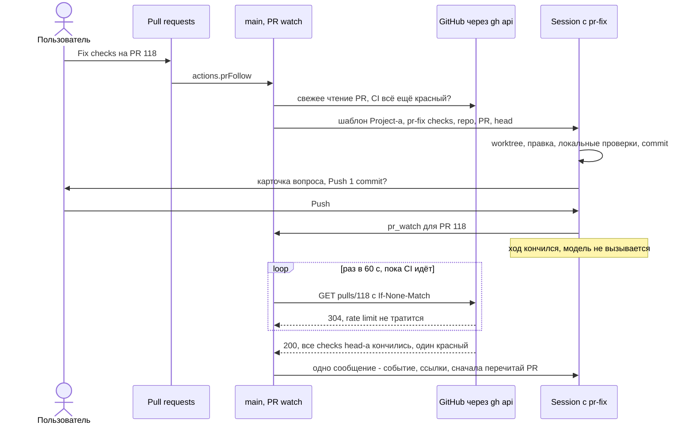

# worfy-pr-follow: PR доводится до merge по событиям — Session просыпается на красный CI, конфликт или замечания; действия Fix checks, Resolve conflicts, Address comments

Status: черновик 2026-11-13 из исследования конкурентов, владельцем не принят
Critic: [docs/product/critic/worfy-pr-follow-2026-11-14.md](../../docs/product/critic/worfy-pr-follow-2026-11-14.md) — Split.
Source: [исследование конкурентов 2026-11-13](../../docs/research/2026-11-13-competitors/), три проверенные идеи:
review-quality-1 («Кнопка Fix для PR: красный CI, конфликт, замечания ревью → Session на ветке PR»), review-quality-6
(«Наблюдение за PR без вызова модели: Session будят только на событие»), orchestration-4 («Доводка PR Ticket-а по его
событиям: CI, review threads, конфликт»). Досье:
[GitHub Copilot app](../../docs/research/2026-11-13-competitors/github-copilot-app.md) (Agent Merge, кнопки Fix),
[GitHub Copilot cloud agent](../../docs/research/2026-11-13-competitors/github-copilot-cloud-agent-and-agent-hq-mission-.md)
(«Fix with Copilot», «Watch and fix»),
[Cursor](../../docs/research/2026-11-13-competitors/cursor-agents-window-cloud-agents-and-automation.md) (Subscriptions,
Auto-fix CI, `/autopilot`), [Kiro](../../docs/research/2026-11-13-competitors/kiro.md) (узел `watch`, recipe
`publish-pr`), [OpenHands](../../docs/research/2026-11-13-competitors/openhands.md) (доработка с точным head SHA,
`/iterate`), [Devin](../../docs/research/2026-11-13-competitors/devin.md) (Auto-Fix),
[Claude Code desktop app](../../docs/research/2026-11-13-competitors/claude-code-desktop-app.md) (Auto-fix, кнопки
thread-ов Projects),
[Claude Code cloud sessions and Projects](../../docs/research/2026-11-13-competitors/claude-code-cloud-sessions-and-projects.md)
(Auto-fix для PR), [Claude Code Agent View](../../docs/research/2026-11-13-competitors/claude-code-agent-view.md) (выбор
Session, которая уже работает над PR), [Orca](../../docs/research/2026-11-13-competitors/orca.md) («Fix broken checks»,
«Resolve with AI», action recipes),
[Warp](../../docs/research/2026-11-13-competitors/warp-agent-management-panel-oz-cloud-agents-and-.md) (события вместо
опроса), [OpenAI Symphony](../../docs/research/2026-11-13-competitors/openai-symphony.md) (`Rework`). Строки кода и
документов worfy сверены с `04fc90f3a`.
Depends on: [worfy-pr-inbox](../worfy-pr-inbox/spec.md) (closed, 8/8: PR inbox, чтение GitHub из main, решения Q2 и
Q9) и [worfy-pipeline](../worfy-pipeline/spec.md) (closed, 10/10: Stage, флаги CI failing и rework, CI без отметок
агентов). ADR [0002](../../docs/adr/0002-worfy-is-a-view-over-the-workflow.md) (worfy — вид над workflow),
[0005](../../docs/adr/0005-worfy-own-state-inventory.md) (собственное состояние worfy),
[0076](../../docs/adr/0076-auto-archive-of-finished-sessions.md) (автоархив Session-ов),
[0105](../../docs/adr/0105-pr-reply-only-on-the-users-click.md) (ответ в PR только по щелчку пользователя);
[CONTEXT.md](../../CONTEXT.md) — термины PR inbox, Session, Binding, Orchestrator, Autopilot, Limits, Auto-continue, Fix,
Linked machine, Full mode, Silent mode.
Ticket-ы: Epic `worfy-pr-follow`, 12 Ticket-ов, нумерация с `01`. Файлов `issues/` пока нет: их заводят после принятия
spec-а.

## Проблема

PR inbox показывает, что PR нужна правка — красный CI, конфликт или запрос изменений, — но чинить приходится руками:
открыть Session, пересказать, что упало, и снова следить за PR. Агент, который сам ждёт CI, тратит на опрос ходы
модели и Limits.

- **Причина видна, действия нет.** Группа Needs a fix — свой PR пользователя с красным CI, `CHANGES_REQUESTED` или
  конфликтом `DIRTY` (`src/main/github/inbox-groups.ts:119`, `docs/features/pr-inbox.md:36`). Полоса «что дальше» у
  такого PR даёт одну кнопку — Open checks, ссылку на страницу checks на GitHub
  (`src/renderer/pr-inbox/usePrInbox.ts:354-363`). На Ticket Node те же сигналы: badge открытых нитей и «changes
  requested» (`src/renderer/canvas/badges/ReviewThreads.tsx:11-18`), флаг rework (`src/renderer/pipeline/Stepper.tsx:182-184`),
  Stage CI с подсостоянием `failing` (`src/shared/workflow/pipeline.ts:404`). Щелчок по badge открывает вид Pull
  requests, и только.
- **Draft replies код не правит.** Skill `pr-reply` пишет черновики ответов; commit, push и checkout в checkout человека
  ему запрещены (`harness/skills/pr-reply/SKILL.md:15-19`). Его `fixPlan` — план правки для человека, он никуда не
  уходит (`harness/skills/pr-reply/SKILL.md:100-101`).
- **Пересказ.** Чтобы починить, человек открывает Session и пересказывает ей имя check-а, лог, текст замечания или файлы
  конфликта. После push он снова сам смотрит, прошёл ли CI и не пришло ли новое замечание.
- **Ожидание CI стоит ходов модели.** Ship ticket ждёт CI одной командой `gh run watch` в Bash с timeout 10 минут и
  повторяет её, пока CI не кончится (`harness/skills/ship-ticket/step-8-pr-and-ci.md:91-100`). Orchestrator в Wave ждёт
  так же (`harness/skills/epic-wave/SKILL.md:938-947`). Каждый повтор — ход модели над всем контекстом Session. Prompt
  cache живёт 5 минут, поэтому после 10-минутного ожидания контекст читается заново без cache — часто 100k токенов и
  больше (`harness/skills/epic-wave/SKILL.md:776-778`). Всё это время Session `busy`, и сообщение человека ждёт в
  очереди.
- **Ожидание review не ведёт никто.** Session кончила ход и молчит, пока человек не вспомнит о PR. Main сам продолжает
  только Orchestrator — после временной ошибки API или отказа Limits (Auto-continue); «A regular Session is never
  continued» (`docs/features/orchestrator-modes.md:62-67`, `src/main/agent/orchestrator-continue.ts:1-20`).

На что Epic опирается — это уже есть:

- **Main читает GitHub без модели.** Поиск PR inbox раз в 5 минут и детали сдвинувшихся PR
  (`docs/features/pr-inbox.md:205-206`; `PrInbox.refresh` — `src/main/github/inbox.ts:345`). Уведомления GitHub —
  условным запросом, ответ 304 которого не тратит rate limit (`src/main/github/inbox-notifications.ts:1-21`,
  `docs/features/gate-and-github.md:625-634`). Checks веток Ticket-ов — раз в 60 с (`src/main/github/prs.ts:41`,
  `checksOf` — `src/main/github/prs.ts:342`).
- **Main говорит с Session.** Шлёт текст — сразу или в очередь, пока идёт ход (`Session.send`,
  `src/main/agent/session.ts:405-411`). Продолжает законченную Session по транскрипту (`NodeSessions.resume`,
  `src/main/agent/node-sessions.ts:299`). Показывает свою строку, которую модель не видит (`Session.notice`,
  `src/main/agent/session.ts:292-301`).
- **Прошлые решения, которые Epic соблюдает.** Подпись кнопки — не голое «Fix»: этим словом в CONTEXT.md назван шаг
  Terminal AI (`.scratch/worfy-pr-inbox/spec.md:276-277`, `CONTEXT.md:331-333`). Fix «никогда не делает push сам; push —
  отдельный щелчок» (Q9, `.scratch/worfy-pr-inbox/spec.md:334`). Main публикует в PR только показанный ответ по щелчку
  Send и не делает push (ADR-0105, пункты 2 и 4).

## Решение

Две части и один новый термин.

**PR watch** (термин для CONTEXT.md): наблюдение main за одним открытым PR пользователя по поручению одной Session.
Main читает PR без модели и присылает этой Session одно сообщение, когда PR нужна её работа. _Avoid_: подписка,
babysit, autofix, Agent Merge.

1. **Три действия — Fix checks, Resolve conflicts, Address comments.** Это новые action templates Project-а, как Ship
   ticket и Draft replies (`src/shared/projects/action-templates.ts:22-31`). Кнопки стоят там, где worfy уже показывает
   причину: в полосе PR в Pull requests и на Ticket Node. Щелчок отдаёт PR Session с готовым текстом — шаблоном
   Project-а с `{repo}`, `{pr}` и `{sha}`. Skill сам читает упавшие checks, конфликт или нити; пересказывать нечего.
2. **PR watch.** Session, которая сделала свою часть, кончает ход, и за PR дальше следит main. Пока ничего не
   случилось, модель не вызывается ни разу. Событие — одно сообщение в ту же Session.

Push остаётся за человеком (Q9 PR inbox). Skill спрашивает его через AskUserQuestion, а worfy показывает вопрос
карточкой с кнопками в любом permission mode (`docs/features/sessions.md:158-161`). Щелчок «Push» на карточке — и
есть отдельный щелчок Q9. Main по-прежнему не делает push и не пишет в PR ничего нового (ADR-0105, пункт 4).

### Что будит Session

| Событие | Условие | Что получает Session |
|---|---|---|
| CI head-а красный | все checks head-а закончились, или хотя бы один упал, а остальные всё ещё идут через 30 минут после этого. Отметки агентов `review`, `check/*`, `deploy` — не CI (`src/main/github/prs.ts:230-233`, `harness/skills/ship-ticket/step-8-pr-and-ci.md:71-73`) | сообщение: имена упавших checks и ссылки на их логи |
| CI head-а зелёный | все checks закончились успешно | notice-строку; сообщение — только если Session просила `wake: any` (ship-ticket ждёт зелёного CI, чтобы сделать merge) |
| Конфликт с базой | `DIRTY`, один раз на пару (head PR-а, head базы). GitHub не создаёт CI run для PR в `DIRTY` (`harness/skills/ship-ticket/step-8-pr-and-ci.md:82-83`), поэтому на это время ожидание CI снято | сообщение: база и её head |
| Запрос изменений | новый review с `CHANGES_REQUESTED` | сообщение: автор и ссылка на review |
| Новая нить или комментарий | от человека с правом записи (`author_association` OWNER, MEMBER или COLLABORATOR; боты — Q5), не от самого пользователя | сообщение: ссылки на нити и комментарии, без текстов |
| PR готов к merge | одобрен, CI не идёт и не красный, не draft — как группа Ready (`src/main/github/inbox-groups.ts:121`) | notice-строку; merge остаётся за человеком или за шагом 9 ship-ticket |
| PR слит или закрыт | `merged` или `closed` | notice-строку; PR watch кончается |
| Новый head | любой push | ничего само по себе: ожидание CI начинается заново, уже с этим head |

Правила пробуждения:

- **Одно сообщение на чтение.** События одного чтения склеиваются. Сообщение кончается просьбой сначала перечитать PR:
  пока оно шло, PR мог измениться (так делает Cursor).
- **Один раз на head.** Тот же красный CI или тот же конфликт на том же head второй раз не будит (как узел `watch`
  Kiro).
- **Занятая Session.** Пока идёт ход, сообщение ждёт его конца. Перед отправкой main читает PR снова и шлёт свежую
  сводку; устаревшие события выпадают.
- **Потолок.** После 3 пробуждений подряд без участия человека (Q2) main больше не будит: только notice-строки, badge
  «stopped» и уведомление ОС. Участие — сообщение человека, ответ в карточке вопроса или на запрос разрешения; оно
  сбрасывает счёт.
- **Limits.** Окно Limits Vendor-а использовано до конца — сообщение ждёт сброса, как продолжение Auto-continue
  (`src/main/agent/orchestrator-continue.ts:11-13`). Notice-строка говорит, до какого времени.
- **Кого не будит.** Orchestrator, Session без человека (Autopilot) и Product Session: `pr_watch` им отказывает, а
  действия их не выбирают.
- **Что в сообщении.** Только события, имена checks, id и ссылки. Тексты комментариев коллег Session читает сама, как
  их читает skill `pr-reply`; main их не пересказывает и не хранит (ADR-0105, пункт 6).

### Куда идёт щелчок по действию

Main выбирает Session по порядку. Так Claude Code Agent View по номеру PR выбирает Session, которая уже над ним
работает, вместо новой.

1. **Session, которая уже следит за этим PR.** Текст уходит в неё; во время хода — в очередь, как у Run wave
   (`src/shared/ipc/actions.ts:44-60`). Процесс Session кончился — сначала `resume`.
2. **Иначе Session с Binding-ом manual или launch на Ticket этого PR** (`src/shared/binding/resolve.ts:4-8`), если её
   последний ход кончился меньше 24 часов назад (Q7). Так же: сразу, в очередь или после `resume`.
3. **Иначе новая Session Node Project-а на Claude Code**, как у Draft replies (`src/main/actions/launch.ts:241-252`), с
   Binding-ом launch на Ticket PR-а, если он есть (`bindWhenKnown`, `src/main/actions/launch.ts:406`).

После щелчка за PR следит та Session, которой ушёл текст.

### Поток пользователя

**A. Свой PR вне workflow, красный CI.**

1. Pull requests → группа Needs a fix → строка `owner/web#118` с чипом «CI failing».
2. Полоса справа: «2 checks failed on 3f2a9c1: test (ubuntu), lint», кнопка **Fix checks** и ссылка **Open checks**.
3. Щелчок Fix checks. На Canvas появляется Session Node, в заголовке PR — чип «Watching · <имя Session>».
4. Session получает `/worfy:pr-fix checks owner/web#118 3f2a9c1…`. Skill делает worktree ветки PR на этом head, читает
   логи упавших checks, правит код, запускает локальные проверки с exit code и делает commit.
5. Карточка вопроса: «Push 1 commit to fix/retry-429?» — **Push** или **Not now**. Если окно не в фокусе — уведомление
   ОС «Asks: …» (`docs/features/notifications.md:15`).
6. Щелчок Push. Session делает push, вызывает `pr_watch` и кончает ход. Здесь наблюдение уже включил щелчок по
   действию, вызов его только подтверждает; Session, которую запустили не действием, этим вызовом его включает. Badge
   на Session Node: «Watching #118 · CI running».
7. Main читает PR раз в 60 с, почти все ответы — 304. CI зелёный → notice-строка «worfy: CI passed on 4b1e2d0 (7
   checks)», badge «waits for review». Модель за это время не вызывалась ни разу.
8. Коллега запросил изменения → одно сообщение в Session. Она читает нити, правит код, ответы пишет черновиками в PR
   inbox (Send нажимает пользователь, ADR-0105) и снова спрашивает про push.
9. PR слит → notice-строка «worfy: owner/web#118 merged, watch ended», badge пропал. Дальше Session живёт по правилам
   автоархива (ADR-0076).

**B. Ticket на Canvas, конфликт.**

1. На Ticket Node `worfy-x 07` — кнопка **Resolve conflicts**. На кнопке первая причина в порядке Resolve conflicts →
   Fix checks → Address comments: пока PR в `DIRTY`, CI не запускается. Остальные причины — в меню ▾ той же кнопки.
2. Щелчок. Session Ticket-а, которую вчера запустил Ship ticket (Binding launch), получает текст
   `/worfy:pr-fix conflicts …`. Дальше — как шаги 4–9 потока A.

**C. Ship ticket ждёт CI без опроса.**

1. Ship ticket → Session `/worfy:ship-ticket worfy-x 07` → шаг 8 открыл PR и сделал push.
2. В Session worfy есть tool `pr_watch`. Skill вызывает его с `wake: any` и кончает ход — вместо цикла `gh run watch`.
   Badge «Watching #N · CI running».
3. CI кончился → сообщение «CI finished on <sha>: all 9 checks passed» или «2 failed: …». Skill продолжает с вердикта
   шага 8: зелёный — шаг 9 (merge), красный — правка и новый push. В ship-ticket push делает сам skill, как сегодня.
4. В терминале tool-а `pr_watch` нет — там всё как сейчас.

**D. «Watch until merge» без Session (Q8).**

1. В заголовке своего открытого PR в Pull requests — переключатель **Watch until merge**. Включён, а Session нет — чип
   «Watching · no Session yet».
2. Первое событие-проблема: main делает то же, что щелчок по действию этого события (маршрут выше). Дальше — как поток
   A с шага 4.
3. Выключить — тем же переключателем или пунктом Stop watching в меню badge-а Session Node.

### Как это выглядит

```text
Pull requests · web-app                                                              [Refresh]
+-- Needs a fix (2) ---------------+   +-- owner/web#118  Retry on 429 -------------------------------+
| > owner/web#118 Retry on 429     |   |  fix/retry-429 -> main   +42 -7      [x] Watch until merge    |
|   CI failing                     |   |  Watching · fix checks #118   (Open Session)                 |
|   owner/web#121 Cache headers    |   |  +-- CI failing ------------------------------------------+  |
|   Merge conflict                 |   |  | 2 checks failed on 3f2a9c1: test (ubuntu), lint         |  |
+-- Needs my answer (1) -----------+   |  | [Fix checks]   Open checks                              |  |
|   owner/api#77 Pagination        |   |  +---------------------------------------------------------+  |
+----------------------------------+   |  Threads (0 open)                                            |
                                       +--------------------------------------------------------------+

Ticket Node                                   Session Node
+-- worfy-x 07  Retry on 429 -----------+     +-- fix checks #118 -----------------------------+
| CI · failing                          |     | (Watching #118 · CI running)                   |
| [2 open threads]                      |     | ...                                            |
| [Fix checks v]   [Open PR]            |     | worfy: CI passed on 4b1e2d0 (7 checks)         |
|   +- Address comments                 |     | worfy: owner/web#118 merged, watch ended       |
+---------------------------------------+     +------------------------------------------------+
```



## Как это сделано у конкурентов

- **GitHub Copilot, Agent Merge** ([app](../../docs/research/2026-11-13-competitors/github-copilot-app.md), «GitHub и
  путь PR до merge», «Механизмы» п. 1; [cloud agent](../../docs/research/2026-11-13-competitors/github-copilot-cloud-agent-and-agent-hq-mission-.md)).
  Включается вручную на один PR; Session чинит workflows, конфликты и замечания и делает merge, когда GitHub
  разрешает; переживает перезапуск; опрос раз в 10 минут. Жалобы: модель вызывают ради проверок, с которыми справился
  бы вызов API; включение по умолчанию на проект убрали — Agent Merge брал невыбранные PR. Кнопки Fix failing checks и
  «Fix with Copilot» у упавших Actions и конфликтов; облачный «Watch and fix» не работает со stacked PR и PR из fork.
- **Cursor** ([досье](../../docs/research/2026-11-13-competitors/cursor-agents-window-cloud-agents-and-automation.md),
  Subscriptions и «CI-цикл»). Агент подписывается на события PR и CI, кончает ход и спит; пачка событий — одно
  пробуждение, перед действием агент перечитывает источник. CI-подписка ждёт все checks, и один зависший check
  останавливает агента. Auto-fix CI — до 10 follow-up на PR, не после push человека и не если тот же check красный на
  базе.
- **Kiro** ([досье](../../docs/research/2026-11-13-competitors/kiro.md), узел `watch`, recipe `publish-pr`). GitHub раз
  в 60 с, модель не вызывается, пока ничего не происходит; сбой или конфликт будит агента один раз на head commit.
  Responder при конфликте делает merge commit базы, никогда rebase и force-push; перед изменением дизайна, объёма или
  UX спрашивает человека; merge — за человеком.
- **OpenHands** ([досье](../../docs/research/2026-11-13-competitors/openhands.md)). Задача доработки называет точный
  head SHA; агент исправляет каждое замечание или доказывает, что правка не нужна; push — в ту же ветку. Skill
  `/iterate` ведёт PR через CI и бота-ревьюера до зелёного.
- **Devin** ([досье](../../docs/research/2026-11-13-competitors/devin.md)). Auto-Fix: Session, открывшая PR, сортирует
  каждую находку — исправить, проверить или передать человеку. Merge-конфликты чинит в течение 12 часов активности
  Session.
- **Claude Code desktop и cloud** ([desktop](../../docs/research/2026-11-13-competitors/claude-code-desktop-app.md),
  [cloud](../../docs/research/2026-11-13-competitors/claude-code-cloud-sessions-and-projects.md)). Auto-fix чинит
  упавший CI и отвечает на review-комментарии; при неясном комментарии спрашивает; повторные события пропускает.
  Облачный на конфликты не реагирует: GitHub не шлёт для них webhook. Кнопки Resolve conflicts, Fix CI и Address
  comments у thread-ов Projects отправляют инструкцию как сообщение пользователя.
- **Claude Code Agent View** ([досье](../../docs/research/2026-11-13-competitors/claude-code-agent-view.md)). `#1234`
  или URL PR выбирает Session, которая уже работает над этим PR, вместо запуска новой.
- **Orca** ([досье](../../docs/research/2026-11-13-competitors/orca.md)). «Fix broken checks» отдаёт упавшие checks
  агенту, «Resolve with AI» — конфликт, рядом Abort merge и Abort rebase. Force-push with lease — отдельное, явно
  подписанное действие. Action recipes репозитория задают агента и шаблон prompt каждого AI-действия — как action
  templates worfy.
- **Warp** ([досье](../../docs/research/2026-11-13-competitors/warp-agent-management-panel-oz-cloud-agents-and-.md)).
  Родитель получает события, а не опрашивает детей; законченный ребёнок просыпается от нового сообщения.
- **OpenAI Symphony** ([досье](../../docs/research/2026-11-13-competitors/openai-symphony.md)). `Rework` — полный сброс:
  закрыть PR и начать новую ветку от `origin/main`. Для доводки живого PR не подходит.

Что берём: ожидание без модели и одно пробуждение на head (Kiro); склейку событий и «сначала перечитай» (Cursor); порог
для зависшего check-а (урок Cursor); явное включение на PR (урок Copilot); push отдельным явным действием (Orca, Q9);
выбор Session, которая уже работает над PR (Agent View); шаблоны действий (recipes Orca). Не берём: merge агентом
(Copilot), публикацию ответов агентом (Claude Code cloud; в worfy это Send пользователя, ADR-0105), сброс ветки
(Symphony).

## Истории пользователя

1. Как пользователь, я вижу в Pull requests свой PR с красным CI и одним щелчком отдаю его Session, не пересказывая,
   какой check упал.
2. Как пользователь, я разрешаю конфликт PR с базой одним щелчком, и мой checkout при этом никто не трогает.
3. Как пользователь, на запрос изменений я получаю правку кода и черновики ответов, а отправляю ответы сам.
4. Как пользователь, я хочу, чтобы push в ветку PR был только после моего щелчка.
5. Как пользователь, я не хочу тратить ходы модели и Limits, пока CI идёт или PR ждёт review.
6. Как пользователь, я хочу, чтобы Session проснулась сама, когда CI снова упал или пришло новое замечание, и чтобы
   несколько событий пришли одним сообщением.
7. Как пользователь, я хочу видеть на Session Node и в строке PR, что за PR следят, и выключать это одним щелчком.
8. Как пользователь, я хочу, чтобы Session, запущенная Ship ticket, ждала CI без опроса и сама продолжила, когда CI
   кончился.
9. Как пользователь, я хочу, чтобы наблюдение пережило перезапуск worfy и сон Mac.
10. Как пользователь, я хочу, чтобы worfy не будил Session без конца: после нескольких пробуждений без меня он
    останавливается и говорит об этом.
11. Как пользователь Linked machine с доступом read-only, я вижу, за какими PR следят, но действий не запускаю.

## Решения по реализации

Имена новых файлов — предложение; implementer сверяет их с `main`.

### 1. Детектор событий — чистая функция

- Новый `src/main/github/pr-watch-events.ts`: `detect(state, facts, now)` возвращает события и новое состояние. Без
  I/O, поэтому все правила таблицы «Что будит Session» покрывают unit test-ы.
- Факты одного чтения: состояние PR (`open`, `merged`, `closed`), head SHA, база и её head, `mergeable_state`, checks
  head-а в форме `CheckFact` (`src/shared/workflow/pipeline.ts:119-124`) со ссылкой на лог, reviews и комментарии —
  только id, автор и `author_association`, без текстов.
- Состояние: head, для которого уже было событие CI; пара (head, head базы) последнего конфликта; id виденных reviews
  и комментариев. Первое чтение после включения — baseline: старое не будит. Так же уведомления PR inbox считают
  первое чтение базой (`src/main/index.ts:189-190`).
- `STUCK_AFTER` = 30 минут. Отметки агентов отсекаются по `MARK_CONTEXTS` (`src/main/github/prs.ts:230-233`).
  Комментарии самого пользователя — по логину viewer-а без учёта регистра, функцией `same`
  (`src/main/github/inbox-groups.ts:56`).

### 2. Чтение PR для наблюдения

- Новый `src/main/github/pr-watch-read.ts`. gh — через `ghRunner` (`src/main/github/prs.ts:118`) с окружением
  `accountAuth` (`src/main/github/prs.ts:172`): GitHub-аккаунт Project-а и только репозитории Project-а (`remoteRepos`,
  `src/main/github/inbox.ts:672`), как у PR inbox (ADR-0105, пункт 1).
- Вызов: `gh api -i repos/{o}/{r}/pulls/{n} -H "If-None-Match: <ETag>"`. Пока CI head-а идёт — ещё
  `repos/{o}/{r}/commits/{sha}/check-runs` и `.../status`, каждый со своим ETag. Ответ 304 — «без перемен»: gh выходит
  на нём с кодом 1 и печатает `gh: HTTP 304`, и worfy уже читает это как ответ, а не сбой; GitHub не считает 304 в rate
  limit (`docs/features/gate-and-github.md:631-634`). Тот же приём у уведомлений PR inbox, только с
  `If-Modified-Since` (`notificationsArgs`, `src/main/github/inbox-notifications.ts:40-41`).
- Reviews и нити: когда PR ответил 200 с новым `updated_at` или уведомление GitHub назвало этот PR
  (`src/main/github/inbox-notifications.ts`), main зовёт `PrInbox.refresh(repo, number)`
  (`src/main/github/inbox.ts:345`) и берёт id из `snapshot` (`src/main/github/inbox.ts:376`). Детали PR читаются одним
  GraphQL-запросом PR inbox, а не двумя.
- Новое поле `isCrossRepository` в `PULL_FIELDS` (`src/main/github/inbox.ts:62-70`): PR из fork действия не получают.
- Темп: 60 с, пока CI head-а идёт или mergeability неизвестна (как `unsettled`, `src/main/github/inbox.ts:206`, и
  `BASE_INTERVAL_MS`, `src/main/github/prs.ts:41`); иначе 5 минут, как поиск PR inbox; сразу — на уведомление. Остаток
  REST rate limit меньше 10 % — ни одного вызова до сброса (`NOTIFICATIONS_RATE_FLOOR`,
  `src/main/github/inbox-notifications.ts:32`). После сбоя интервал удваивается до 32 минут, как у трекера PR
  (`docs/features/gate-and-github.md:513-514`). Темп не зависит от фокуса окна: наблюдение нужно как раз тогда, когда
  человека нет.
- Project с `"prInbox": false` (`src/shared/projects/action-templates.ts:211-215`) не читает GitHub, поэтому и PR watch
  в нём нет.
- Только чтение: PR watch ничего не пишет на GitHub.

### 3. PR watch в main: состояние, доставка, потолок, Limits

- Новый `src/main/agent/pr-watch.ts` (класс `PrWatches`) и состояние в `<Project data folder>/pr-watch.json` в
  `WORFY_DATA_DIR` — модулем рядом с `src/main/projects/pr-inbox-state.ts`, который пишет `pr-inbox.json`
  (`src/main/github/inbox.ts:31`). Запись: repo, PR, id Session (или пусто — поток D), `wake`, откуда взялось
  (`tool`, `action`, `toggle`), когда, состояние детектора, пробуждения без человека, причина остановки. Тексты коллег
  не хранятся (ADR-0105, пункт 6). Поправка к ADR-0005: новое место собственного состояния.
- Один PR — одна Session под наблюдением. `pr_watch` или щелчок из другой Session забирает PR себе; прежняя получает
  notice-строку «owner/web#118 is now watched by <Session>».
- Доставка через `SessionRegistry` (`src/main/agent/session/registry.ts:27`):
  - Session живая и `idle` — `send` (`src/main/agent/session.ts:405-411`);
  - `busy` — ждать конца хода через `observe` (`src/main/agent/session/registry.ts:84`), прочитать PR снова и послать
    свежую сводку;
  - процесса нет — `NodeSessions.resumable`, затем `resume` (`src/main/agent/node-sessions.ts:315`, `:299`), затем
    `send`;
  - не продолжить (`resumable` говорит, почему) — наблюдение стоит с причиной, видной в Pull requests, и уведомлением ОС.
- Участие человека, которое сбрасывает потолок: его `prompt` — так Auto-continue отличает своё продолжение от
  сообщения человека (`src/main/agent/orchestrator-continue.ts:16-19`), — ответ в карточке вопроса или на запрос
  разрешения.
- Limits: перед пробуждением — `LimitsWait` (`src/main/autopilot/limits-wait.ts:101`) над `appLimits()`
  (`src/main/agent/limits.ts:359`). Окно использовано до конца — сообщение ждёт сброса, notice-строка «worfy: PR event held
  until the Limits reset at 14:20». На Codex окна перед отправкой читаются заново бесплатным запросом, как у
  Auto-continue (`src/main/agent/orchestrator-continue.ts:33-35`).
- Без keep-awake: Mac, который спит, читает PR при пробуждении, как Auto-continue
  (`src/main/agent/orchestrator-continue.ts:41-42`).
- Notice-строки — `Session.notice` (`src/main/agent/session.ts:292-301`): модель их не получает; после перезапуска
  приложения их нет, worfy ничего не пишет в транскрипт Claude Code (ADR-0005,
  `src/main/agent/orchestrator-continue.ts:26-31`).
- Кого не будит: Orchestrator (по видам Orchestrator-ов, `sharedOrchestrators`, `src/main/agent/app-orchestrators.ts:65`;
  так же его узнаёт `orchestratorMatcher`, `src/main/ipc/getting-started.ts:271`), Session без человека
  (`unattended`, `src/main/autopilot/chat-confirm.ts:251-252`), Product Session (`kind: 'product'`,
  `src/shared/ipc/sessions.ts:26-28`).
- Автоархив: Session под наблюдением — не кандидат (`src/main/layout/archive.ts:131-139`). Поправка к ADR-0076, пункт 2
  («Не архивируются никогда»).
- Запуск — в `src/main/index.ts` рядом с PR inbox (`src/main/index.ts:186-191`).
- Каналы (ADR-0006): `src/shared/ipc/pr-watch.ts` — `prWatch.list` (`read`), `prWatch.changed` (событие),
  `prWatch.set` (`write`: включить или выключить на PR), все `project`; обработчик — `src/main/ipc/pr-watch.ts`.

### 4. Tool `pr_watch` сервера worfy-canvas

- Форма в `src/shared/canvas/tools.ts:99-118`: `pr_watch: { repo, pr, wake: 'problems' | 'any' = 'problems', stop:
  boolean = false }`; `repo` — `githubRepoSchema` (`src/shared/ipc/actions.ts:79-84`). Tools — публичный контракт
  агента и приложения, он меняется вместе с `src/main/mcp/agent-instructions.md` (`src/shared/canvas/tools.ts:3-5`):
  новый раздел «PR watch» рядом с разделом Autopilot (`src/main/mcp/agent-instructions.md:48-54`).
- Обработчик в `src/main/mcp/canvas-server.ts` — по образцу `autopilot_start` (`src/main/mcp/canvas-server.ts:123-131`,
  `:300-310`); id вызвавшей Session — `sessionId()` её canvas (`src/main/mcp/canvas-server.ts:515-520`).
- Ответ: «Watching owner/web#118 for you. End your turn now: worfy sends you one message when CI finishes red, a
  conflict appears, changes are requested or a person comments. Merged or closed ends the watch.»
- Отказ с причиной: Orchestrator, Session без человека, Product Session (ей и `autopilot_start` не дают:
  `src/main/mcp/canvas-server.ts:494-496`), репозиторий не Project-а, PR не открыт или не пользователя, PR из fork, PR
  inbox выключен в Project.
- Codex получает тот же сервер по HTTP (`src/main/mcp/canvas-server.ts:1-5`), а доставка — `Session.send`, поэтому PR
  watch работает и для Session Codex.

### 5. Действия: action templates и launcher

- `src/shared/projects/action-templates.ts`: `ACTIONS` (`:22`) получает `fixChecks`, `resolveConflicts`,
  `addressComments`; подписи (`:26-31`) — «Fix checks», «Resolve conflicts», «Address comments». Шаблоны старого Harness
  (`:47-55`) — пустые: такого skill-а у него нет, кнопки не будет, как у `prReply`. Шаблоны плагина (`:64-69`):
  - `fixChecks`: `/worfy:pr-fix checks {repo}#{pr} {sha}`;
  - `resolveConflicts`: `/worfy:pr-fix conflicts {repo}#{pr} {sha}`;
  - `addressComments`: `/worfy:pr-fix comments {repo}#{pr} {sha}`.
  Известные шаблоны по умолчанию (`:94-100`), схема (`:137-140`) и чтение старых settings без этих полей — как у
  `gateQueue` и `prReply` (`:221-245`, `src/main/projects/settings.ts:39-67`).
- Плейсхолдер `{sha}` — head PR-а, 40 hex-символов и ничего больше: текст уходит в Session с `bypassPermissions`, как и
  `{repo}` (`src/shared/ipc/actions.ts:79-84`). Он входит в список плейсхолдеров
  (`src/shared/actions/render-template.ts:7-15`); `prFollowState` — рядом с `prReplyState`
  (`src/shared/actions/render-template.ts:148-151`).
- Канал `actions.prFollow` в `src/shared/ipc/actions.ts` рядом с `actionsPrReply` (`:93-103`): `{ projectId, repo, pr,
  action, near? }` → `{ nodeId, sessionId, text, delivery: 'sent' | 'queued' | 'new' }`, `project`, `write`. Обработчик —
  `src/main/ipc/actions.ts`.
- `prFollow()` в `src/main/actions/launch.ts`:
  - свежее чтение PR перед запуском, как Ship ticket берёт вердикт снова по свежему чтению
    (`src/main/actions/launch.ts:6-8`): причина ещё есть — CI красный на текущем head, `DIRTY`, запрос изменений или
    открытые нити; `{sha}` — текущий head;
  - маршрут — раздел «Куда идёт щелчок». Binding-и — `sessionBindings` (`src/main/layout/archive.ts:599`) и
    `resolveBinding` (`src/shared/binding/resolve.ts:242`); Ticket PR-а — по строкам `PR:` или ветке, как `ticketOfRow`
    (`src/renderer/canvas/badges/review-threads.ts:44-47`);
  - отказ с причиной: пустой шаблон; идёт Autopilot (`src/main/actions/launch.ts:262` — так отказывает Run wave);
    Orchestrator с Binding-ом на Epic этого Ticket-а `busy` — его Wave сама чинит свои PR
    (`harness/skills/epic-wave/SKILL.md:519-520`); PR не пользователя, из fork или закрыт;
  - после отправки текста — PR watch для этой Session, откуда — `action`.
- Состояние трёх кнопок считает одна чистая функция для Pull requests, Ticket Node и Command palette — так
  `src/renderer/canvas/actions/gates.ts:1-3` считает Ship ticket и Run wave, чтобы кнопка и строка palette не
  расходились.

### 6. Skill `/worfy:pr-fix` (Harness)

- Новый `harness/skills/pr-fix/SKILL.md` — skill плагина, тот же в worfy и в терминале (ADR-0002). Аргументы:
  `<checks|conflicts|comments> <owner>/<repo>#<N> [<sha>]`.
- Шаги:
  1. Прочитать PR. Head не равен `<sha>` — сказать об этом и работать с текущим head.
  2. Worktree: worktree Ticket-а, если он на этом head и чистый; иначе новый worktree ветки PR. Checkout человека не
     трогать (`harness/skills/pr-reply/SKILL.md:19`).
  3. По режиму:
     - `checks` — упавшие checks и их логи (`gh pr checks`, `gh run view --log-failed`). Отметки агентов — не CI
       (`harness/skills/ship-ticket/step-8-pr-and-ci.md:71-73`). Check, красный и на head базы, — сообщить, не чинить
       (правило Cursor). Перезапуск check-а — только ответом человека в карточке вопроса;
     - `conflicts` — по политике Q4; сначала `git merge-tree`, чтобы назвать файлы конфликта;
     - `comments` — открытые нити, reviews с `CHANGES_REQUESTED`, `fixPlan` из черновиков
       (`harness/skills/pr-reply/SKILL.md:100-101`), комментарии-вердикты `REJECTED` со списком
       (`harness/skills/epic-wave/SKILL.md:44`). Перед изменением дизайна, объёма работы или UX — спросить (как
       responder Kiro). Ответы — черновиками через `harness/bin/pr-reply-draft`; публикует их пользователь кнопкой Send
       (ADR-0105).
  4. Локальные проверки с exit code: `commands.verify` Profile-а или gate fast.
  5. Commit. Guard hook проверяет тексты commit-ов на следы workflow (`harness/hooks/guard.mjs:520-568`); в Silent mode
     следов нет (`harness/skills/ship-ticket/silent-mode.md`).
  6. Push — только после ответа «Push» на AskUserQuestion «Push N commits to <branch>?». Если это rebase, вопрос
     называет `--force-with-lease`. Без человека (unattended) push нет, и отчёт говорит, что ждёт.
  7. Никогда: merge, комментарий, review, resolve, re-request review, метки — тот же список, что у pr-reply
     (`harness/skills/pr-reply/SKILL.md:15-18`).
  8. Конец: tool `pr_watch` есть (worfy) — вызвать и кончить ход; нет (терминал) — сказать, за какими событиями
     следить.
- Сообщение PR watch: перечитать PR и действовать по названному событию. Head не тот, что Session пушила, — спросить
  человека, прежде чем что-то делать.
- Evals `harness/evals/pr-fix-*` — по образцу `harness/evals/pr-reply-guards` (`case.yaml`, `prompt.md`, `scaffold.sh`,
  `graders`); запуск — `scripts/eval-harness.mjs`, сначала `--dry-run`.

### 7. ship-ticket шаг 8 в Session worfy

- `harness/skills/ship-ticket/step-8-pr-and-ci.md:91-100`: в Session worfy (tool `pr_watch` есть) после push —
  `pr_watch { repo, pr, wake: 'any' }` и конец хода. Следующее сообщение worfy несёт итог CI; skill продолжает с
  вердикта шага 8. В терминале — `gh run watch`, как сейчас. `pr_watch` отказал (например, PR inbox выключен в
  Project) — тоже `gh run watch`.
- Ожидание CI Orchestrator-ом в epic-wave не меняется (раздел «Не в этом Epic-е»).
- Eval `harness/evals/ship-ticket-pr-green-ci` получает случай с `pr_watch`.

### 8. UI: Pull requests, Ticket Node, Session Node, Command palette

- **Pull requests.** `NextAction` (`src/renderer/pr-inbox/usePrInbox.ts:311-313`) получает вид `{ kind: 'pr-follow',
  action }`. `nextStep` для `needs-fix` (`src/renderer/pr-inbox/usePrInbox.ts:354-363`): главная кнопка — действие
  первой причины, остальные причины — кнопками рядом, Open checks остаётся ссылкой. Свой PR с нитями, ждущими ответа,
  попадает в Needs my answer раньше, чем в Needs a fix (`src/main/github/inbox-groups.ts:116-119`), поэтому там
  Address comments стоит рядом с Draft replies. Рисует `src/renderer/pr-inbox/PrInboxView.tsx:430-481`. Там же в
  заголовке своего открытого PR — переключатель «Watch until merge» и чип «Watching · <Session>» со ссылкой на Session.
- **Ticket Node.** Новый слот `src/renderer/canvas/actions/PrFollow.tsx` — слоты добавляются по файлу
  (`src/renderer/canvas/badges/index.ts:1-12`). Одна кнопка по первой причине и меню ▾ с остальными. Причины: снимок PR
  inbox (`reviewsByTicket`, `src/renderer/canvas/badges/review-threads.ts:50-69`; `mergeStateStatus` строки) и Pipeline
  (`rework` и подсостояние `failing`, `src/shared/workflow/pipeline.ts:239-240`, `:404`). Новая Session Node встаёт у
  Ticket-а, как у Ship ticket (`near`, `src/shared/ipc/actions.ts:23-27`).
- **Session Node.** Новый badge `src/renderer/canvas/badges/PrWatch.tsx` — Session Node рисует только badge-и
  (`src/renderer/canvas/badges/index.ts:17-20`): «Watching #118 · CI running», «waits for review», «waiting for the
  Limits», «stopped: 3 wakes without you». Меню: Open in Pull requests, Stop watching.
- **Command palette.** Строки «Fix checks: owner/web#118» и так далее — из той же функции состояния, что и кнопки.

### 9. Уведомления ОС

- `src/main/notify.ts`, рядом с `PrInboxNotices` (`src/main/notify.ts:661`): «PR watch stopped: owner/web#118» с
  причиной — потолок пробуждений или Session не продолжить; щелчок открывает Session. Остальное уже есть: Session
  кончила ход и Session задаёт вопрос (`docs/features/notifications.md:12-15`).

### 10. Linked machine, Vendor, Autopilot

- Каналы действий и `prWatch.set` — `write`, как Ship ticket и Draft replies (`src/shared/ipc/actions.ts:40-41`,
  `:101-102`). Linked machine с доступом read-only видит чипы, badge-и и состояние переключателя, но не кнопки.
- Действия запускают Claude Code, как Draft replies: skill-ы Harness работают под Claude Code, пока worfy-multi-vendor
  не перенесёт их в Codex (`src/main/actions/launch.ts:14-17`). Сам PR watch от Vendor-а не зависит.
- Пока идёт Autopilot, действий нет; `pr_watch` отказывает Session без человека; Orchestrator событиями PR не будится.

### 11. Документы

- Новый ADR (номер резервирует Ticket 03, шаг 3 ship-ticket): main будит Session событием PR по её поручению; push —
  щелчок человека в карточке вопроса; main в PR не пишет. Это первый случай, когда main сам шлёт сообщение Session,
  которая не Orchestrator. Поправки — ADR-0005 (`pr-watch.json`) и ADR-0076 (Session под наблюдением не архивируется).
- Термин PR watch вносит в CONTEXT.md docs-PR принятия spec-а.
- Страницы Feature: новая `docs/features/pr-watch.md` и перевод в `docs/features/ru/`; правки `docs/features/pr-inbox.md`,
  `docs/features/workflow.md` (таблица действий, `:103`), `docs/features/notifications.md`,
  `docs/features/storage-and-diagnostics.md` (таблица файлов, `:174-176`), `docs/features/sessions.md`.

## Решения по test-ам

- Каждый Ticket начинается с падающего test-а (skill `worfy:tdd`).
- Ни в одном test-е нет настоящего GitHub и настоящей модели. gh — stand-in `test/fixtures/gh/gh-stub.mjs` (миры —
  `test/contract/gh-world.ts`), агент — fake agent `WORFY_AGENT=fake` (`src/main/agent/fake-query.ts:1`).
- **Unit.**
  - Детектор — таблица случаев в `test/unit/pr-watch-events.test.ts`: одно событие на head; зависший check через 30
    минут; `DIRTY` снимает ожидание CI; отметки агентов — не CI; комментарии самого пользователя и людей без права
    записи не будят; первое чтение — baseline; merged кончает наблюдение.
  - Шаблоны и чтение старых settings — `test/unit/action-templates.test.ts`; форма `pr_watch` —
    `test/unit/canvas-tools.test.ts`; полоса «что дальше» — `test/unit/pr-inbox-view.test.tsx`.
- **Contract.**
  - Reader на gh stub: ETag и 304 как «без перемен», порог 10 %, удвоение интервала, каждый вызов — чтение (как
    проверка в `test/contract/pr-inbox-notifications.test.ts:24`).
  - Доставка с fake agent: `idle` — сразу; `busy` — после конца хода, со свежей сводкой; после перезапуска — `resume`;
    потолок; ожидание Limits; notice-строк нет во входе модели.
  - `pr_watch` отказывает Orchestrator-у, Session без человека и Product Session — по образцу
    `test/contract/autopilot-start-tool.test.ts`. Маршрут действий — `test/contract/actions.test.ts`.
  - Главный test стоимости: час ожидания PR с CI в работе и без событий — ноль ходов fake agent-а и только чтения gh.
- **E2E.** `test/e2e/pr-inbox.spec.ts`: Fix checks создаёт Session Node с текстом шаблона, переключатель и чип. Canvas:
  кнопка на Ticket Node и badge на Session Node. Время — через `test/time-scale.ts` и `test/scaled-waits.ts`, без
  настоящих минут ожидания.
- **Harness.** Evals `harness/evals/pr-fix-*`: нет push без ответа «Push»; нет записей в PR; работа в worktree, а не в
  checkout; упавший check починен; check, красный и на базе, не тронут. Eval `harness/evals/ship-ticket-pr-green-ci` —
  ветка с `pr_watch`. Сначала `--dry-run` (`scripts/eval-harness.mjs`).

## Не в этом Epic-е

- **Orchestrator и Autopilot.** Ожидание CI Orchestrator-ом в Wave (`harness/skills/epic-wave/SKILL.md:938-947`)
  остаётся как есть. Autopilot считает Wave законченной по концу хода Orchestrator-а без живых background task-ов
  (`src/main/autopilot/run.ts:26-33`), и ход, кончившийся ради `pr_watch`, кончил бы Wave. Будить Orchestrator
  событиями PR — отдельный Epic.
- **Merge агентом или worfy.** Нет «Merge it» и auto-merge: merge остаётся за человеком или за шагом 9 ship-ticket.
- **Записи в PR.** Resolve нити, re-request review и ответ без щелчка Send — нет; ADR-0105 в силе.
- **Чужие PR и PR из fork.** Действия и PR watch — только для своих открытых PR пользователя.
- **Keep-awake** на время наблюдения (у Copilot это опция). Как у Auto-continue, Mac, который спит, продолжает после
  пробуждения.
- **Webhooks и GitHub App.** Своего сервера у worfy нет; только опрос условными запросами.
- **Хосты кроме GitHub** — GitLab, Bitbucket, Azure DevOps.
- **Действия на Codex.** Действия запускают Claude Code, пока skill-ы Harness не перенесены в Codex; PR watch для
  Session Codex работает.
- **Разбор комментариев Haiku** — он остаётся следующим шагом PR inbox (`.scratch/worfy-pr-inbox/spec.md:272-274`).
- **Отличать push человека от push Session.** Вместо этого сообщение просит перечитать PR, а skill спрашивает
  человека, если head не его.
- **Перезапуск упавшего check-а самим worfy.** Только ответом человека в карточке вопроса внутри skill-а.

## Ticket-ы

1. **Детектор событий PR** — чистый `src/main/github/pr-watch-events.ts`: события из двух чтений PR, одно на head, порог
   зависшего check-а, baseline; unit test-ы. Blocked by: —.
2. **Чтение PR для наблюдения** — `src/main/github/pr-watch-read.ts`: REST с `If-None-Match`, 304, темп 60 с и 5 минут,
   порог 10 %, детали через `PrInbox.refresh`, поле `isCrossRepository`; contract test-ы на gh stub. Blocked by: 01.
3. **PR watch в main и новый ADR** — `src/main/agent/pr-watch.ts`, `pr-watch.json`, доставка (`send`, конец хода,
   `resume`), notice-строки, потолок, Limits, автоархив, каналы `prWatch.*`; ADR и поправки ADR-0005, ADR-0076.
   Blocked by: 01, 02.
4. **Tool `pr_watch`** — форма в `src/shared/canvas/tools.ts`, обработчик и отказы в `src/main/mcp/canvas-server.ts`,
   раздел в `agent-instructions.md`; contract test. Blocked by: 03.
5. **Действия в main** — action templates `fixChecks`, `resolveConflicts`, `addressComments`, плейсхолдер `{sha}`,
   канал `actions.prFollow`, маршрут и отказы в `launch.ts`, включение PR watch, чистая функция состояния кнопок для
   07 и 08; contract test-ы. Blocked by: 03.
6. **Skill `/worfy:pr-fix`** — `harness/skills/pr-fix/SKILL.md`: три режима, worktree на head, push только ответом в
   карточке вопроса, без записей в PR, `pr_watch` в конце; evals. Blocked by: —.
7. **Pull requests: кнопки и «Watch until merge»** — `usePrInbox.ts`, `PrInboxView.tsx`: действия по причинам, Address
   comments в Needs my answer, Open checks — ссылкой, переключатель и чип; e2e. Blocked by: 05.
8. **Canvas и Command palette** — слот `PrFollow.tsx` на Ticket Node, badge `PrWatch.tsx` на Session Node, строки
   palette; e2e. Blocked by: 05.
9. **Уведомление ОС «PR watch stopped»** — `src/main/notify.ts`: потолок или Session не продолжить; unit test.
   Blocked by: 03.
10. **ship-ticket ждёт CI через `pr_watch`** — `step-8-pr-and-ci.md`: в Session worfy `pr_watch` с `wake: any` и конец
    хода, в терминале как раньше; eval `ship-ticket-pr-green-ci`. Blocked by: 04.
11. **Документация** — `docs/features/pr-watch.md` и перевод, правки `pr-inbox.md`, `workflow.md`, `notifications.md`,
    `storage-and-diagnostics.md`, `sessions.md`. Blocked by: 03–10.
12. **Приёмка владельцем** — живой PR в тестовом репозитории: красный CI, конфликт, замечание, merge; ноль ходов модели
    в ожидании, push только по щелчку. Blocked by: 11.

## Волны

| Wave | Ticket-ы | Почему так |
|---|---|---|
| 1 | 01, 06 | детектор (`src/main/github/`) и skill (`harness/skills/pr-fix/`): общих файлов нет, skill не ждёт кода worfy — в терминале он работает без `pr_watch` |
| 2 | 02 | reader отдаёт факты в форме, которую задал детектор |
| 3 | 03 | состояние, доставка и ADR — на них стоят tool, действия и уведомление |
| 4 | 04, 05, 09 | tool (`src/shared/canvas/`, `src/main/mcp/`), действия (`src/shared/projects/`, `src/shared/actions/`, `src/main/actions/`, `src/shared/ipc/actions.ts`), уведомление (`src/main/notify.ts`): общих файлов нет |
| 5 | 07, 08, 10 | Pull requests (`src/renderer/pr-inbox/`), Canvas (`src/renderer/canvas/`), ship-ticket (`harness/skills/ship-ticket/`): общих файлов нет |
| 6 | 11 | документация по сделанному |
| 7 | 12 | приёмка |

Wave — Ticket-ы, которые можно брать параллельно: блокеры закрыты, общих файлов нет. Wave, которую берут в работу,
вычисляется заново в момент запуска (CONTEXT.md, термин Wave). Пользователь получает кнопки в Wave 5; ожидание без
модели для Session pr-fix работает с Wave 4.

## Риски

- **Цена пробуждения.** Session, которая молчала дольше 5 минут, на первом сообщении читает контекст заново без prompt
  cache — часто 100k токенов и больше (`harness/skills/epic-wave/SKILL.md:776-778`). Меры: зелёный CI — notice-строка
  без хода (Q6), склейка событий, потолок (Q2), порог 24 часа для старой Session (Q7). Даже так одно пробуждение на
  событие дешевле хода модели на каждые 10 минут ожидания.
- **Rate limit GitHub.** Много PR под наблюдением — много вызовов gh. 304 не тратит rate limit
  (`docs/features/gate-and-github.md:631-634`), детали читаются одним запросом PR inbox, порог 10 %
  (`src/main/github/inbox-notifications.ts:32`). Остаётся цена процесса gh на вызов; поэтому темп 60 с — только пока CI
  идёт.
- **Push без спроса.** Session в `bypassPermissions` (`src/main/actions/launch.ts:10-11`) технически может сделать push
  сама. Текст skill-а это запрещает, eval проверяет. Это сила самого агента, как у любой Session с Bash; по правилу
  соразмерности защиты она описана, а не закрыта — так же, как в ADR-0105 (раздел «Последствия»).
- **Зависший check** держал бы Session без конца — так случается у Cursor. Мера — порог 30 минут после первого
  красного check-а. Зелёный CI с зависшим check-ом — notice-строка.
- **Два агента на одной ветке** — implementer Wave и Session pr-fix на одном PR. Меры: отказ, пока идёт Autopilot или
  Orchestrator с Binding-ом на Epic Ticket-а `busy`; один PR — одна Session под наблюдением; Ship ticket и так не даёт
  второго запуска на Ticket (`src/shared/ipc/actions.ts:105-110`).
- **Fork и stacked PR.** PR из fork — отказ с причиной (так же у облачного Agent Merge Copilot). У stacked PR база —
  другая ветка; конфликт разрешается с базой PR, какая бы она ни была.
- **Следы workflow в Silent mode.** Commit-ы pr-fix в командном репозитории не должны нести следов workflow: guard hook
  проверяет их тексты (`harness/hooks/guard.mjs:520-568`), правила — `harness/skills/ship-ticket/silent-mode.md`.
- **Тексты коллег в транскрипте.** Сообщение main их не содержит. Session читает их сама, и они попадают в её
  транскрипт так же, как при Draft replies.
- **Ошибка в «праве записи».** `author_association` — не точное право записи: доступ через команду или бот-reviewer
  могут дать лишнее или пропущенное пробуждение (Q5). Нить при этом всё равно видна в Pull requests.
- **Windows.** Разбор вывода `gh api -i` (заголовки, концы строк `\r\n`) и пути worktree. Contract test-ы reader-а
  должны пройти и в Windows CI job.

## Вопросы владельцу

1. **Q1 — когда включается PR watch.** Только явно: щелчок действия, «Watch until merge» или вызов `pr_watch` Session
   (рекомендация), — или ещё и сам на каждый PR Ticket-а в работе, как предлагает идея review-quality-6? Copilot убрал
   включение Agent Merge по умолчанию на проект: тот брал невыбранные PR.
2. **Q2 — потолок пробуждений подряд без человека.** 3 (рекомендация), 5 или 10 (у Cursor Auto-fix CI — до 10
   follow-up на PR)?
3. **Q3 — push в Full mode.** Решение Q9 PR inbox («push — отдельный щелчок») действует и на PR Ticket-ов Project-а в
   Full mode, где ship-ticket и так пушит сам? Рекомендация: да, без исключений в этом Epic-е; ослабить — отдельным
   решением после приёмки.
4. **Q4 — как разрешать конфликт.** Merge базы в ветку PR обычным merge commit или rebase на базу и
   `git push --force-with-lease`? Рекомендация — по режиму Profile-а: в Full mode rebase, как делает Wave сегодня
   (`harness/skills/epic-wave/SKILL.md:918`); в Silent mode merge commit — rebase переписывает историю, которую мог
   взять коллега (responder Kiro никогда не делает rebase и force-push).
5. **Q5 — чьи комментарии будят.** Только людей с правом записи и ботов из списка в Profile, пустого по умолчанию
   (рекомендация), или всех ботов-reviewer-ов? Copilot app называл PR готовым к merge при открытых комментариях бота.
6. **Q6 — зелёный CI.** Только notice-строка и badge (рекомендация) или ход модели «CI passed» для всех? Session,
   которая просила `wake: any` (ship-ticket), получает сообщение в любом случае.
7. **Q7 — давно молчавшая Session Ticket-а.** Продолжать её, если её последний ход был меньше 24 часов назад
   (рекомендация; порог — как у автоархива, ADR-0076), продолжать всегда или всегда начинать новую Session?
8. **Q8 — «Watch until merge» без Session.** На первое событие-проблему worfy сам запускает Session с шаблоном этого
   события (рекомендация) или только уведомляет и ждёт щелчка?
9. **Q9 — имена.** Переключатель «Watch until merge», badge «Watching #N» и термин CONTEXT.md «PR watch»
   (рекомендация) или «Listening», как в идее orchestration-4?

## Готово, когда

- [ ] В Pull requests у своего PR группы Needs a fix — кнопка по первой причине (Resolve conflicts, Fix checks, Address
      comments) и остальные причины рядом; Open checks остаётся ссылкой. У своего PR в Needs my answer — Address
      comments рядом с Draft replies.
- [ ] На Ticket Node с красным CI, флагом rework, конфликтом или открытыми нитями — та же кнопка с меню; Command palette
      показывает те же действия с теми же причинами отказа.
- [ ] Щелчок продолжает Session, которая следит за PR, или Session с Binding-ом на Ticket (порог Q7), иначе запускает
      новую. Пустой шаблон — кнопка неактивна, tooltip говорит, где его задать.
- [ ] Skill `/worfy:pr-fix` работает в worktree ветки PR, checkout человека не трогает, push делает только после «Push»
      в карточке вопроса, в PR ничего не пишет; его evals зелёные.
- [ ] Пока PR ждёт без событий, модель не вызывается: contract test — ноль ходов за час ожидания.
- [ ] Красный CI, конфликт, запрос изменений, новая нить от человека с правом записи — одно сообщение на событие и
      head; события одного чтения — одно сообщение; merged или closed — конец наблюдения и notice-строка.
- [ ] Session в ходе получает сообщение после конца хода, со свежей сводкой. После перезапуска worfy наблюдение
      продолжается, а Session продолжается через `resume`.
- [ ] Потолок пробуждений и ожидание Limits работают; уведомление ОС «PR watch stopped» называет причину.
- [ ] `pr_watch` отказывает Orchestrator-у, Session без человека и Product Session; действия отказывают, пока идёт
      Autopilot.
- [ ] Ответ 304 не тратит rate limit; при остатке меньше 10 % вызовов нет.
- [ ] Session под наблюдением не уходит в автоархив; новый ADR и поправки ADR-0005 и ADR-0076 в репозитории.
- [ ] Linked machine с доступом read-only видит чипы и badge-и, кнопок у неё нет.
- [ ] Ship ticket в Session worfy ждёт CI через `pr_watch`, в терминале — как раньше; eval `ship-ticket-pr-green-ci`
      зелёный.
- [ ] Страницы Feature en и ru описывают сделанное; термин PR watch есть в CONTEXT.md.
- [ ] Владелец принял на живом PR.
