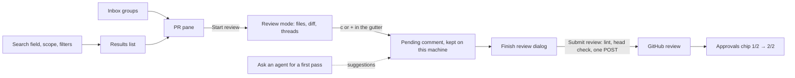

# worfy-pr-review: поиск и ревью чужих PR прямо во вкладке Pull requests; счётчик нужных одобрений (1/2, 2/2) по правилам репозитория

Status: draft 2026-11-20 — черновик Orchestrator-а; владелец его не видел, critic не запускался
Source: просьба владельца 2026-11-20: «нужна ещё возможность искать и ревьювать чужие пулл реквесты прямо во вкладке
pull requests, продумай все детали по этому; ещё нужно отображение сколько нужно аппрувов (1/2, 2/2) в зависимости от
настроек репозитория, и это нужно отображать». Факты GitHub API — по документации docs.github.com (раздел «Факты GitHub
API» ниже, у каждого — ссылка и пометка, проверен ли он запросом). Строки кода и документов сверены с `5c1327f53`
(2026-11-20).
Зависит от: [worfy-pr-inbox](../worfy-pr-inbox/spec.md) (closed, 8/8: вид Pull requests, чтение GitHub из main,
`pr-inbox.json`, черновики ответов и Send), [worfy-changes-view](../worfy-changes-view/spec.md) часть 1 (4/7 на
`5c1327f53`: чтение diff-а в `src/main/changes/`, Node Changes, `DiffPane`, `FileTree`; Ticket 05 — комментарии к строкам —
открыт), [worfy-pr-follow](../worfy-pr-follow/spec.md) часть 1 (closed: действия правки своего PR, skill `pr-fix`),
[worfy-human-review](../worfy-human-review/spec.md) (Team reviewer, формат черновика ревью), worfy-auth-check (строка
`GitHub access` в Health check). ADR [0002](../../docs/adr/0002-worfy-is-a-view-over-the-workflow.md) (worfy — вид
над workflow), [0005](../../docs/adr/0005-worfy-own-state-inventory.md) (собственное состояние worfy),
[0066](../../docs/adr/0066-read-only-access-for-a-linked-machine.md) (доступ Read only у Linked machine),
[0105](../../docs/adr/0105-pr-reply-only-on-the-users-click.md) (публикация в PR только по щелчку пользователя; PR
inbox читает GitHub из main), [0110](../../docs/adr/0110-changes-reads-git-writes-nothing.md) (Changes читает git,
ничего не пишет).
Термины [CONTEXT.md](../../CONTEXT.md): PR inbox, Team reviewer, Session, Binding, Project, Profile, Linked machine,
Full mode, Silent mode, Health check, Stage; Changes — термин, который вносит Ticket 06 worfy-changes-view. Новые термины
этого Epic-а — Review mode и Required approvals (раздел «Решения по реализации», 13).
Ticket-ы: Epic `worfy-pr-review`, 12 Ticket-ов, `issues/01`–`issues/12`. Файлов Ticket-ов ещё нет: их заводит
`/worfy:to-tickets` после принятия spec-а. Имена новых файлов ниже — предложение; implementer сверяет их с `main`.

## Проблема

- **Чужой PR в worfy не найти.** PR inbox показывает только «открытые PR пользователя и запросы ревью у него» по
  репозиториям Project-а (`CONTEXT.md:151-152`). Поиск — два фиксированных запроса `review-requested:@me` и
  `involves:@me` над `repo:` каждого репозитория Project-а (`src/main/github/inbox.ts:83-86`), «another repository of
  the same account is never named in a call» (`src/main/github/inbox.ts:5-6`). PR коллеги, где пользователя не звали,
  PR соседнего репозитория организации, закрытый или слитый PR — не видны. Строки поиска нет: pr-inbox отложил «свои
  разделы строкой поиска» (`.scratch/worfy-pr-inbox/spec.md:280-281`).
- **Ревью уходит на GitHub.** Для PR в группе Needs my review полоса «что дальше» даёт Start review — ссылку на вкладку
  Files на GitHub (`src/renderer/pr-inbox/usePrInbox.ts:338`, `docs/features/pr-inbox.md:78`). worfy сам «никогда не
  отправляет review и не оставляет pending review» (`docs/features/pr-inbox.md:182-183`; ADR-0105, пункт 4 — только
  две записи: ответ в нити и комментарий в разговоре PR, `docs/adr/0105-pr-reply-only-on-the-users-click.md:31-34`).
  Diff чужого PR в worfy тоже не открыть: экран Changes части 1 знает только Ticket (`src/shared/ipc/changes.ts:1-5`,
  `src/renderer/changes/DiffPane.tsx:17-23`), а PR как предмет Changes — набросок части 2 без Ticket-ов
  (`.scratch/worfy-changes-view/spec.md:623-635`). Действия pr-follow — «только для своих открытых PR пользователя»
  (`.scratch/worfy-pr-follow/spec.md:411`).
- **Сколько одобрений нужно — не видно.** Ячейка Review выбранного PR показывает одно слово из `reviewDecision`:
  Approved, Changes requested, Review required или None yet (`src/renderer/pr-inbox/usePrInbox.ts:199-210`,
  `src/renderer/pr-inbox/PrInboxView.tsx:500-509`). Сколько одобрений требует ветка, сколько уже есть и чьих ждут
  (CODEOWNERS), worfy не читает. Запрос деталей берёт `latestOpinionatedReviews(first: 10)` без права записи автора и
  `reviewRequests` без признака code owner (`src/main/github/inbox.ts:75-76`). Без правила ветки `reviewDecision` равен
  `null`, и worfy тогда сам решает по отзывам (`src/main/github/inbox-groups.ts:40`, `:66-71`). Stage Human review
  Pipeline-а ждёт `APPROVED` и не говорит, сколько осталось (`src/shared/workflow/pipeline.ts:367-368`).
- **Q3 части 2 worfy-changes-view открыт.** «Что делать с комментариями к PR коллеги?» — только агенту или Submit
  review на GitHub (`.scratch/worfy-changes-view/spec.md:674-678`). Просьба владельца отвечает на него: ревью чужого
  PR делается в worfy и уходит на GitHub.

## Что уже есть и что этот Epic добавляет

| Что | Уже есть (кто владеет) | Этот Epic |
|---|---|---|
| Вид Pull requests, группы, строка списка, панель PR, нити, ↑ ↓ | worfy-pr-inbox (`src/renderer/pr-inbox/PrInboxView.tsx`, `docs/features/pr-inbox.md:11-122`) | Берёт как есть. Добавляет строку поиска над списком, список результатов вместо групп, Review mode вместо панели PR, chip одобрений в строке |
| Чтение GitHub из main аккаунтом Project-а, кэш, пауза на rate limit, ошибки входа → Health check | worfy-pr-inbox, worfy-auth-check (`src/main/github/inbox.ts:20-22`, `accountAuth` — `src/main/github/prs.ts:172`, `docs/features/pr-inbox.md:189-194`) | Тот же `ghRunner`, тот же аккаунт, тот же порог 10 %. Новое — поиск по запросу пользователя за пределами репозиториев Project-а (Amendment к ADR-0105, пункт 1) |
| Детали PR одним GraphQL-запросом (`PULL_FIELDS`) | worfy-pr-inbox (`src/main/github/inbox.ts:71-79`) | Добавляет поля одобрений: `baseRefName`, право записи автора отзыва, признак code owner у запроса ревью |
| Публикация ровно показанного текста по щелчку, lint перед публикацией, один POST без повтора | ADR-0105, `src/main/github/pr-reply-send.ts:15-17`, `:372`; `review-draft-lint --reply` | Третья запись: один `POST /repos/{o}/{r}/pulls/{n}/reviews` по Submit review в диалоге. Тот же порядок: показать → lint → отметка → один POST |
| Формат черновика ревью = тело `POST …/reviews` (`event`, `body`, `comments[]` с `path`, `line`, `side`) | Team reviewer: `harness/bin/review-draft-lint:4-11` | Черновик ревью пользователя хранится в этом же формате и проверяется этим же lint-ом |
| Diff, дерево файлов, Inline / Side by side, Wrap, Hide whitespace, окно отрисовки | worfy-changes-view часть 1 (`src/renderer/changes/DiffPane.tsx:229`, `FileTree.tsx:45`, `src/main/changes/`) | Предмет `pr` у Changes: diff PR из локального git, если commit-ы есть, иначе из GitHub. Это пункт «PR» наброска части 2 worfy-changes-view (`.scratch/worfy-changes-view/spec.md:623-635`) — его берёт этот Epic, часть 2 его вычёркивает |
| Комментарий к строке: «+» в gutter, `c`, диапазон, popover | worfy-changes-view Ticket 05 (открыт) | Тот же popover и те же клавиши; адресат — не Session, а «Your review» |
| Черновики ответов в нитях, Send, Send all | worfy-pr-inbox (`DraftThread.tsx`) | Ответ в существующей нити в Review mode — тот же черновик и тот же Send, без изменений |
| Skill-ы ревью: Team reviewer (`/human-review`), линзы `/worfy:code-review` | worfy-human-review, Harness | Кнопка Ask an agent for a first pass (Q4): Session пишет предложения в черновик ревью; ничего не публикует |
| Действия правки своего PR, PR watch | worfy-pr-follow части 1 и 2 | Не трогает: этот Epic — про чужие PR. Свой PR в Review mode можно смотреть и комментировать (Comment), но не Approve и не Request changes — GitHub это запрещает |

## Решение

Вкладка Pull requests получает строку поиска и Review mode.

1. **Поиск.** Поле над списком принимает текст и квалификаторы поиска GitHub. Меню области: This Project (репозитории
   Project-а, по умолчанию), организация или владелец каждого репозитория Project-а, All of GitHub (всё, что видит
   аккаунт Project-а). Chip-ы фильтров дописывают квалификаторы в то же поле: State, Review requested, Author, Involves
   me, Label, Draft, Review status. Найденные PR стоят списком вместо групп, той же строкой, что в inbox. Поиск можно
   сохранить: сохранённые поиски — в меню поля.
2. **PR из результатов** открывается в той же панели справа, что PR из inbox: заголовок, полоса «что дальше», ячейки,
   нити, разговор. Полоса чужого PR — «Review this pull request» с кнопкой **Start review**.
3. **Review mode.** Start review — теперь кнопка в worfy, не ссылка на GitHub. Список сворачивается в узкую колонку,
   панель PR становится экраном ревью: дерево файлов с отметками Viewed, diff из Changes, нити GitHub на своих строках.
   Пользователь пишет комментарии к строкам и диапазонам, предлагает правку блоком `suggestion`, отмечает файлы. Всё это
   — **pending review**, черновик на этой машине (не на GitHub), он переживает перезапуск worfy.
4. **Submit review.** Finish review открывает диалог: итоговый текст, выбор Comment / Approve / Request changes и
   каждый комментарий ровно так, как он уйдёт. Submit review — один POST на GitHub. Без щелчка Submit в диалоге на
   GitHub не уходит ничего (ADR-0105 в новой редакции).
5. **Одобрения.** У каждого PR — chip `1/2`: сколько действующих одобрений есть и сколько требует правило базовой ветки.
   Он стоит в строке списка, в шапке PR и в Review mode, на карточке доски Pipeline на Stage Human review и на карточке
   Ticket-а на Canvas (Q5). Правило читается из rulesets ветки, доступных на чтение; если правило не видно — `1/?`.
6. **Помощь агента** (Q4, отдельный Ticket в конце). Ask an agent for a first pass запускает Session, которая пишет
   предложенные комментарии в тот же черновик. Пользователь берёт или отбрасывает каждый; публикует только Submit.

### Как пользователь идёт по экрану

**A. Найти чужой PR и сделать ревью.**

1. Pull requests → `/` ставит курсор в поле поиска (или щелчок). Пользователь набирает `retry author:alice`, область
   — This Project; Enter.
2. Слева вместо групп — «Search · 7 results», строки как в inbox и у каждой chip одобрений (`0/2`). Первый результат
   выбран сам; ↑ ↓ ходят по списку.
3. Справа — PR: полоса «Review this pull request» и **Start review**. Пользователь жмёт.
4. Review mode: список уходит в узкую колонку со стрелкой «← Results», справа — дерево файлов и diff. В шапке —
   `main ← fix/retry-429`, head `3f2a9c1`, `6 files · +184 −22`, chip `0/2 approvals`, «Viewed 0/6».
5. `j` / `k` — по файлам, `n` / `p` — по hunk-ам, `v` — Viewed. На строке `c` или «+» в gutter открывает popover:
   текст в Markdown, кнопка Suggest change вставляет блок `suggestion` с текстом выбранных строк. ⌘↵ — сохранить.
   Комментарий встаёт на строку с пометкой Pending.
6. Внизу экрана — полоса «Your review · 3 pending comments · [Finish review]». Пользователь уходит на Canvas,
   закрывает worfy — черновик лежит в файле. Строка этого PR в списке получает chip `Review draft`.
7. Finish review: диалог «Submit review to owner/web#118». Поле Summary, переключатель Comment / Approve / Request
   changes, список «3 comments will be posted» с `path:line` и текстом каждого, строка lint-а. **Submit review** и
   Cancel.
8. Main проверяет текст lint-ом, перечитывает head PR и отправляет один POST. Chip становится `1/2`, нити пользователя
   стоят на строках уже как GitHub их вернул, черновик закрыт отметкой `submitted` и ссылкой на ревью.

**B. Сколько одобрений осталось.**

1. В группе Waiting on others у своего PR chip `1/2`. Tooltip: «1 of 2 required approvals · approved by @bob ·
   waiting for code owners: @org/payments».
2. В шапке PR вместо ячейки Review — ячейка Approvals: `1/2` и список reviewer-ов с состоянием каждого (approved,
   changes requested, commented, requested, stale — одобрение до последнего push, когда правило их снимает).
3. На доске Pipeline карточка Ticket-а на Stage Human review пишет `Waits: team · 1/2 approvals`.

**C. Head сдвинулся, пока пользователь писал.**

1. Пользователь начал ревью на `3f2a9c1`, автор сделал push `7d0e4b2`. При следующем чтении PR (раздел «Решения по
   реализации», 9) шапка Review mode показывает полосу «2 new commits since you started · Show new commits».
2. Show new commits переключает diff на «since 3f2a9c1» (diff двух commit-ов), комментарии остаются на своих строках
   старого head-а.
3. Finish review в диалоге говорит: «Your comments are on 3f2a9c1; the head is 7d0e4b2.» Две кнопки — **Submit on
   3f2a9c1** и Cancel. Комментарий к строке, которую новый head поменял, GitHub, скорее всего, покажет как
   outdated (не проверено); диалог перечисляет такие.

**D. Правило не видно.** Репозиторий держит classic branch protection, которую аккаунт без прав admin прочитать не
может. Chip — `1/?`, tooltip: «1 approval · GitHub does not show this branch's review rule to your account. GitHub
says: review required». Когда GitHub говорит `APPROVED`, chip — `✓ 2` зелёный: решение GitHub важнее счёта.

### Экран

```
┌ Pull requests · web-app ───────────────────────────────────────────────────────────────── [Refresh] ┐
│ [This Project ▾] [Search pull requests… retry author:alice                  ] [☆ Save] [× Clear]   │
│ [State: Open ▾] [Review requested ▾] [Author ▾] [Label ▾] [Draft ▾] [Review status ▾]              │
├─ Search · 7 results ────────────┬─ owner/web#118  Retry on 429 ─────────────────────────────────────┤
│ > AL Retry on 429        0/2    │ fix/retry-429 → main · alice · 2 h ago                            │
│   web#118 · CI ●   2h  💬 2     │ ┌ Review this pull request ─────────────────────────────────────┐ │
│   BO Cache headers       ✓ 2/2  │ │ alice asked nobody; 0 of 2 required approvals.  [Start review] │ │
│   web#121 · CI ●   1d           │ └───────────────────────────────────────────────────────────────┘ │
│   CA Pagination  Review draft   │ CI ●  Approvals 0/2  Merge Blocked  Size +184 −22                 │
│   api#77 · CI ○    3d    1/?    │ Threads 2 open · 0 resolved …                                      │
└─────────────────────────────────┴───────────────────────────────────────────────────────────────────┘

Review mode
┌ ← Results │ owner/web#118 Retry on 429 · main ← fix/retry-429 · 3f2a9c1 · 6 files +184 −22 · 0/2 ──┐
│           │ [Inline | Side by side] [ ] Wrap [ ] Hide whitespace     Viewed 2/6   [Refresh]        │
│ AL #118 • ├───────────────────────┬────────────────────────────────────────────────────────────────┤
│ BO #121   │ Filter files…         │ src/net/retry.ts                     M +120 −8  [✓] Viewed     │
│ CA #77    │ ▾ src/net             │  10  10    const MAX = 3                                       │
│           │   M retry.ts      ✓ 1 │      11 +  const BACKOFF = [100, 400, 1600]          [+]       │
│           │   A backoff.ts        │      ┌ Pending ─────────────────────────────────┐              │
│           │ ▾ test                │      │ Should this read Retry-After first?      │              │
│           │   M retry.test.ts     │      └──────────────────────── Edit · Delete ───┘              │
│           │                       │      ┌ bob · 1 h · open thread ─────────────────┐              │
│           │                       │      │ Why three tries?        [Reply]          │              │
│           │                       │      └──────────────────────────────────────────┘              │
│           ├───────────────────────┴────────────────────────────────────────────────────────────────┤
│           │ Your review · 3 pending comments on 2 files   [Ask an agent…]  Discard  [Finish review] │
└───────────┴─────────────────────────────────────────────────────────────────────────────────────────┘

Finish review (dialog)
┌ Submit review to owner/web#118 ─────────────────────────────────────────┐
│ Summary  [Looks good apart from the backoff question.                 ] │
│ (•) Comment   ( ) Approve   ( ) Request changes                         │
│ 3 comments will be posted on 3f2a9c1:                                   │
│   src/net/retry.ts:11   Should this read Retry-After first?             │
│   src/net/backoff.ts:4–9  ```suggestion …                               │
│   test/retry.test.ts:40  Missing the 503 case.                          │
│ ✓ Checked: no workflow traces, no AI signature, no personal data        │
│                                              [Cancel] [Submit review]   │
└─────────────────────────────────────────────────────────────────────────┘
```

Тексты UI английские («UI copy is ENGLISH», `docs/design/BRIEF.md:4`; ADR-0017 — английские канонические термины).



## Факты GitHub API

Источник — документация docs.github.com; «проверено» — подтверждено ответом настоящего GitHub на запрос к публичному
репозиторию без записи; «по документации» — только документация; «не проверено» — не удалось подтвердить.

Сверено 2026-11-20 с документацией и ответами GitHub на запросы только на чтение к публичным репозиториям (nodejs/node,
cli/cli, microsoft/vscode, golang/go, kubernetes/kubernetes, vercel/next.js).

**Поиск PR.**

- Квалификаторы `is:pr`, `review-requested:` (лично или через команду; reviewer пропадает из выдачи, когда отозвался),
  `user-review-requested:@me`, `team-review-requested:org/team`, `review-involves:` (держит reviewer-а и после отзыва),
  `reviewed-by:`, `involves:` (автор, assignee, упоминание, комментатор), `author:@me`, `org:`, `repo:`, `user:`,
  `label:a label:b` (И), `label:a,b` (ИЛИ), `draft:`, `review:none|required|approved|changes_requested`,
  `archived:false`, `is:open|closed|merged` — проверено по
  [Searching issues and pull requests](https://docs.github.com/en/search-github/searching-on-github/searching-issues-and-pull-requests).
- Предел — 1 000 результатов на запрос, 100 на страницу; запрос длиннее 256 символов или больше чем с 5 операторами
  AND/OR/NOT — 422; на таймауте GitHub отдаёт часть с `incomplete_results: true` — проверено по
  [REST Search](https://docs.github.com/en/rest/search/search).
- REST `GET /search/issues`: 30 запросов в минуту с токеном — проверено (заголовок `X-Ratelimit-Resource: search`,
  limit 30). Пометок об устаревании у него нет — проверено (документация и заголовки ответа).
- GraphQL `search(type: ISSUE, query: "… is:pr …")` отдаёт узлы `PullRequest` и стоит 1 пункт из 5 000 в час —
  проверено ответом; есть ли у GraphQL-поиска свой лимит в минуту, документация не говорит — **не проверено**. Общие
  вторичные лимиты: 2 000 пунктов GraphQL в минуту, 100 одновременных запросов — проверено по
  [GraphQL rate limits](https://docs.github.com/en/graphql/overview/rate-limits-and-query-limits-for-the-graphql-api).
- Advanced search (`advanced_search=true`, GraphQL `ISSUE_ADVANCED`) по-прежнему включается явно; в нём пробел между
  `repo:` значит И, в обычном поиске — ИЛИ — проверено по changelog-ам GitHub 2025-03-06 и 2025-07-17. worfy остаётся на
  `type: ISSUE`, как PR inbox (`src/main/github/inbox.ts:68`).
- Private-репозитории, которые видит токен, входят в выдачу: документация говорит только «resources that you have
  access to» — вывод, **не проверено** отдельно.

**Сколько одобрений требует ветка.**

- `GET /repos/{o}/{r}/rules/branches/{branch}` отдаёт все активные правила ветки, и репозитория, и организации
  (`ruleset_source_type: Organization`); правила в режиме `evaluate` и `disabled` не входят. Fine-grained токену нужно
  только Metadata read; публичный репозиторий отвечает 200 даже без токена — проверено по
  [REST Rules](https://docs.github.com/en/rest/repos/rules) и ответами nodejs/node и microsoft/vscode.
- Правило `pull_request` несёт `required_approving_review_count`, `dismiss_stale_reviews_on_push`,
  `require_code_owner_review`, `require_last_push_approval`, `required_review_thread_resolution`, `required_reviewers[]`
  (`file_patterns`, `minimum_approvals`, `reviewer`), `ignore_approvals_from_contributors`,
  `require_extra_approval_for_unattributed_changes` — проверено ответами.
- То же видно в GraphQL читателю: `Ref.rules { type parameters { ... on PullRequestParameters {
  requiredApprovingReviewCount dismissStaleReviewsOnPush requireCodeOwnerReview requireLastPushApproval } } }` —
  проверено ответом nodejs/node.
- На ветку могут действовать несколько правил `pull_request` сразу (vercel/next.js: правило организации на 1 и правило
  репозитория на 0) — проверено. Что действует наибольшее число — вывод, **не проверено** по документации.
- Classic branch protection читателю не видна: `GET …/branches/{b}/protection` требует Administration read и отвечает
  404 без него; GraphQL `branchProtectionRules` даёт 0, `Ref.branchProtectionRule` — `null` на защищённых ветках
  kubernetes/kubernetes и golang/go — проверено ответами; документа с этим правилом видимости нет.
  `GET …/branches/{b}` отдаёт только `protected` и `required_status_checks`, его `required_approving_review_count` был
  `null` везде, даже там, где правило требует 1 — проверено.
- Поля PR с нужным числом нет; `mergeStateStatus` (`BLOCKED` и др.) не говорит почему — проверено интроспекцией.
- `reviewDecision` — `APPROVED`, `CHANGES_REQUESTED`, `REVIEW_REQUIRED`; `null`, когда ничего не требует ревью (golang/go)
  — проверено ответом, документация случай `null` не описывает.

**Сколько одобрений есть.**

- `latestOpinionatedReviews(writersOnly: true)` — последний «мнение»-отзыв каждого reviewer-а с правом записи;
  `PullRequestReview.authorCanPushToRepository` есть; состояния отзыва — `PENDING`, `COMMENTED`, `APPROVED`,
  `CHANGES_REQUESTED`, `DISMISSED`; `reviewRequests { asCodeOwner requestedReviewer }` есть — проверено интроспекцией и
  ответами.
- Считаются одобрения людей с правом записи или admin; автор не одобряет свой PR; при «dismiss stale» push, меняющий
  код, снимает одобрение; при last-push approval последний push одобряет не тот, кто его сделал — проверено по
  [Approving a pull request with required reviews](https://docs.github.com/en/pull-requests/collaborating-with-pull-requests/reviewing-changes-in-pull-requests/approving-a-pull-request-with-required-reviews)
  и [About protected branches](https://docs.github.com/en/repositories/configuring-branches-and-merges-in-your-repository/managing-protected-branches/about-protected-branches).

**Отправка ревью.**

- `POST /repos/{o}/{r}/pulls/{n}/reviews`: `event` — `APPROVE`, `REQUEST_CHANGES`, `COMMENT`; без `event` — PENDING
  review; `body` обязателен для `REQUEST_CHANGES` и `COMMENT`; `commit_id` по умолчанию — последний commit; `comments[]`
  с `path`, `body`, `line`, `side`, `start_line`, `start_side`; запрос шлёт уведомления и может задеть вторичный лимит —
  проверено по [REST Pull request reviews](https://docs.github.com/en/rest/pulls/reviews). Лимит создания контента —
  80 в минуту и 500 в час — проверено по странице GraphQL rate limits.
- GraphQL-аналоги — `addPullRequestReview`, `addPullRequestReviewThread`, `submitPullRequestReview` — проверено
  интроспекцией; worfy берёт REST, как `pr-reply-send.ts`.
- «Один pending review на пользователя и PR»: документация этого не говорит — **не проверено**. Если у пользователя
  висит pending review с github.com, поведение POST неизвестно; Ticket 09 проверяет это на тестовом репозитории.
- Права: fine-grained — Pull requests: write; classic — `repo` (private) или `public_repo` (только public; хватает ли его
  для review — вывод, **не проверено**) — по
  [permissions for fine-grained tokens](https://docs.github.com/en/rest/authentication/permissions-required-for-fine-grained-personal-access-tokens)
  и [OAuth scopes](https://docs.github.com/en/apps/oauth-apps/building-oauth-apps/scopes-for-oauth-apps). Токены gh
  на Mac владельца несут `repo`, `read:org`, `gist`, `workflow` — проверено `gh auth status` 2026-11-20.
- SAML SSO: неавторизованный токен получает 403 или 404; на 403 заголовок `X-GitHub-SSO` несёт ссылку авторизации на 1
  час; поиск по нескольким организациям — `X-GitHub-SSO: partial-results; organizations=…` — проверено по
  [Authenticating to the REST API](https://docs.github.com/en/rest/authentication/authenticating-to-the-rest-api). Тот
  же заголовок у GraphQL-поиска — **не проверено**.

**Diff и файлы.**

- `GET …/pulls/{n}/files` — не больше 3 000 файлов, до 100 на страницу; commit-ов PR — до 250 — проверено по
  [REST Pulls](https://docs.github.com/en/rest/pulls/pulls). Пределы diff-а — 20 000 строк или 1 MB на PR, 20 000 строк
  или 500 KB на файл, 300 файлов на diff, «most of the limits … affect both GitHub and the API» — проверено по
  [Repository limits](https://docs.github.com/en/repositories/creating-and-managing-repositories/repository-limits).
- Нет `patch` у binary и большого файла — документация не говорит, **не проверено**; какую ошибку даёт слишком большой
  `application/vnd.github.diff` — **не проверено** (REST указывает 406 без пояснения).
- `PullRequestChangedFile.viewerViewedState` — `VIEWED`, `UNVIEWED`, `DISMISSED` (файл изменился после отметки);
  `markFileAsViewed` / `unmarkFileAsViewed` — мутации, то есть запись — проверено по
  [Reviewing proposed changes](https://docs.github.com/en/pull-requests/collaborating-with-pull-requests/reviewing-changes-in-pull-requests/reviewing-proposed-changes-in-a-pull-request)
  и ответом.

## Решения по реализации

### 1. Поиск в main (Ticket 04)

- Новый модуль `src/main/github/pr-search.ts`. gh — через `ghRunner` (`src/main/github/prs.ts:118`) с окружением
  `accountAuth` (`src/main/github/prs.ts:172`): аккаунт Project-а, глобальный аккаунт gh не переключается — как у PR
  inbox. Только чтение: `gh api graphql` с `query`, без `--method`, без `mutation` (как `src/main/github/inbox.ts:30-32`).
- Запрос — GraphQL `search(type: ISSUE, query: $q, first: 30, after: $cursor)` с `issueCount` и полями строки списка:
  те же, что у строки inbox, плюс поля одобрений (раздел 3). Один вызов на страницу; «Load more» — следующая страница
  по cursor-у. Предел GitHub — 1 000 результатов на запрос (раздел «Факты»): после него строка «Showing the first 1,000
  — narrow the search».
- Строка запроса — чистая функция `src/shared/pr-search/query.ts`: текст пользователя + `is:pr` (всегда; `is:issue`
  пользователя отбрасывается с notice) + область + `archived:false` по умолчанию + `sort:updated-desc`, если сортировку
  не задал пользователь. Область:
  - This Project — `repo:` каждого репозитория Project-а (`remoteRepos`, `src/main/github/inbox.ts:731`); при 256
    символах и больше — несколько запросов, как подсказывает shortcut `src/main/github/inbox.ts:82`;
  - `org:<owner>` для каждого владельца репозиториев Project-а (организация или пользователь — `user:`);
  - All of GitHub — без ограничения: всё, что видит аккаунт Project-а.
- Chip-ы фильтров пишут квалификаторы в то же поле: поле — единственный источник правды, chip показывает, что в поле
  уже есть такой квалификатор. State → `is:open` / `is:closed` / `is:merged`; Review requested → `review-requested:@me`
  (лично или через команду) или `user-review-requested:@me` (только лично); Author → `author:@me` / `author:<login>`;
  Involves me → `involves:@me`; Label → `label:"…"`; Draft → `draft:true|false`; Review status →
  `review:none|required|approved|changes_requested`; Reviewed by me → `reviewed-by:@me`; Asked or
  reviewed → `review-involves:@me` (держит PR и после отзыва пользователя, в отличие от `review-requested:`). Запрос
  длиннее 256 символов или больше чем с 5 операторами AND/OR/NOT GitHub отвергает (422): поле предупреждает об этом
  до Enter.
- Поиск идёт по Enter, не на каждую букву: REST-поиск ограничен 30 запросами в минуту, а свой лимит GraphQL-поиска не
  документирован (раздел «Факты»). Повтор того же запроса моложе 60 с отвечает из памяти.
- Канал `prSearch.run` (`'project', 'read'`): поиск делает Machine Project-а её аккаунтом, Linked machine с доступом Read
  only тоже может искать (ADR-0066: вызов не меняет состояния Project-а). Ответ — строки, `issueCount`, cursor, остаток
  rate limit и `notice`.
- Сохранённые поиски — `<Project data folder>/pr-searches.json` в `WORFY_DATA_DIR` рядом с `pr-inbox.json`: имя, строка
  запроса, область; не больше 20. Каналы `prSearch.saved`, `prSearch.save`, `prSearch.forget` — `'project', 'write'`.
  Поправка к ADR-0005 (новое место состояния). Два встроенных поиска, которые нельзя удалить: «Review requested from me
  · All of GitHub» и «Reviewed by me · open».
- Amendment к ADR-0105, пункт 1: фоновые чтения PR inbox остаются в репозиториях Project-а; поиск по запросу
  пользователя и чтение одного PR, который пользователь открыл из результатов, могут назвать любой репозиторий, видимый
  аккаунту Project-а. Это чтение, ничего на GitHub не меняется.

### 2. Чтение одного PR вне inbox (Ticket 04)

- PR из результатов, которого нет в inbox, читается тем же GraphQL-запросом деталей (`PULL_FIELDS`,
  `src/main/github/inbox.ts:71-79`) по каналу `prSearch.pull` (`'project', 'read'`) и показывается той же панелью.
  `PrInbox.refresh` (`src/main/github/inbox.ts:372-375`) для этого не годится: он читает только репозитории, которые
  читает какой-то Project.
- Кэш — в памяти main по `repo#N` и `updatedAt`, отдельно от кэша inbox, не больше 200 PR; слова коллег на диск не
  пишутся (ADR-0105, пункт 6).
- Строка результата, которая есть и в inbox, берёт строку inbox: один PR не читается дважды.
- Mark seen для PR вне inbox не пишется: `pr-inbox.json` хранит только PR inbox.

### 3. Required approvals (Ticket 02)

- **Сколько нужно** — чистая функция `src/shared/github/approvals.ts` над тем, что прочитал main:
  1. Rulesets ветки — в том же GraphQL-запросе деталей: `baseRef { rules(first: 50) { nodes { type parameters { ... on
     PullRequestParameters { requiredApprovingReviewCount dismissStaleReviewsOnPush requireCodeOwnerReview
     requireLastPushApproval } } } } }` (раздел «Факты»: виден читателю и включает правила организации; REST-аналог —
     `GET /repos/{o}/{r}/rules/branches/{base}`). Нужное число — наибольшее `requiredApprovingReviewCount` правил
     `PULL_REQUEST`. Источник — `ruleset`. Что действует наибольшее, — вывод (раздел «Факты»); Ticket 02 сверяет его
     на тестовом репозитории с двумя правилами.
  2. Classic branch protection: `baseRef { branchProtectionRule { requiredApprovingReviewCount
     requiresCodeOwnerReviews dismissesStaleReviews requireLastPushApproval } }`. Аккаунту без прав admin GitHub отдаёт
     `null` (раздел «Факты»), так что число видно только админам репозитория. Источник — `protection`. С ruleset —
     наибольшее из двух.
  3. Ни то, ни другое не прочитано, а `reviewDecision` не `null` — правило есть, числа нет: `need = null`, источник
     `hidden` (поток D).
  4. `reviewDecision` равен `null` и правил нет — одобрения не требуются: `need = 0`, chip не показан, а в ячейке
     Approvals — «No review rule · 1 approval».
  5. Флаги ruleset-а, которые worfy не считает точно (`required_reviewers[]` по путям, `ignore_approvals_from_contributors`,
     `require_extra_approval_for_unattributed_changes`), названы в tooltip («more rules apply — GitHub decides»), а
     зелёным chip становится только по `reviewDecision = APPROVED`.
- **Сколько есть** — `latestOpinionatedReviews(first: 50, writersOnly: true)`: последний отзыв каждого reviewer-а с
  правом записи; одобрение без права записи правило не считает (раздел «Факты»). Считаются отзывы `APPROVED` на любом
  commit-е, кроме случая `dismiss_stale_reviews_on_push`: тогда GitHub сам снимает их при push (состояние `DISMISSED`),
  и worfy их не считает. Отзыв `APPROVED` автора последнего push при `require_last_push_approval` помечен «needs another
  approver». Одобрения без права записи показаны в списке reviewer-ов серым «does not count».
- **Code owners.** Запрос ревью получает `asCodeOwner`; при `require_code_owner_review` строка «waiting for code owners:
  @org/payments» держит chip незелёным, даже если число набрано.
- **Решение GitHub главнее счёта.** `reviewDecision = APPROVED` — chip зелёный `✓ M/N`, даже если счёт worfy меньше
  (GitHub видит правила, которых не видит аккаунт). `CHANGES_REQUESTED` — chip красный с числом одобрений.
- **Цена.** Правила читаются в том же запросе деталей, отдельного вызова нет; страница из 10 PR дорожает на поля
  `rules`. Contract test Ticket-а 02 записывает `rateLimit.cost` страницы до и после; если цена выросла больше чем вдвое,
  правило уходит в отдельный вызов `rules/branches` с кэшем по `(repo, base)` на 1 час.
- **Поля.** `PULL_FIELDS` получает `baseRefName`, `writersOnly: true` и `authorCanPushToRepository` у отзывов,
  `asCodeOwner` у запросов ревью, `baseRef { rules … branchProtectionRule … }`. Строка inbox (`PrInboxRow`) получает
  `approvals: { have, need, source, codeOwnersPending, stale, lastPushNeedsOther }`. Правило «Ready» группировки
  (`src/main/github/inbox-groups.ts:121`) не меняется: оно уже смотрит на `decisionOf`.

### 4. Diff PR в Changes (Ticket 06)

- Changes получает предмет `pr`: `{ repo: 'owner/name', number, headOid, baseOid }`. Каналы `changes.scopes`,
  `changes.list`, `changes.file` принимают его рядом с Ticket-ом (`changesTicketSchema`,
  `src/shared/ipc/changes.ts:22`). `DiffPane` и `FileTree` получают `subject` вместо `ticket`
  (`src/renderer/changes/DiffPane.tsx:17-23`, `:229`).
- **Локально, если можно.** Репозиторий PR — репозиторий Project-а, и оба commit-а есть локально (`git cat-file -e`) —
  diff считает `src/main/changes/` тем же git только на чтение (ADR-0110); показ всего файла работает. Fetch worfy не
  делает никогда (ADR-0110).
- **Иначе — GitHub.** `GET /repos/{o}/{r}/pulls/{n}/files?per_page=100` страницами — список файлов со статусом, `+/−` и
  `patch` каждого; разбор `patch` — тот же `src/shared/changes/parse.ts` (hunk-и без заголовков git, адаптер в
  `src/main/changes/github.ts`). Файл без `patch` (большой или binary) — «Large diff · Open on GitHub». Больше 3 000
  файлов GitHub не отдаёт — строка «GitHub lists the first 3,000 files». Контекст шире hunk-ов GitHub — только у
  локального diff-а; у diff-а из GitHub — ссылка «View file on GitHub».
- Ответ GitHub кэшируется в памяти main по head commit-у. Scope-ы PR: All changes (база ↔ head), Commit (список commit-ов
  PR, `GET …/pulls/{n}/commits`), Since my review (head, на котором пользователь начал или отправил ревью, ↔ новый head;
  `GET /repos/{o}/{r}/compare/{a}...{b}` или локально).
- Нити ревью GitHub стоят на своих строках (`path`, `line`, `isOutdated` уже читает PR inbox,
  `src/main/github/inbox.ts:77`); outdated — списком над файлом. Ответ в нити — существующий черновик и Send PR inbox,
  без изменений.
- Amendment к ADR-0110: Changes читает GitHub для предмета `pr`; только GET, только по открытому экрану.

### 5. Review mode во вкладке Pull requests (Ticket 07)

- Start review в полосе «что дальше» — кнопка, а не ссылка (`src/renderer/pr-inbox/usePrInbox.ts:338`); Open on GitHub
  остаётся в ряду кнопок. Полоса чужого PR вне Needs my review — «Review this pull request» с той же кнопкой.
- Review mode — компонент `src/renderer/pr-review/ReviewMode.tsx` на месте панели PR. Список сворачивается в колонку
  48 px с аватарами и номерами (`← Results` / `← Inbox` возвращает его); ↑ ↓ в Review mode не меняют PR — меняют файл,
  как `j` / `k`. Escape закрывает popover, второй Escape — Review mode (черновик остаётся).
- Внутри — `FileTree` и `DiffPane` Changes с предметом `pr`; у файла в дереве — счётчик нитей и Pending-комментариев.
  Шапка: база ← head, head commit, файлы и `+/−`, chip одобрений, Viewed N/M, Refresh.
- **Viewed.** Отметки — в черновике ревью (раздел 6) по `path` и blob id новой стороны; снимается сама, когда blob файла
  сменился в новом head-е. Синхронизация с отметками Viewed на github.com — Q3.
- Kit — ToggleGroup, Menu, Popover, Dialog, Tooltip, ContextMenu из `src/renderer/theme/kit/` (ADR-0106).
- Состояние Review mode (PR, файл, прокрутка) живёт в store вида: смена вкладки и возврат его сохраняют, как сейчас
  панель PR (`docs/features/pr-inbox.md:249-250`).

### 6. Черновик ревью (Ticket 08)

- Файл `<Profile folder>/state/pr-review/<owner>-<repo>-<N>.json` на этой машине, рядом с черновиками ответов
  (`state/pr-inbox/drafts/`, ADR-0105, пункт 6), вне репозитория и вне истории git Harness home. Формат — тот, что
  проверяет `review-draft-lint` (`harness/bin/review-draft-lint:8-11`), плюс поля worfy:
  `{ schema: 1, repo, pr, startedOn: <head sha>, payload: { event, body, comments: [{ path, line, side, start_line?,
  start_side?, body }] }, anchors: [{ text, by: 'user'|'agent', kept }], viewed: { <path>: <blob> }, state:
  'draft'|'submitting'|'submitted', reviewUrl?, error? }`. В `anchors` — текст строк, к которым стоит комментарий (код,
  не слова коллег), для поиска строки заново после нового push.
- Пишет main: каждое изменение через временный файл и rename, не чаще раза в 500 ms, как правки черновиков ответов
  (`docs/features/pr-inbox.md:242-246`). Session помощи агента (раздел 8) пишет только через `bin/pr-review-draft`,
  который добавляет предложения с `by: 'agent'` и не трогает комментарии пользователя.
- Один черновик на PR. Discard review удаляет файл после подтверждения «Discard 3 pending comments?». Отправленный
  черновик хранится 30 дней (ссылка на ревью для повторной проверки), потом удаляется при запуске worfy.
- Каналы `prReview.draft`, `prReview.saveComment`, `prReview.deleteComment`, `prReview.setViewed`, `prReview.discard` —
  `'local'`, как черновики ответов (`src/shared/ipc/pr-inbox.ts:233-239`): Linked machine их не вызывает.
- Строка списка с черновиком — chip `Review draft` (tooltip — «3 pending comments, started on 3f2a9c1»).
- Profile без `github.account` ревью не теряет, но Submit отказывает, как Send (`docs/features/pr-inbox.md:165-166`).

### 7. Submit review (Ticket 09)

- Finish review открывает Dialog kit-а. Выбор Approve и Request changes неактивен на своём PR («GitHub does not let
  you approve or request changes on your own pull request»). Request changes и Comment без Summary и без комментариев
  неактивны (раздел «Факты»: GitHub требует `body` для этих событий). Диалог держит тексты, с которыми открылся: правка
  черновика агентом во время диалога не меняет того, что уйдёт (как Send all, `docs/features/pr-inbox.md:154-157`).
- Порядок в main, модуль `src/main/github/pr-review-submit.ts` рядом с `pr-reply-send.ts`:
  1. перечитать файл черновика и взять ровно показанные тексты (как ADR-0105, пункт 3);
  2. `review-draft-lint` над `payload` — следы workflow, подпись ИИ, личные данные, длина; без `lint.json` Team
     reviewer-а — длины шаблона, как уже делает `--reply` (`harness/bin/review-draft-lint:264`, `:271`; Ticket 09
     добавляет это и обычному режиму). Находка — ничего не отправлено, текст находки в диалоге;
  3. перечитать head PR; head сдвинулся — диалог показывает это до отправки (поток C), комментарии идут на `startedOn`;
  4. отметка `state: 'submitting'` в файле, затем один `POST /repos/{o}/{r}/pulls/{n}/reviews` с `commit_id`,
     `event`, `body`, `comments` — тело ровно как в `payload`, без добавленного байта;
  5. ответ GitHub → `submitted` и `reviewUrl`; PR inbox и строка результата перечитывают PR (`refresh`).
- **Сбой.** GitHub или сеть не ответили — черновик остаётся с «GitHub did not confirm the review: <reason>»; worfy не
  повторяет сам. Новый Submit после сбоя или после отметки `submitting` сначала читает `GET …/pulls/{n}/reviews` и ищет
  отзыв этого аккаунта на том же `commit_id` с тем же `body`; нашёл — только отмечает `submitted` (как повтор Send,
  `docs/features/pr-inbox.md:172-176`).
- **Никогда:** pending review на GitHub (запрос без `event`), второй POST по одному щелчку, resolve нитей, re-request
  review, dismiss чужого отзыва, merge. Pending review — только локальный файл (ADR-0105, пункт 6, в силе).
- Новый ADR «worfy отправляет ревью PR только по Submit пользователя» (номер — при Ticket-е 09): третья запись к двум
  записям ADR-0105, пункт 4; Amendment к ADR-0105 и ADR-0002. Ревью кода Ticket-а 09 — ступень `max` (запись на GitHub,
  как `pr-reply-send.ts` в ADR-0105, «Последствия»).

### 8. Помощь агента (Ticket 10, если Q4 — да)

- Ask an agent for a first pass в полосе Review mode запускает новую Session Node Project-а на Claude Code с шаблоном
  Project-а «Pre-review» (новый action template рядом с Draft replies, `src/shared/projects/action-templates.ts`):
  `/human-review {repo}#{pr}`, когда у Project-а есть Team reviewer, иначе `/worfy:code-review` над PR с линзами Profile-а.
- Session пишет предложения через новый `harness/bin/pr-review-draft` в тот же файл черновика (`by: 'agent'`); сама на
  GitHub не пишет — тот же запрет, что у `pr-reply` (`harness/skills/pr-reply/SKILL.md:12-19`), и тот же guard hook.
- Предложение агента стоит на строке пунктиром «Suggested by the agent · Keep · Edit · Dismiss». В диалог Submit идут
  только комментарии пользователя и принятые (Keep или Edit) предложения.
- Session видит diff и нити чужого PR, они попадают в её транскрипт, как при Draft replies (`.scratch/worfy-pr-follow/spec.md`,
  «Риски», «Тексты коллег в транскрипте»).

### 9. Когда что обновляется

- Inbox — как сейчас: поиск раз в 5 минут, уведомления GitHub (`src/main/github/inbox.ts:20-25`).
- Результаты поиска — снимок: «Searched 3 min ago · Refresh», без таймера (бережём лимит поиска). Сохранённый поиск
  выполняется при выборе.
- Выбранный PR вне inbox — при выборе, по Refresh, при фокусе окна, если чтению больше 60 s.
- Review mode — при входе, по Refresh, при фокусе окна (старше 60 s) и раз в 2 минуты, пока Review mode открыт и окно в
  фокусе: новый head даёт полосу «N new commits since you started». Пауза на rate limit — общая с PR inbox (порог 10 %,
  `src/main/github/inbox.ts:21-22`).
- Правило одобрений — вместе с деталями PR (раздел 3).

### 10. Ошибки

| Что | Что видит пользователь |
|---|---|
| Репозиторий не найден или нет доступа (404 у private) | «owner/repo is not visible to <account>» вместо результатов или панели PR |
| Организация с SAML SSO, токен не авторизован (403 с заголовком `X-GitHub-SSO`) | «Authorize your token for <org> single sign-on» и ссылка из заголовка; строка Health check `GitHub access` (worfy-auth-check) |
| Поиск по нескольким организациям, часть из них за SSO (`X-GitHub-SSO: partial-results; organizations=…`) | результаты есть, над ними notice «Results from <org> are hidden: authorize your token for its single sign-on» |
| Поиск ответил `incomplete_results: true` (таймаут GitHub) | «GitHub returned part of the results — search again or narrow it» |
| Submit: у пользователя висит pending review, начатый на github.com (поведение GitHub не проверено) | причина GitHub в диалоге и Open on GitHub; черновик остаётся |
| Вход gh отказан (401, нет токена) | как сейчас: «GitHub refused the sign-in: …» и Open Health check (`docs/features/pr-inbox.md:189-194`) |
| Rate limit поиска или GraphQL | «Search paused until 14:05 (GitHub rate limit)»; поле активно, Enter ставит поиск на это время |
| Запрос шире 1 000 результатов | «Showing the first 1,000 — narrow the search» |
| Ошибка разбора запроса GitHub (422) | текст GitHub под полем, поле красной рамкой |
| Submit: нет «Pull requests: write» у fine-grained токена, свой PR, PR закрыт | причина GitHub в диалоге, черновик остаётся |
| Diff не прочитан (файлов больше 3 000, patch нет) | строка над деревом и Open on GitHub |

### 11. Linked machine, Silent mode, Vendor

- **Linked machine.** Поиск, чтение PR, diff и chip одобрений — каналы `'project', 'read'`: окно Linked machine видит
  их, вызовы идут на Machine Project-а её аккаунтом. Черновик ревью и Submit — `'local'`, как черновики ответов: на Linked
  machine Start review неактивен с tooltip «Review on the machine of the Project», Review mode открывается только для
  чтения (diff, нити, без «+» и полосы ревью). Сохранённые поиски с доступом Read only читаются, но не меняются.
- **Silent mode.** Текст ревью проверяет `review-draft-lint` на следы workflow и подпись ИИ — в любом режиме, как
  ответы. Предложения агента — особенно: они проходят тот же lint при Submit.
- **Vendor.** Помощь агента запускает Claude Code, как Draft replies и действия pr-follow, пока skill-ы Harness не
  перенесены в Codex.

### 12. Доступность и темы

- Поле поиска — `role="searchbox"` с подписью «Search pull requests»; `/` фокусирует его из любого места вида, кроме
  текстового поля; Escape очищает фокус. Меню области и chip-ы — кнопки kit-а с клавиатурой.
- Список результатов — тот же список с ↑ ↓, что inbox (`docs/features/pr-inbox.md:66-71`); Enter на строке — Start
  review.
- Chip одобрений несёт текст, а не только цвет: `aria-label="1 of 2 required approvals"`, `1/?` —
  «1 approval, rule not visible».
- Клавиши Review mode — те же, что Changes (`j`/`k`, `n`/`p`, `c`, `v`), плюс ⌘⇧↵ — Finish review. Dialog kit-а держит
  фокус внутри; Submit review — не кнопка по умолчанию для Enter (только щелчок или ⌘↵ в диалоге).
- Цвета — tokens обеих тем: набрано — `--ready-*`, Changes requested — `--blocked-*`, меньше нужного — нейтральный,
  `?` — приглушённый. e2e снимает экран поиска, Review mode и диалог в светлой и тёмной теме на 1280 и 1600 px.

### 13. Документы, термины, ADR

- Страницы Feature (ADR-0088 — английские страницы Feature): `docs/features/pr-inbox.md` — поиск, Review mode, Submit,
  одобрения; `docs/features/changes.md` — предмет `pr`; `docs/features/workflow.md` — `1/2 approvals` на доске Pipeline;
  переводы в `docs/features/ru/`.
- CONTEXT.md: **Review mode** — экран ревью одного PR во вкладке Pull requests: diff, нити, pending comments,
  Submit review; _Avoid_: review screen, режим ревью. **Required approvals** — сколько одобрений требует правило базовой
  ветки PR и сколько их есть, `1/2`; _Avoid_: аппрувы, approvals count. Термин PR inbox получает фразу о поиске и
  Submit review.
- ADR: новый — Submit review (Ticket 09); Amendment-ы — ADR-0105 (пункты 1, 4), ADR-0002 (исключение «main пишет»
  расширено), ADR-0005 (`pr-searches.json`, `state/pr-review/`), ADR-0110 (чтение GitHub для предмета `pr`).

## Решения по test-ам

- Хороший test проверяет поведение снаружи: какую строку поиска получил gh, какие PR видит пользователь, какое число
  одобрений показано, какой ровно POST ушёл и что без щелчка не ушло ничего.
- **Без сети и без моделей.** gh — stand-in через `WORFY_GH` (`src/main/github/prs.ts:74-95`), Claude — `WORFY_AGENT=fake`.
  Владельцы, репозитории и login-ы fixture-ов выдуманы; ответы GitHub в fixture-ах — по форме из документации и из
  проверенных ответов публичного репозитория (раздел «Факты»), без чужих текстов.
- **Seam 1 — unit:** сборка строки запроса из поля, области и chip-ов; `approvalsOf` — ruleset, classic protection,
  оба, скрытое правило, `reviewDecision` главнее счёта, stale, без права записи, code owners, last push; разбор `patch`
  GitHub в hunk-и; поиск строки комментария заново после нового head-а; формат черновика ↔ `payload` lint-а.
- **Seam 2 — contract** (main на gh stand-in): `prSearch.run` — запрос, cursor, 1 000, rate limit, 403 SSO, 422;
  `prSearch.pull`; правило одобрений в запросе деталей и его цена (`rateLimit.cost`); `changes.*` с предметом `pr` локально и из GitHub; черновик — запись
  через rename, Linked machine получает отказ на `'local'`; Submit — lint, head сдвинулся, один POST, сбой, повтор без
  второго POST; **ни одной записи** на GitHub от поиска, чтения, открытого Review mode и сохранения черновика (stand-in
  падает test на любом `--method`, кроме одного POST Submit-а).
- **Seam 3 — e2e** в настоящем Electron (образец — `test/e2e/pr-inbox.spec.ts`): поиск → результат → Start review →
  комментарий → перезапуск → черновик на месте → Finish review → Submit → stand-in получил один POST с ровно этими
  текстами; chip `1/2` → `2/2`; Linked machine Read only — Review mode без «+». Снимки в обеих темах.
- Eval (Ticket 10): skill помощи агента не пишет на GitHub и пишет только через `bin/pr-review-draft`.
- **Сначала падающий test** в каждом Ticket-е кода; он красный на старом поведении, это пишется в «Итог».

## Не в этом Epic-е

- **Pending review на GitHub** и синхронизация черновика с ним; продолжение ревью, начатого на github.com.
- **Resolve нитей, re-request review, dismiss чужого отзыва, merge, правка описания и меток PR.** ADR-0105 в силе.
- **Поиск issues, discussions, коммитов и кода**, поиск по GitLab, Bitbucket, GitHub Enterprise Server (`remoteRepos`
  берёт только github.com, `src/main/github/inbox.ts:730`).
- **Уведомления о новых результатах сохранённого поиска** и фоновый поиск по таймеру.
- **Подсветка синтаксиса** (Q5 worfy-changes-view — решено «нет»), diff картинок, контекст шире hunk-ов у diff-а из
  GitHub.
- **Правка чужого PR агентом** (push в чужую ветку) — действия pr-follow остаются только для своих PR.
- **Сводка ревью моделью без Session** (Haiku и т.п.) — только Session по щелчку (Q4).
- **Счётчик одобрений для веток без PR** и редактирование правил защиты веток.

## Ticket-ы

1. **01 — Прототип: поиск, Review mode, диалог Submit и chip одобрений.** Card с HTML-прототипом на выдуманных данных:
   поле, область, chip-ы, результаты, Review mode с pending-комментарием и предложением агента, диалог, все состояния
   chip-а (`0/2`, `1/2`, `✓ 2/2`, `1/?`, changes requested, code owners) в обеих темах. Ticket-ы 03, 05, 07 строят экран
   по нему. Test-ы: нет кода; проверка — Card открывается, все состояния на месте. Blocked by: —.
2. **02 — Required approvals в main.** Поля `PULL_FIELDS`, rulesets и classic protection базовой ветки в запросе деталей,
   `approvalsOf` в `src/shared/github/approvals.ts`, поле `approvals` строки inbox. Test-ы: unit `approvalsOf` (все
   случаи раздела 3); contract — stand-in с ruleset-ами репозитория и организации, с classic protection видимой (admin) и
   `null`, цена страницы до и после; ручная сверка правила «наибольшее из двух» на тестовом репозитории. Blocked by: —.
3. **03 — Chip одобрений в UI.** `src/renderer/pr-inbox/ApprovalsChip.tsx`; строка списка, ячейка Approvals со
   списком reviewer-ов, tooltip; доска Pipeline на Stage Human review (`src/renderer/pipeline/PipelineBoard.tsx:139`);
   карточка Ticket-а на Canvas по Q5 (`src/renderer/canvas/badges/ReviewThreads.tsx`, `ticket-card.ts:70`). Test-ы: unit
   компонента (тексты, aria-label, цвета состояний); unit доски; e2e снимок обеих тем. Blocked by: 01, 02.
4. **04 — Поиск в main.** `src/main/github/pr-search.ts`, `src/shared/pr-search/query.ts`, каналы `prSearch.run`,
   `prSearch.pull`, `prSearch.saved/save/forget`, `pr-searches.json`, Amendment-ы к ADR-0105 (пункт 1) и ADR-0005.
   Test-ы: unit сборки запроса; contract — область, cursor, 1 000, rate limit, SSO, 422, нет записей, сохранённые поиски
   и отказ Linked machine Read only на `save`. Blocked by: —.
5. **05 — Поиск в виде Pull requests.** Поле, `/`, меню области, chip-ы, сохранённые поиски, список результатов,
   «Load more», выбор → панель PR (полоса «Review this pull request»), ошибки раздела 10; `docs/features/pr-inbox.md`.
   Test-ы: unit вида поиска; e2e — поиск, выбор, Clear возвращает inbox, ошибки. Blocked by: 01, 03, 04.
6. **06 — Diff PR в Changes.** Предмет `pr` в `src/shared/ipc/changes.ts` и `src/main/changes/`, локальный путь и
   `src/main/changes/github.ts` (`pulls/{n}/files`, `commits`, `compare`), `subject` у `DiffPane` и `FileTree`, нити на
   строках, Amendment к ADR-0110; `docs/features/changes.md`. Test-ы: unit разбора `patch`; contract — локально и из
   GitHub, 3 000 файлов, файл без `patch`, кэш по head, никакого `fetch`, `.git/index` не тронут. Blocked by: —.
7. **07 — Review mode.** `src/renderer/pr-review/ReviewMode.tsx`, Start review — кнопка, свёрнутый список, шапка, дерево
   с нитями, Viewed (по Q3), клавиши, полоса «N new commits», Since my review, Read only. Test-ы: unit клавиш и Viewed;
   e2e — Start review из inbox и из поиска, Escape, возврат, Linked machine Read only. Blocked by: 01, 05, 06.
8. **08 — Черновик ревью в main.** `src/main/github/pr-review-draft.ts`, файл в `state/pr-review/`, каналы
   `prReview.*` (`'local'`), поиск строки заново по `anchors`, хранение 30 дней, поправка к ADR-0005. Test-ы: unit
   формата ↔ `payload`, re-anchor; contract — запись через rename, гонка с `bin/pr-review-draft`, отказ Linked machine.
   Blocked by: —.
9. **09 — Комментарии и Submit review.** «+» в gutter, `c`, диапазон, Suggest change, Pending на строке, полоса «Your
   review», Discard, диалог Finish review, `src/main/github/pr-review-submit.ts`, `review-draft-lint` без `lint.json`,
   новый ADR, Amendment-ы к ADR-0105 и ADR-0002. Ревью — ступень `max`. Test-ы: contract — lint-отказ, head сдвинулся,
   ровно один POST с ровно показанным телом, свой PR, сбой и повтор без второго POST, ни одной записи без щелчка; e2e —
   полный путь A и C. Blocked by: 07, 08.
10. **10 — Помощь агента (если Q4 — да).** Action template «Pre-review», `harness/bin/pr-review-draft`, правка skill-а
    Team reviewer-а и раздел в `/worfy:code-review` о записи в черновик, Keep / Edit / Dismiss в Review mode. Test-ы:
    unit `pr-review-draft`; eval — skill не пишет на GitHub; e2e на fake agent — предложения на строках, в POST только
    принятые. Blocked by: 08, 09.
11. **11 — Документы.** Переводы `docs/features/ru/` (`pr-inbox.md`, `changes.md`, `workflow.md`), термины Review mode и
    Required approvals в CONTEXT.md, фраза в термине PR inbox, проверка, что ADR и Amendment-ы влиты; вычеркнуть пункт
    «PR» и Q3 из части 2 worfy-changes-view. Test-ы: `check-handoff`, `evidence-check`. Blocked by: 02–10.
12. **12 — Приёмка владельцем.** Тестовый репозиторий, как в приёмке worfy-pr-follow: поиск по трём областям, ревью
    чужого PR с Approve от второго аккаунта, `1/2` → `2/2` при правиле ruleset на 2 одобрения, `1/?` на classic
    protection без прав admin, перезапуск с черновиком, Linked machine. Blocked by: 01–11.

## Волны

| Wave | Ticket-ы | Blocked by | Почему так |
|---|---|---|---|
| 1 | 01, 02, 04, 06, 08 | — | прототип (Card вне репозитория), одобрения (`src/main/github/inbox.ts` `PULL_FIELDS`, `src/shared/github/`), поиск (`src/main/github/pr-search.ts`, `src/shared/pr-search/`, `src/shared/ipc/pr-search.ts`), diff PR (`src/main/changes/`, `src/shared/changes/`, `src/shared/ipc/changes.ts`, `src/renderer/changes/`), черновик (`src/main/github/pr-review-draft.ts`, `src/shared/ipc/pr-review.ts`): общих файлов нет |
| 2 | 03 | 01, 02 | chip одобрений (`src/renderer/pr-inbox/`, доска Pipeline, карточка Ticket-а): вторая просьба владельца доходит до него в Wave 2 |
| 3 | 05 | 01, 03, 04 | поиск в виде: общий с 03 и 07 файл `src/renderer/pr-inbox/PrInboxView.tsx`, поэтому отдельной Wave |
| 4 | 07 | 01, 05, 06 | Review mode: тот же `PrInboxView.tsx` и `usePrInbox.ts` |
| 5 | 09 | 07, 08 | комментарии и Submit; после этой Wave главный путь — найти, прочитать, прокомментировать, отправить — у пользователя |
| 6 | 10 | 08, 09 | помощь агента (Harness и Review mode) |
| 7 | 11 | 02–10 | документы по сделанному |
| 8 | 12 | 01–11 | приёмка |

Wave — Ticket-ы, которые можно брать параллельно: блокеры закрыты, общих файлов нет. Wave, которую берут в работу,
вычисляется заново в момент запуска (CONTEXT.md, термин Wave); таблица — прогноз. Wave-ы 3 и 4 идут по одной, потому что
`PrInboxView.tsx` — общий файл вида; если владелец выберет Q4 «нет», Wave 6 пропадает.

## Риски

- **Новая запись на GitHub.** Submit review — третья запись main после двух ADR-0105, и одобрение влияет на merge чужого
  кода. Меры: только щелчок в диалоге, ровно показанный текст, lint, один POST без повтора, повтор после сбоя сначала
  ищет уже отправленный отзыв, ступень ревью `max`, contract test «ни одной записи без щелчка».
- **Approve не на том коде.** Пока пользователь писал, автор сделал push. Мера — проверка head перед POST, `commit_id` =
  head начала ревью, диалог называет оба commit-а (поток C).
- **Число одобрений неверно.** Правило может быть невидимо аккаунту (classic protection без admin), а одобрения людей
  без права записи не считаются. Меры: `1/?` вместо выдуманного числа; решение GitHub (`reviewDecision`) главнее счёта;
  в tooltip — откуда число (ruleset, protection, hidden).
- **Rate limit поиска.** REST-поиск — 30 запросов в минуту; лимит GraphQL-поиска в минуту не документирован
  (раздел «Факты»). Меры: поиск по Enter, кэш 60 с, без таймера,
  пауза до сброса с понятной строкой; общий порог 10 % с PR inbox.
- **Слова коллег.** Код и комментарии чужих PR — только в памяти main; на диск ложится только текст пользователя и
  строки кода для поиска строки заново. Помощь агента кладёт их в транскрипт Session — так же, как Draft replies.
- **Шире Project-а.** All of GitHub ищет по всему, что видит аккаунт Project-а, включая другие организации. Мера — Q1;
  область по умолчанию — This Project.
- **Большие PR.** Diff из GitHub — постранично, файлы без `patch` свёрнуты, предел 3 000 файлов; отрисовка окном
  Changes уже есть (`src/renderer/changes/diff-window.ts:68-83`).
- **Общий файл вида.** `PrInboxView.tsx` правят 03, 05, 07, 09 — отсюда последовательные Wave-ы 2–5.

## Вопросы владельцу

1. **Q1. Где искать?**
   - (а) Три области: This Project (по умолчанию), организации владельцев репозиториев Project-а, All of GitHub — всё,
     что видит аккаунт Project-а. Рекомендация: чужой PR часто лежит в соседнем репозитории организации, а All of GitHub
     нужен для `review-requested:@me` во всех организациях.
   - (б) Только This Project и организации Project-а; All of GitHub — нет.
   - (в) Только репозитории Project-а, как PR inbox сейчас.
2. **Q2. Отправлять ревью из worfy?** Это новая запись на GitHub: ADR-0105 сейчас запрещает отправку review.
   - (а) Да: Submit review в диалоге, один POST с Comment / Approve / Request changes, pending review — только файл на
     этой машине. Рекомендация: «ревьювать прямо во вкладке» без отправки — половина функции.
   - (б) worfy готовит ревью, а отправляет пользователь на github.com: Copy review и Open on GitHub.
   - (в) Pending review на GitHub: worfy создаёт его по мере комментариев, отправляет пользователь там. Запись на GitHub
     до щелчка, забытый pending review висит (ADR-0105 отверг это, Considered Options).
3. **Q3. Отметки Viewed.**
   - (а) Свои, в черновике на этой машине; при первом открытии берутся отметки github.com (`viewerViewedState`, чтение),
     обратно не пишутся. Рекомендация: ни одной записи на GitHub сверх Submit.
   - (б) Синхронно с github.com: отметка в worfy ставит её и на GitHub (мутация `markFileAsViewed`) — ещё одна запись.
   - (в) Только свои, github.com не читаем.
4. **Q4. Помощь агента в ревью.**
   - (а) Да, отдельным Ticket-ом 10 в конце: Ask an agent for a first pass, Team reviewer или линзы `/worfy:code-review`,
     предложения пунктиром, публикует только Submit. Рекомендация: формат черновика уже общий с Team reviewer-ом.
   - (б) Нет в этом Epic-е; позже отдельным Ticket-ом.
5. **Q5. Где показывать `1/2`.** В строке списка, в шапке PR и в Review mode — в любом случае.
   - (а) Ещё на доске Pipeline на Stage Human review и на карточке Ticket-а на Canvas — в строке chip-ов ревью, только
     пока PR открыт и одобрений не хватает. Рекомендация: Ticket ждёт людей, и карточка должна говорить, скольких.
   - (б) Ещё только на доске Pipeline; карточка Canvas не меняется (её высота не растёт).
   - (в) Только в Pull requests.
6. **Q6. Когда правило не видно** (classic protection без прав admin).
   - (а) `1/?` и tooltip «rule not visible to your account»; при `APPROVED` от GitHub — зелёный `✓ 2`. Рекомендация:
     не выдумывать число.
   - (б) Только число одобрений без знаменателя: `1 approval`.
   - (в) Спросить пользователя число для репозитория и хранить его в Project settings.

## Готово, когда

- [ ] Поле поиска во вкладке Pull requests ищет PR по тексту и квалификаторам GitHub в выбранной области; chip-ы
      фильтров, сохранённые поиски, «Load more»; Clear возвращает inbox.
- [ ] PR из результатов открывается в панели PR; Start review открывает Review mode с diff-ом, деревом, нитями и Viewed.
- [ ] Комментарии к строкам и диапазонам, Suggest change, Pending на строке; черновик переживает перезапуск.
- [ ] Finish review → диалог → Submit review отправляет один POST ровно с показанными текстами и выбранным событием;
      без щелчка на GitHub не уходит ничего; head сдвинулся — диалог говорит это до отправки.
- [ ] Chip `M/N` по ruleset или classic protection, `1/?` при скрытом правиле, `✓` при `APPROVED`; code owners и stale
      одобрения в tooltip и в ячейке Approvals; на доске Pipeline (и на карточке Ticket-а — по Q5).
- [ ] Ошибки доступа, SSO, rate limit и 1 000 результатов — понятной строкой; Linked machine Read only ищет и читает,
      но не ревьюит.
- [ ] Новый ADR, Amendment-ы, страницы Feature en и ru, термины в CONTEXT.md.
- [ ] (manual) Владелец принял Epic на тестовом репозитории.
