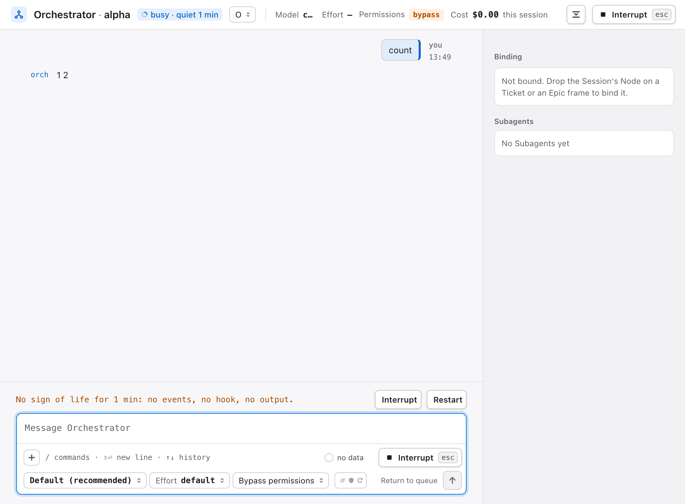

# 06 — UI тишины хода: chip `busy · quiet N min`, Interrupt и Restart на hint line

Type: task
Status: claimed 2026-11-17T10:24Z
PR: #1958
Blocked by: 03, 04
Source: [spec.md](../spec.md), «Ticket-ы», 6; «Решение», 2; «Путь пользователя», B, шаги 1–2; «Экран»; «Решения по
реализации» → «Признаки жизни Session и тишина», пункт «UI»; «Решения по test-ам», UI; «Решено без владельца», 1 и 8

Кто: агент.

Не платформенный Ticket (renderer и IPC Session, без Terminal, окон и меню). Глубина ревью — `medium`. Снимок экрана
chip-а и hint line — в «Итог».

## Что происходит

- После Ticket-а 03 main шлёт `quietSince` — с какого момента ход Session без признаков жизни; порог пометки
  `QUIET_MARK_MS` — в `src/shared/agent/quiet.ts`.
- Chip Session: `busy` (`src/renderer/session/format.ts:9`) значит только «A turn runs»
  (`docs/features/sessions.md:61`).
- Пункты hint line composer-а собираются по glob (`src/renderer/session/composer/index.ts:46`); образец —
  `ContinueCountdown.tsx` (`src/renderer/session/composer/ContinueCountdown.tsx:26–30`).
- Interrupt — `agent.interrupt` (`src/shared/ipc/agent.ts:102`, обработчик — `src/main/ipc/agent.ts:334`).
- Restart с тем же разговором уже есть: `restartProcess` (`src/main/agent/session.ts:842`, worfy-mcp-live 03), но его
  зовут только MCP-действия через `restartFor` (`session.ts:696`, `:807`). `restartFor` отказывает unattended Session
  (`session.ts:808`), а при живых background tasks отвечает причиной (`keptForTasks`, `session.ts:828`, worfy-mcp-live 13).
- Ticket 04 уже правил `docs/features/sessions.md` (Subagent-ы); этот Ticket правит раздел о состоянии Session.

## Что делаем

1. Chip: при `quietSince` старше порога — `busy · quiet N min` (N — целые минуты); иначе `busy`, как сегодня.
2. Новый пункт hint line `src/renderer/session/composer/QuietTurn.tsx` (по образцу `ContinueCountdown.tsx`): текст `No sign
   of life for N min: no events, no hook, no output.` и кнопки Interrupt и Restart. Пункт виден только при тишине.
3. Interrupt — тот же `agent.interrupt`, что у кнопки Session.
4. Restart — новый канал `agent.restart` (`src/shared/ipc/agent.ts`, `src/main/ipc/agent.ts`) и публичный метод Session,
   который зовёт `restartProcess`:
   - unattended или остановленная Session — отказ, как у `restartFor`;
   - живые background tasks — ответ с причиной, ничего не перезапускается (тот же текст, что `keptForTasks`); hint line
     показывает причину;
   - иначе — ход прерван, старый процесс вышел (ADR-0064), новый идёт с тем же разговором.
5. `docs/features/sessions.md`: состояние `busy · quiet N min`, что не считается тишиной, Interrupt и Restart на hint line,
   отказ Restart при живых background tasks.
6. Один e2e на fake agent (`WORFY_AGENT=fake`, `src/main/agent/fake-query.ts`), чей ход молчит; порог задаёт test
   (переменная окружения или параметр fake agent — как уже делают другие e2e). Строка в `scripts/e2e-specs.table.json`,
   если новый spec-файл покрывает только свои пути. Локально e2e не запускать — его гоняет CI.

## Готово, когда

- [ ] Component test `test/unit/quiet-turn.test.tsx` (новый): пункт hint line виден при тишине дольше порога, скрыт при
      `quietSince: null` и в `needs_permission`; кнопки зовут `agent.interrupt` и `agent.restart`.
  - evidence: test-run pass · `pnpm test` exit 0 (test/unit/quiet-turn.test.tsx) · mac - · 33a4b735ddec0a2031772022f0472374e0dbba97
- [ ] Component test: chip показывает `busy · quiet 14 min` при тишине 14 минут и `busy` без неё.
  - evidence: test-run pass · `pnpm test` exit 0 (test/unit/session-state-chip.test.tsx) · mac - · 33a4b735ddec0a2031772022f0472374e0dbba97
- [ ] Contract test `test/contract/agent-session.test.ts`: `agent.restart` на Session с живой background task-ой —
      ответ с причиной, процесс тот же; без задач — один новый процесс с тем же разговором, старый вышел до старта
      нового; unattended Session — отказ.
  - evidence: test-run pass · `pnpm test` exit 0 (test/contract/agent-session.test.ts, agent.restart) · mac - · 33a4b735ddec0a2031772022f0472374e0dbba97
- [ ] e2e `test/e2e/quiet-turn.spec.ts` (новый): fake agent молчит → chip `busy · quiet N min` и hint line; Interrupt
      кончает ход; Restart поднимает Session с тем же разговором, и второго процесса на тот же транскрипт нет.
  - evidence: screenshot pass · `../evidence/06-quiet-turn.png` chip busy, quiet 1 min and the hint line with Interrupt and Restart · mac dev · 1436c10e17c5226198b1ed97c5b93a8e71fcd9bb · scrub: 2026-11-17
- [ ] `docs/features/sessions.md` описывает `quiet`, исключения, Interrupt и Restart.
  - evidence: commit pass · Session chip shows busy, quiet N min; the hint line offers Interrupt and Restart (worfy-stuck-agents 06) · - - · 42ac111ed
- [ ] `pnpm lint`, `pnpm typecheck`, `pnpm test` — exit 0; `ci-ok` зелёный на head PR (в нём e2e).
  - evidence: gate pass · `gate fast` exit 0 · mac - · 33a4b735ddec0a2031772022f0472374e0dbba97

## Тесты

- `test/unit/quiet-turn.test.tsx` (новый), component test chip-а (рядом с тестами `format.ts`),
  `test/contract/agent-session.test.ts`, `test/e2e/quiet-turn.spec.ts` (новый) — каждый test сначала красный.

## Где в коде

- `src/renderer/session/format.ts`
- `src/renderer/session/composer/QuietTurn.tsx` (новый)
- `src/main/agent/session.ts`
- `src/shared/ipc/agent.ts`
- `src/main/ipc/agent.ts`
- `docs/features/sessions.md`
- `test/unit/quiet-turn.test.tsx` (новый)
- `test/contract/agent-session.test.ts`
- `test/e2e/quiet-turn.spec.ts` (новый)
- `scripts/e2e-specs.table.json`

Только читать: `src/shared/agent/quiet.ts` (Ticket 03), `src/renderer/session/composer/ContinueCountdown.tsx`,
`src/renderer/session/composer/index.ts`, `src/main/agent/fake-query.ts`.

## Вне скоупа

- `turn-hung` в Autopilot — Ticket 09.
- Автоматический Interrupt или Restart — нет (ADR-0050; вопрос 3 spec-а).

## Итог

- Снимок Session view Orchestrator-а во время тихого хода: chip в заголовке — `busy · quiet 1 min`, над полем ввода —
  hint line `No sign of life for 1 min: no events, no hook, no output.` с кнопками Interrupt и Restart.

  

- Как снят: сборка `pnpm build` этой ветки, Playwright `_electron` со своим скриптом (не через `pnpm test:e2e`), fake
  agent (`WORFY_AGENT=fake`, сценарий `interrupt`: ход пишет «1 2» и молчит), временный `WORFY_DATA_DIR` с проектом
  `alpha`, `WORFY_QUIET_MARK_MS=2000`. После отправки `count` скрипт ждал 60 с тишины, пока chip не стал
  `quiet 1 min`, снял элемент Session view и нажал Interrupt (chip вернулся в `idle`).
- В пикселях проверено: имени пользователя, хоста, домашнего пути, настоящих проектов и id нет; видны только
  проект-fixture `alpha`, время сообщения и текст fake agent-а.
