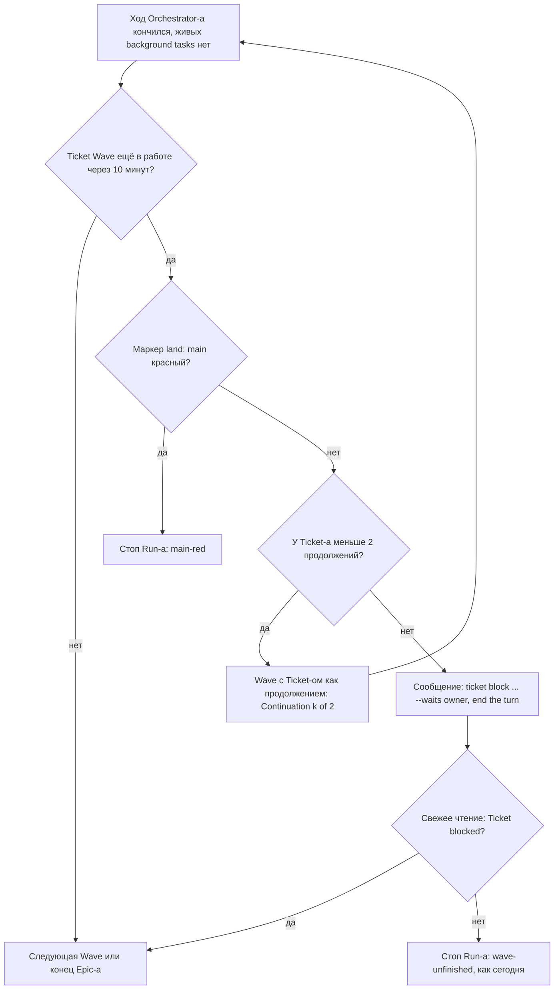

# worfy-stuck-agents: застрявший агент не останавливает Run

Status: черновик 2026-11-13 из исследования конкурентов, владельцем не принят
Critic: [docs/product/critic/worfy-stuck-agents-2026-11-14.md](../../docs/product/critic/worfy-stuck-agents-2026-11-14.md) — Split.
Source: исследование конкурентов 2026-11-13, [папка dossier-ов](../../docs/research/2026-11-13-competitors/). Четыре
проверенные идеи: reliability-cost-1 (детектор зацикливания агента), reliability-cost-12 (watchdog тишины хода —
проверка, что идущий ход ещё подаёт признаки жизни), orchestration-3 (застрявший Ticket не останавливает весь Run),
reliability-cost-22 (эскалация модели по результату). Dossier-ы:
[OpenHands](../../docs/research/2026-11-13-competitors/openhands.md),
[Factory Droids](../../docs/research/2026-11-13-competitors/factory-droids.md),
[Codex app](../../docs/research/2026-11-13-competitors/codex-app-codex-in-the-chatgpt-desktop-app.md),
[Cursor](../../docs/research/2026-11-13-competitors/cursor-agents-window-cloud-agents-and-automation.md),
[OpenAI Symphony](../../docs/research/2026-11-13-competitors/openai-symphony.md),
[Division Swarm](../../docs/research/2026-11-13-competitors/division-swarm.md),
[Claude Code cloud sessions and Projects](../../docs/research/2026-11-13-competitors/claude-code-cloud-sessions-and-projects.md),
[Google Antigravity](../../docs/research/2026-11-13-competitors/google-antigravity.md),
[JetBrains Air](../../docs/research/2026-11-13-competitors/jetbrains-air.md),
[Gas Town](../../docs/research/2026-11-13-competitors/gas-town.md),
[Claude Code plugins and marketplaces](../../docs/research/2026-11-13-competitors/claude-code-plugins-and-marketplaces.md),
[Kiro](../../docs/research/2026-11-13-competitors/kiro.md),
[GitHub Copilot app](../../docs/research/2026-11-13-competitors/github-copilot-app.md).
Прежний разбор: [застрявшие Ticket-ы, 2026-10-15](../../docs/research/2026-10-15-застрявшие-ticket-ы.md). Термины —
[CONTEXT.md](../../CONTEXT.md): Run, Wave, Ticket, Wait, Span, Run history, Subagent, Background task, Orchestrator,
Eco mode, Orchestrator modes, Auto-continue, Shadow mode, Fault scenario, Recovery invariant.
Depends on (по `epic-status` на 2026-11-14): worfy-autopilot-queue (очередь Epic-ов в одном Run-е, closed 21/21),
worfy-failures (failure records gate-а, closed 10/10), worfy-retry (Auto-continue после ошибки API и Limits, closed
14/14), worfy-flight-recorder (Run history, closed 28/28), worfy-throughput (модель и effort по роли, Eco mode; 63/66),
worfy-multi-vendor (Codex как второй Vendor; 47/48).
Ticket-ы: Epic `worfy-stuck-agents`, 15 Ticket-ов; номер в списке «Ticket-ы» — номер Ticket-а, с `01`. Файлов
`issues/` нет: их пишут после приёмки spec-а.

## Проблема

Ночной Run останавливается целиком из-за одного Ticket-а, который остался в работе или повторился в следующей Wave
(пакете Ticket-ов, идущих параллельно). А агент, который раз за разом запускает ту же упавшую команду или молчит
посреди хода, часами тратит Limits, и человек узнаёт об этом только утром.

Как это устроено сейчас:

- **Один Ticket останавливает весь Run.** Три причины остановки касаются одного Ticket-а, а останавливают всё
  (`src/shared/autopilot/cycle.ts:52`, таблица «Why a run stops» — `docs/features/autopilot-faults.md:140–142`):
  - `wave-unfinished` — Ticket Wave остался в работе 10 минут после конца хода (`SETTLE_MS`, `cycle.ts:78`;
    решение — `cycle.ts:327–328`);
  - `no-progress` — следующая готовая Wave совпала с только что законченной (`cycle.ts:274`). ADR-0024 (конец Wave и
    причины остановки, `docs/adr/0024-autopilot-wave-end-and-keep-awake.md`, пункт 3) прямо говорит: второй раз то же
    самое не шлётся;
  - `background-stalled` — background tasks час не дали ни события, ни изменения output file (`BACKGROUND_STALL_MS`,
    `cycle.ts:87`; решение — `cycle.ts:321–323`).
- **Очередь Epic-ов тоже встаёт.** К следующему Epic-у Run ведут только `tickets-done`, `blocked-tickets` и
  `no-ready-wave` (`src/shared/autopilot/epic-queue.ts:33`, `:73`); «anything else stops the Run» (`epic-queue.ts:11–12`,
  `docs/features/autopilot.md:127`).
- **Красный main и застрявший Ticket выглядят одинаково.** При красном push run CI на main `land` держит PR-ы с кодом
  (`harness/skills/epic-wave/SKILL.md:1433–1440`), Ticket-ы остаются `claimed`, и Run видит те же `no-progress` или
  `wave-unfinished` (`.scratch/worfy-autopilot-queue/spec.md:203–204`).
- **Замолчавший ход Run не замечает.** У фазы `turn` цикла нет таймера: из неё выводят только конец хода, ошибка,
  закрытие Session и Stop (`cycle.ts:101`, `:310`). Session не помнит время последнего события (`onEvent`,
  `src/main/agent/session.ts:1058`). `busy` значит только «A turn runs» (`docs/features/sessions.md:61`); Subagent без
  записи о конце остаётся `running`, сколько бы его файл ни стоял (`sessions.md:423`). Живой пример: Codex Session
  висела `busy` после ответа, пока Stop hook невидимо до 900 с гонял gate
  (`.scratch/worfy-multi-vendor/issues/47-codex-session-висит-после-ответа.md:22`).
- **Зацикливание никто не считает.** PreToolUse hook `guard.mjs` (`harness/hooks/hooks.json:155–166`) решает по одному
  вызову и не помнит прошлых; PostToolUse hook-а у Harness нет. Stop hook держит ход при красном gate не больше
  `MAX_BLOCKS = 2` раз и отпускает с фразой «the quality gate is still red» (`harness/hooks/stop.mjs:6–9`, `:54`,
  `:273–281`; `docs/features/gate-and-github.md:92`), не глядя, те же ли test-ы падают. Разбор 2026-10-15 насчитал 0
  случаев «одна и та же падающая команда», но оговорился: Journal Run-а команд не пишет, а транскрипты не читались
  (`docs/research/2026-10-15-застрявшие-ticket-ы.md:113`, `:149–152`).
- **Модель не меняется по результату.** Eco mode ставит ролям Sonnet с effort medium
  (`docs/features/orchestrator-modes.md:30–33`); Opus — только явным выбором на Ticket
  (`.scratch/worfy-throughput/spec.md:771–774`, порядок источников — `harness/skills/ship-ticket/step-7-review.md:17–25`).
  Новый implementer после REJECTED идёт на той же модели (`harness/skills/epic-wave/SKILL.md:774–779`).

Утром человек видит тост `Run stopped: wave-unfinished …` (`docs/features/flight-recorder.md:23`), а остальные Epic-и
очереди не начаты.

## Решение

Три механизма и один необязательный режим. Все держат три правила:

- ADR-0002 (worfy — вид над workflow): статус Ticket-а пишут агенты через `ticket`, worfy в Project ничего не пишет
  (`docs/adr/0002-worfy-is-a-view-over-the-workflow.md:5`; инвариант И7 — `docs/features/autopilot-faults.md:234`).
- ADR-0029 и ADR-0050 (Autopilot ждёт background tasks; Stop прерывает Orchestrator только по слову человека): worfy
  не убивает background tasks и не прерывает ход по своим причинам остановки
  (`docs/adr/0029-autopilot-waits-for-background-tasks.md:71–73`,
  `docs/adr/0050-autopilot-user-stop-interrupts-orchestrator.md:81–83`).
- Слова модели не возвращаются к ней как указания (`src/shared/agent/continue-plan.ts:28`).

1. **Застрявший Ticket откладывается, Run идёт дальше** (Autopilot). Вместо остановки по `wave-unfinished`,
   `no-progress` и `background-stalled` — три ступени с потолком на каждый Ticket:
   - *Продолжение.* Run шлёт Orchestrator-у продолжение из фактов worfy: номера Ticket-ов, статусы, номер попытки,
     имена background tasks и минуты без признаков жизни. Не больше двух продолжений на Ticket за Run.
   - *Отложить.* После потолка Run просит Orchestrator выполнить `ticket block <epic> <NN> "stuck: …" --waits owner`.
     Ticket с `Waits: owner` ждёт владельца, как и Ticket-ы, заблокированные только им (`epic-queue.ts:37–58`); когда
     готовых Ticket-ов больше нет, Epic кончается `waits-owner`, и очередь идёт к следующему Epic-у
     (`epic-queue.ts:81`). Независимые Ticket-ы того же Epic-а идут в следующих Wave-ах: `readyWave` не берёт
     `blocked` (`src/shared/workflow/waves.ts:179`).
   - *Стоп.* Если и после этого Ticket в работе — Run останавливается с той же причиной, что сегодня.
   - Перед продолжением Run проверяет маркер красного main, который пишет `land`. Красный main — стоп всего Run-а с
     новой причиной `main-red`, без продолжений: правило «красный CI main — весь Run» остаётся
     (`.scratch/worfy-autopilot-queue/spec.md:107`).
2. **Watchdog тишины хода.** Session помнит время последнего признака жизни. Тишиной не считаются открытый запрос
   разрешения, идущий hook, растущий output file background task-а, растущий вывод gate-а и занятый e2e lock. На тишине
   chip Session говорит `busy · silent 14 min`, а на hint line появляются Interrupt и Restart с тем же разговором —
   только по нажатию человека. Такая же пометка — на Subagent Node. В Autopilot тишина дольше порога останавливает Run
   с новой причиной `turn-hung` и отдаёт Session человеку; ничего не прерывается и не убивается.
3. **Детектор зацикливания в Harness.** Новый PostToolUse hook ведёт call log агента: последние 20 вызовов (tool, хэш
   ввода, исход). Шаблоны: тот же вызов с тем же неуспешным исходом 3 раза; правка туда и обратно; A-B-A-B. На 3-м
   повторе агент получает одну подсказку, на 4-м `guard.mjs` отказывает. Отчёт implementer-а получает поле `blocked`,
   и `epic-wave` блокирует Ticket с причиной `loop: …`. Stop hook отпускает агента, когда после блока повторился тот же
   отпечаток failure record (отсортированный список упавших test-ов красного run-а gate-а). Работает на Claude Code и
   Codex, в Session и в background implementer-ах.
4. **Эскалация модели** (необязательно, вопрос 5). В Eco mode новый implementer круга доработки идёт на Opus, если
   причина — проверяемое событие: тот же отпечаток дважды, исчерпан `MAX_BLOCKS`, REJECTED, narrow round или
   `blocked: loop`. Только вверх и один раз на Ticket; слово владельца и аргумент skill-а стоят выше.

### Путь пользователя

**A. Ночной Run над очередью из трёх Epic-ов.**

1. Вечером владелец запускает Run над `epic-a`, `epic-b`, `epic-c` и уходит.
2. Wave 2 `epic-a` — Ticket-ы 05 и 07. Ход Orchestrator-а кончился: 07 `done`, 05 остался `claimed` (implementer упал,
   PR нет).
3. Через 10 минут Run читает маркер `land`: main зелёный. Run начинает следующую Wave, где 05 идёт продолжением:
   первая строка `Continuation 1 of 2 for ticket 05: still claimed 10 min after the turn ended.`, дальше обычная Wave
   command, как у Run-а после Force stop (`resumable`, `src/shared/actions/render-template.ts:172–192`). Skill
   `epic-wave` подхватывает Ticket по разделу «How to resume a wave» (`harness/skills/epic-wave/SKILL.md:1834`).
4. После второго продолжения 05 всё ещё в работе. Run шлёт Orchestrator-у: `Ticket 05 stayed claimed after 2
   continuations. Run: ticket block epic-a 05 "stuck: claimed after 2 continuations" --waits owner. Then end the turn.`
5. Свежее чтение: 05 `blocked`, `Waits: owner`. Ticket 09 зависит от 05 — тоже ждёт владельца. Остальные Ticket-ы
   `epic-a` идут дальше; когда готовых нет, Epic кончается `waits-owner`, и Run идёт к `epic-b`.
6. Утром в Run history у 05 попытки `#2` и `#3` и красный `!` с `Blocked reason: stuck: claimed after 2 continuations`
   и `Waits: owner` (`docs/features/flight-recorder.md:122–123`); тост называет `1 blocked`.

**B. Implementer крутится на одной команде.**

1. Implementer Ticket-а 12 в третий раз запускает `pnpm vitest run test/unit/x.test.ts` с тем же exit code 1 и тем же
   выводом.
2. PostToolUse hook добавляет одну подсказку: `This is the 3rd time this call ended the same way. Change the approach,
   or stop and report "blocked": {"reason": "loop"}.`
3. Четвёртый такой вызов `guard.mjs` отказывает: `Refused: the same call ended the same way 3 times (loop). Report
   blocked: loop.`
4. Implementer кончает с `"blocked": {"reason": "loop", "detail": "pnpm vitest … exit 1 ×3"}`. Orchestrator по правилу
   `epic-wave` делает `ticket block <epic> 12 "loop: …" --waits owner` (с эскалацией — сначала один круг на Opus).
5. Run видит `blocked` и идёт дальше, как в пути A, шаг 5.

**C. Ход замолчал.**

1. Днём человек видит chip Orchestrator-а `busy · silent 14 min`, на hint line — `No sign of life for 14 min: no
   events, no hook, no output.` и кнопки Interrupt и Restart.
2. Interrupt прерывает ход (та же кнопка Session, что сегодня). Restart прерывает ход, ждёт выхода старого процесса
   (ADR-0064 — relaunch ждёт выхода старого процесса) и поднимает новый с тем же разговором (`session.ts:809`).
3. В Autopilot через 30 минут тишины Run останавливается с `turn-hung`. Session уходит человеку, как после любой
   другой остановки (`docs/features/autopilot-faults.md:111–118`): ход не прерван, background tasks живут.

### Лестница Run-а



`no-progress` идёт той же лестницей: та же Wave шлётся снова, пока у её Ticket-ов есть попытки. `background-stalled` —
тоже, но продолжение — сообщение в ту же Session: её background tasks живут в её процессе.

### Экран

```
Шапка Session Orchestrator-а
┌─────────────────────────────────────────────────────────────────────────────┐
│ Orchestrator · epic-a                                 busy · silent 14 min  │ ← chip
├─────────────────────────────────────────────────────────────────────────────┤
│ … транскрипт …                                                              │
├─────────────────────────────────────────────────────────────────────────────┤
│ No sign of life for 14 min: no events, no hook, no output.                  │ ← hint line
│                                                  [Interrupt]   [Restart]    │
│ ┌─────────────────────────────────────────────────────────────────────────┐ │
│ │ composer                                                                │ │
│ └─────────────────────────────────────────────────────────────────────────┘ │
└─────────────────────────────────────────────────────────────────────────────┘

Subagent Node (260×84)                    Run history утром
┌──────────────────────────────────┐      Wave 2 · epic-a   05 ████
│ worfy:implementer · sonnet       │      Wave 3 · epic-a   05 #2 ███
│ running 52 min · silent 21 min   │      Wave 4 · epic-a   05 #3 ██ ! stuck: claimed after 2 continuations
│ первая строка итога              │                        07 ██████ done
└──────────────────────────────────┘      Wave 1 · epic-b   …
```

## Как это сделано у конкурентов

| Продукт | Что делает | Что берём |
|---|---|---|
| [OpenHands](../../docs/research/2026-11-13-competitors/openhands.md) | Детектор в последних 20 событиях, 4 шаблона: то же действие и результат 4 раза, действие с ошибкой 3 раза, 3 сообщения без tools, A-B-A-B 6 раз → STUCK (`StuckDetectionThresholds`). Бот самого вендора ответил «I'm on it» 191 раз за ~4 часа в одном issue. | Окно из 20 вызовов и шаблоны |
| [Factory Droids](../../docs/research/2026-11-13-competitors/factory-droids.md) | 3 одинаковых вызова — подсказка, 6 — стоп; повтор с новым результатом разрешён. Mission встаёт с `feature_retry_limit_exceeded`; `subagentInactivityTimeout` 3 минуты. | Подсказка до отказа; новый исход — не цикл |
| [Codex app](../../docs/research/2026-11-13-competitors/codex-app-codex-in-the-chatgpt-desktop-app.md) | `/goal` блокируется после 3 пустых автоматических ходов или одного препятствия 3 хода подряд; статусы blocked, usage_limited, budget_limited. Агент съел 5-часовое окно, крутясь на месте. | Потолок продолжений; `blocked` вместо траты |
| [Cursor](../../docs/research/2026-11-13-competitors/cursor-agents-window-cloud-agents-and-automation.md) | Stop hook `followup_message` с `loop_limit` 5; Bugbot Autofix — не больше 3 попыток. | Потолок продолжений |
| [OpenAI Symphony](../../docs/research/2026-11-13-competitors/openai-symphony.md) | `stall_timeout_ms` 5 минут без событий: worker убит, повторяется только его работа; continuation turns «#N of M». После отмены остался живой app-server. | Текст «Continuation k of N»; новый процесс — только после выхода старого |
| [Division Swarm](../../docs/research/2026-11-13-competitors/division-swarm.md) | Watchdog помечает долгий turn, затем «нет вывода»; `platform.run_stalled` после 300 с. Четыре расследования лежали, пока их не закрыли таймеры. | Пометка тишины |
| [Claude Code cloud sessions and Projects](../../docs/research/2026-11-13-competitors/claude-code-cloud-sessions-and-projects.md) | Баннер «Claude hasn't responded» с Restart Claude, частичный ответ теряется. Сессию нельзя было прервать, кредиты шли. | Restart с тем же разговором, по нажатию |
| [Google Antigravity](../../docs/research/2026-11-13-competitors/google-antigravity.md) | Sentinel перезапускает зависшего агента по времени изменения его файлов прогресса. | Output file как признак жизни (у worfy уже есть) |
| [JetBrains Air](../../docs/research/2026-11-13-competitors/jetbrains-air.md) | После потери сети агент висит в Running; выход — Stop (IJAI-6125). | Тишина должна быть видна |
| [Gas Town](../../docs/research/2026-11-13-competitors/gas-town.md) | «Float over integer»: одна застрявшая работа не останавливает epic. Не больше 3 перезапусков, сброс — `gt sling respawn-reset`; `mountain:skipped` после 3 неудач. Daemon никогда не убивает worker-ов. Пользователи писали cron-скрипты с nudge. | Отложить Ticket и идти дальше; не убивать |
| [Claude Code plugins and marketplaces](../../docs/research/2026-11-13-competitors/claude-code-plugins-and-marketplaces.md) | Замолчавший агент workflow перезапускается до 5 раз; потом внутри `parallel()` его вызов даёт `null`, а при прямом `await` падает весь run. | Сбой одного не роняет остальных |
| [Kiro](../../docs/research/2026-11-13-competitors/kiro.md) | 3 одинаковые ошибки — «Loop detected». Auto переводит на сильную модель только вверх: 69,37 % против 63,96 % у начальной и 70,57 % у сильной; в 80,48 % случаев хватило начальной. Модель не видна пользователю (#8903). | Эскалация вверх; модель видна |
| [GitHub Copilot app](../../docs/research/2026-11-13-competitors/github-copilot-app.md) | Fusion: шаблоны Single, Cascade и Critique. Жалоба #211890: Opus для commit, месяц токенов за день. | Эскалация только по событию |

## Истории пользователя

1. Как владелец, я запускаю Run над очередью Epic-ов на ночь и хочу, чтобы один застрявший Ticket не остановил
   остальные Epic-и.
2. Как владелец, я хочу, чтобы Run сам попробовал продолжить Ticket, оставшийся в работе, прежде чем отложить его.
3. Как владелец, я хочу утром видеть отложенные Ticket-ы с причиной и числом попыток в Run history и в тосте остановки.
4. Как владелец, я хочу, чтобы при красном main Run остановился сразу и назвал причину, а не откладывал невиновные
   Ticket-ы.
5. Как пользователь, я хочу видеть, что ход Session молчит и сколько минут, отдельно от хода, который ждёт моего
   разрешения или идущего hook-а.
6. Как пользователь, я хочу одним нажатием прервать замолчавший ход или перезапустить Session с тем же разговором.
7. Как пользователь, я хочу видеть на Subagent Node, что background implementer давно молчит.
8. Как владелец, я хочу, чтобы замолчавший ход в Autopilot не держал Run всю ночь, а остановил его с понятной
   причиной, не убивая чужую работу.
9. Как владелец, я хочу, чтобы агент, который в третий раз запускает ту же упавшую команду, получил подсказку, в
   четвёртый — отказ, а Ticket ушёл в `blocked` с причиной `loop`.
10. Как владелец, я хочу, чтобы Stop hook не держал агента на том же наборе упавших test-ов, а отпускал его с
    `blocked`.
11. Как пользователь Codex, я хочу того же: подсказки, отказа и пометки тишины.
12. Как владелец, у которого Eco mode, я хочу, чтобы трудный Ticket после проверяемой неудачи один раз получил Opus, и
    видеть, где это случилось.

## Решения по реализации

### Цикл и Run: продолжение, отложить, `main-red`

- **Решения цикла остаются чистыми.** `src/shared/autopilot/cycle.ts` получает счётчик попыток на Ticket за Run и два
  новых эффекта: `continue-tickets` (Ticket-ы, номер попытки, причина) и `give-up` (Ticket-ы, причина). Меняются три
  места, где сегодня `stop(...)`:
  - `settle-timeout` в фазе `settling` (`cycle.ts:327–328`): Ticket-ы в работе под потолком → `continue-tickets`, над
    потолком → `give-up`;
  - `sameSet` в `evaluate()` (`cycle.ts:274`): та же Wave шлётся снова, пока у её Ticket-ов есть попытки; иначе
    `give-up`;
  - `tasks-timeout` с живыми background tasks (`cycle.ts:321–323`): `continue-tickets` с причиной `background-stalled`.
  После `give-up` и одного хода Orchestrator-а прежние причины остаются концом: Ticket всё ещё в работе →
  `wave-unfinished`, та же Wave → `no-progress`, background tasks молчат → `background-stalled`. Счётчик живёт в Run-е; новый Run
  начинает с нуля.
- **Новые причины остановки** `main-red` и `turn-hung`: в `AUTOPILOT_STOP_REASONS` (`cycle.ts:52`), в `STOP_OUTCOMES`
  как `failed` (`src/shared/flight-recorder/from-journal.ts:148`), в таблице «Why a run stops»
  (`docs/features/autopilot-faults.md:132`). Обе останавливают весь Run: `epicOutcome` пропускает к следующему Epic-у
  только концы Epic-а (`epic-queue.ts:73`).
- **Journal.** Новые строки `ticket-continued` (`ticket`, `attempt`, `of`, `cause`: `wave-unfinished` | `no-progress` |
  `background-stalled`) и `ticket-given-up` (`ticket`, `cause`, `attempts`) — в списке видов и схемах
  `src/shared/autopilot/journal.ts:407–431`, `:566–571`. Продолжение через Wave — обычная `wave-started` с полем
  `continuation`, так что инвариант И1 «одна команда `/epic-wave` на `wave-started`» держится
  (`docs/features/autopilot-faults.md:225`).
- **Продолжение — Wave command, а не новый текст.** Для `wave-unfinished` и `no-progress` Run строит следующую Wave
  тем же `runWaveState`, что и Run после Force stop: Ticket-ы в работе идут как `resumable`, готовые — рядом
  (`src/shared/actions/render-template.ts:97`, `:172–192`; `resumableOf` — `src/main/autopilot/run.ts:760`). Над
  командой — одна строка worfy, например `Continuation 1 of 2 for tickets 05, 07: still claimed 10 min after the turn
  ended.` Wave после первой и так идёт в новую SDK session (worfy-throughput 52 — новая SDK session на каждую Wave,
  `run.ts:14–22`), где `wave-brief` даёт свежий контекст.
- **`background-stalled` — сообщение в ту же Session.** Её background tasks живут в её процессе, и после
  `tasks-timeout` Wave и сегодня идёт в текущую Session (`run.ts:19–22`). Текст:
  `Continuation 1 of 2: background tasks impl-05 (61 min), gate fast (61 min) gave no sign of life. Check them. Let a
  task go on, or stop it and resume its ticket, or block the ticket.` Остановить background task может только Orchestrator —
  worfy их не трогает (ADR-0029, ADR-0050).
- **Тексты.** Новый чистый модуль `src/shared/autopilot/continuation.ts` собирает продолжение и `give-up` из фактов
  worfy. `lastText` — последние слова модели, которые Run кладёт в `run-stopped` (`run.ts:2898`), — туда не попадают.
- **Отложить — руками Orchestrator-а.** Сообщение `give-up` называет точную команду
  `ticket block <epic> <NN> "stuck: <cause> after <k> continuations" --waits owner` (`harness/bin/ticket`) и просит
  кончить ход. `Waits: owner` выбран потому, что только он даёт очереди идти дальше (`epic-queue.ts:37–39`, `:80`):
  `Waits: agent` остановил бы Run в конце Epic-а. Кто пишет статус — вопрос 1.
- **Красный main — маркер `land`.** `harness/bin/land` уже читает push run-ы CI на main и знает, что он красный
  (`harness/bin/land:360–366`, `:395`, `:422`). Он начинает писать файл `main-red-<key>.json` (sha, PR-виновник, время,
  URL run-а) в папку состояния gate-а и удалять его на зелёном main. worfy читает его там же, где маркеры
  `red-<key>-<tag>` (`src/main/gate/state.ts:1–25`, `:135`). Перед любым продолжением и `give-up` Run читает маркер;
  есть — стоп `main-red`. Своё чтение `gh run list` отклонено: имя CI workflow знает только brief `land`
  (`harness/skills/epic-wave/SKILL.md:1258–1270`), правило пропуска run-ов документов пришлось бы повторить, а
  инвариант И2 разрешает Run-у только `pr list`, `auth status`, `auth token` и `api repos/<owner>/<repo>`
  (`test/autopilot-invariants.ts:124–132`). Устаревший маркер даёт сегодняшнюю остановку, не хуже.
- **Status line Autopilot** (`src/renderer/canvas/actions/AutopilotAction.tsx`) во время продолжения говорит
  `continuing 05 (1 of 2)`.
- **Amendment-ы.** ADR-0024 (пункт 3 и `wave-unfinished`), ADR-0029 (сообщение Orchestrator-у при `background-stalled`)
  и ADR-0046 (один круг доработки и narrow round, `docs/adr/0046-autopilot-narrow-round-without-owner.md:8–15`: отчёт
  `blocked: loop` блокирует Ticket без круга) получают датированные Amendment-ы в Ticket-е документов.

### Признаки жизни Session и тишина

- **Время последнего признака жизни.** `onEvent` (`session.ts:1058`) запоминает время каждого события (у событий есть
  `at`, `src/shared/agent/events.ts:79`), включая `task_activity` (`events.ts:295`). Driver-ы перестают молчать о
  работе, которую не показывают:
  - Claude: `hook_started`, `hook_progress` и `thinking_tokens` сейчас не дают событий
    (`src/shared/vendors/claude/events.ts:162–165`); они станут скрытым признаком жизни, без строки в транскрипте;
  - Codex: `hookStarted` сообщает только о Stop hook (`src/main/vendors/codex/items.ts:346–350`); признаком жизни станет
    любой hook run.
- **Что не тишина:** `needs_permission` (`session.ts:1050–1054`); hook между началом и концом (gate в TaskCompleted идёт
  до 900 с, `harness/hooks/hooks.json:82–92`); изменение output file background task-а
  (`src/main/autopilot/task-output.ts:1`, worfy-polish 61 — output file как признак жизни); рост `.run-<tag>-<pid>.out`
  gate-а (`harness/hooks/gate.mjs:727`) в папке состояния, которую worfy уже читает (`src/main/gate/state.ts`); e2e lock
  с живым holder-ом (`readE2eLock`, `src/main/workflow/stages.ts:98`).
- **Пороги** решены без владельца, константы рядом с `SETTLE_MS` (`cycle.ts:78`): пометка — после 10 минут тишины,
  `turn-hung` — после 30. Test-ы двигают их через deps Run-а, как сегодня `settleMs` и `backgroundStallMs`
  (`run.ts:402–403`, `:439–440`).
- **UI.** Chip: `busy` (`src/renderer/session/format.ts:9`) на тишине даёт `busy · silent N min`. Hint line: новый пункт
  composer-а по образцу `ContinueCountdown.tsx` (`src/renderer/session/composer/ContinueCountdown.tsx:26–30`; пункты
  собираются по glob, `composer/index.ts:46`) с Interrupt (та же кнопка Session, `agent.interrupt`) и Restart. Restart
  открывает человеку закрытый сегодня `restartProcess` (`session.ts:809`); unattended Session он отказывает, как
  `restartFor` (`session.ts:788`). Subagent Node (`src/renderer/canvas/nodes/SubagentNode.tsx`) и rail
  (`src/renderer/session/rail/SubagentsRail.tsx`) показывают `silent N min` по времени изменения файла Subagent-а
  (`src/main/claude-home/subagents.ts`) вместо вечного `running` (`docs/features/sessions.md:423`).
- **`turn-hung` в Autopilot.** Фаза `turn` (`cycle.ts:101`, `:301–304`) получает событие `turn-silent` от Run-а, и цикл
  отвечает `stop(state, 'turn-hung')`. Run отдаёт Orchestrator человеку по правилу «After any other stop»
  (`docs/features/autopilot-faults.md:111–118`): ход не прерывается, процесс не перезапускается, background tasks живут
  (вопрос 3). Тишина background implementer-а — не `turn-hung`: она ведёт к `background-stalled` и его продолжению.

### Детектор зацикливания (Harness)

- **Call log.** В `harness/hooks/hooks.json` — новые PostToolUse (все tools) и PostToolUseFailure (у Claude Code туда
  приходит вызов с ошибкой, с полем `error`) → новый `harness/hooks/calls.mjs`. Он пишет в папку состояния gate-а
  `calls/<owner>.jsonl` — последние 20 вызовов агента. `owner` — как у счётчика Stop hook-а: Session, а у Subagent-а
  Session и `agent_id` (`harness/hooks/stop.mjs:144–154`). Строка: tool, хэш нормализованного ввода (команда без
  пробелов по краям; у правки — файл и хэш его содержимого после неё), исход, время.
- **Исход по Vendor-ам.** Claude Code: успех — PostToolUse, неуспех — PostToolUseFailure с `error`; exit code — из
  текста ошибки, это проверяет spike (Ticket 01). Codex: у Bash в `tool_response` только вывод, без exit code; у
  `apply_patch` текст начинается с `Exit code: 0` (`test/fixtures/codex-messages/hooks/PostToolUse.jsonl`). Поэтому
  исход — exit code, где он есть, плюс хэш вывода; на Codex Bash — только хэш вывода.
- **Шаблоны** — чистый модуль `harness/hooks/loop-patterns.mjs`:
  - тот же вызов с тем же неуспешным исходом 3 раза среди последних 20;
  - правка туда и обратно: файл дважды вернулся к содержимому, которое было две правки назад;
  - A-B-A-B: пара вызовов с теми же исходами повторилась 3 раза подряд.
  Повтор с новым исходом — не цикл. Команды ожидания CI (`gh pr checks` и подобные) в счёт не идут: их ненулевой exit
  code значит «ещё идёт».
- **Подсказка и отказ.** На 3-м повторе `calls.mjs` отвечает `additionalContext` (поле вывода PostToolUse), один раз на
  шаблон и агента. На 4-й такой вызов `guard.mjs` отказывает через `permissionDecision: "deny"` с причиной
  (`harness/hooks/guard.mjs:44–55`). Чтобы отказывать и на правках, matcher PreToolUse расширяется с `Bash|apply_patch`
  (`hooks.json:157`) на Edit, Write и MultiEdit. Включать ли отказ сразу — вопрос 4; положение «только запись» пишет
  `would-deny` в call log, как Shadow mode у Auto-approval пишет `would-deny` в Journal (CONTEXT.md, Shadow mode).
- **`blocked` в отчёте.** У отчёта implementer-а (`harness/agents/implementer.md:149–163`) появляется поле
  `"blocked": {"reason": "loop", "detail": "…"}`. `epic-wave` (`harness/skills/epic-wave/SKILL.md:849–877`) на такой
  отчёт делает `ticket block <epic> <NN> "loop: <detail>" --waits owner` и строку `blocked` в отчёте Wave, без круга
  доработки (с эскалацией — после одного круга на Opus).
- **Stop hook по отпечатку.** Отпечаток — отсортированные id упавших test-ов (`testId`,
  `harness/hooks/gate-failures.mjs:189`, без номера строки, который плывёт от commit-а к commit-у), а у шага без test-ов
  — имя шага. `stop.mjs` хранит отпечаток каждого блока рядом со счётчиком (`stop.mjs:154`). Если красный run после
  блока дал тот же отпечаток, второго блока нет: hook отпускает агента с заметкой `The same tests failed again after a
  block: stop and report blocked: loop.` `MAX_BLOCKS = 2` остаётся верхней границей (`stop.mjs:54`).
- **Codex и background implementer-ы.** Hook-и одни на оба Vendor-а. Codex держит новые hook-и обновлённого plugin-а
  выключенными до одобрения в `/hooks`, и Run на Codex до этого отказывает (`docs/features/vendors.md:32`, `:121`).
  Subagent-ы различаются по `agent_id`: на Codex — `harness/hooks/codex-input.mjs`, на Claude Code — поле `agent_id`
  hook input-а внутри subagent-а (типы `@anthropic-ai/claude-agent-sdk`, версия в `package.json` — 0.3.322).
  Read-only агенты (`READ_ONLY_AGENTS` в `codex-input.mjs`: worfy-reviewer, worfy-scout) пишутся в call log, но
  `blocked` им не нужен: Ticket держит implementer.

### Эскалация модели (если вопрос 5 — «да»)

- Новое поле Profile `workflow.escalation`: `off` по умолчанию или `opus-on-failure` (`harness/profiles/README.md`).
  Переключатель `Escalate to Opus after a repeated failure` — в меню Modes под Eco mode
  (`src/renderer/session/composer/Modes.tsx`; запись — `src/main/ipc/eco-mode.ts`, `src/shared/ipc/eco-mode.ts`,
  `src/shared/agent/plan-preset.ts`).
- Правило в `epic-wave` (круг доработки — `SKILL.md:774–779`, narrow round — `:849–877`) и в `ship-ticket`, step 7
  (`step-7-review.md:17–25`): при включённом поле новый implementer круга доработки получает `model: opus`, если
  причина — второй тот же отпечаток, исчерпанный `MAX_BLOCKS`, REJECTED, narrow round или `blocked: loop`. Слово
  владельца (`Ticket <NN> — opus`) и аргумент skill-а стоят выше. Строка отчёта:
  `Model: opus (escalation: same failure twice)`.
- Только вверх и один раз на Ticket; третий тот же отпечаток — `ticket block … "Loop detected: …" --waits owner`.
- Где видно: на Subagent Node — уже сейчас (`type · model`, `SubagentNode.tsx:77`); у Span-а агента в Run history
  модели нет (`src/renderer/flight-recorder/DetailPanel.tsx`) — Ticket её добавляет.

### Run history и тексты

- Слова для `main-red`, `turn-hung`, `ticket-continued` и `ticket-given-up` — `src/renderer/flight-recorder/span-words.ts`.
  Продолжение — новый Span того же вида с номером попытки (`#2`; CONTEXT.md, Span; `docs/features/flight-recorder.md:122`),
  отложенный Ticket — красный `!` с `Blocked reason` и `Waits` (`flight-recorder.md:123`): новой разметки не нужно.
- Тексты Guide, где назван `wave-unfinished`: `src/renderer/guide/topics/autopilot/en.json:104`, `ru.json:104`.

## Решения по test-ам

- **Чистые модули — unit test-ы:** решения цикла (потолок, `give-up`, `main-red`, `turn-hung`, счётчик по Ticket-ам);
  тексты `continuation.ts` (в них нет `lastText`); `epicOutcome` с отложенным Ticket-ом и цепочкой за ним → `waits-owner`;
  `loop-patterns.mjs` (три шаблона, «новый исход — не цикл», команды ожидания); отпечаток failure record.
- **Fault scenarios** (`test/contract/autopilot-faults-*.test.ts`; хелпер `faultRun()` —
  `test/contract/autopilot-faults-setup.ts`; скрипты fake agent — `test/fixtures/agent-scripts/`; gh —
  `test/contract/gh-world.ts`):
  1. Ticket остался `claimed`, продолжение доводит его до `done`;
  2. Ticket `claimed` после двух продолжений → `give-up` → скрипт Orchestrator-а пишет `blocked` с `Waits: owner` → Run
     идёт к следующему Epic-у очереди;
  3. `give-up` без ответа → `wave-unfinished`, как сегодня;
  4. маркер `main-red` → стоп `main-red`, ни одного продолжения;
  5. ход без событий 30 минут (часы двигает test) → `turn-hung`, Session у человека, Interrupt не вызывался;
  6. `background-stalled` → сообщение в ту же Session, без новой SDK session и без убитых background tasks.
  Сценарии 2, 5 и 6 повторяются на Codex (`test/contract/autopilot-faults-codex.test.ts`, fake app-server
  `test/fixtures/codex-app-server/fake-app-server.mjs`). Инварианты И1–И8 (`test/autopilot-invariants.ts`) держатся во
  всех; новое правило: у Ticket-а за Run не больше двух `ticket-continued`, а после `ticket-given-up` он `blocked`, или
  Run кончился прежней причиной.
- **Hook-и Harness:** shell test-ы в `harness/hooks/tests/` по образцу `stop-gate-cycle.test.sh` и
  `guard-silent.test.sh` — call log, подсказка один раз, отказ на 4-м, команды ожидания вне счёта, Stop hook по
  отпечатку. Codex — `test/contract/harness-codex-hooks.test.ts` и `test/contract/codex-fake-hooks.test.ts` на fixture-ах
  `test/fixtures/codex-messages/hooks/`; Claude Code — на fixture-ах, которые запишет spike.
- **UI:** component test chip-а и пункта hint line; один e2e в собранном приложении на fake agent (`WORFY_AGENT=fake`,
  `src/main/agent/fake-query.ts`), чей ход молчит: chip, Interrupt, Restart без второго процесса на тот же транскрипт.
- Ни один test не зовёт модель и настоящий binary Codex.

## Не в этом Epic-е

- worfy сам не пишет статус Ticket-а (ADR-0002). Если вопрос 1 решится вариантом (б) — отдельный ADR.
- worfy не убивает и не останавливает background tasks (ADR-0029, ADR-0050); остановить зависший background task может только
  Orchestrator по сообщению продолжения.
- Автоматический Interrupt замолчавшего хода в Autopilot — только при варианте (б) вопроса 3.
- «Memento» — свежий агент с записью прошлых попыток: ответ «нет» принят 2026-10-16
  (`.scratch/worfy-reliability/issues/02-застрявшие-ticket-ы-и-свежий-агент-с-записью-попыток.md:105`); вернуться к
  нему, если наберётся три и больше случаев без прогресса (`docs/research/2026-10-15-застрявшие-ticket-ы.md:198–199`).
- Зацикливание внутри рассуждения модели без вызовов tools: Harness видит только вызовы.
- Эскалация reviewer-ов и verifier-ов, понижение модели.
- Правило красного main: он по-прежнему останавливает весь Run.
- Показ call log в UI worfy.

## Ticket-ы

1. **Spike: что дают PostToolUse и PostToolUseFailure** на Claude Code и на Codex для Bash, правки и Subagent-а (exit
   code, вывод, `agent_id`), доходит ли `additionalContext` до модели на Codex, сколько стоит hook на вызов;
   fixture-ы в `test/fixtures/`, скрипт рядом с `scripts/spikes/sdk-probe.ts`.
2. **Цикл: продолжение и отложить** — счётчик попыток на Ticket, эффекты `continue-tickets` и `give-up`, причины
   `main-red` и `turn-hung`, строки Journal `ticket-continued` и `ticket-given-up`, `STOP_OUTCOMES`.
3. **Run: продолжение и `give-up`** — Wave command с `resumable`, сообщение в ту же Session при `background-stalled`,
   сообщение `give-up`, модуль `continuation.ts`, проверка маркера `main-red`, строка status line.
4. **Маркер красного main** — `land` пишет и снимает `main-red-<key>.json`, `src/main/gate/state.ts` его читает.
5. **Признаки жизни Session** — время последнего события в `session.ts`, скрытые признаки жизни от hook-ов и thinking
   у обоих driver-ов, исключения (permission, hook, output files, вывод gate-а, e2e lock), поле тишины в IPC.
6. **UI тишины** — chip `busy · silent N min`, пункт hint line с Interrupt и Restart с тем же разговором, пометка на
   Subagent Node и в rail-е.
7. **`turn-hung` в Autopilot** — таймер тишины в фазе `turn`, остановка и отдача Session без Interrupt, слова Run
   history.
8. **Call log Harness** — PostToolUse и PostToolUseFailure hook `calls.mjs`, модуль шаблонов, одна подсказка через
   `additionalContext`.
9. **Отказ и `blocked: loop`** — `guard.mjs` отказывает на 4-м повторе (или пишет `would-deny`, по ответу на вопрос 4),
   поле `blocked` в отчёте implementer-а, правило `epic-wave` с `ticket block … --waits owner`.
10. **Stop hook по отпечатку failure record** — нет второго блока на том же наборе упавших test-ов, заметка «report
    blocked: loop».
11. **Codex и background implementer-ы** — call log, подсказка и отказ на fake app-server, ключ Subagent-а, текст об
    одобрении hook-ов в `/hooks`.
12. **Fault scenarios и инварианты** — шесть сценариев на Claude Code, три на Codex, правило «не больше двух
    продолжений», e2e замолчавшего хода.
13. **Эскалация модели** (если вопрос 5 — «да») — поле Profile, переключатель в Modes, правила `epic-wave` и
    `ship-ticket`, строка `Model:`, модель у Span-а агента в Run history.
14. **Документы** — страницы Feature en и ru (`autopilot.md`, `autopilot-faults.md`, `sessions.md`,
    `gate-and-github.md`, `orchestrator-modes.md`, `flight-recorder.md` и их копии в `docs/features/ru/`), термины
    CONTEXT.md, тексты Guide, датированные Amendment-ы к ADR-0024, ADR-0029 и ADR-0046.
15. **Приёмка с владельцем** — Run над очередью fixture-проектов с застрявшим Ticket-ом, замолчавшим ходом и циклом,
    затем одна настоящая ночь.

## Волны

| Wave | Ticket-ы | Почему так |
|---|---|---|
| 1 | 01, 02, 04, 05, 10 | Общих файлов нет: spike — `scripts/spikes/` и fixture-ы; цикл — `src/shared/autopilot/`; маркер — `harness/bin/land` и `src/main/gate/state.ts`; признаки жизни — `src/main/agent/` и driver-ы; Stop hook — `harness/hooks/stop.mjs`. Никто не ждёт другого |
| 2 | 03, 06, 08 | Run опирается на цикл (02) и маркер (04); UI — на признаки жизни (05); call log — на ответы spike-а (01) |
| 3 | 07, 09 | `turn-hung` — на цикл, Run и признаки жизни (02, 03, 05); отказ и `blocked` — на call log (08) |
| 4 | 11, 12, 13 | Codex — на hook-и 08–10; Fault scenarios — на 03 и 07; эскалация — на `blocked: loop` (09) и отпечаток (10) |
| 5 | 14 | Документы по сделанному |
| 6 | 15 | Приёмка |

Wave — Ticket-ы, которые можно брать параллельно: блокеры закрыты, общих файлов нет. Wave, которую берут в работу,
вычисляется заново в момент запуска (CONTEXT.md, Wave). Если вопрос 5 решится вариантом (б), Ticket 13 уходит, и Wave
4 — это 11 и 12. Механизм 1 (Ticket не останавливает Run) доходит до владельца уже после Wave 2.

## Риски

- **Ложный цикл.** Агент законно повторяет команду: ждёт CI, перезапускает flaky test. Ответ: повтор с новым исходом —
  не цикл; команды ожидания вне счёта; отказ — только после подсказки и, по вопросу 4, сначала только записью.
  Причина отказа видна агенту, и он может сменить подход.
- **Ложная тишина.** Долгая работа без событий: длинный foreground-вызов, долгое рассуждение, MCP tool, который
  работает минутами. Ответ: thinking и hook — признаки жизни; порог 10 минут только рисует пометку; `turn-hung` —
  после 30 минут, и он ничего не прерывает.
- **Продолжение повторяет шаг с последствиями** (push, merge). Ответ: продолжение — Wave command с `resumable`, а
  `epic-wave` при возобновлении сначала читает состояние worktree и PR («How to resume a wave», `SKILL.md:1834`); слов
  модели в тексте нет.
- **Расход.** Каждое продолжение — ещё одна Wave на Ticket. Потолок — два продолжения и один короткий ход `give-up` на
  Ticket за Run. Сегодня такой Run стоит до утра; с Epic-ом он тратит не больше трёх лишних ходов на застрявший Ticket
  и идёт дальше.
- **Orchestrator не выполнит `give-up`.** Тогда Run останавливается прежней причиной — не хуже сегодняшнего. Вариант (б)
  вопроса 1 это снимает ценой ADR-0002.
- **Отложенных Ticket-ов станет много.** Утром владелец видит несколько `Waits: owner`. Они в тосте (`N blocked`), в
  Run history с причиной и в `epic-status` как blocked.
- **Устаревший маркер `main-red`.** `land` снимает его только когда запускается сам. Если main уже зелёный, Run
  остановится лишний раз — так же, как сегодня.
- **Hook на каждый вызов.** PostToolUse запускает node на каждом вызове tool-а. Spike меряет время; `calls.mjs` — один
  файл без тяжёлых import-ов.
- **Одобрение hook-ов Codex.** После обновления plugin-а Codex держит новые hook-и выключенными до `/hooks`, и Run на
  Codex откажет до одобрения (`docs/features/vendors.md:32`). Это один шаг владельца на каждой Machine.
- **Windows.** Hook-и Harness работают и на Windows; shell test-ы `harness/hooks/tests/` и contract test-ы должны быть
  зелёными там.
- **Эскалация дороже.** Opus на круге доработки стоит больше; у Copilot Fusion — месяц токенов за день. Поэтому только
  по событию, раз на Ticket и выключено по умолчанию.

## Вопросы владельцу

1. **Кто пишет `blocked` отложенному Ticket-у.** (а) Orchestrator по сообщению worfy (`ticket block … --waits owner`):
   ADR-0002 и инвариант И7 «worfy ничего не пишет в Project» без изменений; если Orchestrator не выполнит, Run
   остановится, как сегодня — **рекомендую**. (б) worfy сам вызывает `ticket block`: надёжнее, но worfy становится
   писателем статуса — новый ADR вместо ADR-0002.
2. **Сколько продолжений до того, как Ticket откладывается.** (а) 2 на Ticket за Run — **рекомендую** (Gas Town — 3
   перезапуска, Codex app — 3 хода, Cursor — `loop_limit` 5); (б) 1 — дешевле, но первая же неудача implementer-а
   откладывает Ticket; (в) 3. Любой вариант меняет пункт 3 ADR-0024 («второй раз то же самое не шлётся»).
3. **Замолчавший ход в Autopilot.** (а) стоп `turn-hung` через 30 минут, Session — человеку, ничего не прерывается;
   ADR-0050 без изменений — **рекомендую**. (б) один автоматический Interrupt и сообщение `previous turn went silent`,
   новый процесс — только после выхода старого (ADR-0064); `turn-hung` — на второй тишине. Ночь не теряется, но worfy
   начинает прерывать ход по своей причине — Amendment к ADR-0050.
4. **Как включить детектор зацикливания.** (а) подсказка сразу, отказ сначала только записывается (`would-deny`, как
   Shadow mode у Auto-approval) и включается вашим словом после просмотра записей — **рекомендую**: разбор 2026-10-15
   не видел команд, и доля ложных срабатываний неизвестна. (б) подсказка и отказ сразу. (в) сначала только запись, без
   подсказки.
5. **Эскалация модели в этом Epic-е.** (а) да, выключена по умолчанию, переключатель в Modes рядом с Eco mode
   (Ticket 13); для тех, кто её включит, она меняет правило «Opus — только явным выбором на Ticket»
   (`.scratch/worfy-throughput/spec.md:771–774`) — **рекомендую**: на Profile worfy она не влияет, пока выключена.
   (б) отложить до замера Eco против full (worfy-throughput 43 — blocked, ждёт вас,
   `.scratch/worfy-throughput/issues/43-замер-эффекта-eco-против-full.md:4`).

## Готово, когда

- [ ] Run над очередью из двух Epic-ов, где Ticket первого остаётся `claimed`: два продолжения (`#2` и `#3` в Run
      history), затем `blocked` с `Waits: owner` и `Blocked reason: stuck: …`, и Run доходит до второго Epic-а. Fault
      scenario на Claude Code и на Codex.
- [ ] `no-progress` и `background-stalled` идут той же лестницей; `background-stalled` не открывает новую SDK session и
      ничего не убивает.
- [ ] При маркере `main-red` Run останавливается с `main-red`, без продолжений и без отложенных Ticket-ов.
- [ ] Chip `busy · silent N min` и Interrupt и Restart на hint line появляются на тишине и не появляются при открытом
      запросе разрешения, идущем hook-е, растущем выводе gate-а и занятом e2e lock. Restart не запускает второй
      процесс на тот же транскрипт.
- [ ] Subagent Node показывает `silent N min` у молчащего background implementer-а.
- [ ] В Autopilot ход без признаков жизни 30 минут даёт `turn-hung`; Interrupt не вызывался, background tasks живы.
- [ ] Третий одинаковый неуспешный вызов даёт одну подсказку, четвёртый — отказ (или запись `would-deny` по вопросу
      4); отчёт implementer-а с `blocked: loop` ведёт к `ticket block … "loop: …"`; то же на Codex и в background
      implementer-е.
- [ ] Stop hook не держит агента второй раз на том же отпечатке failure record.
- [ ] Если вопрос 5 — «да»: в Eco mode с эскалацией implementer круга доработки идёт на Opus, отчёт пишет
      `Model: opus (escalation: …)`, модель видна на Node и в Run history.
- [ ] Инварианты И1–И8 и новое правило о продолжениях держатся во всех Fault scenarios; gate fast и CI зелёные.
- [ ] Страницы Feature en и ru, CONTEXT.md, Guide и Amendment-ы к ADR-0024, ADR-0029 и ADR-0046 описывают сделанное.
- [ ] Владелец принял Epic по Ticket-у 15.
