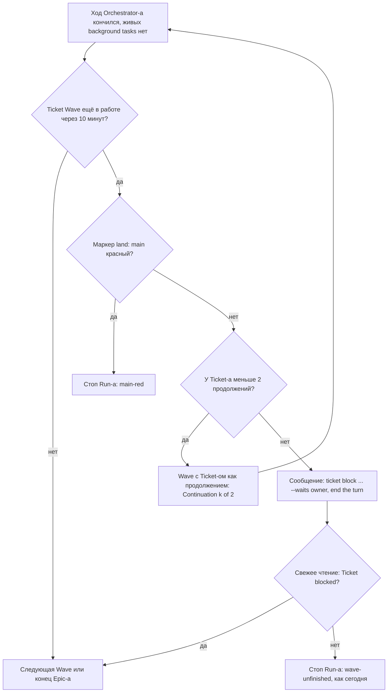

# worfy-stuck-agents: застрявший Ticket не останавливает Run, замолчавший ход виден (часть 1)

Status: черновик 2026-11-17 (часть 1 после Split critic-а), ждёт приёмки владельца
Critic: [docs/product/critic/worfy-stuck-agents-2026-11-14.md](../../docs/product/critic/worfy-stuck-agents-2026-11-14.md) — Split.
Как Split учтён: в Epic-е остались Run ladder (лестница Run-а: продолжить, отложить, остановить) и watchdog тишины хода —
они опираются на наблюдённые сбои; детектор зацикливания Harness остался только в форме записи (call log и счёт
`would-deny`, без подсказки и отказа), а отказ, `blocked: loop`, Stop hook по отпечатку, Codex-паритет детектора и
эскалация модели ушли в раздел «Вне Epic-а» с причинами critic-а; английскую страницу Feature правит Ticket своего
поведения (возражение 3), Ticket документов держит только перевод, CONTEXT.md и Guide.
Source: решение владельца 2026-11-17 (Q1: следующий Epic — часть 1 этого spec-а, Split critic-а применён; story этого
Epic-а из toast-а — приёмка Ticket-а worfy-code-stories 17). Черновик 2026-11-13 из исследования конкурентов,
[папка dossier-ов](../../docs/research/2026-11-13-competitors/): reliability-cost-12 (watchdog тишины хода),
orchestration-3 (застрявший Ticket не останавливает Run), reliability-cost-1 (детектор зацикливания — здесь только
запись). Прежний разбор: [застрявшие Ticket-ы, 2026-10-15](../../docs/research/2026-10-15-застрявшие-ticket-ы.md).
Термины — [CONTEXT.md](../../CONTEXT.md): Run, Wave, Ticket, Wait, Span, Run history, Subagent, Background task,
Orchestrator, Auto-continue, Shadow mode, Silent mode, Fault scenario, Recovery invariant.
Depends on (по `epic-status` на 2026-11-17): worfy-autopilot-queue (очередь Epic-ов в одном Run-е, closed 21/21),
worfy-faults (Fault scenarios и инварианты И1–И8, closed 8/8), worfy-retry (Auto-continue после ошибки API и Limits,
closed 14/14), worfy-flight-recorder (Run history, closed 28/28), worfy-mcp-live (Restart с тем же разговором, 13/14,
осталась приёмка), worfy-throughput 64 (`land` видит красный `main`, done), worfy-multi-vendor (Codex как второй Vendor,
47/48, осталась приёмка).
Ticket-ы: Epic `worfy-stuck-agents`, 11 Ticket-ов, `issues/01`–`issues/11`, нумерация с `01`. Шапка — `Type:` /
`Status:` / `Blocked by:` / `Source:`, как у worfy-code-stories. Порядок — раздел «Волны». Это первый Epic, который
целиком идёт с Code stories (`code_stories.pr` в Profile-е включён, менять ничего не нужно): у каждого Ticket-а с кодом
пункты «Готово, когда» называют поведение и test, на которые опирается story PR.

## Проблема

Ночной Run останавливается целиком из-за одного Ticket-а, который остался в работе или повторился в следующей Wave
(пакете Ticket-ов, идущих параллельно). Ход агента, который молчит посреди работы, часами держит Run и Limits, и
человек узнаёт об этом только утром.

Как это устроено сейчас (main на f27a868e7):

- **Один Ticket останавливает весь Run.** Три причины остановки касаются одного Ticket-а, а останавливают всё
  (`AUTOPILOT_STOP_REASONS`, `src/shared/autopilot/cycle.ts:52`; таблица «Why a run stops» —
  `docs/features/autopilot-faults.md:140–142`):
  - `wave-unfinished` — Ticket Wave остался в работе 10 минут после конца хода (`SETTLE_MS`, `cycle.ts:78`; решение —
    `cycle.ts:328–329`);
  - `no-progress` — следующая готовая Wave совпала с только что законченной (`cycle.ts:275`). ADR-0024 (конец Wave и
    причины остановки, `docs/adr/0024-autopilot-wave-end-and-keep-awake.md`, пункт 3, строка 24) прямо говорит: второй
    раз то же самое не шлётся;
  - `background-stalled` — background tasks час не дали ни события, ни изменения output file (`BACKGROUND_STALL_MS`,
    `cycle.ts:87`; решение — `cycle.ts:322–324`).
- **Очередь Epic-ов тоже встаёт.** К следующему Epic-у Run ведут только `tickets-done`, `blocked-tickets` и
  `no-ready-wave` (`EPIC_ENDS`, `src/shared/autopilot/epic-queue.ts:33`, `:73`); «anything else stops the Run»
  (`epic-queue.ts:11–12`, `docs/features/autopilot.md:127`).
- **Красный main и застрявший Ticket выглядят одинаково.** При красном push run CI на main `land` держит PR-ы с кодом
  (`harness/skills/epic-wave/SKILL.md:1544–1556`; `mainGreen` — `harness/bin/land:475–520`, worfy-throughput 64),
  Ticket-ы остаются `claimed`, и Run видит те же `no-progress` или `wave-unfinished`
  (`.scratch/worfy-autopilot-queue/spec.md:203–204`). `land` знает строку красного main (`mainRed`,
  `harness/bin/land:450–451`), но держит её только в памяти: файла, который мог бы прочитать worfy, нет.
- **Замолчавший ход Run не замечает.** У фазы `turn` цикла нет таймера: из неё выводят только конец хода, ошибка,
  закрытие Session и Stop (`cycle.ts:101`, `:283–292`, `:311–319`). Session не помнит время последнего события
  (`onEvent`, `src/main/agent/session.ts:1094`). `busy` значит только «A turn runs» (`docs/features/sessions.md:61`);
  Subagent без записи о конце остаётся `running`, сколько бы его файл ни стоял (`sessions.md:423`). Живой пример:
  Codex Session висела `busy` после ответа, пока Stop hook невидимо до 900 с гонял gate
  (`.scratch/worfy-multi-vendor/issues/47-codex-session-висит-после-ответа.md:22`; починено в #1796, но класс «ход
  молчит» остался без признака).
- **Повторы одной и той же упавшей команды никто не считает.** Разбор 2026-10-15 насчитал 0 случаев «одна и та же
  падающая команда» и «доказательства test-ов не меняются от круга к кругу», но оговорился: Journal Run-а команд не
  пишет, а транскрипты не читались (`docs/research/2026-10-15-застрявшие-ticket-ы.md:113–115`, `:149–152`). Условие
  вернуться к механизму — три и больше случаев (`:198`). Сейчас считать их нечем: у Harness нет PostToolUse hook-а
  (`harness/hooks/hooks.json` — только SessionStart, UserPromptSubmit, SubagentStart, TaskCompleted, TeammateIdle,
  Stop, SubagentStop, SessionEnd и PreToolUse на `:155–166`).

Утром человек видит тост `Run stopped: wave-unfinished · N done, M blocked · …` (`docs/features/flight-recorder.md:23`),
а остальные Epic-и очереди не начаты.

## Решение

Два механизма и одна запись. Все держат три правила:

- ADR-0002 (worfy — вид над workflow): статус Ticket-а пишут агенты через `ticket`, worfy в Project ничего не пишет
  (`docs/adr/0002-worfy-is-a-view-over-the-workflow.md:5`; инвариант И7 — `docs/features/autopilot-faults.md:234`).
- ADR-0029 и ADR-0050 (Autopilot ждёт background tasks; Stop прерывает Orchestrator только по слову человека): worfy
  не убивает background tasks и не прерывает ход по своим причинам остановки
  (`docs/adr/0029-autopilot-waits-for-background-tasks.md:71–73`,
  `docs/adr/0050-autopilot-user-stop-interrupts-orchestrator.md:81–83`).
- Слова модели не возвращаются к ней как указания (`src/shared/agent/continue-plan.ts:28`).

1. **Run ladder: застрявший Ticket откладывается, Run идёт дальше** (Autopilot). Вместо остановки по
   `wave-unfinished`, `no-progress` и `background-stalled` — три ступени с потолком на каждый Ticket:
   - *Продолжение.* Run шлёт Orchestrator-у продолжение из фактов worfy: номера Ticket-ов, статусы, номер попытки, имена
     background tasks и минуты без признаков жизни. Не больше двух продолжений на Ticket за Run.
   - *Отложить.* После потолка Run просит Orchestrator выполнить `ticket block <epic> <NN> "stuck: …" --waits owner`.
     Ticket с `Waits: owner` ждёт владельца, как и Ticket-ы, заблокированные только им (`epic-queue.ts:37–58`); когда
     готовых Ticket-ов больше нет, Epic кончается `waits-owner`, и очередь идёт к следующему Epic-у
     (`epic-queue.ts:79–81`). Независимые Ticket-ы того же Epic-а идут в следующих Wave-ах: `readyWave` не берёт
     `blocked` (`src/shared/workflow/waves.ts:177`).
   - *Стоп.* Если и после этого Ticket в работе — Run останавливается с той же причиной, что сегодня.
   - Перед продолжением Run читает маркер красного main, который начинает писать `land`. Красный main — стоп всего
     Run-а с новой причиной `main-red`, без продолжений: правило «красный CI main — весь Run» остаётся
     (`.scratch/worfy-autopilot-queue/spec.md:107`).
2. **Watchdog тишины хода.** Session помнит время последнего признака жизни. Тишиной не считаются открытый запрос
   разрешения, идущий hook, растущий output file background task-а, растущий вывод gate-а и занятый e2e lock. На тишине
   chip Session говорит `busy · quiet 14 min`, а на hint line появляются Interrupt и Restart с тем же разговором —
   только по нажатию человека. Такая же пометка — на Subagent Node Claude Code. В Autopilot тишина дольше порога
   останавливает Run с новой причиной `turn-hung` и отдаёт Session человеку; ничего не прерывается и не убивается.
   Слово `quiet`, а не `silent`: `Silent mode` — уже термин (CONTEXT.md, Silent mode).
3. **Call log Harness — только запись.** Новый PostToolUse и PostToolUseFailure hook ведёт call log агента: последние
   20 вызовов (tool, хэш ввода, исход). Шаблоны: тот же вызов с тем же неуспешным исходом 3 раза; правка туда и обратно;
   A-B-A-B. Совпадение пишется в отдельный log случаев как `would-hint` (3-й повтор) и `would-deny` (4-й) — агент ничего
   не видит, вызов не задерживается, hook всегда отвечает exit 0 без вывода. Команда `loop-log` считает случаи. Когда
   их наберётся три и больше — условие разбора 2026-10-15 (`:198`) выполнено, и владелец решает о втором Epic-е
   (подсказка, отказ, `blocked: loop`; раздел «Вне Epic-а»).

### Путь пользователя

**A. Ночной Run над очередью из трёх Epic-ов.**

1. Вечером владелец запускает Run над `epic-a`, `epic-b`, `epic-c` и уходит.
2. Wave 2 `epic-a` — Ticket-ы 05 и 07. Ход Orchestrator-а кончился: 07 `done`, 05 остался `claimed` (implementer упал,
   PR нет).
3. Через 10 минут Run читает маркер `land`: main не красный. Run начинает следующую Wave, где 05 идёт продолжением:
   первая строка `Continuation 1 of 2 for ticket 05: still claimed 10 min after the turn ended.`, дальше обычная Wave
   command, как у Run-а после Force stop (`resumable`, `runWaveState` — `src/shared/actions/render-template.ts:173–191`).
   Skill `epic-wave` подхватывает Ticket по разделу «How to resume a wave» (`harness/skills/epic-wave/SKILL.md:1945`).
4. После второго продолжения 05 всё ещё в работе. Run шлёт Orchestrator-у: `Ticket 05 stayed claimed after 2
   continuations. Run: ticket block epic-a 05 "stuck: claimed after 2 continuations" --waits owner. Then end the turn.`
5. Свежее чтение: 05 `blocked`, `Waits: owner`. Ticket 09 зависит от 05 — тоже ждёт владельца. Остальные Ticket-ы
   `epic-a` идут дальше; когда готовых нет, Epic кончается `waits-owner`, и Run идёт к `epic-b`.
6. Утром в Run history у 05 попытки `#2` и `#3` и красный `!` с `Blocked reason: stuck: claimed after 2 continuations`
   и `Waits: owner` (`docs/features/flight-recorder.md:122–123`); тост уже называет `M blocked`
   (`flight-recorder.md:23`).

**B. Ход замолчал.**

1. Днём человек видит chip Orchestrator-а `busy · quiet 14 min`, на hint line — `No sign of life for 14 min: no events,
   no hook, no output.` и кнопки Interrupt и Restart.
2. Interrupt прерывает ход (та же кнопка Session, что сегодня). Restart прерывает ход, ждёт выхода старого процесса
   (ADR-0064 — relaunch ждёт выхода старого процесса) и поднимает новый с тем же разговором — это уже построено для
   MCP-действий (`restartProcess`, `src/main/agent/session.ts:842`, worfy-mcp-live 03 и 13). Пока живы background tasks
   Session, Restart отвечает причиной и ничего не делает, как MCP Restart (`keptForTasks`, `session.ts:828`).
3. В Autopilot через 30 минут тишины Run останавливается с `turn-hung`. Session уходит человеку, как после любой другой
   остановки (`docs/features/autopilot-faults.md:111–120`): ход не прерван, background tasks живут.

**C. Implementer крутится на одной команде (только запись).**

1. Implementer Ticket-а 12 в третий и четвёртый раз запускает `pnpm vitest run test/unit/x.test.ts` с тем же неуспешным
   исходом.
2. Агент ничего не замечает: hook пишет в log случаев `would-hint`, потом `would-deny`.
3. Утром Orchestrator или владелец запускает `loop-log --since 2026-11-18` и видит число случаев, шаблон, Session и
   начало команды. По этим строкам решается, нужен ли второй Epic.

### Лестница Run-а



`no-progress` идёт той же лестницей: та же Wave шлётся снова, пока у её Ticket-ов есть попытки. `background-stalled` —
тоже, но продолжение — сообщение в ту же Session: её background tasks живут в её процессе.

### Экран

```
Шапка Session Orchestrator-а
┌─────────────────────────────────────────────────────────────────────────────┐
│ Orchestrator · epic-a                                  busy · quiet 14 min  │ ← chip
├─────────────────────────────────────────────────────────────────────────────┤
│ … транскрипт …                                                              │
├─────────────────────────────────────────────────────────────────────────────┤
│ No sign of life for 14 min: no events, no hook, no output.                  │ ← hint line
│                                                  [Interrupt]   [Restart]    │
│ ┌─────────────────────────────────────────────────────────────────────────┐ │
│ │ composer                                                                │ │
│ └─────────────────────────────────────────────────────────────────────────┘ │
└─────────────────────────────────────────────────────────────────────────────┘

Subagent Node (260×84)                    Run history утром
┌──────────────────────────────────┐      Wave 2 · epic-a   05 ████
│ worfy:implementer · sonnet       │      Wave 3 · epic-a   05 #2 ███
│ running 52 min · quiet 21 min    │      Wave 4 · epic-a   05 #3 ██ ! stuck: claimed after 2 continuations
│ первая строка итога              │                        07 ██████ done
└──────────────────────────────────┘      Wave 1 · epic-b   …
```

## Как это сделано у конкурентов

| Продукт | Что делает | Что берём |
|---|---|---|
| [Codex app](../../docs/research/2026-11-13-competitors/codex-app-codex-in-the-chatgpt-desktop-app.md) | `/goal` блокируется после 3 пустых автоматических ходов или одного препятствия 3 хода подряд; статусы blocked, usage_limited, budget_limited. Агент съел 5-часовое окно, крутясь на месте. | Потолок продолжений; `blocked` вместо траты |
| [Cursor](../../docs/research/2026-11-13-competitors/cursor-agents-window-cloud-agents-and-automation.md) | Stop hook `followup_message` с `loop_limit` 5; Bugbot Autofix — не больше 3 попыток. | Потолок продолжений |
| [OpenAI Symphony](../../docs/research/2026-11-13-competitors/openai-symphony.md) | `stall_timeout_ms` 5 минут без событий: worker убит, повторяется только его работа; continuation turns «#N of M». После отмены остался живой app-server. | Текст «Continuation k of N»; новый процесс — только после выхода старого |
| [Factory Droids](../../docs/research/2026-11-13-competitors/factory-droids.md) | Mission встаёт с `feature_retry_limit_exceeded`; `subagentInactivityTimeout` 3 минуты; 3 одинаковых вызова — подсказка, 6 — стоп. | Тишина Subagent-а видна; повтор с новым исходом — не цикл |
| [Division Swarm](../../docs/research/2026-11-13-competitors/division-swarm.md) | Watchdog помечает долгий turn, затем «нет вывода»; `platform.run_stalled` после 300 с. Четыре расследования лежали, пока их не закрыли таймеры. | Пометка тишины |
| [Claude Code cloud sessions and Projects](../../docs/research/2026-11-13-competitors/claude-code-cloud-sessions-and-projects.md) | Баннер «Claude hasn't responded» с Restart Claude, частичный ответ теряется. Сессию нельзя было прервать, кредиты шли. | Restart с тем же разговором, по нажатию |
| [Google Antigravity](../../docs/research/2026-11-13-competitors/google-antigravity.md) | Sentinel перезапускает зависшего агента по времени изменения его файлов прогресса. | Output file как признак жизни (у worfy уже есть) |
| [JetBrains Air](../../docs/research/2026-11-13-competitors/jetbrains-air.md) | После потери сети агент висит в Running; выход — Stop (IJAI-6125). | Тишина должна быть видна |
| [Gas Town](../../docs/research/2026-11-13-competitors/gas-town.md) | «Float over integer»: одна застрявшая работа не останавливает epic. Не больше 3 перезапусков; `mountain:skipped` после 3 неудач. Daemon никогда не убивает worker-ов. | Отложить Ticket и идти дальше; не убивать |
| [Claude Code plugins and marketplaces](../../docs/research/2026-11-13-competitors/claude-code-plugins-and-marketplaces.md) | Замолчавший агент workflow перезапускается до 5 раз; потом внутри `parallel()` его вызов даёт `null`, а при прямом `await` падает весь run. | Сбой одного не роняет остальных |
| [OpenHands](../../docs/research/2026-11-13-competitors/openhands.md) | Детектор в последних 20 событиях, 4 шаблона → STUCK (`StuckDetectionThresholds`). Бот самого вендора ответил «I'm on it» 191 раз за ~4 часа в одном issue. | Окно из 20 вызовов и шаблоны — для записи |

## Истории пользователя

1. Как владелец, я запускаю Run над очередью Epic-ов на ночь и хочу, чтобы один застрявший Ticket не остановил
   остальные Epic-и.
2. Как владелец, я хочу, чтобы Run сам попробовал продолжить Ticket, оставшийся в работе, прежде чем отложить его.
3. Как владелец, я хочу утром видеть отложенные Ticket-ы с причиной и числом попыток в Run history и в тосте остановки.
4. Как владелец, я хочу, чтобы при красном main Run остановился сразу и назвал причину, а не откладывал невиновные
   Ticket-ы.
5. Как пользователь, я хочу видеть, что ход Session молчит и сколько минут, отдельно от хода, который ждёт моего
   разрешения или идущего hook-а.
6. Как пользователь, я хочу одним нажатием прервать замолчавший ход или перезапустить Session с тем же разговором.
7. Как пользователь, я хочу видеть на Subagent Node, что background implementer давно молчит.
8. Как владелец, я хочу, чтобы замолчавший ход в Autopilot не держал Run всю ночь, а остановил его с понятной
   причиной, не убивая чужую работу.
9. Как владелец, я хочу знать, сколько раз агенты повторяли ту же упавшую команду, прежде чем решать, отказывать ли
   им.

## Решения по реализации

### Цикл и Run: продолжение, отложить, `main-red`

- **Решения цикла остаются чистыми.** `src/shared/autopilot/cycle.ts` получает счётчик продолжений на Ticket за Run и
  два новых эффекта: `continue-tickets` (Ticket-ы, номер попытки, причина) и `set-aside` (Ticket-ы, причина). Имя
  `give-up` черновика не берём: так уже зовётся вид плана ожидания Limits (`src/shared/autopilot/resume-at.ts:74`,
  `src/main/autopilot/run.ts:2640`). Меняются три места, где сегодня `stop(...)`:
  - `settle-timeout` в фазе `settling` (`cycle.ts:328–329`): Ticket-ы в работе под потолком → `continue-tickets`, над
    потолком → `set-aside`;
  - `sameSet` в `evaluate()` (`cycle.ts:275`): та же Wave шлётся снова, пока у её Ticket-ов есть попытки; иначе
    `set-aside`;
  - `tasks-timeout` с живыми background tasks (`cycle.ts:322–324`): `continue-tickets` с причиной `background-stalled`.
  После `set-aside` и одного хода Orchestrator-а прежние причины остаются концом: Ticket всё ещё в работе →
  `wave-unfinished`, та же Wave → `no-progress`, background tasks молчат → `background-stalled`. Счётчик живёт в Run-е;
  новый Run начинает с нуля.
- **Потолок — параметр цикла.** Ticket цикла (01) вводит его со значением 0 — поведение Run-а не меняется, пока Run не
  умеет слать продолжение. Ticket Run-а (05) ставит 2. Так main ни на одном commit-е не шлёт эффект, который Run не
  исполняет.
- **Новые причины остановки** `main-red` и `turn-hung`: в `AUTOPILOT_STOP_REASONS` (`cycle.ts:52`), в `STOP_OUTCOMES`
  как `failed` (`src/shared/flight-recorder/from-journal.ts:148`), в таблице «Why a run stops»
  (`docs/features/autopilot-faults.md:132`). Обе останавливают весь Run: `epicOutcome` пропускает к следующему Epic-у
  только концы Epic-а (`epic-queue.ts:73`).
- **Journal.** Новые строки `ticket-continued` (`ticket`, `attempt`, `of`, `cause`: `wave-unfinished` | `no-progress` |
  `background-stalled`) и `ticket-set-aside` (`ticket`, `cause`, `attempts`) — в `JOURNAL_EVENT_KINDS` и схемах
  `src/shared/autopilot/journal.ts:401–432`, `:566–571`. Продолжение через Wave — обычная `wave-started` с полем
  `continuation`, так что инвариант И1 «одна команда `/epic-wave` на `wave-started`» держится
  (`docs/features/autopilot-faults.md:225`).
- **Продолжение — Wave command, а не новый текст.** Для `wave-unfinished` и `no-progress` Run строит следующую Wave тем
  же `runWaveState`, что и Run после Force stop: Ticket-ы в работе идут как `resumable`, готовые — рядом
  (`src/shared/actions/render-template.ts:98`, `:173–191`; `resumableOf` — `src/main/autopilot/run.ts:760`). Над
  командой — одна строка worfy, например `Continuation 1 of 2 for tickets 05, 07: still claimed 10 min after the turn
  ended.` Wave после первой и так идёт в новую SDK session (worfy-throughput 52, `run.ts:14–22`), где `wave-brief` даёт
  свежий контекст.
- **`background-stalled` — сообщение в ту же Session.** Её background tasks живут в её процессе, и после
  `tasks-timeout` Wave и сегодня идёт в текущую Session (`run.ts:19–22`). Текст:
  `Continuation 1 of 2: background tasks impl-05 (61 min), gate fast (61 min) gave no sign of life. Check them. Let a
  task go on, or stop it and resume its ticket, or block the ticket.` Остановить background task может только
  Orchestrator — worfy их не трогает (ADR-0029, ADR-0050).
- **Тексты.** Новый чистый модуль `src/shared/autopilot/continuation.ts` собирает продолжение и `set-aside` из фактов
  worfy. `lastText` — последние слова модели, которые Run кладёт в `run-stopped` (`run.ts:2902`), — туда не попадают.
- **Отложить — руками Orchestrator-а.** Сообщение `set-aside` называет точную команду
  `ticket block <epic> <NN> "stuck: <cause> after <k> continuations" --waits owner` (`harness/bin/ticket`) и просит
  кончить ход. `Waits: owner` выбран потому, что только он даёт очереди идти дальше (`epic-queue.ts:37–39`, `:80`):
  `Waits: agent` остановил бы Run в конце Epic-а. Кто пишет статус — вопрос 1.
- **Красный main — маркер `land`.** `land` уже читает push run-ы CI на main и держит строку `mainRed`
  (`harness/bin/land:450–451`, `mainGreen` — `:475–520`, печать — `:1226`). Он начинает писать файл
  `main-red-<key>.json` (sha, PR-виновник, время, URL run-а) в папку состояния gate-а и удалять его, когда main не
  красный. worfy читает его там же, где маркеры `red-<key>-<tag>` (`src/main/gate/state.ts:1–25`, `:135`). Когда цикл
  просит продолжение или `set-aside`, Run сначала читает маркер; есть — стоп `main-red`. Своё чтение `gh run list`
  отклонено: имя CI workflow знает только brief `land` (`harness/skills/epic-wave/SKILL.md:1252–1270`), правило
  пропуска run-ов документов пришлось бы повторить, а инвариант И2 разрешает Run-у только `pr list`, `auth status`,
  `auth token` и `api repos/<owner>/<repo>` (`test/autopilot-invariants.ts:122–132`). Устаревший маркер даёт
  остановку там, где Run остановился бы и сегодня, — не хуже.
- **Status line Autopilot** (`src/renderer/canvas/actions/AutopilotAction.tsx`) во время продолжения говорит
  `continuing 05 (1 of 2)`.
- **Слова Run history** для `main-red`, `turn-hung`, `ticket-continued` и `ticket-set-aside` —
  `src/renderer/flight-recorder/span-words.ts`. Продолжение — новый Span того же вида с номером попытки (`#2`;
  CONTEXT.md, Span; `docs/features/flight-recorder.md:122`), отложенный Ticket — красный `!` с `Blocked reason` и
  `Waits` (`flight-recorder.md:123`): новой разметки не нужно.
- **Amendment-ы ADR** пишет Ticket своего поведения, датой своего PR: ADR-0024 (пункт 3 и `wave-unfinished`) — Ticket 05,
  ADR-0029 (сообщение Orchestrator-у при `background-stalled`) — Ticket 08 (правило владельца 2026-11-12 Q5: implementer
  дописывает Amendment к ADR, который называет его Ticket).

### Признаки жизни Session и тишина

- **Время последнего признака жизни.** `onEvent` (`session.ts:1094`) запоминает время каждого события (у событий есть
  `at`, `src/shared/agent/events.ts:76–79`), включая `task_activity` (`events.ts:295`). Driver-ы перестают молчать о
  работе, которую не показывают:
  - Claude: `hook_started`, `hook_progress` и `thinking_tokens` сейчас не дают событий
    (`src/shared/vendors/claude/events.ts:162–165`); они станут скрытым признаком жизни, без строки в транскрипте;
  - Codex: `hookStarted` сообщает только о Stop hook (`src/main/vendors/codex/items.ts:346–350`); признаком жизни станет
    любой hook run.
- **Что не тишина:** открытый запрос разрешения (`needs_permission`, `permissionsChanged` — `session.ts:1086–1091`); hook
  между началом и концом (gate в TaskCompleted идёт до 900 с, `harness/hooks/hooks.json:82–92`); изменение output file
  background task-а (`src/main/autopilot/task-output.ts:1`, worfy-polish 61); рост `.run-<tag>-<pid>.out` gate-а
  (`harness/hooks/gate.mjs:727`) в папке состояния, которую worfy уже читает (`src/main/gate/state.ts`); e2e lock с
  живым holder-ом (`readE2eLock`, `src/main/workflow/stages.ts:98`).
- **Пороги** (решено без владельца, пункт 7), константы рядом с `SETTLE_MS` (`cycle.ts:78`): пометка — после 10 минут
  тишины, `turn-hung` — после 30. Test-ы двигают их через deps Run-а, как сегодня `settleMs` и `backgroundStallMs`
  (`run.ts:402–403`, `:439–440`).
- **UI.** Chip: `busy` (`src/renderer/session/format.ts:9`) на тишине даёт `busy · quiet N min`. Hint line: новый пункт
  composer-а по образцу `ContinueCountdown.tsx` (`src/renderer/session/composer/ContinueCountdown.tsx:26–30`; пункты
  собираются по glob, `composer/index.ts:46`) с Interrupt (та же кнопка Session, `agent.interrupt`) и Restart. Restart —
  новый публичный вход к `restartProcess` (`session.ts:842`), который сегодня зовут только MCP-действия через
  `restartFor` (`session.ts:696`, `:807`); unattended Session он отказывает, как `restartFor` (`session.ts:808`), а при
  живых background tasks отвечает причиной (`keptForTasks`).
- **Subagent Node.** Subagent Node (`src/renderer/canvas/nodes/SubagentNode.tsx`) и rail
  (`src/renderer/session/rail/SubagentsRail.tsx`, время сейчас тикает только у `running`, `:225`) показывают
  `quiet N min` по времени изменения файла Subagent-а `agent-<agentId>.jsonl` (`src/main/claude-home/subagents.ts`)
  вместо вечного `running` (`docs/features/sessions.md:423`). Только Claude Code: Subagent-ы Codex приходят из его
  threads без файла (`sessions.md:397–398`).
- **`turn-hung` в Autopilot.** Фаза `turn` (`cycle.ts:101`; вход в неё — `wave-sent`, `:302–305`) получает событие
  `turn-quiet` от Run-а, и цикл отвечает `stop(state, 'turn-hung')`. Run отдаёт Orchestrator человеку по правилу «After
  any other stop» (`docs/features/autopilot-faults.md:111–120`): ход не прерывается, процесс не перезапускается,
  background tasks живут (вопрос 3). Тишина background implementer-а — не `turn-hung`: она ведёт к
  `background-stalled` и его продолжению.

### Call log Harness — только запись

- **Hook.** В `harness/hooks/hooks.json` — новые PostToolUse (все tools) и PostToolUseFailure → новый
  `harness/hooks/calls.mjs`. Он пишет в папку состояния gate-а `calls/<owner>.jsonl` — последние 20 вызовов агента.
  `owner` — Session, а у Subagent-а Session и `agent_id`. У Claude Code `agent_id` есть в hook input-е только внутри
  Subagent-а (`BaseHookInput` в `@anthropic-ai/claude-agent-sdk`, `sdk.d.ts:184–187`); Stop hook сегодня берёт его только
  на Codex (`harness/hooks/stop.mjs:150`), новый hook — на обоих Vendor-ах. Строка: tool, хэш нормализованного ввода
  (команда без пробелов по краям; у правки — файл и хэш его содержимого после неё), исход, время.
- **Исход по Vendor-ам.** Claude Code: успех — PostToolUse, неуспех — PostToolUseFailure с полем `error` (строка, без
  exit code: `PostToolUseFailureHookInput`, `sdk.d.ts:2753–2765`); исход — «неуспех» плюс хэш текста ошибки. Codex: у Bash
  в `tool_response` только вывод, у `apply_patch` текст начинается с `Exit code: 0`
  (`test/fixtures/codex-messages/hooks/PostToolUse.jsonl`); исход — exit code, где он есть, плюс хэш вывода.
- **Шаблоны** — чистый модуль `harness/hooks/loop-patterns.mjs`:
  - тот же вызов с тем же неуспешным исходом 3 раза среди последних 20;
  - правка туда и обратно: файл дважды вернулся к содержимому, которое было две правки назад;
  - A-B-A-B: пара вызовов с теми же исходами повторилась 3 раза подряд.
  Повтор с новым исходом — не цикл. Команды ожидания CI (`gh pr checks` и подобные) в счёт не идут: их ненулевой exit
  code значит «ещё идёт».
- **Только запись.** Совпадение дописывается в `calls/loops.jsonl`: `would-hint` на 3-м повторе, `would-deny` на 4-м
  (тот же смысл, что `would-deny` у Shadow mode Auto-approval, CONTEXT.md). Строка: время, Session, `agent_id`, шаблон,
  tool, начало команды до 200 символов. Hook не пишет в stdout, всегда exit 0, ошибку чтения или записи глотает: вызов
  агента он не меняет и не держит. Файлы Session старше 7 дней удаляются при записи, `loops.jsonl` держит последние
  2000 строк.
- **`harness/bin/loop-log [--since <date>]`** печатает случаи `would-deny` (Session, шаблон, начало команды) и строку
  `cases: N (revisit at 3)`. Exit 0.
- **Codex.** Hook-и одни на оба Vendor-а. Codex выключает hook-и plugin-а после каждого его обновления до одобрения в
  `/hooks` (`docs/features/harness.md:193`), так что новый hook не добавляет владельцу шага.

## Решения по test-ам

- **Чистые модули — unit test-ы:** решения цикла (потолок, `set-aside`, `main-red`, `turn-hung`, счётчик по Ticket-ам,
  потолок 0 = поведение сегодня); тексты `continuation.ts` (в них нет `lastText`); `epicOutcome` с отложенным Ticket-ом и
  цепочкой за ним → `waits-owner`; чтение маркера `main-red`; время последнего признака жизни и исключения.
- **Fault scenarios** (`test/contract/autopilot-faults-*.test.ts`; хелпер `faultRun()` —
  `test/contract/autopilot-faults-setup.ts:282`; скрипты fake agent — `test/fixtures/agent-scripts/`; gh —
  `test/contract/gh-world.ts`) — каждый в Ticket-е своего поведения:
  1. Ticket остался `claimed`, продолжение доводит его до `done` (Ticket 05);
  2. Ticket `claimed` после двух продолжений → `set-aside` → скрипт Orchestrator-а пишет `blocked` с `Waits: owner` →
     Run идёт к следующему Epic-у очереди (Ticket 05);
  3. `set-aside` без ответа → `wave-unfinished`, как сегодня (Ticket 05);
  4. маркер `main-red` → стоп `main-red`, ни одного продолжения (Ticket 05);
  5. `no-progress` той же лестницей (Ticket 05);
  6. `background-stalled` → сообщение в ту же Session, без новой SDK session и без убитых background tasks (Ticket 08);
  7. ход без признаков жизни 30 минут (часы двигает test) → `turn-hung`, Session у человека, Interrupt не вызывался
     (Ticket 09).
  Сценарии 2, 6 и 7 повторяются на Codex (`test/contract/autopilot-faults-codex.test.ts`, fake app-server
  `test/fixtures/codex-app-server/fake-app-server.mjs`). Инварианты И1–И8 (`test/autopilot-invariants.ts:7–19`) держатся
  во всех; новый И9 (Ticket 05): у Ticket-а за Run не больше двух `ticket-continued`, а после `ticket-set-aside` он
  `blocked`, или Run кончился прежней причиной.
- **Hook-и Harness:** shell test-ы в `harness/hooks/tests/` по образцу `stop-gate-cycle.test.sh` и `guard-silent.test.sh`
  (раннер `test/harness-scripts-suite.ts` подхватывает их сам); Codex — `test/contract/harness-codex-hooks.test.ts` на
  fixture-ах `test/fixtures/codex-messages/hooks/`; Claude Code — на fixture-ах по типам SDK. `land` — shell test-ы
  `harness/bin/tests/land.test.sh`.
- **UI:** component test-ы chip-а, пункта hint line и Subagent Node; один e2e в собранном приложении на fake agent
  (`WORFY_AGENT=fake`, `src/main/agent/fake-query.ts`), чей ход молчит: chip, Interrupt, Restart без второго процесса на
  тот же транскрипт. Локально e2e не запускается — его гоняет CI.
- Ни один test не зовёт модель и настоящий binary Codex.

## Вне Epic-а

Отложено (по critic-у, Split):

- **Подсказка и отказ при зацикливании, `blocked: loop` в отчёте implementer-а и правило `epic-wave`** (прежний Ticket 09)
  и **Codex-паритет детектора** (прежний 11). Причина critic-а: разбор 2026-10-15 насчитал 0 таких случаев
  (`docs/research/2026-10-15-застрявшие-ticket-ы.md:113–115`), условие вернуться — три и больше (`:198`), доля ложных
  срабатываний неизвестна, а hook-и идут на каждом вызове каждого агента. Вернуться, когда `loop-log` покажет
  `cases: 3` и больше, — отдельным Epic-ом. Порядок там: сначала поле `blocked` и правило `epic-wave`, потом текст
  подсказки, который на него ссылается (critic, возражение 1). Вопрос 4 черновика (как включать отказ) снят: решение
  владельца 2026-11-17 — только запись.
- **Stop hook по отпечатку failure record** (прежний Ticket 10: не держать агента второй раз на том же наборе упавших
  test-ов) — часть того же детектора, та же причина.
- **Эскалация модели в Eco mode** (прежний Ticket 13). Причина critic-а: Eco mode для worfy выключен, замер Eco против
  full ждёт владельца (`.scratch/worfy-throughput/issues/43-замер-эффекта-eco-против-full.md:4–6`); вернуться после
  его итога. Вместе с ней ушёл вопрос 5 черновика.
- **Spike PostToolUse** (прежний Ticket 01) отдельным Ticket-ом не нужен: на вопросы о `agent_id` и поле `error`
  отвечают типы SDK, а записи не нужна точность exit code. Как выглядят настоящие payload-ы, видно на приёмке по
  `loop-log`.

Не в этом Epic-е вообще:

- worfy сам не пишет статус Ticket-а (ADR-0002). Если вопрос 1 решится вариантом (б) — отдельный ADR.
- worfy не убивает и не останавливает background tasks (ADR-0029, ADR-0050); остановить зависший background task может
  только Orchestrator по сообщению продолжения.
- Автоматический Interrupt замолчавшего хода в Autopilot — только при варианте (б) вопроса 3.
- Пометка тишины у Subagent-ов Codex: у них нет файла, статусы читаются из Codex (`sessions.md:397–398`).
- «Memento» — свежий агент с записью прошлых попыток: ответ «нет» принят 2026-10-16
  (`.scratch/worfy-reliability/issues/02-застрявшие-ticket-ы-и-свежий-агент-с-записью-попыток.md:105`).
- Зацикливание внутри рассуждения модели без вызовов tools: Harness видит только вызовы.
- Показ call log в UI worfy.
- Правило красного main: он по-прежнему останавливает весь Run.

Уже построено, не повторяем:

- Restart с тем же разговором и отказ при живых background tasks — worfy-mcp-live 03 и 13 (`session.ts:842`, `:828`).
- `land` находит красный main и PR-виновника — worfy-throughput 64 (#1733); Epic добавляет только файл-маркер.
- Output file background task-а как признак жизни — worfy-polish 61 (`task-output.ts`).
- Тост остановки с `M blocked` и попытки `#N` в Run history — worfy-flight-recorder (`flight-recorder.md:23`, `:122–123`).
- Auto-continue после ошибки API и Limits — worfy-retry: это повтор хода, а не продолжение застрявшего Ticket-а.

## Ticket-ы

1. **Цикл: лестница продолжений** — счётчик на Ticket, эффекты `continue-tickets` и `set-aside`, причина `main-red`,
   строки Journal `ticket-continued` и `ticket-set-aside`, `STOP_OUTCOMES`; потолок 0 по умолчанию.
2. **Маркер красного main** — `land` пишет и снимает `main-red-<key>.json`, `src/main/gate/state.ts` его читает.
   Платформенный PR (скрипт Harness).
3. **Признаки жизни Session** — время последнего признака жизни в `session.ts`, скрытые признаки от hook-ов и thinking у
   обоих driver-ов, исключения, поле тишины в IPC.
4. **Тишина Subagent-а** — `quiet N min` на Subagent Node и в rail-е по времени изменения файла Subagent-а.
5. **Run: продолжение и откладывание** — Wave command с `resumable`, сообщение `set-aside`, `continuation.ts`, проверка
   маркера, status line, слова Run history, потолок 2, Fault scenarios 1–5, И9, Amendment ADR-0024.
6. **UI тишины хода** — chip `busy · quiet N min`, пункт hint line с Interrupt и Restart, e2e.
7. **Call log Harness — только запись** — hook `calls.mjs`, модуль шаблонов, `loops.jsonl`, `loop-log`. Платформенный PR
   (hook-и Harness).
8. **Run: `background-stalled` продолжением** — сообщение в ту же Session, Fault scenario 6 на Claude Code и Codex,
   Amendment ADR-0029.
9. **`turn-hung` в Autopilot** — таймер тишины в фазе `turn`, остановка без Interrupt, Fault scenario 7 на Claude Code и
   Codex.
10. **Документы** — переводы `docs/features/ru/` страниц, которые изменили Ticket-ы 02–09, термины CONTEXT.md, тексты
    Guide.
11. **Приёмка владельцем** (manual) — ночной Run над очередью и story Epic-а из toast-а.

## Волны

| Wave | Ticket-ы | Почему так |
|---|---|---|
| 1 | 01, 02, 03, 07 | Общих файлов нет: цикл — `src/shared/autopilot/` и `from-journal.ts`; маркер — `harness/bin/land`, `src/main/gate/state.ts` и `gate-and-github.md`; признаки жизни — `src/main/agent/`, `src/shared/agent/` и driver-ы, без страницы Feature; call log — `harness/hooks/`, `harness/bin/loop-log` и `skills-agents-and-hooks.md`. Никто не ждёт другого |
| 2 | 04, 05 | Subagent берёт порог тишины из модуля 03; Run опирается на цикл (01) и маркер (02) |
| 3 | 06, 08 | UI хода — на признаки жизни (03) и после 04, который тоже правит `sessions.md`; `background-stalled` правит те же `run.ts`, `continuation.ts` и Fault scenarios, что 05 |
| 4 | 09 | `turn-hung` — на признаки жизни (03) и на `run.ts` после 08 |
| 5 | 10 | Переводы, CONTEXT.md и Guide по сделанному |
| 6 | 11 | Приёмка |

Wave — Ticket-ы, которые можно брать параллельно: блокеры закрыты, общих файлов нет. Wave, которую берут в работу,
вычисляется заново в момент запуска (CONTEXT.md, Wave). Run ladder доходит до владельца после Wave 2, пометка тишины —
после Wave 3, `turn-hung` — после Wave 4. Платформенные PR (нужен вердикт Windows до merge, ADR-0056, пункт 2; ADR-0071) — 02 и 07: оба правят скрипты
Harness; job-ы `windows (harness-scripts …) / full-suite` в составе `ci-ok` на head PR.

## Риски

- **Ложная тишина.** Долгая работа без событий: длинный foreground-вызов, долгое рассуждение, MCP tool, который работает
  минутами. Ответ: thinking и hook — признаки жизни; порог 10 минут только рисует пометку; `turn-hung` — после 30 минут,
  и он ничего не прерывает.
- **Продолжение повторяет шаг с последствиями** (push, merge). Ответ: продолжение — Wave command с `resumable`, а
  `epic-wave` при возобновлении сначала читает состояние worktree и PR («How to resume a wave», `SKILL.md:1945`); слов
  модели в тексте нет.
- **Расход.** Каждое продолжение — ещё одна Wave на Ticket. Потолок — два продолжения и один короткий ход `set-aside` на
  Ticket за Run. Сегодня такой Run стоит до утра; с Epic-ом он тратит не больше трёх лишних ходов на застрявший Ticket и
  идёт дальше.
- **Orchestrator не выполнит `set-aside`.** Тогда Run останавливается прежней причиной — не хуже сегодняшнего. Вариант
  (б) вопроса 1 это снимает ценой ADR-0002.
- **Отложенных Ticket-ов станет много.** Утром владелец видит несколько `Waits: owner`. Они в тосте (`M blocked`), в Run
  history с причиной и в `epic-status` как blocked.
- **Устаревший маркер `main-red`.** `land` снимает его только когда запускается сам. Маркер читается только там, где Run
  сегодня и так остановился бы, поэтому лишней остановки он не даёт — меняет только её причину.
- **Hook на каждый вызов.** PostToolUse запускает node на каждом вызове tool-а. `calls.mjs` — один файл без тяжёлых
  import-ов; время одного вызова Ticket 07 пишет в «Итог». Если оно заметно — hook выключается одной строкой
  `hooks.json`, запись ничего не держит.
- **Windows.** Hook-и Harness и `land` работают и на Windows; shell test-ы и contract test-ы должны быть зелёными там
  (job-ы Windows в `ci-ok`).

## Вопросы владельцу

Ticket-ы написаны по рекомендованным ответам (а). Другой ответ меняет Ticket-ы, названные в вопросе.

1. **Кто пишет `blocked` отложенному Ticket-у.** (а) Orchestrator по сообщению worfy (`ticket block … --waits owner`):
   ADR-0002 и инвариант И7 «worfy ничего не пишет в Project» без изменений; если Orchestrator не выполнит, Run
   остановится, как сегодня — **рекомендую**. (б) worfy сам вызывает `ticket block`: надёжнее, но worfy становится
   писателем статуса — новый ADR вместо ADR-0002. Ticket-ы: 05.
2. **Сколько продолжений до того, как Ticket откладывается.** (а) 2 на Ticket за Run — **рекомендую** (Gas Town — 3
   перезапуска, Codex app — 3 хода, Cursor — `loop_limit` 5); (б) 1 — дешевле, но первая же неудача implementer-а
   откладывает Ticket; (в) 3. Любой вариант меняет пункт 3 ADR-0024 («второй раз то же самое не шлётся»). Ticket-ы: 05
   (одна константа).
3. **Замолчавший ход в Autopilot.** (а) стоп `turn-hung` через 30 минут, Session — человеку, ничего не прерывается;
   ADR-0050 без изменений — **рекомендую**. (б) один автоматический Interrupt и сообщение `previous turn went quiet`,
   новый процесс — только после выхода старого (ADR-0064); `turn-hung` — на второй тишине. Ночь не теряется, но worfy
   начинает прерывать ход по своей причине — Amendment к ADR-0050. Ticket-ы: 09.

## Решено без владельца

Каждый пункт — вопрос, на который можно ответить «да».

1. **Слово `quiet` вместо `silent`** в UI (`busy · quiet N min`), в событиях (`turn-quiet`) и в термине CONTEXT.md? Причина:
   `Silent mode` — уже термин (CONTEXT.md, Silent mode), и «silent 14 min» на chip-е читался бы как режим Project-а.
2. **Эффект `set-aside` и строка Journal `ticket-set-aside`** вместо `give-up` черновика? Причина: `give-up` уже вид плана
   ожидания Limits (`src/shared/autopilot/resume-at.ts:74`); одно имя для двух вещей в одном Run-е путало бы Journal.
3. **Потолок продолжений — параметр цикла, 0 в Ticket-е 01 и 2 в Ticket-е 05?** Причина: цикл и Run идут разными PR-ами;
   с потолком 0 main между ними ведёт себя как сегодня.
4. **Без отдельного spike-а PostToolUse?** Причина: `agent_id` внутри Subagent-а и строковое поле `error` без exit code
   видны в типах SDK (`sdk.d.ts:184–187`, `:2753–2765`), а записи достаточно хэша текста ошибки; живые payload-ы видны на
   приёмке.
5. **Call log хранит начало команды до 200 символов** — только на Machine, в папке состояния gate-а, не в git и не в UI?
   Причина: без текста команды владелец не отличит настоящий цикл от ложного срабатывания, а ради этого запись и
   заводится.
6. **Call log пишется и на Codex?** Причина: hook-и одни на оба Vendor-а, а одобрение в `/hooks` нужно после каждого
   обновления plugin-а и так (`docs/features/harness.md:193`) — лишнего шага нет.
7. **Пороги тишины: пометка через 10 минут, `turn-hung` через 30?** Причина: 10 минут — как `SETTLE_MS`, после которого
   Run и сегодня считает Wave застрявшей; 30 минут втрое длиннее, и такой ход ничего не прерывает. Symphony берёт 5
   минут, но он убивает worker-а; worfy только помечает.
8. **Restart на hint line при живых background tasks отвечает причиной и ничего не делает** — как MCP Restart
   (worfy-mcp-live 13)? Причина: Restart закрывает процесс, а с ним и background tasks (ADR-0029).
9. **Тишина Subagent-а — только у Claude Code?** Причина: у Subagent-ов Codex нет файла, по времени изменения которого
   её можно мерить (`sessions.md:397–398`).
10. **Fault scenarios — в Ticket-ах своего поведения, а не отдельным Ticket-ом** (прежний 12)? Причина: test пишется до
    кода в том же PR, и story PR опирается на него; отдельный Ticket test-ов после кода этого не даёт.
11. **Amendment-ы ADR-0024 и ADR-0029 — в Ticket-ах 05 и 08, а не в Ticket-е документов?** Причина: так ADR и код не
    расходятся ни на одном commit-е main; правило владельца 2026-11-12 Q5 это разрешает, когда Ticket называет ADR.
12. **Ticket 03 не правит страницу Feature** — `sessions.md` правят 04 и 06? Причина: 03 добавляет поле в IPC без видимого
    поведения; человеку его показывают 04 и 06, они и описывают.

## Как поймём, что работает

- Первые ночные Run-ы после Epic-а: Run с застрявшим Ticket-ом доходит до следующего Epic-а очереди, а не стоит до утра.
  Аналитики нет: мерило — Run history и слова владельца на приёмке.
- `loop-log` через две недели после Epic-а: число случаев решает, нужен ли второй Epic (условие — три и больше).

## Готово, когда

- [ ] Run над очередью из двух Epic-ов, где Ticket первого остаётся `claimed`: два продолжения (`#2` и `#3` в Run
      history), затем `blocked` с `Waits: owner` и `Blocked reason: stuck: …`, и Run доходит до второго Epic-а. Fault
      scenario на Claude Code и на Codex.
- [ ] `no-progress` и `background-stalled` идут той же лестницей; `background-stalled` не открывает новую SDK session и
      ничего не убивает.
- [ ] При маркере `main-red` Run останавливается с `main-red`, без продолжений и без отложенных Ticket-ов.
- [ ] Chip `busy · quiet N min`, Interrupt и Restart на hint line появляются на тишине и не появляются при открытом
      запросе разрешения, идущем hook-е, растущем выводе gate-а и занятом e2e lock. Restart не запускает второй
      процесс на тот же транскрипт.
- [ ] Subagent Node показывает `quiet N min` у молчащего background implementer-а Claude Code.
- [ ] В Autopilot ход без признаков жизни 30 минут даёт `turn-hung`; Interrupt не вызывался, background tasks живы.
- [ ] Третий и четвёртый одинаковый неуспешный вызов дают строки `would-hint` и `would-deny` в `loops.jsonl`; агент
      ничего не получает; `loop-log` их считает. То же на Codex.
- [ ] Инварианты И1–И9 держатся во всех Fault scenarios; `ci-ok` зелёный на каждом PR.
- [ ] Страницы Feature en (в PR своего поведения) и ru, CONTEXT.md, Guide и Amendment-ы к ADR-0024 и ADR-0029 описывают
      сделанное.
- [ ] Владелец принял Epic по Ticket-у 11.
