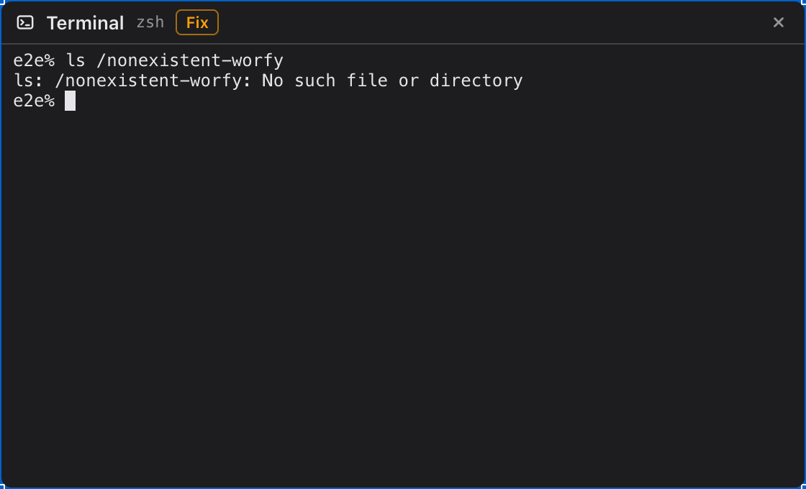
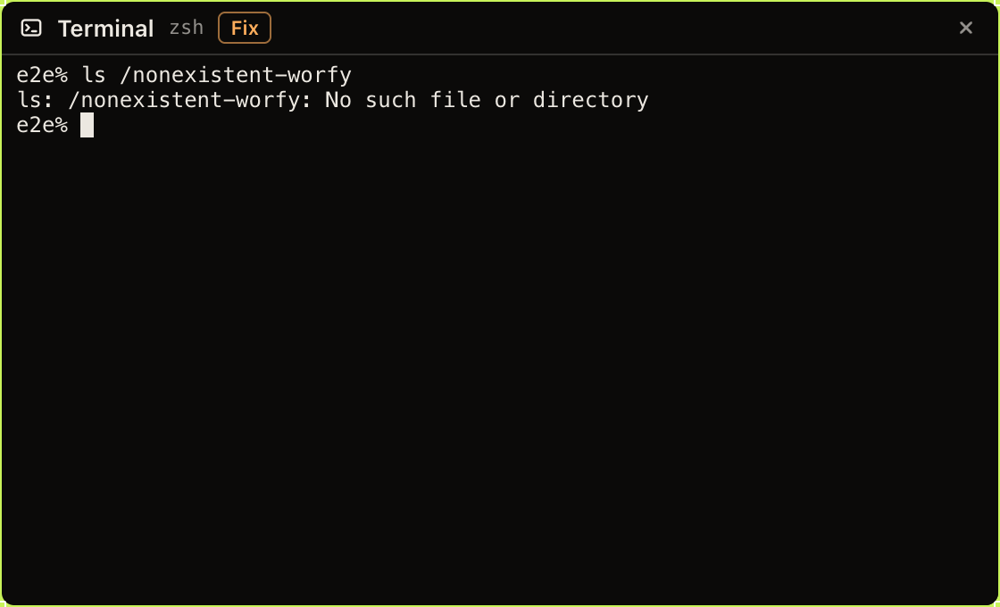

# 07 — Fix: кнопка после команды с ошибкой, Sonnet вставляет исправленную команду, не запуская её

Type: task
Status: done 2026-10-14
PR: #316
Branch: worfy-terminal-ai/07
Blocked by: 02, 03
Source: решения владельца 2026-10-09: пункт 1(d) (кнопка «Fix» после команды с кодом выхода не 0; Sonnet получает команду и ~50 последних строк вывода, возвращает исправленную; она вставляется и не запускается), пункт 2 (функция по требованию доступна до `rejected`), пункт 3 (хвост вывода — только для Fix; redaction до отправки) ([spec.md](../spec.md)); [ADR-0058](../../../docs/adr/0058-terminal-ai-assist-process.md), пункты 5–6; пометки доступа каналов — `src/shared/ipc/channels.ts:20-34`, [ADR-0052](../../../docs/adr/0052-machines-and-linking.md), пункт 6

## Что происходит

- После Ticket-а 01 main хранит для каждого Terminal-а последнюю законченную команду: строку (OSC 633
  E), код выхода (OSC 633 D) и вывод от C до D в пределах `REPLAY_LIMIT` — с escape-последовательностями
  цвета и курсора, как его печатала программа.
- После Ticket-а 03 main заменяет строку shell-а сообщением `insert`.
- После Ticket-а 02 у main есть `request('fix', …)`: Sonnet с `effort: 'low'`, тайм-аут 30 с, отказ
  только при `rejected`; хвост вывода разрешён только у `fix`.
- Шапка Terminal Node-а — `src/renderer/canvas/nodes/TerminalNode.tsx:241-263`: заголовок, имя shell-а,
  после выхода shell-а — `exit N` и Restart (`:249-256`), кнопка закрытия. О кодах выхода отдельных
  команд renderer не знает.
- Рассылка событий всем окнам — реестр клиентов Ticket-а 03 Epic-а `worfy-link`
  (`src/main/clients.ts`, `src/main/broadcast.ts`).
- Spike 2026-10-09: на ошибку TS2307 (нет модуля `axios`) Sonnet ответил `npm install axios`, на отказ
  push (на remote есть чужие коммиты) — `git pull --rebase`; ответ с пояснением — до 3,8 с.
- Ticket 06 правит те же `TerminalNode.tsx` и `TerminalNode.css` — поэтому этот Ticket в Wave после
  него (spec, «Волны»).

## Что делаем

1. **Когда кнопка есть.** `available` — последняя команда кончилась с кодом не 0, новая не началась,
   у команды есть текст (не начиналась с пробела), zsh Terminal-а подключён к socket-у, Fix включён в
   Settings. Каналы — по образцу `projects.settings.get` и `projects.settings.changed`:
   - `terminalAi.fix.state {projectId, nodeId}` → `{available}` — при монтировании Node-а;
   - событие `terminalAi.fix.changed {projectId, nodeId, available}`;
   - `terminalAi.fix.run {projectId, nodeId}` — запрос.

   Файлы — `src/shared/ipc/terminal-ai-fix.ts`, `src/main/ipc/terminal-ai-fix.ts` (новые). Пометка —
   `project`, как у Command request (Ticket 06): Fix работает с Terminal-ом Project-а, рабочий стол ему
   не нужен; с экрана Linked machine-а при включённом доступе кнопка работает и тратит подписку
   Machine Project-а (решение владельца 8(a)).
2. **Кнопка** — в шапке Terminal Node-а, рядом с заголовком: «Fix».
   - Нажатие — `terminalAi.fix.run`, на кнопке «Fixing…».
   - Ответ — строка shell-а заменена исправленной командой, кнопка прячется до следующей ошибки.
   - Отказ (Limits, «Terminal is busy») — короткий текст в шапке на несколько секунд.
3. **Хвост вывода** — `src/shared/terminal-ai/output-tail.ts` (новый): вывод команды без
   escape-последовательностей (CSI, OSC, `\r` перезаписи строки прогресса), последние 50 строк.
4. **Запрос** — `src/main/terminal-ai/fix.ts` (новый). Не в `features/`: Fix начинается с канала IPC,
   а не с сообщения `ask` shell-а, и glob Ticket-а 03 его не собирает. Строка команды, код выхода, папка, ветка, хвост
   вывода → `request('fix', …)` → `insert` в shell. Shell не ждёт ввода — отказ «Terminal is busy».
   Redaction — в контексте Ticket-а 02, в том числе для хвоста вывода.

**Не входит:** автоматический Fix без нажатия; Fix команды внутри
ssh или вложенного shell-а (там нет скриптов worfy).

## Готово, когда

- [x] Unit `test/unit/terminal-ai-output-tail.test.ts` (новый): цвета, движения курсора и OSC убраны; строка прогресса с `\r` — последнее её состояние; 120 строк → последние 50; пустой вывод — пустой хвост.
- [x] Contract `test/contract/terminal-ai-fix.test.ts` (новый), настоящий zsh, assist — поддельный: `ls /nonexistent-worfy` → `terminalAi.fix.state` и событие `terminalAi.fix.changed` — `available` true; `terminalAi.fix.run` → в журнале команда `ls /nonexistent-worfy`, код выхода не 0, хвост с «No such file», модель `sonnet`; строка shell-а — ответ fake; команда не запущена (main не писал в pty `\r`).
- [x] Тот же contract: команда печатает `ghp_…` и падает — в журнале `[redacted]`; началась новая команда — `available` false; команда с пробелом в начале упала — `available` false; Fix выключен в Settings — false; Terminal на `/bin/sh` — false; каналы помечены `project`; Limits `rejected` — отказ со временем сброса, запроса нет.
- [x] Unit (jsdom) `test/unit/terminal-ai-fix-button.test.tsx` (новый): `available` — кнопка «Fix» в шапке; нажатие — «Fixing…» и вызов канала; отказ — текст; событие `terminalAi.fix.changed` с `available` false прячет кнопку.
- [x] e2e `test/e2e/terminal-ai-fix.spec.ts` (новый), fake с ответом: команда с ошибкой в Terminal Node — кнопка «Fix»; нажатие — в строке xterm ответ fake; вывода исправленной команды нет, пока test не нажал Enter; после Enter кнопка пропала.
- [ ] (вручную) `WORFY_AGENT=fake pnpm dev`: кнопка «Fix» в шапке Terminal-а в светлой и тёмной теме — `../evidence/07-fix-light.png`, `../evidence/07-fix-dark.png`. Как проверить: окно worfy. — не проверено: `pnpm dev` с настоящим HOME не запускался; снимки по этим путям сделаны Playwright-ом из `test/e2e/terminal-ai-fix.spec.ts` на собранном приложении с временным HOME.
- [x] `test/e2e/terminal.spec.ts` и `test/e2e/focus.spec.ts` зелёные без правки ожиданий.
- [x] `pnpm lint`, `pnpm typecheck`, `pnpm test` — exit 0; `GATE_SCOPE=all` gate full локально — exit 0.

## Тесты

Сначала падающий test — contract «`ls /nonexistent-worfy` → `available` true»: каналов ещё нет.
Потом хвост вывода, кнопка, e2e. Assist поддельный. В «Итог» — как падал первый test.

## Где в коде

- `src/main/terminal-ai/fix.ts` (новый)
- `src/shared/terminal-ai/output-tail.ts` (новый)
- `src/shared/ipc/terminal-ai-fix.ts` (новый)
- `src/main/ipc/terminal-ai-fix.ts` (новый)
- `src/renderer/canvas/nodes/TerminalNode.tsx`
- `src/renderer/canvas/nodes/TerminalNode.css`
- `test/unit/terminal-ai-output-tail.test.ts` (новый)
- `test/unit/terminal-ai-fix-button.test.tsx` (новый)
- `test/contract/terminal-ai-fix.test.ts` (новый)
- `test/e2e/terminal-ai-fix.spec.ts` (новый)

## Итог

**Первый test.** Contract `test/contract/terminal-ai-fix.test.ts` до кода каналов падал так: файл
не загружался — `Error: Cannot find module '/src/main/ipc/terminal-ai-fix'` (0 tests, exit 1).

**Как сделано.**

- Какая команда упала, main узнаёт из событий интеграции shell-а (`command-started`,
  `command-finished` с текстом команды и кодом выхода) — `FailedCommands` в
  `src/main/terminal-ai/fix.ts`. Команда считается, если её текст известен (не начиналась с пробела) и
  код выхода не 0. Её снимают: начало следующей команды, отключение zsh от socket-а, Fix, чей ответ
  уже в строке. Слушатель событий ставится при первом вызове канала (Node вызывает
  `terminalAi.fix.state` при монтировании), синхронно, до загрузки assist-сервиса.
- `available` = есть упавшая команда, команда сейчас не идёт, zsh подключён, Fix включён в Settings.
  Каналы `terminalAi.fix.state` / `terminalAi.fix.changed` / `terminalAi.fix.run`, все `project`.
- `runFix()`: shell не ждёт ввода (идёт команда, альтернативный экран, prompt ещё не показан) —
  «Terminal is busy», модель не спрашивается. Иначе `request('fix', …)` с хвостом вывода
  (`outputTail`, `src/shared/terminal-ai/output-tail.ts`); redaction и обрезка строк до 500 символов —
  прежние, в `prepareContext()` Ticket-а 02. Ответ — `insert` в zsh; Enter не пишется.
- Ответ, пришедший после начала новой команды, в строку не попадает: начало команды отменяет запрос, и
  `runFix()` ещё раз сверяет, что упавшая команда та же.
- Кнопка — в шапке рядом с именем shell-а; «Fixing…» на время запроса; после ответа фокус уходит в
  терминал (Enter запускает команду); отказ — серый текст в шапке на 4 с.
- Ни preload, ни `channels.ts`, ни `src/main/terminal/*`, ни `shell-link.ts` не правились.

**Решено без владельца, подтверждено владельцем 2026-10-16:**

1. Команда уходит в модель как последняя из «Recent commands» вместе с «Exit code of the last
   command»; отдельного поля в контексте нет (`context.ts` не менялся).
2. После удачного Fix кнопка пропадает на всех экранах до следующей упавшей команды; пустой Enter её
   не возвращает.
3. Тексты отказов: те же, что у Command request («Limits reached until 14:20», «Terminal AI is off»,
   «Terminal is busy», «Claude did not answer in time», «Claude had no command for that», «Claude
   could not answer», «The shell is not ready yet»), и свои — «Nothing to fix», «Cancelled»,
   «The shell is not connected to Terminal AI», «The shell is gone».
4. Строка прогресса: хвост показывает то, что показал бы терминал. Короткое состояние поверх длинного
   оставляет конец длинного, если программа не стёрла его (`CSI K`).
5. Вид кнопки — оранжевая обводка цвета ошибки (`--blocked-ring`) в обеих темах; контраст текста
   кнопки ≥ 4,5:1 проверяет e2e.

**Проверки (head на 69b7d1d3):**

- `pnpm lint`, `pnpm typecheck`, `pnpm test` — exit 0 (242 файла прошли, 6 пропущены; 5105 tests
  прошли, 66 пропущены); gate fast — exit 0, «зелено (fast)».
- e2e на собранном приложении под общей блокировкой: `terminal-ai-fix` — 1 passed (снимки
  `../evidence/07-fix-light.png`, `../evidence/07-fix-dark.png`); `terminal`, `focus`,
  `terminal-ai-request` — 14 passed, ожидания не правились.
- Mutation testing: 15 мутантов на копиях в своём каталоге (`fix.ts`, канал main, кнопка, хвост
  вывода), убиты все. Первый круг оставил живым один — «Fixing…» пропадал, если main убирал кнопку до
  ответа канала; под него дописана проверка в `test/unit/terminal-ai-fix-button.test.tsx`.

### Gate оркестратора (2026-10-14)

- Wave Epic-а под Autopilot из одного Ticket-а 07; соседей нет. Образец — Ticket 06 (каналы `state`/`changed`/`run` с пометкой `project`, contract на настоящем zsh, e2e с временным `HOME`).
- Гейт — один круг: `VERIFIED` на `b3c29de` ([комментарий в PR #316](https://github.com/IDSAD-XL/worfy/pull/316#issuecomment-6164486894)). Verifier сам: gate fast — код 0, не из кэша; три новых test-файла — 24 passed; 14 своих мутантов — 9 красные, 2 эквивалентные, 3 — пробелы ниже; e2e `terminal-ai-fix`, `terminal`, `focus`, `terminal-ai-request` под замком — 16 passed; снимки шапки («Fix», «Fixing…», отказ) в обеих темах, контраст текста отказа 5,6:1 и 6,3:1 при ≥ 4,5:1 (`docs/design/F-SPEC.md:40`); evidence Ticket-а показывают кнопку после `ls /nonexistent-worfy`. «main не пишет Enter в pty» подтверждено: `runFix()` шлёт только `insert` (`src/main/terminal-ai/fix.ts:103`). Гонки со слушателем событий shell integration (not_verified исполнителя) нет: `terminalAi.fix.state` уходит раньше `terminal.open` (`TerminalNode.tsx:200`, `:306`).
- Мерж: база main `69b7d1d`, head `b3c29de`; `GATE_SCOPE=all gate full` — один запуск под замком e2e, код 0, не из кэша, строка `[gate] зелено (full)` с `test:e2e` и `test:package`; CI зелёный, CLEAN; влит `5c4b543`.
- Act on, Consider, Dismissed — нет.
- Noted ([low]):
  - `src/main/ipc/terminal-ai-fix.ts:47` (`link.connected()` в `available`) и `:83` (`failed.forget(key)` при отключении zsh) защищают от одного случая, и мутант без любой из них по отдельности выживает: без test-а Restart под тем же ключом Terminal-а и события shell integration при неподключённом socket-е Terminal AI;
  - `src/renderer/canvas/nodes/TerminalNode.tsx:389` (`onMouseDown preventDefault`) не держит ни один test: после отказа фокус остался бы на кнопке, а не в терминале.
- Ручной пункт `pnpm dev` — `[ ]`: не проверено, `pnpm dev` с настоящим HOME не запускался; снимки — Playwright на собранном приложении с временным HOME.
- **Решено без владельца, подтверждено владельцем 2026-10-16:** решения исполнителя выше в «Итог» (команда — последней в «Recent commands» с кодом выхода, без отдельного поля; после Fix кнопка пропадает на всех экранах до следующей ошибки; новые тексты отказов; хвост строки прогресса — как показал бы терминал; оранжевая обводка `--blocked-ring`).

Решение владельца 2026-10-16: все пункты «Решено без владельца» этого Ticket-а приняты пакетом.
