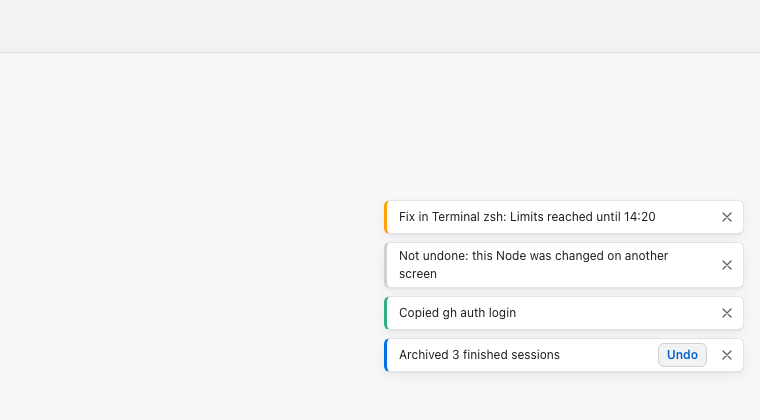
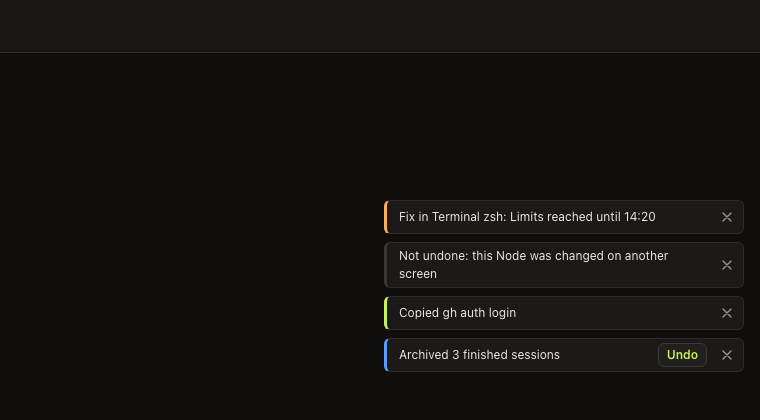
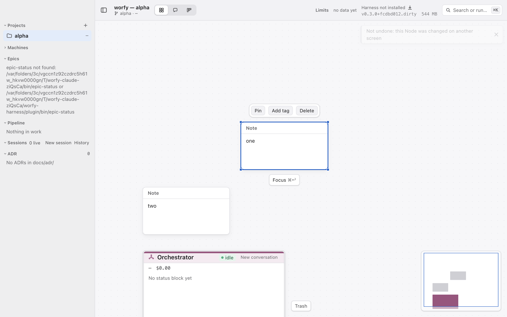
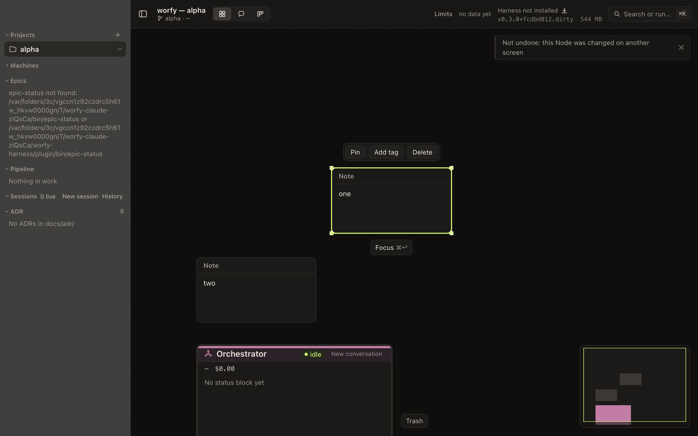
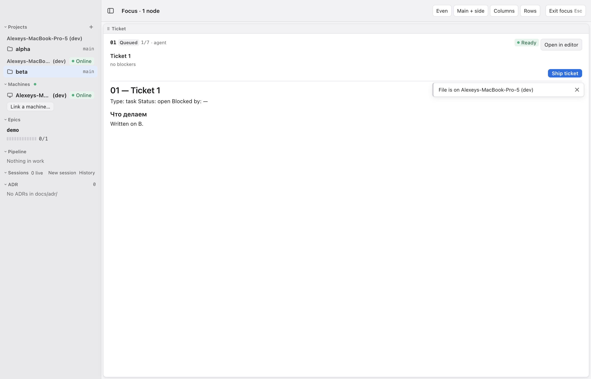
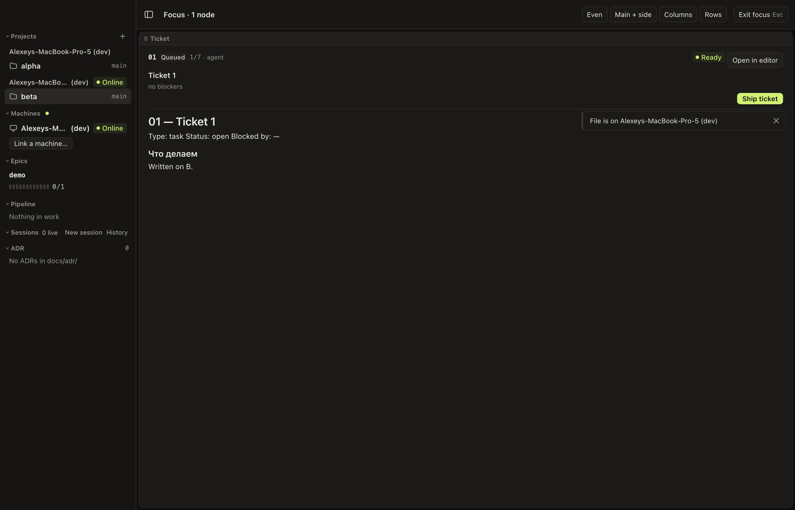
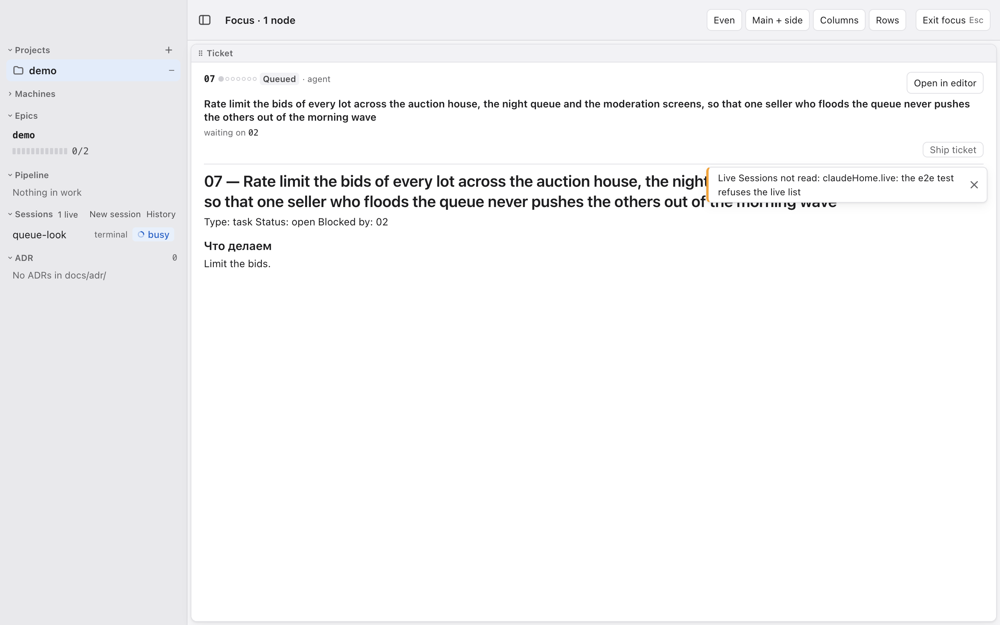
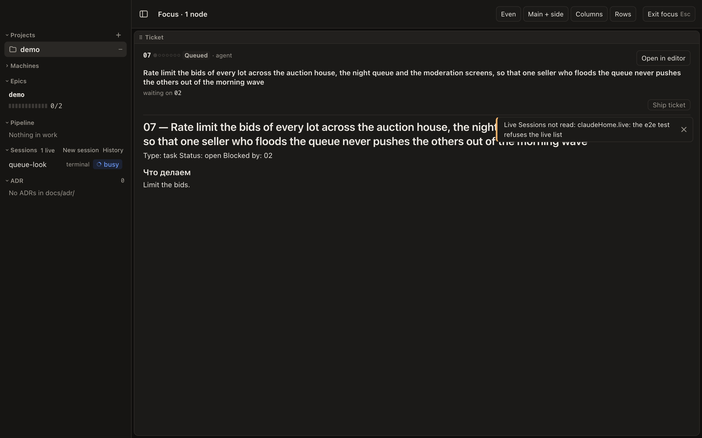
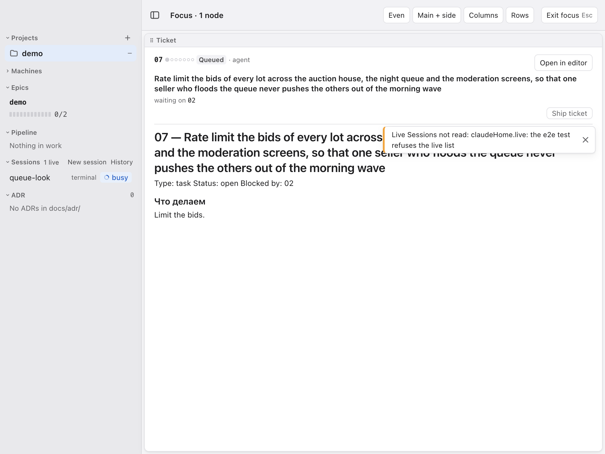
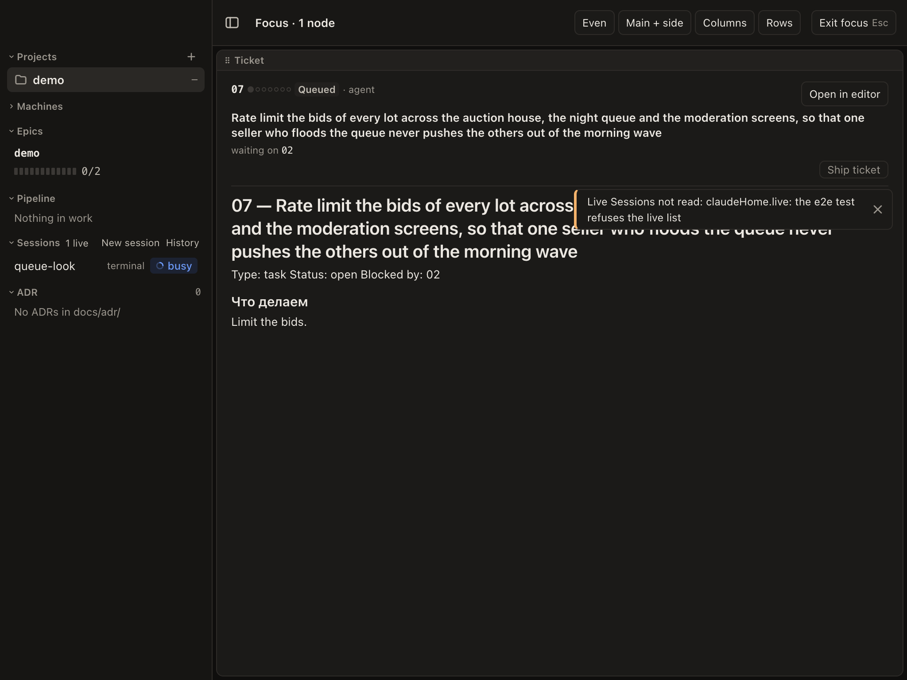

# 16 — Внутренние toast-ы: одно хранилище и один компонент для уведомлений в окне

Type: task
Status: claimed 2026-10-21T08:09Z
Branch: worfy-ui/16
Blocked by: —
Source: отзыв владельца 2026-10-19 после ручной приёмки Ticket-а 12 на Stable copy: «внутренние
toast-ы, которые можно использовать для многих вещей, в том числе для таких вопросов» (вопросы с
вариантами ответа — [Ticket 17](17-вопросы-с-вариантами-ответа-в-session.md)). Код перечитан по main
`9fa28aed`.

## Что происходит

- Компонента toast-а в renderer нет: поиск `toast` по `src/renderer` пуст. Каждое короткое сообщение
  в окне сделано на месте, со своим таймером и своей вёрсткой.
- Четыре таких сообщения:
  - **⌘Z пропущен** (worfy-link 07). Хранилище `skippedNotice` и таймер — `src/renderer/canvas/history.ts:191`
    (`SKIPPED_NOTICE_MS = 4000`) и `:211`. Показывает overlay `src/renderer/canvas/overlays/UndoSkipped.tsx:40`
    (`role="status"`, React Flow `Panel` сверху по центру), только для активного Project-а. Overlay-и
    собирает glob `src/renderer/canvas/extensions.ts:84`. e2e — `test/e2e/trash-undo.spec.ts:310`
    (`undo-skipped`).
  - **«File is on <Machine>»** (worfy-link 12). Hook `src/renderer/machines/useFileElsewhere.ts:11`
    (`HINT_MS = 4000`, таймер `:30`) отдаёт элемент `FileElsewhereHint`
    (`src/renderer/machines/FileElsewhereHint.tsx:25`, `role="status"`), и его ставят у себя
    `TicketNode.tsx:133`, `AdrSection.tsx:109` и `Markdown.tsx:58`. e2e —
    `test/e2e/linked-system-actions.spec.ts:218`.
  - **Причина отказа Fix в Terminal** (Terminal AI). `src/renderer/canvas/nodes/TerminalNode.tsx:161`
    (`FIX_NOTE_MS = 4000`), таймер `:190`, текст в шапке Terminal `:485` (`role="status"`).
  - **«Copied»** у кнопки Copy в First run и Settings → Health — `src/renderer/shell/FirstRunChecks.tsx:84`.
    Таймера нет: надпись «Copied» (`:87`) остаётся, пока кнопка на экране.
- Ошибки IPC (вызовы main из окна) в четырёх hook-ах:
  - **Только в консоли**, человек их не видит:
    - сбой подписки — `useWorkflow.ts:75`, `useDocs.ts:43`, `useClaudeHome.ts:191`, `useLayout.ts:45`;
    - `claudeHome.live` — `useClaudeHome.ts:154`.
  - **Уже показаны на месте**, кроме консоли:
    - `workflow.open` (`useWorkflow.ts:91`) — секция Epics, `EpicsSection.tsx:52`;
    - `docs.open` (`useDocs.ts:57`) — секция ADR и HANDOFF Node;
    - `claudeHome.sessions` (`useClaudeHome.ts:124`) — секция Sessions;
    - `claudeHome.transcript` (`useClaudeHome.ts:269`) — в transcript-е;
    - `layout.get` (`useLayout.ts:67`) — вместо Canvas, `Canvas.tsx:595-600` (`role="alert"`);
    - `layout.apply` (`useLayout.ts:99`) — ответ вызывающему коду.
- Системные уведомления (`src/main/notify.ts`) приходят, только когда у окна нет фокуса:
  `NoteDisplay.show` выходит при фокусе (`notify.ts:163`), показ — `showSystem` (`:417`). В окне с
  фокусом о конце хода Session в фоне ничего не сообщает. Это ниже, в «Вне скоупа».

## Что делаем

1. **Хранилище toast-ов** — `src/renderer/toast/toasts.ts` (новый), zustand, как остальные хранилища
   renderer. API: `showToast(toast)` → id, `dismissToast(id)`; повторный показ с тем же `key`
   заменяет toast и запускает время заново (так сейчас работает повторный ⌘Z, `key={notice.count}`).
   Необязательный `projectId`: toast виден, только пока этот Project активен (как `UndoSkipped`).
2. **Виды:**
   - `info` и `success` — скрываются сами через 4 с (время четырёх сообщений сейчас);
   - `error` — висит, пока его не закроют;
   - `action` — с кнопками (1–3), висит, пока не нажата кнопка или не закрыт. Нажатие кнопки зовёт её
     обработчик и закрывает toast.
   - У каждого есть кнопка закрытия.
   - Наведение мыши или фокус клавиатуры на toast-е останавливают таймер, уход — запускает заново.
3. **Предел стопки:** на экране не больше трёх toast-ов. Новый toast вытесняет самый старый из тех,
   что скрываются сами. Если все три висят (`error`, `action`), новый ждёт в очереди и выходит, когда
   место освободится.
4. **Компонент** `src/renderer/toast/ToastRegion.tsx` (новый; не `Toasts.tsx`: рядом с `toasts.ts` на
   файловой системе без учёта регистра оба имени — один файл) — один на окно, ставится в
   `src/renderer/main.tsx`. Его видно поверх Canvas, Session view и режима фокуса. Место на экране
   выбирает исполнитель (в «Итог», со снимком), с одним условием: toast-ы не закрывают поле ввода
   Session с кнопкой Send и Minimap.
5. **Доступность:**
   - `info`, `success` и `action` — в области `role="status"` (`aria-live="polite"`), `error` — в
     `role="alert"`;
   - область — landmark с `aria-label="Notifications"`;
   - toast не забирает фокус; кнопки `action` доступны по Tab; Escape на toast-е в фокусе закрывает
     его.
6. **Вид** — токены `src/renderer/theme/tokens.css`, светлая и тёмная тема. С «Reduce motion» в
   системных настройках toast появляется без анимации. Вид и размеры — в «Итог» (соглашение Epic-а:
   Ticket-ы описывают вид у себя, F-SPEC пишет Ticket 12).
7. **Перевод четырёх сообщений на toast-ы:**
   - ⌘Z пропущен — `info` с `key` и `projectId`. `UndoSkipped.tsx` удаляется, `skippedNotice` и
     `SKIPPED_NOTICE_MS` в `history.ts` — тоже: `history.ts` зовёт `showToast`. `data-testid="undo-skipped"`
     остаётся на toast-е, e2e `trash-undo.spec.ts` проверяет его.
   - «File is on <Machine>» — `info` с `key`; `useFileElsewhere` больше не отдаёт элемент `hint`, три
     места его показа его не ставят.
   - Отказ Fix — `error` с текстом причины и названием Terminal (toast теперь не в шапке Terminal, а
     в общем месте окна).
   - Copy — `success` «Copied <что>», надпись кнопки остаётся «Copy».
8. **Ошибки IPC, которые сейчас только в консоли** (сбои подписки в четырёх hook-ах и
   `claudeHome.live`), становятся toast-ами `error` с `key` по каналу: повтор той же ошибки не
   складывает стопку. Ошибки, которые уже показаны на месте (список выше), toast не дублирует.
   `console.error` остаётся.

**Не входит:** вопросы Session с вариантами ответа (Ticket 17 ставит их в toast `action`).

## Готово, когда

- [ ] Поиск `setTimeout` с `SKIPPED_NOTICE_MS`, `HINT_MS`, `FIX_NOTE_MS` в `src/renderer` пуст;
      `UndoSkipped.tsx` и `FileElsewhereHint.tsx` удалены или не показывают сообщение сами.
- [ ] Unit хранилища (`test/unit/toasts.test.ts`, fake timers): `info` скрывается через 4 с, `error`
      и `action` — нет; тот же `key` заменяет toast и сбрасывает время; четвёртый toast вытесняет
      старейший самоскрывающийся, а при трёх висящих ждёт в очереди; пауза таймера при наведении и
      фокусе; `projectId` прячет toast чужого Project-а.
- [ ] Unit компонента (`test/unit/toasts-view.test.tsx`): роли `status` и `alert`, `aria-label`
      области, Escape закрывает toast в фокусе, кнопка `action` зовёт обработчик и закрывает toast,
      фокус при показе не уходит из поля ввода.
- [ ] e2e: `trash-undo.spec.ts` — пропущенный ⌘Z показывает toast `undo-skipped`, во втором окне его
      нет, через 4 с он исчезает; `linked-system-actions.spec.ts` — «File is on <Machine>» как toast.
- [ ] Ошибка подписки (подменённый `subscribe` бросает) показывает один toast `error`, повтор — не
      второй (unit).
- [ ] Мутанты красные: `error` скрывается сам; без замены по `key`; без предела стопки; без паузы
      таймера при фокусе.
- [ ] Снимки toast-ов всех четырёх видов в светлой и тёмной теме — в «Итог»; `pnpm lint`,
      `pnpm typecheck`, `pnpm test` — exit 0; gate full — exit 0 и строка `[gate] зелено (full)`
      (оркестратор перед merge).

## Тесты

- Unit `test/unit/toasts.test.ts` (новый) — хранилище: время, `key`, стопка, очередь, пауза, Project.
- Unit `test/unit/toasts-view.test.tsx` (новый) — роли, клавиатура, кнопки `action`.
- Сначала падающие: unit хранилища и e2e `undo-skipped` на toast-е пишутся до переноса.
- e2e `test/e2e/trash-undo.spec.ts` и `test/e2e/linked-system-actions.spec.ts` — перенесённые сообщения.
- Unit `test/unit/terminal-ai-fix-button.test.tsx` и `test/unit/file-elsewhere.test.tsx` — обновляются
  под toast-ы.

## Где в коде

- `src/renderer/toast/toasts.ts` (новый)
- `src/renderer/toast/ToastRegion.tsx` (новый)
- `src/renderer/toast/toast.css` (новый)
- `src/renderer/main.tsx`
- `src/renderer/canvas/history.ts`
- `src/renderer/canvas/overlays/UndoSkipped.tsx`
- `src/renderer/machines/useFileElsewhere.ts`
- `src/renderer/machines/FileElsewhereHint.tsx`
- `src/renderer/canvas/nodes/TicketNode.tsx`
- `src/renderer/shell/sidebar/AdrSection.tsx`
- `src/renderer/markdown/Markdown.tsx`
- `src/renderer/canvas/nodes/TerminalNode.tsx`
- `src/renderer/shell/FirstRunChecks.tsx`
- `src/renderer/workflow/useWorkflow.ts`
- `src/renderer/docs/useDocs.ts`
- `src/renderer/claude-home/useClaudeHome.ts`
- `src/renderer/canvas/useLayout.ts`
- `test/unit/toasts.test.ts` (новый)
- `test/unit/toasts-view.test.tsx` (новый)
- `test/unit/terminal-ai-fix-button.test.tsx`
- `test/unit/file-elsewhere.test.tsx`
- `test/e2e/trash-undo.spec.ts`
- `test/e2e/linked-system-actions.spec.ts`
- `src/renderer/ipc.ts` (`showSubscribeError` — один текст сбоя подписки для четырёх hook-ов)
- `src/renderer/canvas/nodes/TerminalNode.css` (убрано правило строки отказа Fix)
- `tsconfig.test.node.json` (`toasts.ts` в `include`: его импортирует `history.ts`)
- `test/unit/adr-section.test.tsx`, `test/unit/markdown.test.tsx`, `test/unit/ticket-focus.test.tsx`,
  `test/unit/settings-health.test.tsx` — «File is on <Machine>» и «Copied» теперь toast-ы
- `src/renderer/toast/placement.ts` (новый: выбор полосы для стопки), `test/unit/toast-placement.test.ts` (новый)
- `test/e2e/toast-placement.spec.ts` (новый: toast не закрывает кнопки при 1280×800 и 1024×768)
- метки `data-toast-keep-out` / `data-toast-over`: `src/renderer/shell/Toolbar.tsx`,
  `src/renderer/focus/FocusMode.tsx`, `src/renderer/session/SessionView.tsx`,
  `src/renderer/session/ExternalSessionPanel.tsx`, `src/renderer/find/CanvasFind.tsx`,
  `src/renderer/shell/sidebar/AdrSection.tsx`, `src/renderer/canvas/nodes/TicketNode.tsx`
- `.scratch/worfy-ui/evidence/16-*.png` (снимки)

## Вне скоупа

- Toast о событии Session в фоне, пока у окна фокус (сейчас системное уведомление в этом случае не
  приходит, `notify.ts:163`). Нужен — отдельный Ticket поверх этого хранилища.
- Раздел «Toasts» в `docs/design/F-SPEC.md`. Его пишет Ticket 12 по «Итог» этого Ticket-а, если 16
  влит раньше; иначе — docs-правка оркестратора после мержа. F-SPEC не в «Где в коде», чтобы не
  пересекаться с 12.
- Ошибки, которые уже показаны на месте: секции боковой панели, Canvas, transcript.

## Итог

Черновик исполнителя (PR ветки `worfy-ui/16`); оркестратор дополняет при закрытии.

- **Файлы.** Хранилище — `src/renderer/toast/toasts.ts` (`showToast`, `dismissToast`, `pressToastAction`,
  `holdToast`, `setToastProject`, `isToastShown`); текст сбоя подписки — `showSubscribeError` в
  `src/renderer/ipc.ts`, его зовут четыре hook-а. Компонент — `src/renderer/toast/ToastRegion.tsx`, а не
  `Toasts.tsx`: рядом с `toasts.ts` на файловой системе без учёта регистра (macOS, Windows) импорт
  `./toasts` и `./Toasts` попадает в один файл, test компонента получал хранилище вместо компонента.
- **API для worfy-canvas 10.** `showToast({ kind: 'action', key: batch, projectId, text, actions: [{ label: 'Undo', run }] })`;
  `key` — это id toast-а, повтор с тем же `key` заменяет toast на месте; кнопка зовёт `run` и закрывает
  toast, даже если `run` бросил; у `action` от одной до трёх кнопок (проверяет тип).
- **Место — правый край окна, высота измеряется** (решение исполнителя после второго ревью #677, для
  владельца): сверху по центру открываются Command palette и поиск по Canvas, и `error`, который
  висит, закрывал бы их поле; а постоянный отступ от toolbar не годится, потому что шапка focus mode
  растёт с заголовком и строкой блокеров Ticket-а. Пока toast на экране, `ToastRegion.tsx` раз в
  200 мс и при resize меряет, что лежит в его колонке (ширина до 360 px, `right: 16px`): toolbar,
  полосу focus mode и заголовки плиток, ряды шапки Ticket-а в фокусе (номер с «Open in editor»,
  заголовок, строка блокеров, ряд действий с «Ship ticket»), шапку Session view, шапку ADR, поиск по
  Canvas — они помечены `data-toast-keep-out`, — и любой открытый `role="dialog"` или `role="menu"`
  (Command palette, Settings, меню «⋯»). Стопка встаёт в первую свободную полосу сверху, где
  помещается целиком (`placement.ts`, зазор 12 px); если такой нет — в самую высокую полосу,
  обрезанная по ней (прокрутка); если колонку целиком закрывает диалог — под toolbar поверх него,
  чтобы ошибку всё равно было видно. Панель ADR (`data-toast-over`) высотой во всю колонку: toast
  может лечь на её текст, но не на шапку с кнопками. Canvas не меряется: его Node-ы двигаются под
  toast-ом вместе с видом. Без toast-ов ничего не меряется. Доказательство — e2e
  `toast-placement.spec.ts` при 1280×800 и 1024×768 с `error`, который висит: ни одна кнопка, поле
  или пункт focus mode на Ticket-е с заголовком в две строки и строкой блокеров, Command palette с
  результатами, Settings, шапки Session view (Orchestrator с Interrupt и Session из терминала) не
  пересекается с toast-ом, и `document.elementFromPoint` в центре каждого — не toast. Область
  рисуется на `<body>` с z-index 120: над focus mode, над диалогами (90–101) и над окном Settings
  (110; modal guard пропускает клавиши слоя выше). Мышь берут только сами toast-ы.
  Порядок: сначала `error` (область `role="alert"`), под ними остальные (`role="status"`).
- **Вид.** Поверхность `--surface`, рамка `--border`, радиус `--radius-button`, тень `--shadow-node`,
  текст 12/18 px, до трёх строк (полный текст — в `title`). Вид — полоса слева 3 px: `info` —
  `--border-strong`, `success` — `--ready-dot`, `error` — `--blocked-ring`, `action` — `--working-dot`.
  Кнопки `action` — 24 px, `--accent`; кнопка закрытия «Dismiss» 24 px. Появление — 160 мс
  (прозрачность и сдвиг справа на 8 px), при «Reduce motion» без анимации.
- **Фокус.** Escape, Dismiss или кнопка `action` на toast-е в фокусе возвращают фокус туда, где он был
  до toast-а.
- **Время.** Наведение мыши или фокус останавливают время; когда ушли оба, 4 с начинаются заново
  целиком.
- **Toast другого Project-а** скрыт и не занимает места в стопке из трёх; его время идёт.
- **Тексты.** ⌘Z — прежние «Not undone/Not redone: this Node was changed on another screen»;
  «File is on <Machine>»; отказ Fix — «Fix in Terminal <shell>: <причина>»; Copy — «Copied <команда>»;
  сбой подписки — «Updates stopped: cannot subscribe to <канал> (<ошибка>)»; `claudeHome.live` —
  «Live Sessions not read: <причина>». Повтор той же причины `claudeHome.live` при опросе раз в 2 с
  не показывает toast снова и не возвращает закрытый; ответ без ошибки убирает его. Toast один на все
  корни Project-ов: когда отвечает корень, чью причину он показывает, а другой ещё не отвечает, toast
  показывает причину другого.
- **Снимки.** Все четыре вида (разметка компонента с `tokens.css` и `toast.css` в Chromium):
   .
  В приложении (e2e `trash-undo.spec.ts`): 
   (снято в середине появления, 160 мс); над focus mode
  (e2e `linked-system-actions.spec.ts`): 
  ; `error` под шапкой Ticket-а с заголовком в две
  строки (e2e `toast-placement.spec.ts`), 1280×800: 
  , 1024×768: 
  .
