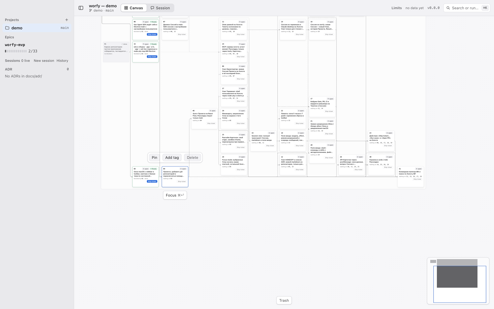

# 05 — Edge-и тонкие и бледные: цепочка Ticket-а — при наведении, Binding — только у живых агентов

Type: task
Status: done — 2026-10-07, [PR #87](https://github.com/IDSAD-XL/worfy/pull/87)
Blocked by: 03
Source: решения владельца 2026-10-07, вопросы 14, 15 и 20 ([spec.md](../spec.md), раздел «Решения владельца по Canvas»); [spec.md](../spec.md), этап 2

## Что происходит

- Все Edge-и видны всегда, наведение и выделение их не меняют.
  - Blocked by (`src/renderer/canvas/edges/blocking.ts:15`): пунктир, пока блокер не done; тонкая
    сплошная линия, когда done (`src/renderer/canvas/epic-frame.css:341`, `:346`).
  - Binding (`src/renderer/canvas/edges/bindings.ts:10`): пунктир `5 4` цвета `--accent`, кривая
    React Flow по умолчанию.
  - Subagent (`src/renderer/canvas/edges/subagents.ts:15`): `smoothstep`.
- На рамке с десятками Ticket-ов Edge-и done и Edge-и Binding всех Session-ов закрывают картину:
  связи одного Ticket-а не разглядеть.
- Ticket 03 даёт маршруты Blocked by по коридорам между колонками, свой тип Edge-а
  (`src/renderer/canvas/edge-types/RoutedEdge.tsx`) и точку расширения `edge-types/`, которой не
  нужна правка `Canvas.tsx`.

## Что делаем

1. **По умолчанию — тонко и бледно** (решение 14). Все Edge-и Blocked by — 1 px, бледный цвет.
   Edge от done Ticket-а (блокер done) по умолчанию не рисуется. Цвета — существующие токены обеих
   тем (`src/renderer/theme/tokens.css`). Если нужен новый токен — исполнитель добавляет файл
   токенов в «Где в коде» и заводит токен в обеих темах.
2. **Цепочка Ticket-а.** Наведение на Ticket или его выделение подсвечивает цепочку — все Edge-и
   Blocked by на путях через этот Ticket: вверх (кто блокирует его и кто блокирует тех, до конца) и
   вниз (кого блокирует он, до конца). Edge-и от done Ticket-ов в цепочке рисуются, пока она
   подсвечена. Остальные Edge-и остаются бледными. Подсвечены сразу цепочки всех выделенных
   Ticket-ов и Ticket-а под курсором.
3. **Binding** (решение 20). Всегда видна линия живого агента: Session, чей процесс Claude Code
   работает сейчас (`claudeHome.live`, `src/shared/ipc/claude-home.ts:84`), и Subagent со статусом
   `running`. Линия остального агента рисуется, пока наведён или выделен Node агента или Node его
   цели (Ticket, рамка Epic). Форма — ортогональная со скруглёнными углами, радиус тот же, что у
   Blocked by. Пунктир и цвет — прежние.
4. **Subagent** — та же ортогональная форма и радиус; видимость прежняя.
5. **Как это устроено.** Overlay в `src/renderer/canvas/overlays/` (Canvas находит его сам, без
   правки `Canvas.tsx`) следит за наведением на Node-ы и за выделением React Flow и кладёт их в
   store. Компоненты Edge-ей читают store и решают сами: бледный, подсвеченный или скрытый. Список
   Edge-ей (`edgesOf`, `Canvas.tsx:161`) от наведения не пересчитывается. Перерисовываются только
   Edge-и, чьё состояние поменялось.

## Готово, когда

- [x] Unit: на фикстуре Epic-а Edge от done блокера по умолчанию не нарисован; остальные Edge-и Blocked by — 1 px и с бледным классом.
- [x] Unit: цепочка на фикстуре A→B→C, D→B, C→E, F→G (стрелка — «блокирует»): наведение на B подсвечивает A→B, D→B, B→C, C→E и не трогает F→G. Edge от done блокера в цепочке нарисован, пока цепочка подсвечена. Уход курсора возвращает вид по умолчанию.
- [x] Unit: выделенный Ticket держит подсветку, пока он выделен; наведение на другой Ticket добавляет его цепочку.
- [x] Unit: смена наведения перерисовывает только Edge-и, чьё состояние поменялось (счётчик render-ов компонента Edge-а).
- [x] Binding: линия живой Session видна всегда; линия Session без процесса — только при наведении или выделении её Node-а или Node-а цели; форма ортогональная. Unit-test в `test/unit/binding-canvas.test.tsx` и e2e.
- [x] e2e `test/e2e/edges.spec.ts`: наведение на Ticket рамки `worfy-mvp` подсвечивает ровно Edge-и его цепочки (по `data-testid`) не позже 100 ms после наведения; уход курсора возвращает вид по умолчанию.
- [x] Бюджет `test/e2e/epic-frame.spec.ts:779` держится. В нём же — замер: наведение на Ticket самой большой рамки, время до подсветки печатается, с `WORFY_PERF=1` — не больше 100 ms.
- [x] Снимки в светлой и тёмной теме (helper `test/e2e/snapshots.ts`): вид по умолчанию, подсвеченная цепочка, линия живой и неживой Session. Сверены с F-SPEC (линии 1 px, токены обеих тем); ссылка из «Итог» — `../evidence/05-edge-и.png`.
- [ ] (вручную) Stable copy после влития: самая большая рамка Auction — по умолчанию только бледные Edge-и, наведение на Ticket показывает его цепочку, линии Binding видны у работающих Session-ов. Как проверить: окно приложения.
  2026-10-07: бледные Edge-и по умолчанию и цепочка при наведении проверены на Stable copy из 6df9791; линии Binding не проверены — на Canvas Auction нет Edge-ей Binding; проверка этой рамки не прошла из-за ⌘Z после перетаскивания рамки (Ticket 03) — подраздел [«Ручная проверка 2026-10-07»](#ручная-проверка-2026-10-07).

## Тесты

Сначала падающий test — `test/unit/edge-focus.test.tsx`: Edge от done блокера по умолчанию не
нарисован. На нынешнем main `blockingEdges` (`edges/blocking.ts:15`) отдаёт его с классом
`w-edge-blocking--done`, и он виден — test падает. В «Итог» — как он падал.

- `test/unit/edge-focus.test.tsx` — новый: вид по умолчанию, цепочка, выделение, число перерисовок.
- `test/unit/binding-canvas.test.tsx` — линии живых и неживых агентов.
- `test/e2e/edges.spec.ts` — новый: наведение и выделение на собранном приложении.

Test-ы, которые меняются вместе с поведением:

- `test/e2e/epic-frame.spec.ts:206` — по умолчанию нарисованы Edge-и только от блокеров не done;
  Edge от done блокера появляется при наведении на Ticket его цепочки.
- `test/e2e/binding.spec.ts:291` — шесть линий Binding были видны всегда; теперь — только у живых
  агентов, остальные — при наведении.

## Где в коде

- `src/renderer/canvas/edge-focus.ts` — новый: store наведения и выделения, расчёт цепочки
- `src/renderer/canvas/overlays/EdgeFocus.tsx` — новый
- `src/renderer/canvas/edge-types/RoutedEdge.tsx`
- `src/renderer/canvas/edge-types/StepEdge.tsx` — новый: ортогональный Edge Binding и Subagent
- `src/renderer/canvas/edges/blocking.ts`
- `src/renderer/canvas/edges/bindings.ts`
- `src/renderer/canvas/edges/subagents.ts`
- `src/renderer/canvas/sources/workflow-bindings.ts`
- `src/renderer/canvas/epic-frame.css`
- `test/unit/edge-focus.test.tsx` — новый
- `test/unit/binding-canvas.test.tsx`
- `test/e2e/edges.spec.ts` — новый
- `test/e2e/epic-frame.spec.ts`
- `test/e2e/binding.spec.ts`

`workflow-bindings.ts` кладёт в данные anchor-а Binding-а, жив ли агент (он уже читает
`useClaudeHome`). `Canvas.tsx` этот Ticket не меняет. Общих файлов с Ticket-ом 04 нет, он в той же
Wave.

## Итог

Сделано в ветке `worfy-week/05`, база `origin/main` 73e8b52. ADR не заводился.

**Влито.** [PR #87](https://github.com/IDSAD-XL/worfy/pull/87), merge 6e0811f. Ревью — VERIFIED с
первого круга, без доработки: состояния «бледный» и «подсвеченный» и подписка каждого Edge-а на
свой ответ подтверждены мутантами (подписка на всё множество `lit`, обход цепочки только вверх,
`showWith` и у живого агента, бледный вместо скрытого Edge от done блокера). С клавиатуры: Tab ставит
фокус на Ticket, Enter выделяет его, и его цепочка подсвечивается. База ветки 73e8b52 совпадала с
`origin/main`, поэтому `GATE_SCOPE=all gate.sh full` исполнителя (exit 0) прошёл на том же дереве,
что получилось после мержа.

**Как падал первый test.** `test/unit/edge-focus.test.tsx`, «does not draw the Edge from a done
blocker…»: Epic из трёх Ticket-ов, 01 done блокирует 02. На main React Flow рисовал Edge
`blocks:e/1->2` — у обёртки Edge-а был `path.react-flow__edge-path` (`d="M101,20.5 C…"`), а test
ждал, что линии нет (`expected … toBeNull()`).

**Что сделано.**

- `src/renderer/canvas/edge-focus.ts` — store (zustand): Node-ы под курсором и выделенные
  (`focused`) и Edge-и Blocked by на их цепочках (`lit`). `chainOf` — обход вверх по блокерам и
  вниз по блокируемым, цикл останавливается на уже пройденном. Каждый Edge подписан на свой ответ
  «да/нет» (`useEdgeLit`, `useAnyFocused`), поэтому смена наведения перерисовывает только Edge-и,
  чьё состояние поменялось; неизменные множества в store остаются теми же объектами.
- `src/renderer/canvas/overlays/EdgeFocus.tsx` — overlay без разметки: `pointerover` /
  `pointerleave` на корне React Flow (Node — ближайший `.react-flow__node`), выделение — из store
  React Flow, Edge-и Blocked by — из `state.edges`. `Canvas.tsx` и `edgesOf` не менялись.
- `edge-types/RoutedEdge.tsx`: данные `idle: 'pale' | 'hidden'`; бледный путь —
  `w-edge-path--pale`, подсвеченный — `w-edge-path--lit` и `data-focus`. Edge с `idle: 'hidden'`
  (от done блокера) рисуется только подсвеченным. У подсвеченного Edge-а свой marker стрелки
  (`w-edge-arrow--lit`): marker React Flow одного цвета, а стрелка должна менять цвет вместе с
  линией. Маршруты ELK и кривая до первого ответа — как в Ticket-е 03.
- `edges/blocking.ts`: все Edge-и — `markerEnd` цвета `--border-strong`, `idle` по состоянию
  блокера; список Edge-ей прежний (Edge от done блокера в нём есть, классы прежние).
- `epic-frame.css`: все Edge-и Blocked by — 1 px, `--border-strong`; ждущие — пунктир `4 3`;
  подсвеченные — `--text-secondary`, тоже 1 px. Новых токенов нет.
- `edge-types/StepEdge.tsx` (новый, kind `rounded-step`): `getSmoothStepPath` с радиусом
  `EDGE_CORNER_RADIUS` (8, как у Blocked by). Данные `showWith` — список Node-ов: Edge рисуется,
  только пока один из них наведён или выделен.
- `edges/bindings.ts`: тип `rounded-step`; у неживого агента `showWith = [Node агента, Node цели]`.
  Пунктир `5 4`, цвет `--accent`, толщина 1.25 — прежние.
- `edges/subagents.ts`: тип `rounded-step` вместо `smoothstep`; видимость прежняя.
- `sources/workflow-bindings.ts`: в данных anchor-а агента — `live` (Session: её id в
  `claudeHome.live`; Subagent: статус `running`) и `targetNodeId` (Node Ticket-а или рамки Epic-а,
  на котором висит anchor цели).

**Проверки.**

- Unit: `test/unit/edge-focus.test.tsx` (вид по умолчанию, цепочка на фикстуре A→B→C, D→B, C→E,
  F→G, выделение, счётчик render-ов через React `Profiler`), `test/unit/binding-canvas.test.tsx`
  (живая и неживая Session, наведение и выделение Node-а агента и Node-а цели, форма и радиус).
  Мутанты пойманы: подписка Edge-а на всё множество `lit` вместо своего ответа — краснеет test
  счётчика render-ов; `showWith` и у живого агента — краснеют два test-а Binding.
- e2e `test/e2e/edges.spec.ts` (новый): фикстура worfy-mvp с done 01 и 02, стопка done открыта;
  по умолчанию нарисованы ровно Edge-и от блокеров не done, все бледные, 1 px, цвет
  `--border-strong`; наведение на 04 подсвечивает ровно его цепочку (с Edge-ами от 01 и 02) за
  7–10 ms от прихода курсора до кадра с подсветкой; уход курсора, выделение 04, добавление цепочки
  20 наведением, сброс щелчком по пустому месту.
- `test/e2e/epic-frame.spec.ts`: в test-е рамки worfy-mvp по умолчанию нарисованы бледными ровно
  Edge-и от блокеров не done (в этой фикстуре done нет — все). В test-е Auction — замер наведения:
  6.9 ms с `WORFY_PERF=1`, бюджеты test-а (интерактивность до 3 s, кадры) держатся.
- `test/e2e/binding.spec.ts`: шесть Edge-ей Binding в DOM, нарисована линия живой Session волны;
  у трёх Session-ов без процесса и у Subagent-ов не `running` линии нет; наведение на Session —
  её линия, наведение на Ticket 12 — линия Session, привязанной к нему.

**Снимки** (сверены с F-SPEC: линии 1 px, токены обеих тем):

- подсвеченная цепочка 04, крупно: , тёмная —
  [05-edge-и-тёмная.png](../evidence/05-edge-и-тёмная.png);
- вид по умолчанию: [светлая](../evidence/05-edge-и-по-умолчанию.png),
  [тёмная](../evidence/05-edge-и-по-умолчанию-тёмная.png);
- линии Binding — живая Session волны и наведённая Session без процесса:
  [светлая](../evidence/05-binding.png), [тёмная](../evidence/05-binding-тёмная.png).

**Долг** (все low).

- `src/renderer/canvas/overlays/EdgeFocus.tsx:28` — наведение узнаётся только по `pointerover`:
  если Canvas сдвинулся под неподвижным курсором, старая цепочка может остаться подсвеченной до
  следующего движения мыши (ревью).
- `src/renderer/canvas/nodes/BindingAnchorNode.tsx:20-22` — anchor агента выводит Edge Binding влево
  (`Position.Left`), anchor Ticket-а принимает справа (`Position.Right`): Edge к Ticket-у, стоящему
  правее агента, сначала уходит влево от Node-а агента, обходит его сверху и входит в Ticket с
  правой стороны (видно на [05-binding.png](../evidence/05-binding.png)).

**Решено без владельца, подтверждено владельцем 2026-10-12.** Подсвеченная цепочка — тоже 1 px, отличается только цветом
(`--text-secondary` против `--border-strong`): Ticket требует «линии 1 px», про толщину подсветки
не говорит. Наведение на Ticket внутри рамки — наведение на Ticket, не на рамку: линии Binding к
рамке Epic-а показывает наведение на саму рамку (заголовок, пустое место).

### Ручная проверка 2026-10-07

Проверял агент, ночь 2026-10-07 (проверка M21 второго круга ручных проверок). Stable copy из 6df9791
(pid 2455, CDP 9351), Canvas Project-а Auction, мышь ОС (CGEvent).

- Выбор рамки: у backlog больше всех Ticket-ов (97), но Edge-ей у неё 0. Самая большая открытая рамка
  с Edge-ами — notifications-telegram (12 Ticket-ов, 14 Edge-ей). Больше всех Edge-ей у deepening
  (50 Ticket-ов, 51 Edge) — её раскрывали на время проверки.
- **Ticket 03 — условия выполнены.** Через Ticket не проходит ни один Edge: 6 и 14 Edge-ей
  notifications-telegram (стопка done свёрнута и раскрыта), 13 на всём Canvas, 51 у deepening. Все
  318 прямых отрезков — горизонтальные или вертикальные. Ticket 11 тянули трижды (pointerdown на
  Ticket-е, 16–20 pointermove): за 481 кадр он не сдвинулся, sha `layout.json` тот же. Рамку за
  заголовок тянули на 200 px: со snapping вышло 192, все Ticket-ы и пути Edge-ей сдвинулись ровно
  на 192.
- **Ticket 05.** По умолчанию 6 Edge-ей бледные (1 px, пунктир 4 3), а 8 Edge-ей от done-блокеров не
  нарисованы. Наведение на Ticket 08 подсветило ровно его 4 Edge-а: 1.4 ms до DOM, 15.5 ms до кадра.
  При раскрытой стопке наведение на 11 подсветило ровно 5 Edge-ей его цепочки, включая Edge-и от
  done-блокеров. Курсор ушёл — вернулся вид по умолчанию. Линии Binding — не проверено: на Canvas
  Auction нет ни одного Edge-а Binding.
- **Не прошло: ⌘Z после перетаскивания рамки.** ⌘Z не вернул рамку на место, а отменил прошлый шаг
  истории Canvas: вернулся Session Node 99564eee, удалённый в проверке M20, и колонка рамок уехала на
  x=1620. Причина: `moved()` в `src/renderer/canvas/sources/epics.ts:459-465` сохраняет смещение
  рамки через `saveEpicChange` (`:152-166`), а та пишет `applyLayoutOp()` напрямую, без шага истории.
  Комментарий `src/renderer/canvas/history.ts:8-12` относит Epic source к автоматическим писателям,
  хотя перетаскивание рамки — жест пользователя. Сворачивание рамки (`patchData collapsed`) идёт тем
  же путём; его ⌘Z, по коду, тоже не отменит (не проверялось).
- Замечание: при раскрытой стопке done ELK выравнивает открытые Ticket-ы по их done-блокерам. В
  notifications-telegram первый Ticket колонок Level 1–3 встаёт в 780 px от верха рамки против 92 px
  при свёрнутой стопке: верх колонок пуст, а Edge-и, которые объясняют сдвиг, по умолчанию скрыты.
- Состояние возвращено: ⇧⌘Z снова удалил Session Node 99564eee, рамка дотянута до смещения 0, стопки
  и deepening свёрнуты, viewport (0, 0, 1). В `layout.json` остались две явные записи: смещение рамки
  notifications-telegram (0, 0) и `collapsed: true` у deepening.
- Вердикт: не прошло (⌘Z после перетаскивания рамки, это Ticket 03). Для этого Ticket-а: Edge-и
  по умолчанию и цепочка при наведении — проверено; линии Binding — не проверено. Пункт остаётся `[ ]`.
- Снимки (в scratchpad Session Orchestrator-а, в репозиторий не положены): `M21-frame.png`,
  `M21-hover.png`, `M21-hover-zoom.png`, `M21-after-ticket-drag.png`, `M21-frame-dragged.png`,
  `M21-after-undo.png`, `M21-stack-open-default.png`, `M21-all-lit.png`, `M21-hover-done-chain.png`,
  `M21-deepening-lit-zoom.png`, `M21-final.png`; данные — `M21-edges.json`, `M21-drag.txt`.
