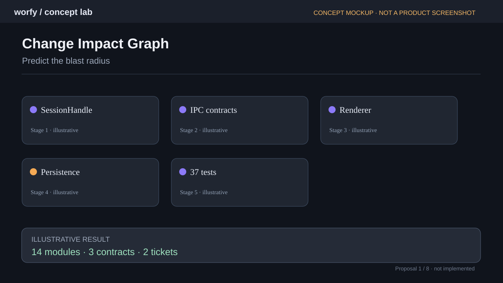
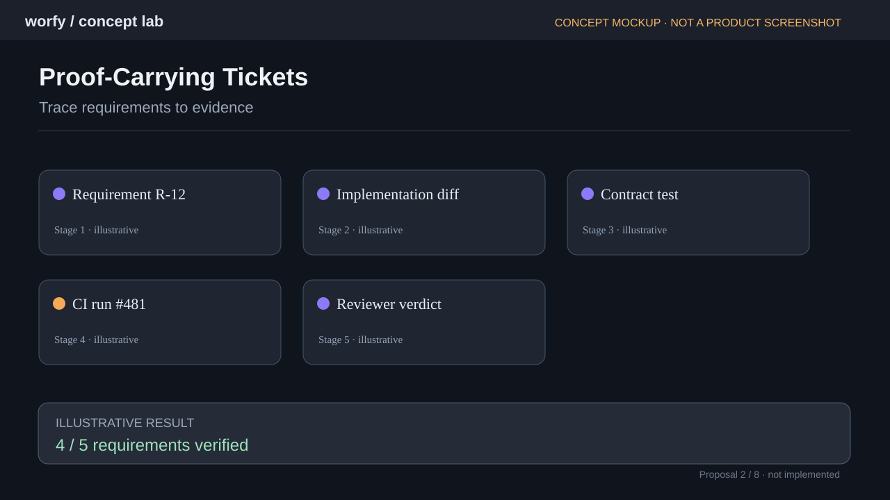
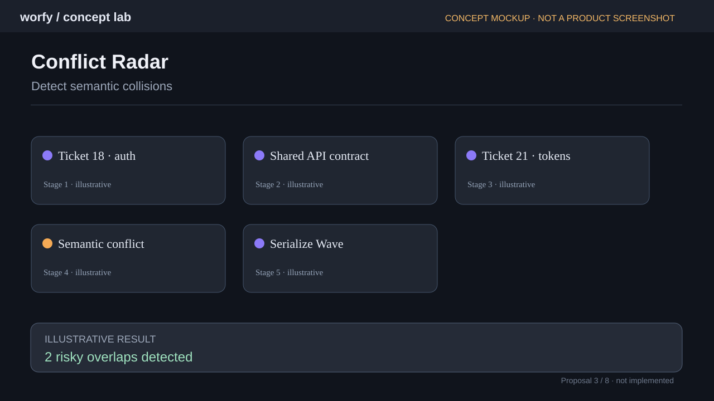
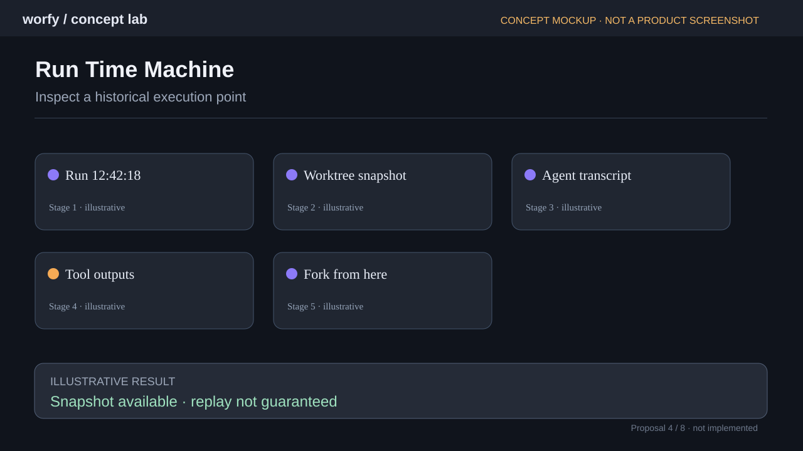
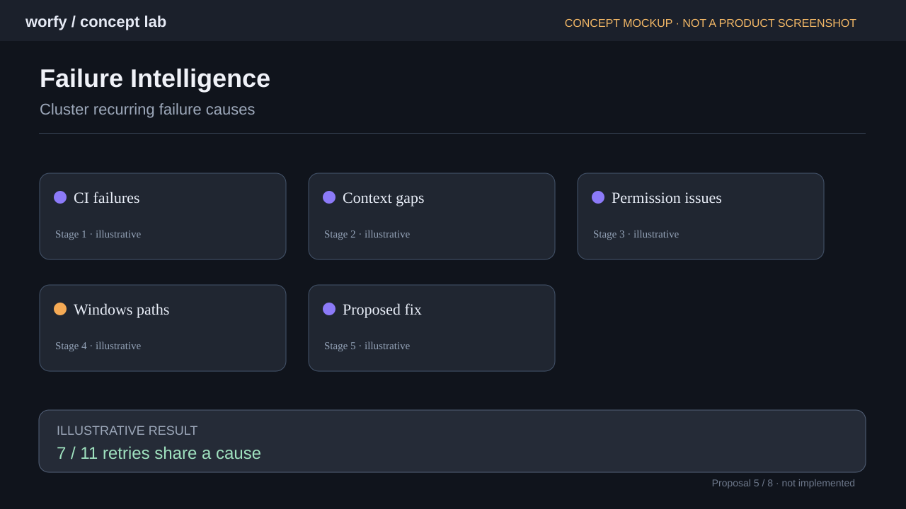
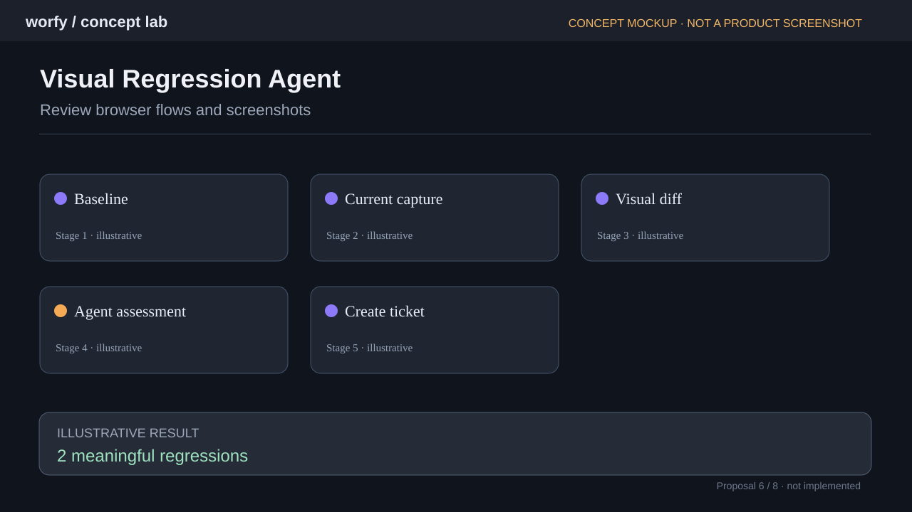
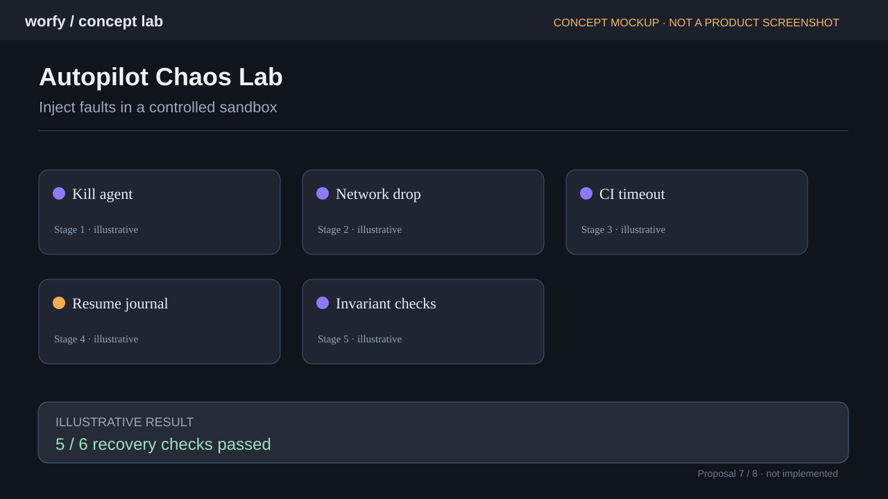
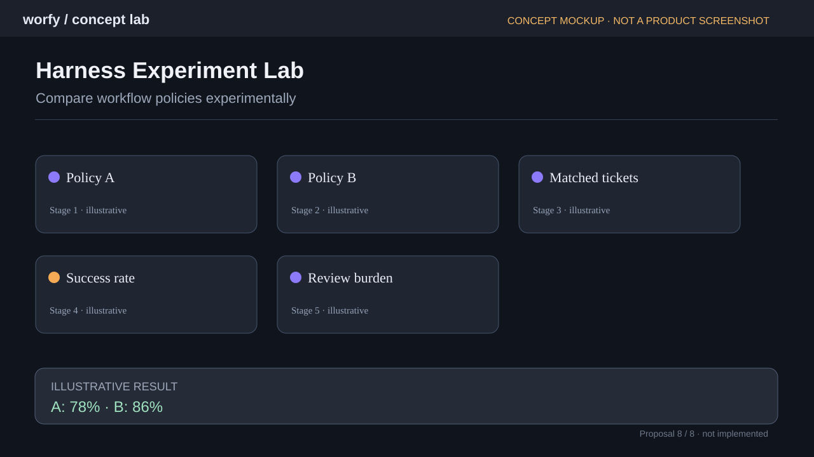

# Proposal: eight product capabilities beyond multi-vendor

> **Status:** ideation only. **Do not implement or merge as a feature commitment.** Request: have Claude critically review and prioritize. Created 2026-11-04.
>
> **Images:** the eight SVGs below are **new illustrative UI mockups**, not screenshots of existing Worfy functionality. The previous chat contained illustrative image-search results, not reusable screenshots of the product. These mockups are included so the proposal has reviewable visuals without pretending the features already exist.

## Context

Worfy already has Autopilot, Harness, Browser, Run Planning and Flight Recorder. These proposals build on them rather than duplicate existing capabilities. They deliberately exclude multi-vendor development.

## At a glance

| # | Idea | Complexity | Suggested value |
|---|---|---|---|
| 1 | Change Impact Graph | L | Risk-aware planning |
| 2 | Proof-Carrying Tickets | M | Verifiable delivery |
| 3 | Conflict Radar | L | Parallelism safety |
| 4 | Run Time Machine | L | Historical debugging |
| 5 | Failure Intelligence | M | Self-improving reliability |
| 6 | Visual Regression Agent | M | UI quality |
| 7 | Autopilot Chaos Lab | M–L | Recovery guarantees |
| 8 | Harness Experiment Lab | L | Evidence-based optimization |

## 1. Change Impact Graph

**Concept.** Before a Ticket starts, build a dependency and risk graph connecting files, symbols, public contracts, tests, active Tickets and affected services. Re-evaluate after implementation.

**Example.** A SessionHandle change may touch IPC, renderer, persistence and contract tests. Flag an active Ticket that changes the same API.

**Possible MVP.** Start with static imports, symbol references, changed-file history and test coverage; layer semantic reasoning only for ambiguous edges.

**Acceptance signal.** Risk-scored impact report with provenance for every edge; no unsupported certainty. Compare predicted affected files/contracts with actual changes.

**Risks and caveats.** False positives, dynamic imports, generated code, stale indexes. Must work without an LLM for the basic graph.

## 2. Proof-Carrying Tickets

**Concept.** For each acceptance criterion, link evidence: diff/commit, test execution, CI check, reviewer statement, screenshot when relevant. Evidence must be attributable and reproducible.

**Example.** A Ticket is done but one criterion has no linked test or manual verification: mark it unverified rather than claiming success.

**Possible MVP.** Attach evidence to existing Gate and GitHub objects; do not duplicate CI artifacts or invent results.

**Acceptance signal.** An evidence matrix per Ticket; clear verified/unverified/failed states; source links open the original artifacts.

**Risks and caveats.** Tests can pass without proving intent; agent review is a claim, not independent proof.

## 3. Conflict Radar

**Concept.** Predict parallel Ticket collisions at file, symbol, contract and migration levels, then suggest serializing or re-planning a Wave.

**Example.** Two Tickets edit separate files but both change the same auth payload shape incompatibly.

**Possible MVP.** Begin with touched files and planned file lists; expand to symbol/API impact graph and explicit contract-change detection.

**Acceptance signal.** Before a Wave, show risky pairs with reasons; measure prevented conflicts versus false alarms.

**Risks and caveats.** Avoid excessive serialization and speculative semantic conflict labels.

## 4. Run Time Machine

**Concept.** Navigate from Flight Recorder to a historical state: commit/worktree snapshot, agent transcript, instructions, tool results and environment metadata. Allow a safe fork for investigation.

**Example.** Click a failed review span, inspect exact code and context at that moment, then create a new isolated investigation branch.

**Possible MVP.** Build on existing journal and links; record immutable references and content hashes. Explicitly distinguish reconstruction from deterministic replay.

**Acceptance signal.** Historical spans link to available artifacts; missing snapshots are shown as missing; forking never modifies the original Run.

**Risks and caveats.** Git commit is not the entire environment; external services, secrets and nondeterministic outputs cannot be replayed exactly.

## 5. Failure Intelligence

**Concept.** Cluster repeated retries by root cause across Runs and propose actionable Harness/workflow changes, supported by linked evidence.

**Example.** Multiple Windows CI failures arise from the same path-normalization bug, rather than unrelated coding mistakes.

**Possible MVP.** Derive initial categories from CI statuses, errors, hooks and journal; use LLM classification as advisory and allow manual correction.

**Acceptance signal.** Cross-run cause dashboard; each cluster links to original failures; proposed fix includes an evaluation plan.

**Risks and caveats.** Correlation is not causation; do not auto-edit Harness based only on a model-generated diagnosis.

## 6. Visual Regression Agent

**Concept.** Use Browser Node to capture reproducible flows, compare against reviewed baselines and ask an agent to triage meaningful visual changes.

**Example.** After a UI Ticket, capture login and dashboard states across viewport sizes; classify an unexpected clipped control.

**Possible MVP.** Deterministic browser scripts, controlled viewport/data, image diff first, semantic review second; require approved baseline updates.

**Acceptance signal.** Show baseline/current/diff and source navigation; reproducible failure opens a Ticket with evidence.

**Risks and caveats.** Animations, fonts, data drift, responsive changes and false positives; protect sensitive screenshots.

## 7. Autopilot Chaos Lab

**Concept.** Run controlled fault-injection experiments against a disposable project: process kill, network disconnect, CI timeout, rate limit and interrupted restart.

**Example.** Kill an implementer during a write; verify journal recovery, no duplicate merge and clear blocked/retry state.

**Possible MVP.** A sandbox-only test harness with explicit opt-in, immutable fixtures and invariant assertions. Never run against production repositories.

**Acceptance signal.** Pass/fail matrix for recovery invariants, linked traces and minimal reproductions.

**Risks and caveats.** Destructive by design: hard guardrails, isolation, resource limits and no real credentials.

## 8. Harness Experiment Lab

**Concept.** Compare alternative Harness policies using matched Ticket sets, randomized or crossover runs and consistent outcome metrics.

**Example.** Compare strict review after each step against review after implementation for retries, gate success and elapsed time.

**Possible MVP.** Store policy version, environment, model, inputs and run configuration; reuse Flight Recorder metrics and evidence.

**Acceptance signal.** Comparison report includes sample sizes, confidence/uncertainty, cost, quality and reproducible configurations.

**Risks and caveats.** Small samples, changing models, cross-run contamination and cherry-picked benchmarks.

## Suggested sequencing (hypothesis, not a roadmap decision)

1. **Proof-Carrying Tickets**: direct value from existing Gate, CI, review and Ticket metadata.
2. **Failure Intelligence**: reuse Flight Recorder data, start with deterministic error clustering.
3. **Change Impact Graph**: deeper investment; validate with small repositories before semantic predictions.
4. **Conflict Radar**: can reuse the impact graph and planning data.
5. **Visual Regression Agent**: build on Browser Node, with strict reproducibility requirements.
6. **Run Time Machine**: first validate immutable historical references and missing-artifact behavior.
7. **Autopilot Chaos Lab**: develop only in disposable fixtures with explicit destructive-operation safeguards.
8. **Harness Experiment Lab**: most useful after reliable metrics and a representative corpus of tasks.

## Questions for Claude's review

- Which ideas overlap with current code, ADRs, existing Tickets or planned work? Cite paths.
- Which assumptions are invalid or overengineered? Propose cuts.
- Which 2–3 ideas offer the best user value / implementation effort ratio?
- What is the smallest safe MVP for each, with testable acceptance criteria?
- What data is already captured by Flight Recorder and what would need instrumentation?
- Which ideas introduce unsafe automation, privacy leakage or misleading evidence claims?
- Recommend **research / build / defer / reject** for each. Do not generate implementation Tickets until the owner approves.

## Scope

Documentation and illustrative mockups only; no product source code changes. SVG mockups are conceptual and do not claim to show implemented features.
